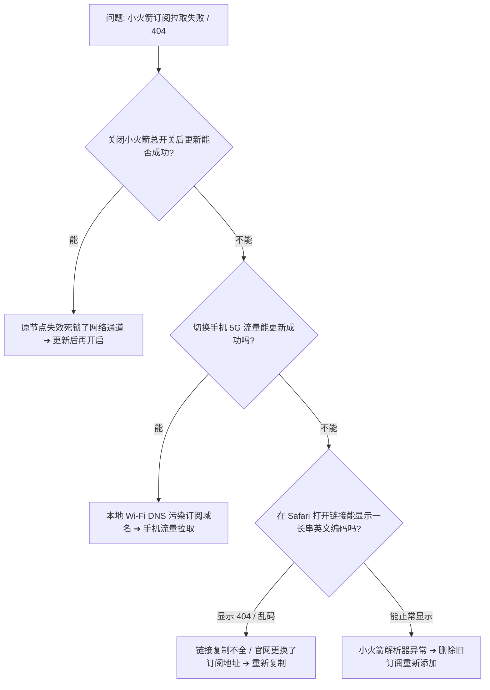

## 核心诊断决策树：30 秒定位小火箭订阅失败原因

---

## 一、导致订阅更新失败的 4 大根本原因

### 1. 本地网络 DNS 污染与节点通道死锁
如果你的小火箭当前正处于开启状态，但连接的节点已经失效，此时客户端所有新流量均无法出海，导致订阅更新请求超时。

### 2. 订阅 URL 参数复制不完整
许多机场的订阅链接包含长串加密 Token（例如 `https://domain.com/api/v1/client/subscribe?token=xxxxxx`）。用户在手机长按复制时，若未完全选中文本末尾，服务器将返回 404 错误。

### 3. 套餐到期或流量配额耗尽
服务商系统在检测到用户套餐已过期时，会自动关闭该用户的订阅下发接口，返回空数据或禁止访问代码。

---

## 二、4 步逐步排查与修复流程

### 第一步：关闭小火箭总开关，切换网络重试
1. 打开 Shadowrocket，关闭最顶部的 **连接总开关**。
2. 断开当前 Wi-Fi，切换为手机 **4G/5G 蜂窝移动网络**。
3. 在首页找到对应的订阅卡片，**向右滑动** 并点击 **「更新 (Update)」**。

### 第二步：在 Safari 中核验订阅有效性
1. 复制你的订阅链接。
2. 打开 iPhone 自带的 **Safari 浏览器**，粘贴链接并回车访问。
3. 若页面显示一长串以 `vmess://`、`vless://` 或 Base64 开头的编码，说明链接正常有效；若显示 404 或无响应，请登录机场后台重新复制。

### 第三步：删除旧订阅并重新添加
1. 在小火箭首页向左滑动失效的订阅，点击 **「删除」**。
2. 点击右上角 **「+」**，类型选择 **`Subscribe`**。
3. 重新粘贴完整 URL，点击右上角 **「保存」**。

### 第四步：检查并校准 iPhone 系统时钟
进入 iPhone「设置」➔「通用」➔「日期与时间」，确认开启 **「自动设置」**。

---

## 三、总结与延伸

按照上述 4 步操作，绝大多数订阅拉取与格式报错问题均能快速解决。如需长期稳定、节点全天候高可用的专线订阅，可前往 [机场手册服务商库](/brands/) 探索客观核验的品牌方案！
