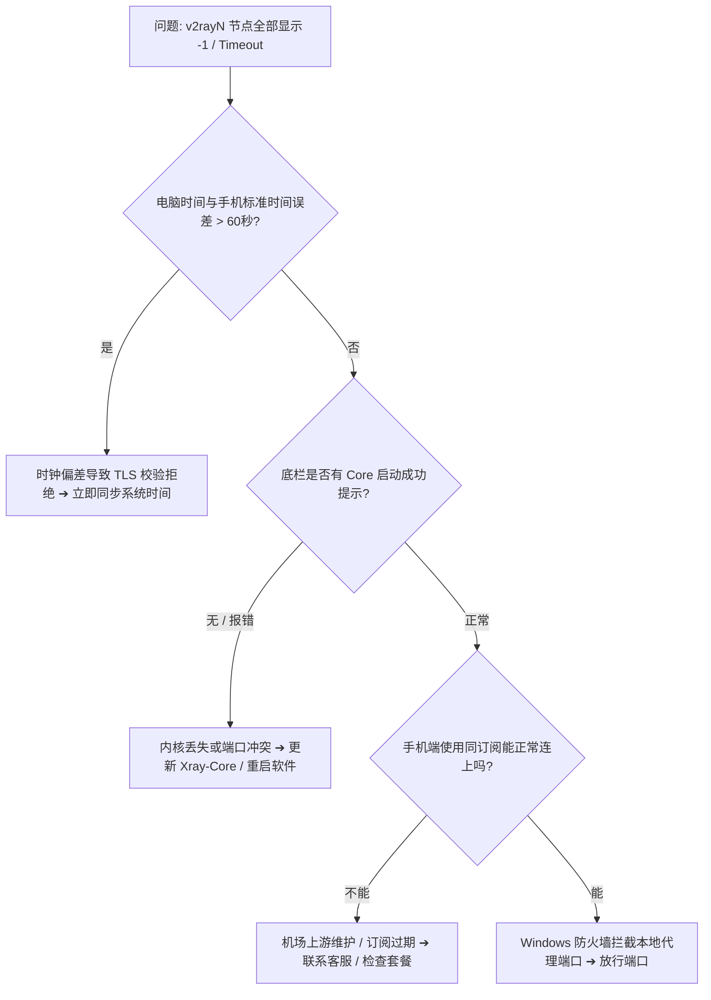

## 核心诊断决策树：30 秒定位 v2rayN 全红原因

---

## 一、导致节点全部超时的 4 大根本原因

### 1. 系统时钟误差（占据 80% 的排错案例）
加密协议在握手时强制校验客户端时间戳。一旦电脑由于主板电池没电或时区设置错误，导致系统时间偏差超过 60 秒，服务端将单方面丢弃数据包。

### 2. Xray / V2Ray 核心内核崩溃或缺失
在纯净版中缺少 `xray.exe` 文件，或者本地 `10808`、`10809` 代理端口被其他网络软件占用，导致代理服务未能成功在本地监听。

### 3. Windows 防火墙或第三方杀软拦截
Windows Defender 将未签名的开源内核误报为风险软件并将其隔离。

### 4. 机场节点整体维护或订阅解析异常
服务商后台更换了节点连接地址，而本地 v2rayN 客户端未及时更新订阅列表。

---

## 二、4 步逐步排查与修复流程

### 第一步：强制同步 Windows 系统时钟（最关键）
1. 按键盘快捷键 `Win + I` 打开 Windows「设置」。
2. 点击 **「时间和语言」** ➔ **「日期和时间」**。
3. 确保开启「自动设置时间」，并点击 **「立即同步」** 按钮（看到出现绿色打勾即可）。

### 第二步：检查并更新 Core 核心组件
1. 打开 v2rayN 主界面，查看最底部状态栏是否有绿色 `Xray-Core 正在运行` 的提示。
2. 如提示未运行，点击顶部菜单 **「检查更新」** ➔ 点击 **「Xray-Core」** 进行在线自动下载与升级。

### 第三步：重新从服务器更新全部订阅
1. 点击顶部菜单栏的 **「订阅分组」** ➔ **「更新全部订阅（不通过代理）」**。
2. 等待节点列表刷新完毕。

### 第四步：检查系统代理与路由规则
- 确保底部 **系统代理** 设置为 **「自动配置系统代理」**。
- 确保底部 **路由** 设置为 **「绕过大陆 (Whitelist)」**。
- 按键盘 `Ctrl + A` 选中所有节点，按 `Ctrl + O` 重新测试真实连接延迟。

---

## 三、验证与延伸阅读

完成上述 4 步后，按 `Ctrl + O` 测速，节点右侧将重新恢复显示健康的毫秒级延迟数字（如 45ms）。

如果确认本地设置均正确但节点仍全部超时，说明当前所用机场服务可能遭遇上游故障，建议前往 [机场手册服务商库](/brands/) 获取高稳定性的备用专线！
