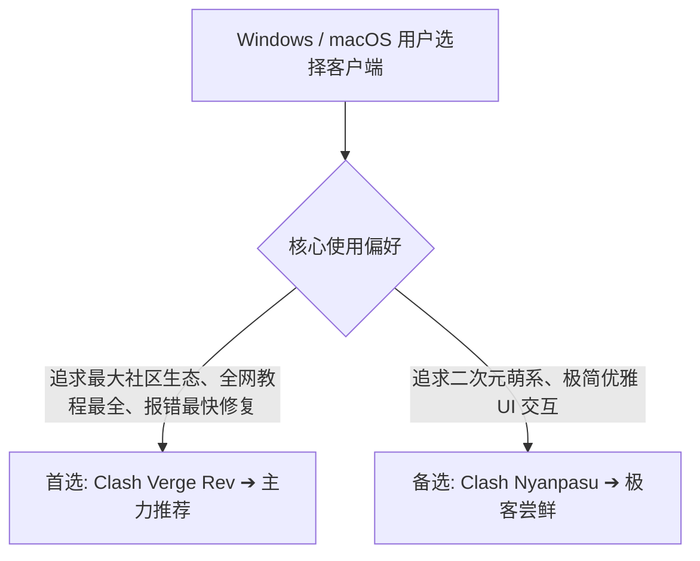

## 核心结论速览：Clash Verge Rev vs Clash Nyanpasu

在旧版 Clash for Windows 停更之后，开源社区涌现出了两款基于 Rust + Tauri 架构的明星客户端：**Clash Verge Rev** 与 **Clash Nyanpasu**。

---

## 一、两大现代客户端核心架构对比

### 1. Clash Verge Rev：全球用户量第一的现代标杆
- **技术栈**：采用 Rust + Tauri 构建图形界面，内置最新稳定版 Mihomo (Clash.Meta) 内核。
- **生态成熟度**：在 GitHub 上拥有数以万计的 Star 与活跃的 Issue 讨论区。当上游内核更新或 Windows/macOS 发生系统升级时，Verge Rev 能够第一时间发布热修复版本。
- **TUN 虚拟网卡支持**：内置完善的 Service Mode 服务模式一键安装驱动，小白用户只需点一次鼠标即可完成透明网卡接管。

### 2. Clash Nyanpasu：优雅细腻的极客之选
- **技术栈**：同样基于 Rust + Tauri 框架，界面采用现代响应式卡片化设计。
- **设计风格**：UI 交互更加轻盈灵动，支持丰富的自定义主题配色与二次元背景定制。
- **适用场景**：适合对界面颜值有极致要求、喜欢折腾个性化布局的进阶玩家。

---

## 二、详细技术参数与功能特性对比矩阵

| 评测维度 | Clash Verge Rev | Clash Nyanpasu | 深度解析 |
| :--- | :--- | :--- | :--- |
| **安装包体积** | 约 20MB–30MB | 约 25MB–35MB | 相比旧版 CFW (100MB+) 大幅瘦身 |
| **内存日常占用** | 40MB–70MB | 45MB–75MB | 极低内存开销，开机静默无感 |
| **ARM64 原生适配** | 100% 原生适配 (M1-M4) | 100% 原生适配 (M1-M4) | 苹果芯片续航不受任何影响 |
| **TUN 模式安装** | 一键安装 Service Mode | 支持图形化 TUN 开关 | 均能完美接管全系统流量 |
| **扩展脚本与合并** | 支持 Merge 与 JavaScript | 支持灵活脚本注入 | 进阶规则合并能力相当 |

---

## 三、最终选型决策与使用建议

1. **新手与主力工作机用户**：坚定选择 **Clash Verge Rev**。全网教程资源最丰富，遇到任何报错都能在 30 秒内检索到现成解决方案。
2. **个性化与审美要求极高用户**：推荐体验 **Clash Nyanpasu**，享受精致清爽的交互体验。
3. **两款软件可无缝平替**：由于两者均使用标准的 Clash YAML 订阅，用户可以随时在两款软件之间自由切换，无需重新配置节点。
