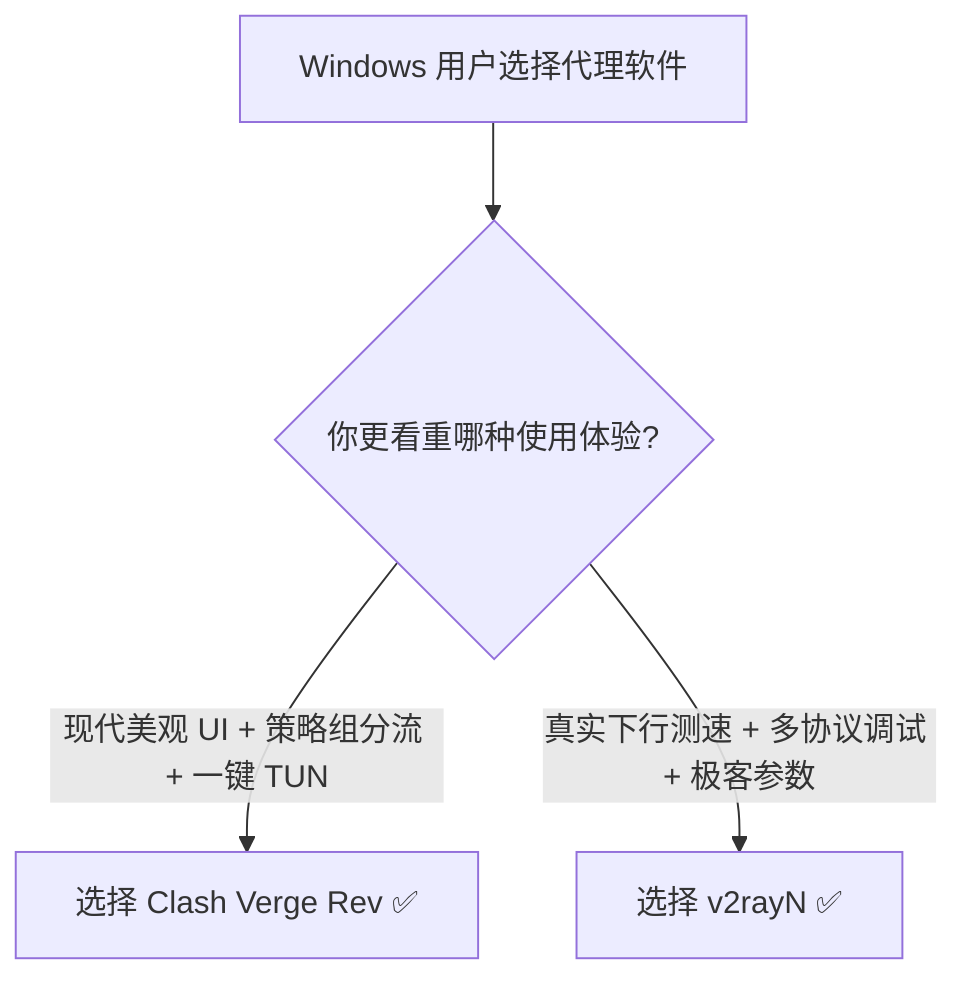

## 30 秒核心结论：Clash Verge Rev 与 v2rayN 怎么选？

在 Windows 生态中，**Clash Verge Rev** 与 **v2rayN** 共同代表了当前代理客户端的最高水平。两者并不是非此即彼的对立关系，而是面向不同需求场景的专业工具。

---

## 一、八大核心维度深度剖析

### 1. 界面与交互体验
- **Clash Verge Rev**：采用 Rust + Tauri 构建，界面现代极简，支持主题切换与直观的节点卡片。
- **v2rayN**：基于经典的表格视图，信息密度极高，适合一次性查看数十个节点的详细技术参数。

### 2. TUN 虚拟网卡易用性
- **Clash Verge Rev**：内置 Service Mode 驱动管理器，点击一键安装即可接管 CMD、Git 及游戏流量。
- **v2rayN**：需要手动指定 TUN 模式的核心类型与路由模式，对新手有一定认知门槛。

### 3. 测速机制差异
- **Clash Verge Rev**：侧重握手延迟（Latency），反应节点响应灵敏度。
- **v2rayN**：支持真实下载测速（Speedtest），能精确测出节点带宽上限。

---

## 二、选型总结

- **选择 Clash Verge Rev**：适合追求省心、界面美观、需要透明代理加速的广大日常用户。
- **选择 v2rayN**：适合需要频繁测试节点真实下载速度、调试多核心配置的技术用户。
