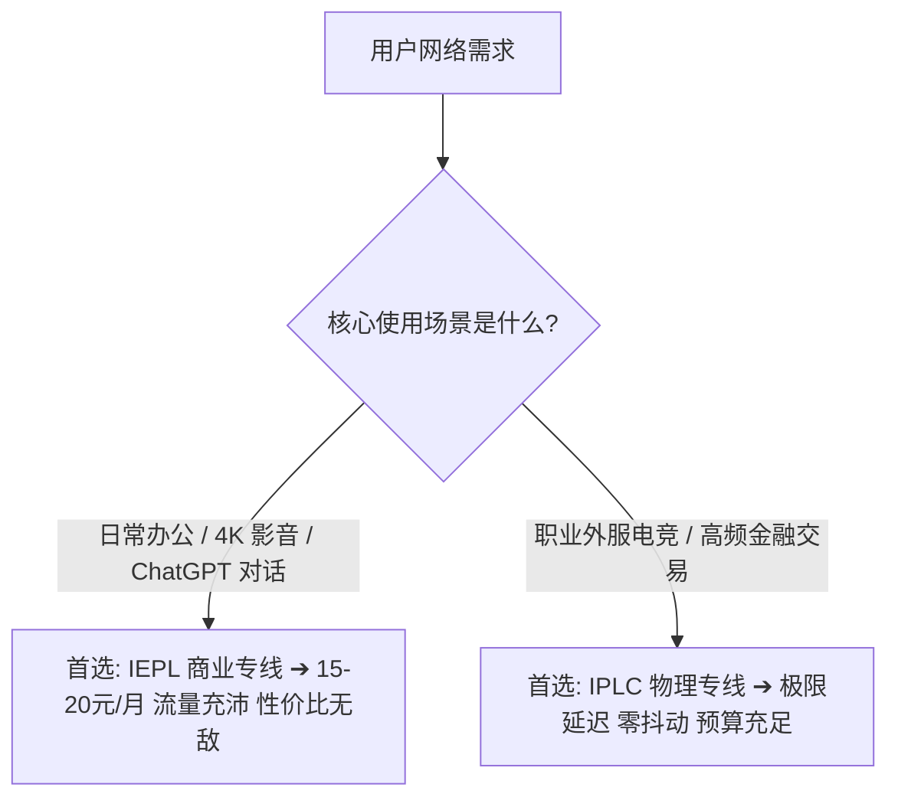

## 核心结论速览：30 秒搞懂 IEPL 与 IPLC 的本质差异

---

## 一、底层物理架构深度剖析

### 1. 什么是 IPLC (International Private Leased Circuit)？
IPLC 是国际私有租用线路。它是两端机房之间通过点对点物理裸光缆建立的直接通信连接。数据在光纤中以接近光速传输，物理路径最短，完全不经过公网路由器，也不经过任何外部网络检测。

### 2. 什么是 IEPL (International Ethernet Private Line)？
IEPL 是国际以太网专线。它基于电信运营商的通用以太网传输网络（如 SDH/OTN），在运营商内网构建虚拟专线隧道。数据同样走内网光纤传输且不走公网出口，但在管理和调度上更加集约灵活，因此带宽成本大幅降低。

---

## 二、核心技术指标对比矩阵

| 指标维度 | IEPL 专线 | IPLC 专线 | 差异深度说明 |
| :--- | :--- | :--- | :--- |
| **OSI 网络层级** | Layer 2 (数据链路以太网层) | Layer 1 (物理层裸光纤) | IPLC 更加偏向底层物理连接 |
| **抖动表现 (Jitter)** | < 3 ms (极优) | < 1 ms (极限) | 日常网页与视频完全无体感差异 |
| **抗封锁能力** | 100% 免疫公网审查 | 100% 免疫公网审查 | 两者均在内网传输，不过 GFW |
| **每 GB 流量成本** | 约 ¥0.10–¥0.20 / GB | 约 ¥0.30–¥0.80 / GB | IEPL 具有压倒性成本优势 |

---

## 三、各用户群体的最终选型建议

1. **普通日常用户 / 留学生 / 职场白领**：坚决选择 **IEPL 专线月付机场**（如 [U1S1](/brands/u1s1/)、[灵猫网络](/brands/lingmao/)）。每月仅需 15–20 元，即可获得 100GB–150GB 充沛流量，晚高峰 4K 视频秒开。
2. **重度 AI 开发者与科研工作者**：选择配备 **原生住宅出口的 IEPL 专线**（如 [速界](/brands/sujie/)、[光速云](/brands/guangsuyun/)），保障 ChatGPT/Claude 长期零风控。
3. **外服竞技游戏核心玩家**：优先选择提供 **沪日 / 深港 IPLC 专线** 的服务商，配合游戏加速规则，享受极限单位数低延迟。
