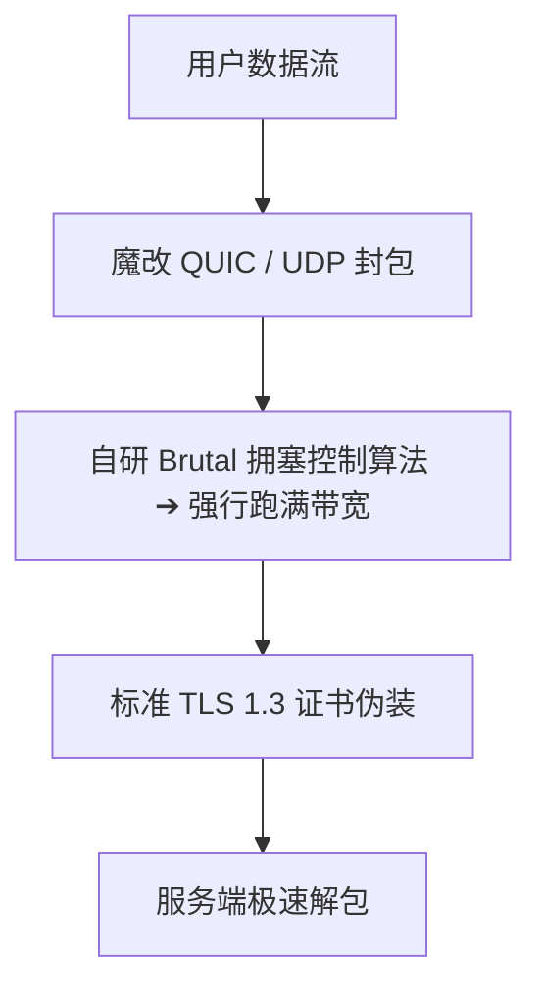

## 什么是 Hysteria 2 协议？

**Hysteria 2** 是网络代理领域针对传统 TCP 协议在恶劣网络环境下性能骤降而研发的下一代 UDP 代理协议。它基于魔改的 QUIC 协议实现，通过自研的拥塞控制机制彻底打破了传统网络传输在丢包环境下的吞吐量瓶颈。

### 核心技术原理与工作机制

传统 TCP 传输依赖拥塞避免算法（如 Cubic 或 BBR），当公网链路出现丢包（例如 5%～10%）时，发送端会判定网络严重拥塞并主动将传输窗口缩减，导致实际下载速率成倍断崖式下跌。

Hysteria 2 采用了专为高丢包跨国公网设计的 **Brutal 拥塞控制算法**：
- **主动式带宽协商**：客户端与服务端直接约定目标上下行速率（例如 100Mbps），发送端不再因为链路偶然丢包而主动减速。
- **UDP 多路复用**：基于 QUIC 协议，消除了传统 TCP 的队头阻塞（Head-of-Line Blocking）问题，单连接中断不会阻塞其他并发请求。
- **现代 TLS 1.3 加密**：所有传输流量在标准 TLS 1.3 下进行强加密，支持端口跳跃（Port Hopping）功能，可有效规避针对固定 UDP 端口的持续阻断。

### 适用场景与优劣势对比

| 评估维度 | 核心表现 | 适用建议 |
| :--- | :--- | :--- |
| **恶劣公网环境** | 极强：在 20%~30% 高丢包公网仍能跑满带宽 | 适合国际公网普通中转节点或直连远距离节点 |
| **晚高峰抗拥堵** | 优秀：通过高频重传强行抢占带宽资源 | 适合晚间网络拥堵严重的骨干出口 |
| **运营商兼容性** | 视地区而定：部分宽带存在严重的 UDP QoS 限制 | 若遇到 UDP 限速严重，专线（IEPL/IPLC）稳定性更佳 |
| **设备硬件开销** | 相对较高：由于高频重传机制，CPU 与发热略高于 TCP | 移动端设备长期重度下载建议关注耗电量 |

### 客户端兼容性与选型建议

目前主流新一代客户端均已原生支持 Hysteria 2 协议：
- **Windows / macOS**：推荐使用 Clash Verge Rev、Sing-box 或 v2rayN（需配套最新 Xray/Sing-box 核心）。
- **iOS**：Shadowrocket（小火箭）、Stash 或 Loon 最新版已完整兼容。
- **Android**：Clash Meta for Android、Sing-box 或 v2rayNG 均可顺畅配置。

