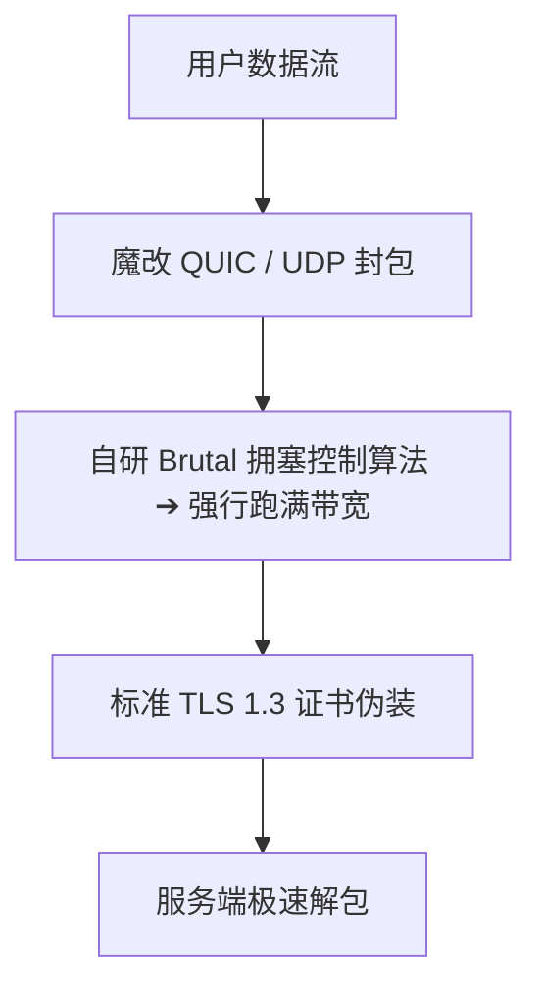

## 什么是 Hysteria 2 协议？

**Hysteria 2** 是网络代理领域针对传统 TCP 协议在恶劣网络环境下性能骤降而研发的革命性 UDP 协议。

### 核心技术亮点

1. **暴力抗丢包 (Brutal 算法)**：传统 TCP 在遭遇 10% 丢包时会主动将传输速率减半；Hysteria 2 忽略常规退避，即使在丢包率 25% 的严重拥堵链路上仍能强行拉满带宽。
2. **标准 TLS 1.3 伪装**：采用正规 HTTPS 握手与端口混淆技术，具备优异的抗探测能力。
3. **UDP 限速提示**：在部分对 UDP 流量有严格 QoS 限速的地区运营商下，专线仍是更稳健的选择。
