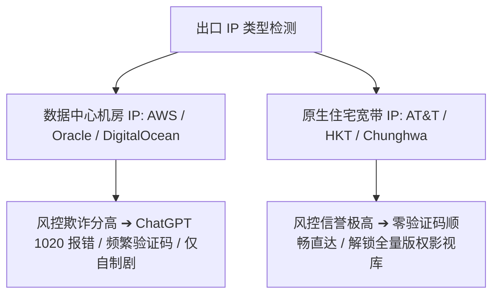

## 什么是原生住宅 IP (Residential IP)？

**原生住宅 IP** 指归属于当地主流宽带运营商（如美国的 AT&T、Comcast，香港的 HKT、HKBN，台湾的中华电信）的家庭宽带 IP 段。与大型云厂商（如 AWS、Google Cloud、阿里云、甲骨文）的数据中心机房 IP（Datacenter IP / Hosting IP）相比，住宅 IP 在各大互联网安全与版权数据库中拥有极高的信任评级。

### 关键技术概念辨析：原生 IP vs 广播 IP vs 住宅 IP

在选择网络节点时，需要注意以下三个常见术语的区别：
- **机房原生 IP (Native Datacenter IP)**：IP 的注册所在地（Whois）与机房物理所在地严格一致，但其类型仍属于 Hosting/DataCenter，可能依然会被部分极为严格的风控拦截。
- **广播 IP (Broadcast / Anycast IP)**：原本注册在 A 地区，后通过 BGP 宣告广播到 B 地区机房使用，在部分旧数据库中可能存在属地漂移识别错误。
- **原生住宅 IP / 双 ISP (Residential / Dual ISP)**：IP 的 ASN 属性直接标记为 ISP/Commercial 宽带运营商，且具有干净的历史访问记录，是风控信誉的最高阶形态。

### 为什么 AI 工具和流媒体强烈要求原生住宅 IP？

1. **欺诈评分极低 (Fraud Score < 10)**：全球风控服务商（如 Cloudflare Turnstile、Arkose Labs、MaxMind、Scamalytics）会将云机房 IP 标记为高风险潜在攻击源，而住宅 IP 被判定为普通自然人家庭网络。
2. **解决 ChatGPT / Claude 访问拒绝与封号**：OpenAI 对大批量机房段实行严格限流或直接返回 `Access Denied (Error 1020)`。使用纯净住宅 IP 能大幅降低验证码弹出频率并保障账号长期安全。
3. **解锁流媒体跨区完整版权库**：Netflix、Disney+、HBO Max 等流媒体平台对机房 IP 执行严格版权过滤。机房 IP 通常只能观看平台自制剧（Netflix Originals），而纯净原生住宅 IP 能够完整解锁全部非自制版权影视资源。

### 如何验证节点的 IP 纯净度？

推荐使用以下专业检测工具综合评估节点的 IP 质量：
- **IPinfo.io**：查看 `type` 字段是否为 `isp` 而非 `hosting`。
- **Scamalytics**：查询 IP 欺诈分（Fraud Score），优质节点得分通常在 0～15 分以内。
- **Whoer.net**：检查匿名度（Anonymity Score），检测 DNS 泄漏与 WebRTC 属地一致性。

