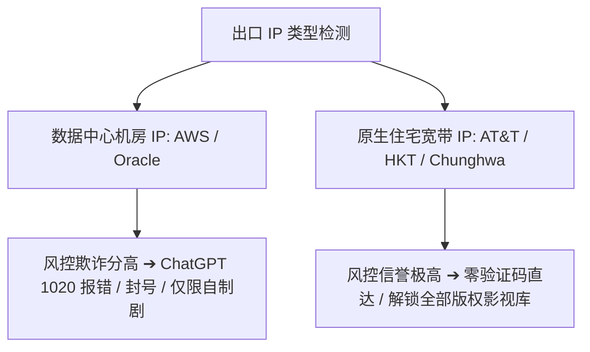

## 什么是原生住宅 IP (Residential IP)？

**原生住宅 IP** 指归属于当地主流宽带运营商（如 AT&T, Comcast, HKT, Chunghwa Telecom）的家庭宽带 IP 段，与大型云机房（AWS, Google Cloud, Oracle, DigitalOcean）的数据中心机房 IP (Datacenter IP) 相对。

### 为什么 AI 工具和流媒体强烈要求原生住宅 IP？

1. **欺诈评分极低 (Fraud Score < 10)**：安全风控系统（如 Cloudflare, Arkose Labs）会将机房 IP 视为潜在机器人，而住宅 IP 被视为真实人类行为。
2. **解除 1020 拦截与 Access Denied**：OpenAI / Claude 会对大批量机房 IP 进行网段级封锁，而原生 IP 能够流畅直达。
3. **解锁流媒体非自制剧**：Netflix 等平台对版权剧集有严格的区域限制，机房 IP 通常只能观看自制剧，原生住宅 IP 可完整解锁全部版权库。
