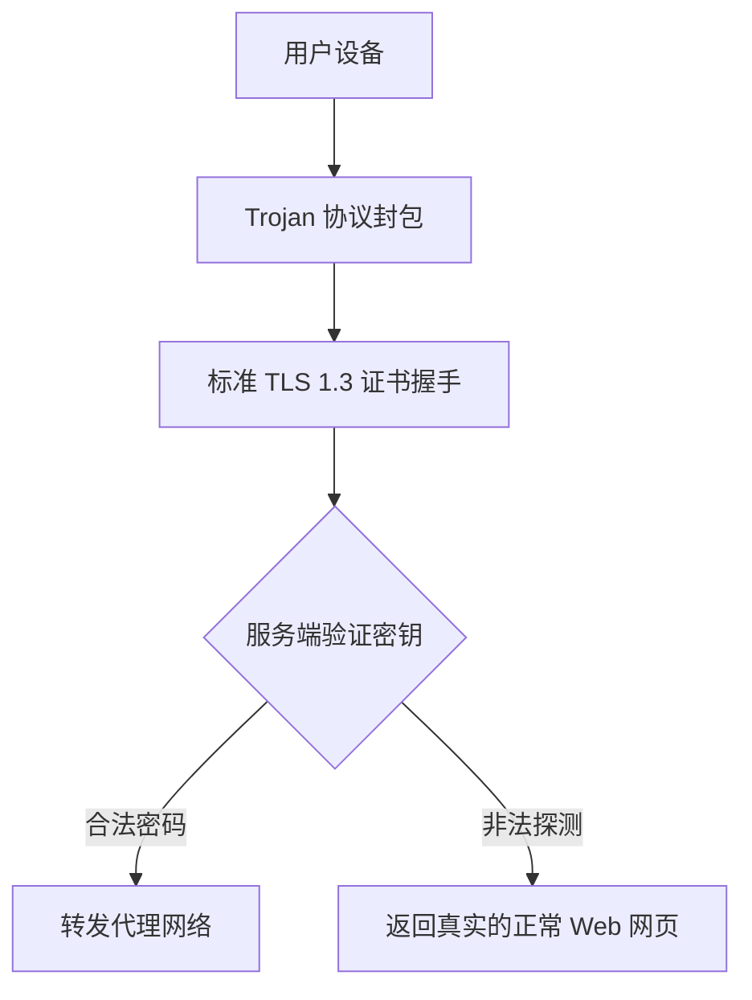

## 什么是 Trojan 协议？

**Trojan** 的设计哲学是“模仿标准 Web 流量”。它不试图自己创造任何私有加密格式，而是直接利用合法的 TLS 证书，将代理请求完全伪装成发往真实 Web 站点的 443 端口流量。

### 核心特性

- **高度隐蔽**：外部防火墙探测时，看到的是标准且完全符合密码学规范的 HTTPS 流量。
- **免探测保护**：如果主动探测未携带正确密码，服务端会直接返回一个真实的正常网页，从而完美防御主动探测。
