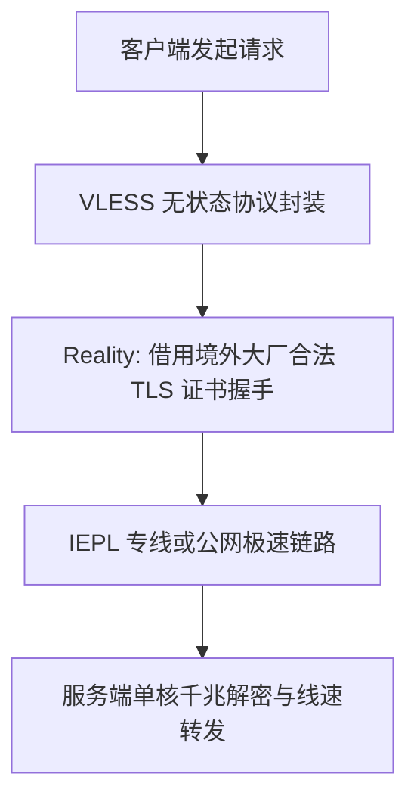

## 什么是 VLESS 协议？

**VLESS** 是一种由 Xray 社区主导研发的轻量级无状态代理传输协议。其命名寓意为“Less is More”（少即是多），核心设计思想是通过剥离传统 VMess 协议中繁冗的双重加密机制，回归极简架构，并将安全加密与身份认证完全托付给成熟的标准 TLS 体系。

### 演进背景：为什么 VLESS 取代了旧版 VMess？

在 V2Ray 发展早期，VMess 依靠内置的私有加密和时间戳验证体系发挥了重要作用。但随着网络环境变化，旧架构暴露出了显著短板：
1. **双重加密的算力浪费**：在 TLS/HTTPS 普及后，VMess 在内部执行二次加密，导致软路由与手机客户端 CPU 计算开销成倍上升，严重阻碍千兆吞吐。
2. **时间同步强依赖**：客户端与服务端系统时间相差若超过 90 秒，VMess 会直接握手失败，引发大量排错困难。
3. **架构解耦**：VLESS 移除了所有内部私有加密层，仅保留 UUID 身份校验，所有安全性由下层传输层（TLS / Reality）负责，实现了真正的高性能与高扩展性。

### 核心技术杀手锏：VLESS + Reality 伪装

**Reality** 是 VLESS 最引人注目的伴生技术：
- **无需自备域名与证书**：传统 TLS 代理需要自费购买域名并申请证书，极易因证书暴露被针对性阻断。Reality 允许节点“借用”境外真实大型互联网公司（如 Apple、Microsoft、Cloudflare、Yahoo 等）的真实公网证书进行 TLS 握手。
- **完美消除证书特征**：外部防火墙探测节点时，看到的是真实的境外企业顶级证书链条，无法从握手层面对节点进行有效识别与阻断。
- **XTLS 零拷贝加速**：通过原生 Direct / Splice 技术实现用户态与内核态数据包零拷贝，大幅降低软路由 CPU 占用。

### 主流传输协议核心技术对比

| 对比维度 | VLESS (with Reality) | VMess | Trojan |
| :--- | :--- | :--- | :--- |
| **内部加密开销** | 无额外内部加密（极轻量） | 强制二次加密（CPU 开销大） | 仅 TLS 固有开销 |
| **时间同步要求** | 宽松（无强依赖） | 严格（系统时钟误差需 < 90s） | 宽松（依赖 TLS 证书有效期） |
| **域名与证书依赖** | 无需自有域名（直接借用大厂） | 需自行申请/托管证书 | 必须拥有合法独立域名与证书 |
| **千兆满速表现** | 极佳（单核即可跑满） | 一般（多核并发占用高） | 优秀 |

### 客户端生态与选型指南

- **PC 端推荐**：Clash Verge Rev（Meta 内核）、v2rayN（配合最新 Xray-core）、Sing-box。
- **移动端推荐**：iOS 平台的 Shadowrocket、Stash、Loon；Android 平台的 Clash Meta for Android、v2rayNG、Sing-box。

