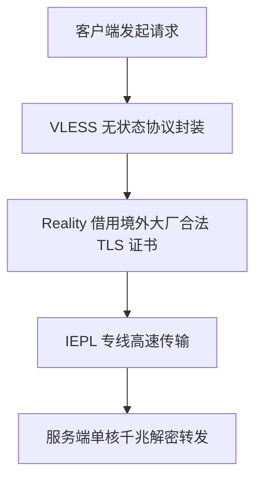

## 什么是 VLESS 协议？

**VLESS** 是一种由 Xray/V2Ray 社区开发的下一代轻量级代理协议。其命名寓意为“Less is More”（少即是多），通过剔除 VMess 协议中繁冗的双重加密机制，使性能大幅飞跃。

### VLESS 的三大革命性优势

1. **极致轻量与高吞吐**：移除了时间戳校验与二次加密，在千兆带宽下单核 CPU 即可跑满速率，大幅降低移动端电池损耗。
2. **Reality 免证书伪装技术**：无需自己购买域名和配置 TLS 证书，直接借用境外大厂（如 Apple、Microsoft、Yahoo）的真实证书签名，彻底防御中间人主动探测。
3. **现代客户端全面原生支持**：Clash Verge Rev、v2rayN、Sing-box 等现代客户端均已提供硬件加速级别的原生支持。
