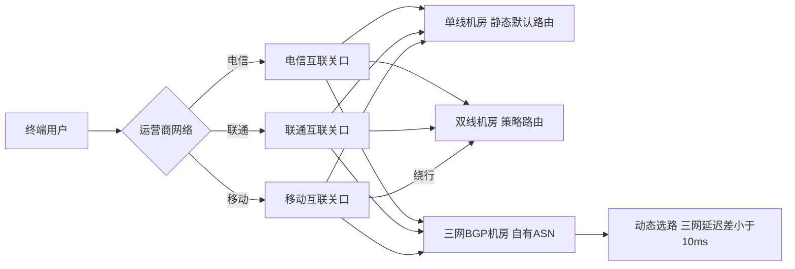
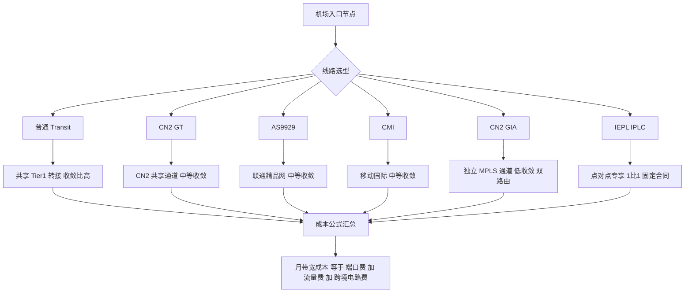

## 国内接入层物理拓扑：单线、双线与真三网BGP的造价与路由差异

机场入口的物理接入方式，直接决定了终端用户到落地节点这一跳的延迟基线、抖动特征和故障域大小。很多团队在选机房时只盯着“带宽单价”，却忽略了跨网路由的隐性成本——用户投诉的“晚高峰卡顿”，八成不是落地带宽不够，而是入口这一跳在运营商互联关口被堵死了。

### 单线机房：静态路由的天然天花板

单线机房只接入一家运营商（电信、联通或移动之一），出口是一条静态默认路由。机柜里一台1U服务器，配一个运营商分配的静态IP，网关指向运营商BRAS/汇聚设备，路由表里除了直连网段就是一条 `0.0.0.0/0`。这种架构的物理成本最低：1U机位月费约300–800元（视城市和带宽包而定，通常含10–30M独享或100M共享）。

问题在于跨网。电信单线机房里，移动用户访问要经过“移动→电信互联关口→目标机房”，互联关口在晚高峰的拥塞是常态。实测跨网延迟30–80ms，抖动可达20ms以上，且丢包率在高峰期能冲到5%–15%。静态路由没有任何选路能力，你无法让移动流量走一条更优的路径——它只有一条路。

### 双线机房：策略路由的“伪智能”

双线机房接入两家运营商，典型做法是双网卡或单网卡双IP，配合策略路由（policy routing）按源地址或目的地址分流。运维在路由器上写 `ip rule`，让电信用户走电信出口、联通用户走联通出口。月费约800–1500元，比单线贵一倍左右。

但双线的坑在于“第三家”。如果机房是电信+联通双线，移动用户进来时，机房没有移动出口，只能绕行——要么从电信出口出去再绕回移动，要么从联通出口绕。这就是典型的“移动绕行”：移动用户的实际路径变成“移动→电信/联通互联→机房”，延迟比移动单线还高，且路径不可控。策略路由是静态配置，它不认识“移动用户应该走哪”，只知道“这个源IP段匹配电信规则”。双线解决了两网互通，却把第三网变成了盲区。

### 真三网BGP：自有ASN与动态选路的代价

真三网BGP机房的核心区别是：机房（或你租用的机柜）拥有**自有ASN**，与电信、联通、移动分别建立eBGP会话，同时向三家宣告自己的IP前缀。路由表里同一个前缀有三条路径，BGP根据AS_PATH长度、本地优先级、MED等属性动态选路。三网延迟差可控制在10ms以内，因为每一家的流量都走自己的最优路径进入，不经过第三方互联关口。

物理造价随之跳升：BGP会话费（部分运营商按会话或按前缀收费）+ 三线端口（每线至少100M–1G独享）+ 机柜费用，月费2000–5000元起步，上不封顶。更关键的是运维门槛——你需要维护ASN、管理前缀宣告、处理路由策略（prefix-list、route-map），还要防前缀劫持。这不是买台服务器插上网线就能跑的。



### traceroute 三网对比与ASN核查

判断一个机房是不是“真三网”，别听销售说，跑两条命令。从电信、联通、移动三个源分别 `traceroute` 到目标IP，看第一跳之后的AS号变化：

```
# 电信源 traceroute 到目标
traceroute to 203.0.113.10, 30 hops max
 1  10.0.0.1        1.2 ms
 2  61.152.x.x       3.4 ms   AS4134 (China Telecom)
 3  202.97.x.x       8.1 ms   AS4134
 4  203.0.113.10    12.3 ms   AS64512 (目标机房自有ASN)
```

如果联通、移动源的最后几跳也直接进入同一个目标ASN（如AS64512），说明三家都是直连BGP；如果中间出现大量第三方AS（比如移动流量绕到AS4134再进目标），那就是绕行或伪三网。查ASN归属用 `whois`：

```
whois -h whois.apnic.net 203.0.113.10
# 输出中 origin: AS64512 即为该前缀的宣告AS
```

再看 `whois AS64512` 确认这个ASN的持有者是不是机房运营方，以及它的 `import`/`export` 策略是否对等开放。真三网机房的ASN通常会在RIPE/APNIC的注册信息里明确列出与三大运营商的peering关系。

选型的底线逻辑：如果你的用户三网均匀分布且对延迟敏感（实时音视频、游戏加速），三网BGP是唯一解，2000–5000元的月费买的是路由可控性；如果用户集中在单一运营商，单线足够，省下的钱投到落地带宽上更划算；双线只适合“两网为主、第三网可容忍绕行”的场景，别指望它解决三网问题。

## 过境光缆传输链路成本拆解：CN2 GIA、AS9929、CMI 与 IEPL/IPLC

机场入口的带宽账单从来不是一张单价表能说清的。同样是“1Gbps 中国方向优化”，普通 transit、CN2 GT、AS9929、CMI、CN2 GIA 之间的月费可以差出两个数量级，而 IEPL/IPLC 又是另一套计价逻辑。要理解这背后的价差，必须把“端口费”“流量费”“跨境电路费”拆开看，并回到物理链路的收敛比与 SLA 承诺上。

### 一、按 1Gbps 端口月费的价差谱系

先给出一线可参考的量级（美元，1Gbps 端口月费，含基础流量，2024 年前后市场行情，实际随合同期、承诺量、机房位置浮动）：

| 链路类型 | 典型月费（1Gbps） | 折合 $/Mbps | 骨干归属 | 典型收敛比 | SLA | 适用场景 |
|---|---|---|---|---|---|---|
| 普通 transit（Tier1/Tier2） | $500–2,000 | 0.5–2 | 多家 Tier1 | 1:20–1:50 | 99.5%–99.9% | 大流量下载、非实时业务 |
| CN2 GT（AS4809 Global Transit） | $5,000–10,000 | 5–10 | 中国电信 CN2 | 1:8–1:15 | 99.9% | 中等质量回国 |
| AS9929（联通精品网） | $8,000–15,000 | 8–15 | 中国联通 | 1:6–1:12 | 99.9% | 联通方向优化 |
| CMI（中国移动国际） | $6,000–12,000 | 6–12 | 中国移动 | 1:8–1:15 | 99.9% | 移动方向优化 |
| CN2 GIA（AS4809 Global Internet Access） | $30,000–80,000 | 30–80 | 中国电信 CN2 独立通道 | 1:2–1:4 | 99.99% | 低延迟实时业务 |
| IEPL/IPLC（2Mbps 起租） | 跨境电路 $200+/月 | >100 | 运营商点对点 | 1:1 专享 | 99.9%+ | 企业专线、金融 |

价差不是营销溢价，而是物理资源占用的直接映射。

### 二、GIA 为什么贵：独立骨干、低收敛比、99.99% 的物理根因

CN2 网络本身分为 GT（Global Transit）与 GIA（Global Internet Access）两类产品。GT 走的是 CN2 的共享转接通道，与大量其他客户的流量混跑，进入国内后还要经过城域网汇聚，收敛比常在 1:8 以上；晚高峰时共享通道被打满，延迟抖动明显。GIA 则是为单一客户预留的独立逻辑通道，从国际出口到国内核心节点走专属 MPLS 标签转发，收敛比压到 1:2–1:4，意味着峰值时每 2–4 个用户才争抢 1 份带宽，而非 8–15 个。

99.99% 的 SLA（年中断不超过约 52 分钟）在物理上要求：双路由光缆、核心节点双电源双主控、故障切换在 50ms 内完成。这些冗余资源平时不承载业务，成本必须摊到单价里。GIA 的 30–80 美元/Mbps 中，相当一部分买的是“平时闲置的备份容量”和“专属标签通道的调度优先级”。这也是为什么 GIA 无法用普通 transit 的价格逻辑去砍价——它卖的不是带宽，是确定性和低收敛。



### 三、IEPL/IPLC：2Mbps 起租的跨境电路逻辑

IEPL（International Ethernet Private Line）与 IPLC（International Private Leased Circuit）是点对点专享电路，按 2Mbps 起租，跨境月费普遍 $200 起，折合 $100/Mbps 以上，且通常要求 1–3 年固定合同、预付。它的成本结构里没有“共享摊薄”这一项：一对跨境光缆的波长或 E1/STM 时隙被整段划给单一客户，运营商要为此预留端到端资源、做跨境段的双边结算（涉及境外运营商落地费），还要承担跨境电路的合规与维护成本。

这直接决定了专线无法支撑大流量套餐。假设一个机场套餐承诺 100Mbps 专线回国，仅电路费就超过 $10,000/月，而面向终端用户的套餐定价通常只有几十元人民币/月，用户数再多也无法覆盖固定电路成本。专线的经济模型是“少用户、高单价、强 SLA”，与机场“大流量、低单价、弹性并发”的模式天然冲突。因此生产环境中专线只用于核心管理通道、支付回调、小流量高价值业务，绝不用于承载用户下载流量。

### 四、成本公式与选型结论

统一成本公式：

**月带宽成本 = 端口费 + 流量费（超出承诺量的 95 计费或阶梯价）+ 跨境电路费（仅专线）**

普通 transit 的端口费低、流量费按实际用量弹性计费，适合做“兜底大流量”；CN2 GIA 端口费高但流量包内单价稳定，适合做“质量兜底”；IEPL/IPLC 则是固定电路费，与流量无关，只适合小流量专享。真实机场架构通常是：普通 transit 承载 70% 以上的非敏感大流量，GIA/9929/CMI 按用户运营商归属做策略分流，专线仅保留管理面与关键 API。把 GIA 当 transit 用会烧穿预算，把 transit 当 GIA 用会在晚高峰被用户投诉到炸——价差背后是收敛比和 SLA 的物理事实，不是可以靠砍价抹平的。

## 境外落地与IXP对等互联：HKIX、Equinix、Any2 的 Peering 机理

跨境入口的下一跳就是境外落地。落地机房选在哪里、和谁建 BGP 会话，直接决定了两件事：一是回程 RTT 与丢包形态，二是每 Mbps 的边际成本。很多机场在境外只买了单条 transit（如 Cogent、NTT），表面便宜，实际在晚高峰被上游的拥塞和 TE（流量工程）策略反复揉搓。真正的解法是把落地接进 IXP，用 Peering 把大流量对端从 transit 上"摘"下来。

### 公共 Peering 与私有 Peering 的本质区别

**公共 Peering** 是在 IXP 的共享交换 fabric（二层交换域）上，与几十上百个 AS 建立 BGP 会话。你只需一个物理端口接入 fabric，就能和所有在该 IXP 有 presence 的对端互告前缀。优点是边际成本极低——端口费 + 少量会员费，新增一个 peer 几乎零硬件成本；缺点是 fabric 是共享广播域，MAC 表规模大，且对端可以随时撤销前缀，路由稳定性依赖对端策略。

**私有 Peering** 是点对点直连（cross-connect 或长距波分），两台路由器之间跑 eBGP，通常走 /30 互联地址。优点是路径确定、可做 QoS、可承载超大流量（100G 单链路），且不受 fabric 故障影响；缺点是要为每个对端单独拉纤、单独配置，规模化成本高。生产上常见组合是：大流量对端（Google、Cloudflare、Akamai）走私有 Peering 或 IXP 上的 route server，长尾对端走公共 fabric。

### 三大 IXP 的定位差异

| IXP | 地理位置 | 峰值/规模 | 接入方式 | 典型对端 | 适用场景 | 成本结构 |
|---|---|---|---|---|---|---|
| HKIX | 香港 | 峰值超 5 Tbps | 单/多端口接入 fabric，支持 route server | 亚太 CDN、Google、Cloudflare、本地 ISP | 中国大陆出口落地、亚太回程 | 端口费 + 会员年费，按端口速率阶梯 |
| Equinix IX | 全球 30+ 城市 | 各站点差异大，法兰克福/阿姆斯特丹/新加坡为大站 | Equinix Fabric 内互联，支持私有互连 | 全球 Tier1、云厂商、大型 CDN | 多区域落地、云直连 | 端口 + cross-connect + Fabric 端口费 |
| Any2 (LA) | 北美西海岸洛杉矶 | 西海岸核心交换点 | 单端口接入，Any2 与 Equinix LA 生态互通 | 北美 CDN、云、内容源 | 美西回程、跨太平洋落地 | 端口费为主，会员门槛低 |

HKIX 的价值在于地理：从深圳/广州出口到 HKIX 的 RTT 常在 3–8ms，接入后与 Google、Cloudflare 在 fabric 上直接建会话，回程不再绕日本或新加坡。Equinix IX 的价值在于覆盖面：一个 Equinix Fabric 端口可以延伸到多个 metro，适合做多区域 anycast 落地。Any2 则是美西性价比之选，洛杉矶到国内电信/联通的回程海缆资源密集。

### 对等内容源带来的真实收益

把 Google（含 GGC）、Cloudflare、Akamai 从 transit 上摘到 Peering，收益是双重的。**RTT 层面**：以香港落地为例，走 transit 到 Cloudflare 可能绕新加坡，RTT 30–40ms；在 HKIX 上直接 peer 后通常降到 5–15ms，改善 5–20ms 是保守估计。**成本层面**：这些内容源占机场下行流量的 40%–60%（视频、静态资源、AI 对话的 SSE 流），从 transit 摘走后 transit 账单可降三到五成。

但必须清醒：**Peering 只解决"最后一跳"**。你的用户在国内，跨境段仍依赖电信/联通/移动的国际出口和你的上游 transit。Peering 优化的是境外落地到内容源这一段，跨境段的拥塞、丢包、QoS 标记依然由上游决定。这也是为什么单纯堆 IXP 端口而不优化跨境入口，晚高峰体验依旧崩——跨境段的物理瓶颈不是 Peering 能解决的。关于跨境链路的物理测地线与抖动压制，可参考[外服电竞联机与网络加速工程指南](/guides/overseas-gaming-ultra-low-latency-and/)中对海缆路径的分析。

### 运维命令与排错

落地路由器上，第一件事是看 peer 状态和端口速率：

```bash
# 查看所有 BGP 邻居状态、前缀接收数、uptime
show bgp summary
# 输出关注：State/PfxRcd 列，数字为接收前缀数，Idle/Active 为异常

# 查看具体邻居的详细能力与最后错误
show bgp neighbor 203.0.113.1

# 查看物理端口速率、CRC 错误、光功率
show interface xe-0/0/0 extensive
# 关注：input/output rate、CRC errors、Laser output power

# 查看某前缀的 BGP 路径来源
show route 104.16.0.0/12 detail
```

排错时先用 `mtr` 定位跨境段与落地段的边界：

```bash
# 从落地侧向内容源探测，观察哪一跳开始出现抖动
mtr -rwzbc 100 104.16.0.1
# 若前几跳（落地机房内）稳定，中间跨境跳丢包，则是上游问题
# 若 peer 直连跳就丢包，检查 fabric 端口或 cross-connect

# 验证 TLS 握手 RTT 是否与 ICMP 一致，排除中间设备限速
curl -o /dev/null -s -w "connect:%{time_connect} tls:%{time_appconnect}\n" https://www.cloudflare.com
```

一个常见坑：`show bgp summary` 显示 Established 但 PfxRcd 为 0，多半是对端只发了默认路由或前缀被 prefix-list 过滤。另一个坑是 fabric 端口 up 但 BGP 起不来，检查互联地址是否同网段、是否有单向 ACL 拦截 179 端口。落地侧的这些细节，和你在客户端侧看到的节点质量是两回事——客户端订阅里一个"香港 IPLC"标签背后可能是 transit 也可能是 peer，具体差异可参考[机场订阅是什么](/guides/what-is-airport-subscription/)中对节点与链路关系的拆解。

总结一句：IXP Peering 是把境外落地做"薄"的核心手段，但它优化的是落地到内容源，跨境段仍要老老实实买优质上游。两者缺一不可。

## 从成本模型反推虚假宣传：百G“纯专线”为何物理上无法持续

先把账算清楚，再谈技术。机场宣传里最经不起推敲的一类话术，就是“百G纯专线入口”“企业级IEPL直连”。我们不去争论名词，直接用上游报价和物理链路带宽反推，看它在成本上是否成立。

**Transit成本基线。** 国际Tier-1/Tier-2的IP Transit批发价，2024年主流区间是$0.5–2/Mbps/月，即1Gbps commit约$500–2000/月，95计费或月均取高。取中位$1/Mbps/月做模型。

**“百G流量”到底需要多少带宽。** 用户口中的“100G”通常是月流量而非带宽。若这100GB集中在晚高峰10小时内跑完：

```
100 GB = 100 × 1024 × 8 Mbit ≈ 819,200 Mbit
819,200 Mbit ÷ (10 × 3600 s) ≈ 22.8 Mbps 持续
```

按$1/Mbps/月，这22.8Mbps的transit成本约**$22.8/月**。即便按贵的$2算也就$45/月。单看流量，确实不贵——这正是低价套餐敢于标“百G”的底气。但问题在于，**用户买的不是流量，是入口的物理专线属性**。

**IEPL/MPLS专线的真实单价。** 真正的跨境IEPL（如深港、沪日）按带宽包月，2Mbps起售，市场价普遍$200+/月，10Mbps常在$800–1500/月，且是CIR承诺带宽，不超售。一条100Mbps的合规IEPL年费可达十万人民币量级。任何声称“全员IEPL专线”的机场，只要用户数上千，仅专线月成本就是六位数美元——这与几元、几十元的套餐定价在算术上直接矛盾。

**单用户全成本拆解。** 除带宽外还有：BGP机位与交叉连接（IXP端口+colocation，单U机位$100–300/月）、IPv4地址（$0.5–2/IP/月，或ARIN转让价$30–50/IP一次性）、ASN与上游配置运维人力。把这些摊到单用户，即便按1:10的乐观收敛比，单用户月成本也在数元人民币以上，且不含支付通道费与客服。**结论：几元套餐若真按标称提供专线级带宽，必然亏损。**

**那低价是怎么活下来的？三条路径：**

1. **超售（收敛比1:50以上）。** 卖1000个“百G”用户，实际只买1–2Gbps transit，靠统计复用。闲时体验尚可，晚高峰集体上线即崩。
2. **晚高峰QoS限速。** 用tc/htb或上游策略把单用户限到1–5Mbps，把“百G”变成“能连上但跑不动”。
3. **虚假标称。** 共享transit冒充专线，路径上根本没有专线特征节点。

**识别方法（生产环境可直接执行）：**

晚高峰（20:00–23:00）对比测速，若下行较闲时下降超50%，基本坐实超售或限速：

```bash
# 服务端起 iperf3，客户端多时段采样
iperf3 -c speed.example.net -p 5201 -t 30 -P 4 -R
# 记录 14:00 与 21:00 两组结果做比值
```

跨境丢包用mtr长采样，丢包>3%且集中在出口段即为拥塞：

```bash
mtr -rwzc 200 --report-cycles 200 1.1.1.1
mtr -rwzc 200 --tcp --port 443 target.example.com
```

路径特征判断是否真专线。电信CN2 GIA常见`59.43.x.x`，联通AS9929常见`218.105.x.x`，移动CMI为`223.120.x.x`；若traceroute全程只有普通163/4837骨干且跳数异常多，就是共享transit：

```bash
traceroute -T -p 443 -n target.example.com
# 或
mtr -n -c 100 target.example.com
```

Clash侧可核对节点是否走预期入口，避免“标称专线、实际绕路”：

```yaml
proxies:
  - name: "HK-IEPL-01"
    type: trojan
    server: hk1.example.net
    port: 443
    password: "***"
    sni: hk1.example.net
    udp: true
rules:
  - DOMAIN-SUFFIX,speedtest.net,DIRECT
  - GEOIP,CN,DIRECT
  - MATCH,HK-IEPL-01
```

配合`curl`看TLS握手RTT是否稳定（专线抖动小、共享transit晚高峰RTT抬升明显）：

```bash
curl -o /dev/null -s -w "connect=%{time_connect} tls=%{time_appconnect} ttfb=%{time_starttransfer}\n" \
  https://target.example.com --resolve target.example.com:443:203.0.113.10
```

**一句话收口：** 带宽可以批发，专线不能批发。当套餐价格低于“标称带宽×transit单价+机位IP摊销”的下限时，差额只能由超售、限速或话术来填。用iperf3看晚高峰衰减、用mtr看跨境丢包、用traceroute看有没有`59.43`/`218.105`这类专线特征，三招下去，宣传与物理现实之间的缝就藏不住了。

## 真三网BGP入口的运维验证：traceroute、mtr与BGP会话检查

入口IP是不是真三网，不看商家宣传页，看路由。一台标称"电信CN2+联通9929+移动CMI"的入口，如果实际宣告只挂在单AS上，三网流量最终会在某个国际出口汇聚成一条路，晚高峰一起堵。验证的核心就三件事：**首跳是否进入不同运营商AS**、**跨境段是否各走各的物理路径**、**BGP宣告是否多origin且前缀一致**。

### 一、mtr：首跳AS与延迟差的判定基准

对同一入口IP，三网分别从各自线路发起探测。TCP模式走443端口，能穿透部分ICMP限速设备，也更贴近真实业务流：

```bash
# 电信侧
mtr --tcp --port 443 -c 100 -r 入口IP
# 联通侧
mtr --tcp --port 443 -c 100 -r 入口IP
# 移动侧
mtr --tcp --port 443 -c 100 -r 入口IP
```

`-r` 输出宽格式报告，便于直接比对。判读要点：

- **首跳AS**：三网首跳应分别落在电信（AS4134/AS4809）、联通（AS4837/AS9929）、移动（AS9808/AS58453）的不同AS内。若三网首跳都是同一个AS，基本可以判定为单线接入+策略路由伪装，所谓"三网优化"只是入口侧做了源地址分流，骨干仍是一条。
- **延迟差**：正常三网BGP入口，三网到入口的RTT差应**<10ms**（同城/同区域机房前提下）。差值稳定在10ms以内说明三条路径物理距离相近、无跨网绕行。
- **跨境段丢包**：从国际出口跳（通常第4~7跳）到入口，丢包率应**<1%**。持续>1%要警惕跨境段拥塞或QoS限速。

异常形态很典型：**跨网绕行多3~5跳**，比如移动流量先绕到联通国际出口再折回，mtr里能看到AS号在中段反复横跳；**移动路径延迟跳变50ms+**，表现为某几跳RTT突然从30ms跳到80ms再回落，这是移动CMI出口调度或国际段拥塞的典型特征；**晚高峰末跳丢包>3%**，末跳即入口前一跳，丢包集中在这里说明入口带宽被打满或上游对等端口拥塞，跟线路质量无关，是容量问题。

### 二、whois查多origin宣告

mtr只能看到转发面，控制面要查RPKI/IRR里的route object。对入口IP查RADB：

```bash
whois -h whois.radb.net 入口IP
```

正常的多线入口，同一前缀（或同段内多个/24）应能看到**多个origin AS**的route object，分别对应电信、联通、移动的上游。若只有一个origin，或origin与mtr观察到的首跳AS对不上，说明宣告是单点发起的，多线只是入口侧策略。同时核对prefix长度：/24比/23、/22更易被各上游接受，长前缀被部分运营商过滤是常见坑。

### 三、tcptraceroute确认跨境路径

ICMP traceroute在跨境段常被中间设备丢弃，改用TCP SYN探测更可靠：

```bash
tcptraceroute -n -p 443 入口IP
```

重点看**国际出口跳之后的路径**：真三网入口，电信走CN2/163、联通走9929/4837、移动走CMI，三条路径在中段应完全分离，直到接近入口机房才可能汇聚。若三条路径在中段就合并到同一跳，说明过境带宽是共享的，所谓三网只是入口侧接了三条本地线路，国际段仍是单条过境。

### 四、客户端侧urltest探测

服务端验证完，客户端还要做持续可用性探测。Clash的urltest用HTTP探测节点健康度：

```yaml
proxy-groups:
  - name: "三网入口-自动"
    type: url-test
    url: "https://www.gstatic.com/generate_204"
    interval: 300
    tolerance: 50
    proxies:
      - 电信入口
      - 联通入口
      - 移动入口
```

`tolerance: 50` 表示延迟差在50ms内不切换，避免三网间频繁抖动。sing-box对应配置：

```json
{
  "type": "urltest",
  "tag": "三网入口-自动",
  "outbounds": ["电信入口", "联通入口", "移动入口"],
  "url": "https://www.gstatic.com/generate_204",
  "interval": "5m",
  "tolerance": 50
}
```

探测间隔别设太短，5分钟足够，过密会自己制造跨境小包压力。客户端选型与探测策略的细节可参考 [Windows 用户机场客户端怎么选？Clash Verge Rev、v2rayN、Clash Nyanpasu 与 Sing-box 全景横评](/guides/windows-client-selection-guide/)，里面把各客户端对urltest的实现差异讲得比较透。

### 五、判定清单

把上面几项合成一张验收表：三网首跳AS互异、RTT差<10ms、跨境段丢包<1%、RADB多origin且前缀匹配、tcptraceroute中段路径分离、晚高峰末跳丢包<3%。任一项不达标，就要回到物理架构层面查——是入口单线伪装、过境共享，还是对等端口容量不足。路由不会说谎，mtr和whois的原始输出就是最硬的证据。

## 双轨制组合与阶梯付费：理性选型与风险隔离指南

把全部业务压在一个入口上，是机场架构里最昂贵的一种省钱方式。真三网BGP入口加CN2 GIA/AS9929中转，单GB成本摆在那里，用它扛日常低延迟交互是合理的，用它扛凌晨的Steam更新和网盘同步则是烧钱。生产环境的通行做法是双轨：主力轨道承担延迟敏感流量，备用轨道承担吞吐型流量，两条轨道在客户端侧做策略分流与故障切换，在付费侧做阶梯验证。

### 主力轨道的定位与边界

主力入口的选型逻辑不是“越快越好”，而是“延迟方差越小越好”。真三网BGP的价值在于电信、联通、移动各自走本地最优出口，晚高峰不出现单网绕转；CN2 GIA与AS9929中转的价值在于跨境段拥塞时的丢包控制。这两者组合起来，目标是把RTT中位数压到可交互区间，并把P95抖动收窄。它适合SSH、API调用、视频会议、游戏这类对时延和丢包敏感、但总流量不大的场景。

边界必须写清楚：主力轨道不承担大流量下载。GIA链路的每Mbps成本是普通transit的数倍，拿它跑满带宽等于用商务舱运货。架构上要在规则层就把大流量剥离出去，而不是等账单出来再后悔。

### 备用轨道的两种形态

备用轨道有两条路线，按预算和容灾等级选。

其一是普通transit。国际 Tier1/Tier2 转接，晚高峰可能绕路、可能拥塞，但单价低、容量足，适合作为吞吐通道和主力故障时的兜底。缺点是故障切换后体验降级明显，延迟可能翻倍。

其二是低倍率节点。部分服务商对特定落地（如某些IXP直连或非热门区域）按0.3~0.5倍率计费，带宽质量介于GIA与普通transit之间，适合作为“次主力”——主力抖动时接管交互流量，同时承担中等体积下载。

两条路线不互斥，预算允许时同时保留：transit扛量，低倍率节点扛切换后的体验底线。

### 客户端策略：fallback 与 urltest 的真实差异

Clash 的 `fallback` 组是“按顺序探测、首个可用即选中”，适合主备结构明确的场景：主力在前，备用在后，主力探测失败才切。sing-box 的 `urltest` 则是“周期探测、选延迟最低”，更适合同等级多节点择优。两者语义不同，别混用。

关键参数：`interval: 300`（5分钟探测一次，兼顾灵敏度与探测开销）、`tolerance: 50`（延迟差在50ms内不触发切换，避免在临界点反复横跳导致连接重置）。探测URL用 `http://www.gstatic.com/generate_204`，返回204即健康，轻量且全球可达。

一个容易踩的坑：`tolerance` 设太小（如10ms），晚高峰抖动会让客户端在主力与备用之间每分钟切换数次，TCP连接反复重建，体验比固定用备用还差。50ms是经过验证的折中值。

分流规则上，把大流量域名（Steam CDN、网盘、系统更新源、视频站点）显式指向备用组，交互类域名指向主力组，其余走 `fallback` 兜底。规则顺序即优先级，别把 `MATCH` 写在前面。

### 阶梯付费：用iperf3把季付的钱验出来

服务商的标称带宽和晚高峰实际吞吐是两件事。月付的第一个月不是“试用”，是验收期。

验收方法：在目标落地部署 iperf3 服务端，本地在晚高峰（20:00–23:00）做多线程下行测试，`iperf3 -c <host> -P 8 -t 30 -R`，连续跑三轮取中位数。判定标准是稳定达到标称的70%以上，且三轮之间波动不超过15%。达不到就月付续着观察或直接换，别急着季付年付——预付周期越长，服务商侧容量超售的风险越由你承担。

同时记录丢包与抖动：`mtr` 跑200个包，看跨境段是否出现固定跳点的持续丢包。吞吐达标但丢包2%以上，交互场景依然不可用。

### 风险隔离：两家不同上游是底线

单一服务商的风险不止是跑路，还包括上游 transit 故障、IXP 端口拥塞、被攻击后的黑洞封禁。这些事件与你的付费等级无关。

底线配置：至少保留两家上游不同的订阅。判断“上游不同”不能只看商家名字，要看其AS路径与落地机房——两家都转租同一家上游、同一机房，等于一家。用 `bgp.he.net` 或 `mtr` 看AS号，路径在跨境段就分叉的才算真隔离。

订阅层面，主力与备用分属不同服务商，客户端里两个订阅各自成组，再用一个顶层 `fallback` 串联。这样任一服务商整体故障，另一条轨道仍在。

双轨制的本质是把“延迟”“吞吐”“成本”“可用性”四个指标拆开，分别用最合适的资源去满足，而不是指望一个入口全占。阶梯付费是把选型决策从“相信标称”变成“相信实测”，风险隔离是把单点故障从“概率事件”变成“已预案事件”。三件事做完，架构才算闭环。

## 跨境链路故障排查与性能基线：从MTU、TLS到UDP转发

跨境链路出问题，最先被怀疑的往往是“带宽不够”，但真实生产环境里，带宽跑满只占故障案例的少数。更常见的是MTU黑洞、TLS握手绕路、UDP被中间设备降级这三类。排查必须按层次推进，从L3可达性一路打到L7会话质量，否则容易在错误层面上反复折腾。

**第一步：MTU与MSS，跨境隧道的隐形杀手。** 跨境链路经常经过GRE、IPSec、VXLAN等封装，路径MTU被压缩到1400甚至更低。用`ping -M do -s 1472 <目标IP>`从1472递减探测（1472+28=1500），日韩方向常见可用值在1400-1420，美西方向偶见1380。一旦发现PMTU小于1500，必须在入口BGP路由器或加速网关上钳制MSS：`iptables -t mangle -A FORWARD -p tcp --tcp-flags SYN,RST SYN -j TCPMSS --set-mss 1360`（对应MTU 1400）。不钳MSS的后果是TCP三次握手正常、小包业务正常，但大包传输（TLS Certificate、HTTP响应体）直接卡死，表现为“能连上但打不开”，这是跨境排障中最典型的假象。

**第二步：TLS握手RTT，判断是否绕路。** 用`openssl s_client -connect <节点>:443 -tls1_3 -servername <域名>`观察握手耗时。TLS 1.3的1-RTT握手理论上应接近一次TCP RTT。若握手RTT显著高于`ping`测得的ICMP RTT（比如ping 60ms但TLS握手200ms+），说明流量在中间被策略路由牵引，走了非最优出口，或遭遇了TLS中间盒。此时应结合`traceroute -T -p 443`做TCP探测，定位绕路跳点，再回到BGP层面检查该目的前缀的选路与对等互联状态。

**第三步：UDP转发质量，游戏与语音的命门。** TCP能通不代表UDP能通。跨境链路上UDP常被QoS降级或NAT会话超时。用`iperf3 -u -b 10M -t 30 -c <目标>`测丢包与抖动，目标基线：抖动<5ms、丢包<0.5%。若丢包集中在特定时间段，对照`ss -ti`查看TCP侧的`cwnd`与`retrans`：cwnd骤降、retrans激增说明链路存在拥塞丢包，UDP同样受害。跨境拥塞时`ss -ti`输出的`rtt`与`retrans`比值是判断链路健康度的直接证据，cwnd长期卡在10以下基本可判定路径拥塞或中间设备限速。

**建立性能基线。** 所有排查最终要落到可对比的数字上：RTT日韩<80ms、美西<150ms，丢包<1%，抖动<5ms。基线不是拍脑袋，而是长期采集的P50/P95值。站内《外服电竞联机与网络加速工程指南》中提到的微秒级抖动压制方法——固定出口、关闭中间设备的深度包检测、UDP会话保持——同样适用于跨境入口的基线校准。每次变更BGP策略或IXP对等关系后，必须重跑上述三步探测，将结果写入监控基线，否则故障复盘时没有参照系，只能靠猜。
