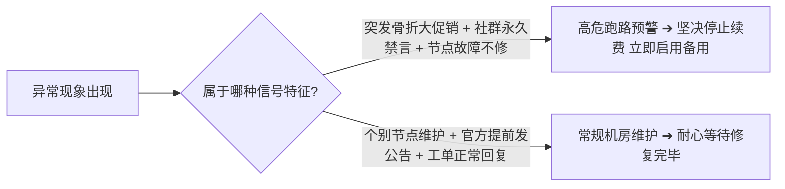

## 引言：保持敏锐的风险意识，拒绝恐慌

在出海代理行业，“跑路”是一个无法回避的话题。
有些是因为运营者遭遇不可抗力，有些是因为资金链断裂，也有些是不良商家蓄意为之。

明确识别**风险信号 ≠ 盲目恐慌**。掌握这些前兆，能让你在出现异常的第一时间做出理性的止损决策。

---

## 一、机场跑路前的 5 大典型危险前兆

### 1. 反常的“抽资式”超级大促销
平时 20 元/月的套餐，突然毫无缘由地推出“88 元买三年”、“168 元终身不限流量”。这种大幅透支未来成本的行为，通常是平台资金链即将见底、试图在关站前最后回笼一笔资金的经典套路。

### 2. 核心节点长时间大面积瘫痪
香港、日本、美国等主力专线全线变红超时，且超过 3 天没有任何修复动向，官方频道一片死寂。

### 3. 交流社群突然关闭或全员禁言
原本开放交流的 Telegram 群组突然开启全员禁言，或者管理人员大规模退群、踢出询问网络情况的用户。

### 4. 客服工单系统彻底停摆
提交的技术支持工单数天无人查看，或系统自动批量关闭工单。

### 5. 线路质量断崖式劣质化
原本宣传的全 IEPL 专线，后台偷偷降级为几块钱的垃圾公网直连，晚高峰延迟从 30ms 暴增至 300ms 且丢包率超过 30%。

---

## 二、普通用户的避险自救三步法则

1. **第一步：恪守「按月付费」底线**
   永远不要为了所谓的“年付折扣”将一整年的费用押注在单一平台上。
2. **第二步：常备「不限时按量备用包」**
   在客户端中导入一个永久有效的备用订阅，遇到突发情况一秒切换，工作生活完全不耽误。
3. **第三步：冷静止损，平滑过渡**
   若确认服务商失联，无需反复刷新或焦虑，直接前往 [机场手册品牌资料库](/brands/) 挑选经过实测核验的优质服务商重新导入即可。
