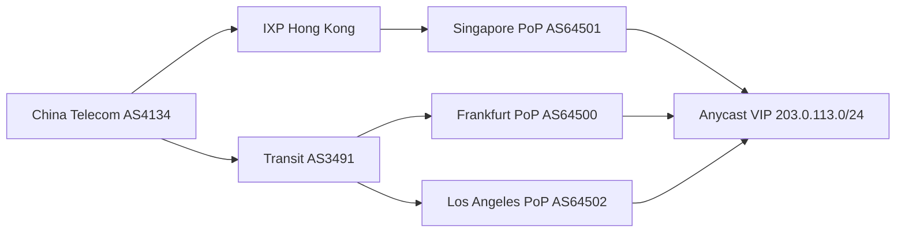
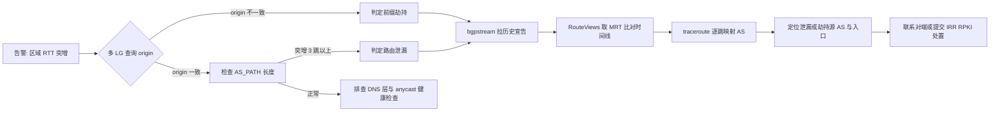

## Anycast 寻址与 BGP 前缀宣告：就近性假设的工程边界

Anycast 的工程本质是把“选路”这件事完全外包给 BGP。同一段服务地址（典型是 /24）在法兰克福、新加坡、洛杉矶三个 PoP 同时 `network` 宣告，客户端发出的报文最终落到哪个 PoP，不取决于 DNS、不取决于负载均衡器，而取决于沿途每一台路由器对这条前缀的最优路径计算。所谓“就近”，只是运维人员对 BGP 决策结果的一种期望，而不是协议保证。

BGP 选路的实际收敛顺序是：先比 Weight / LOCAL_PREF（Cisco 体系），再比 AS_PATH 长度，再比 Origin，再比 MED，最后才落到 eBGP 邻居地址、IGP 度量等 tie-breaker。跨 AS 场景下真正起作用的是前三项。假设法兰克福 PoP 归属 AS64500、新加坡归属 AS64501、洛杉矶归属 AS64502，三者都以 /24 宣告同一前缀。中国电信 AS4134 的边界路由器看到的 AS_PATH 分别是 `4134 64500`、`4134 64501`、`4134 64502`，长度完全相同，此时 LOCAL_PREF 与 MED 成为决胜项。若三个 PoP 通过同一上游 transit 接入，MED 由上游按 IGP 度量下发，结果往往与地理距离无关——上游可能因为新加坡方向链路负载低而给新加坡更优 MED，于是华南用户被“就近”送到了新加坡，而华北用户绕行洛杉矶。这就是就近性假设的第一类失效：**AS_PATH 等长时，MED 与 LOCAL_PREF 由对端策略决定，本地无法控制**。

第二类失效来自前缀长度。BGP 只按前缀长度做最长匹配，/25 永远优先于 /24，与 AS_PATH 无关。生产上常见做法是把 /24 拆成两个 /25 分别宣告到不同 PoP 做流量调度，但这会引入两个问题：其一，RPKI 验证状态。若 ROA 只登记了 /24 而未登记 /25，Validating Router 会把 /25 判为 NotFound（而非 Invalid），多数运营商仍会接受，但部分严格部署 RPKI 的 Tier-1 会直接丢弃，导致该 PoP 完全不可达；其二，/25 在部分老设备上不进入 FIB 或被聚合策略吞掉。因此拆分前缀前必须同步更新 ROA，并在 `routinator` 或 `rpkiclient` 上确认 `valid` 状态。

第三类失效是收敛时间。默认 BGP 扫描器（Cisco `bgp scan-time` 默认 60s，多数厂商 MRAI 默认 30s）意味着一条前缀撤销后，邻居最多要等 30s 才重新计算。Anycast 场景下这 30s 内流量仍被发往已失效 PoP，表现为区域性解析超时。真实排障中，`show ip bgp 203.0.113.0/24` 看到 `stale` 或下一跳不可达但路径未撤，基本可以锁定是 MRAI 与 scan-time 叠加所致。

典型拓扑如下，同一 /24 在三个 PoP 宣告，从 AS4134 发起 traceroute 观察实际命中：



从 AS4134 发起 `traceroute 203.0.113.1`，若第 4~6 跳落在香港 IXP 后直连新加坡，说明 AS_PATH 等长时 MED 偏向新加坡；若路径经 AS3491 绕行法兰克福，则说明 IXP 对等关系改变了最优出口。这里必须引用站内《机场多线BGP入口与过境带宽物理架构》的结论：IXP 对等会把原本经 transit 的路径替换为更短的 AS_PATH（`4134 IXP_AS 64501` 对比 `4134 3491 64500`），但 IXP 端口带宽与对等策略（是否 prepend、是否只宣告部分前缀）会直接决定 Anycast 命中点。多线 BGP 入口在 IXP 上若只对等某一运营商，另一运营商的用户仍会走 transit，形成“同城不同命”的分流误判。

排障落地路径：先用 `bgp.tools` 或 `RIPE RIS` 查该 /24 在各观察点的 AS_PATH 与 MED；再用 `rpkiclient` 确认 ROA 覆盖；最后在边界路由器上 `debug ip bgp updates` 抓撤销与更新时序，核对 scan-time 与 MRAI。就近性不是配置出来的，是在 AS_PATH、LOCAL_PREF、MED、前缀长度、RPKI 状态五个变量同时收敛后才偶然成立的工程结果。

## 路由泄漏与前缀劫持：DNS 解析被牵引至异常 PoP 的识别特征

DNS 解析被牵引到异常 PoP，表象是 RTT 突增、EDNS Client Subnet 回传的 scope 异常、或者某个区域的用户集体解析到非就近的 NS 地址。根因往往不在 DNS 层，而在 BGP 层。必须先区分两类事件：**路由泄漏**与**前缀劫持**，二者的取证路径和处置动作完全不同。

路由泄漏的典型形态是 Tier-2 把从上游学到的全表或部分前缀，错误地转发给了另一个 Tier-1（违反 valley-free 原则），导致大量流量绕行。它通常不改变前缀的 origin，而是改变 AS_PATH 的长度与形状。前缀劫持则是未授权 AS 宣告了一个更具体前缀（/25 覆盖 /24）或同长度但不同 origin 的前缀，直接改变流量归属。DNS 服务商的 anycast /24 一旦被 /25 劫持，只有落入被劫持 /25 的那部分用户被牵引，隐蔽性极强。

识别特征集中在三个维度。第一，AS_PATH 异常：正常路径长度稳定在 4~6 跳，若某观测点路径突增 3 跳以上，且新增 AS 与目的 origin 无客户关系，高度疑似泄漏。第二，RPKI 校验：origin 与 ROA 不匹配（Invalid）是劫持的强信号；泄漏场景下 origin 通常仍 Valid，但路径上的 AS 关系异常。第三，多 Looking Glass 交叉：同一前缀在不同观测点返回不同 origin，基本可判定为劫持；返回相同 origin 但路径分叉严重，则偏向泄漏。

取证链路如下：



工具层面：`bgpstream` 用于回溯历史宣告，按 prefix 与时间窗拉取 collector 数据，确认劫持起始时刻；RouteViews 的 MRT 归档用于离线比对，重点看 `update` 消息中同一 prefix 的 origin 变化；`traceroute` 配合 AS 映射（如 `as-path` 反查或 `mtr --aslookup`）把逐跳 IP 落到 AS 号，验证路径是否真的绕行。注意 traceroute 的 ICMP 回程路径可能与去程不对称，需双向验证。

以某 DNS 服务商 /24 被劫持为例：亚洲用户解析被牵引至欧洲 PoP，RTT 从 30ms 升至 220ms。排查时多 LG 显示该 /24 在部分观测点 origin 变为一个未授权 AS，RPKI 校验为 Invalid；bgpstream 回溯确认劫持在 T0 时刻出现，且宣告的是 /25 更具体前缀，仅覆盖亚洲部分地址段。traceroute 显示流量先进入劫持 AS，再经其上游跨大西洋到欧洲 PoP。处置上先联系劫持 AS 的上游做前缀过滤，同时推动 ROA 覆盖并启用 ROV，最后在 anycast 侧用健康检查与 DNS 探测做兜底牵引。

| 方案 | 检测手段 | 覆盖范围 | 误报率 | 响应时延 | 适用场景 |
|------|----------|----------|--------|----------|----------|
| RPKI ROV | ROA 校验 origin | 全前缀 | 低 | 分钟级 | 劫持主防线 |
| bgpstream 回溯 | 历史宣告比对 | 有 collector 覆盖 | 中 | 小时级 | 事后取证 |
| RouteViews MRT | 离线 update 分析 | 全球观测点 | 中 | 小时级 | 时间线还原 |
| 多 LG 交叉 | origin 与路径比对 | 抽样点 | 中高 | 分钟级 | 快速初判 |
| traceroute 逐跳 | AS 映射验证 | 单源路径 | 高 | 分钟级 | 路径确认 |
| IRR 过滤 | 路由策略校验 | 对端可控 | 低 | 小时级 | 泄漏阻断 |

生产环境的关键是把 RPKI ROV 与 anycast 健康检查做成常态，而不是等 RTT 告警后再查。泄漏与劫持的边界在 origin 是否变化，取证时先定 origin，再定路径，最后用历史数据锁时间线，处置才不会打偏。

## EDNS Client Subnet 与 GeoDNS 误判：跨国分流偏差的成因与复现

当用户抱怨"明明买了香港节点，YouTube 却把我调度到新加坡"或"Netflix 只给我看自制剧"时，问题往往不在代理链路，而在权威 DNS 那一层就已经把用户"认错了地方"。GeoDNS 的判据只有两个来源：递归解析器的出口 IP，或者 EDNS Client Subnet（ECS）携带的客户端子网。理解这两者的差异，是定位跨国分流偏差的起点。

### ECS 的报文结构与传递语义

ECS 定义在 RFC 7871，作为 EDNS0 的一个 option 挂在 OPT 伪记录里，option code 为 8。其 RDATA 结构为：`FAMILY(2B) | SOURCE PREFIX-LENGTH(1B) | SCOPE PREFIX-LENGTH(1B) | ADDRESS(变长)`。FAMILY 取 1 表示 IPv4、2 表示 IPv6；SOURCE PREFIX-LENGTH 是客户端愿意暴露的掩码长度，常见取 24（IPv4）或 56（IPv6），这也是隐私与精度之间的行业折中——/24 已足以定位到运营商与省级出口，又不至于精确到单个用户。SCOPE PREFIX-LENGTH 由权威服务器在响应中回填，表示"我实际按多少位做了决策"，递归器应据此缓存。

递归器收到带 ECS 的查询后，若上游权威支持 ECS，会把客户端子网原样（或截断到自身配置的最大长度）转发；若权威不支持，则回退为不带 ECS 的普通查询。这里存在一个常被忽略的事实：**递归器是否转发 ECS、转发多长，完全由递归器自己决定**，客户端无法强制。这也是后面所有误判的根源。

### GeoDNS 的两种决策模型

| 维度 | 基于解析器出口 IP | 基于 ECS 子网 | 混合策略（ECS 优先，缺失回退出口 IP） |
|---|---|---|---|
| 判据来源 | 递归器与权威之间的源地址 | OPT 中携带的客户端子网 | 两者兼用 |
| 精度 | 仅到递归器所在机房 | 到客户端所在 /24 或 /56 | 视 ECS 有无而定 |
| 公共 DNS 场景 | 1.1.1.1 用户被判定为 Cloudflare 机房位置 | 可还原真实归属 | 部分还原 |
| 运营商 NAT 场景 | 出口 IP 即 NAT 池地址，尚可 | 内网地址被递归器丢弃，ECS 失效 | 回退出口 IP |
| 缓存污染风险 | 低（同一解析器共享结果） | 高（不同子网产生不同应答，缓存键需含 ECS） | 中 |
| 典型实现 | 早期 GeoDNS、部分 CDN | 主流 CDN、大型权威云 | 多数现代权威 |

关键结论：**当递归器不转发 ECS 时，GeoDNS 只能看到递归器的出口 IP**。用 8.8.8.8 解析一个只认 ECS 的权威，你拿到的是"Google 认为你在地球哪里"，而不是"你实际在哪里"。

### 复现步骤与量化判据

用 dig 直接对权威服务器发问，绕开本地递归器的干扰：

```bash
# 1. 不带 ECS，观察默认（按递归器出口 IP）返回
dig @8.8.8.8 www.example-cdn.com A +short

# 2. 显式声明"无客户端子网"，与上面对比
dig @8.8.8.8 www.example-cdn.com A +noclient-subnet +short

# 3. 伪造中国电信 /24 子网，观察是否返回国内节点
dig @8.8.8.8 www.example-cdn.com A +subnet=61.144.0.0/24 +short

# 4. 伪造海外子网做对照
dig @8.8.8.8 www.example-cdn.com A +subnet=203.0.113.0/24 +short

# 5. 查看权威是否真的回填了 SCOPE，确认 ECS 被采纳
dig @8.8.8.8 www.example-cdn.com A +subnet=61.144.0.0/24 +qr
```

拿到返回 IP 后，量化两个指标：**RTT 差异**与 **AS 归属差异**。前者用 `mtr -rwzc 20 <ip>` 或 `ping -c 20` 对比不同子网返回的节点；后者用 `whois <ip> | grep -i origin` 或 `curl -s https://ipinfo.io/<ip>/json` 看 ASN。若 `+subnet=61.144.0.0/24` 返回的 IP 落在国内 AS4134/AS4809，而默认查询返回海外 AS，则说明该权威**强依赖 ECS**，你的本地递归器很可能没转发 ECS。

### 运营商 NAT 与公共 DNS 的处理差异

家宽 CGNAT 场景下，客户端真实地址是 100.64.0.0/10 之类的私网段，递归器在构造 ECS 时通常直接丢弃或截断为 0.0.0.0/0，权威看到的仍是递归器出口。此时无论客户端怎么配置 `+subnet`，只要经过运营商递归器，ECS 都可能被抹掉。这也是为什么在 CGNAT 环境下，**换用支持 ECS 的公共 DNS 反而可能让 GeoDNS 判得更准**——前提是该公共 DNS 真的转发 ECS。

Cloudflare 1.1.1.1 与 Google 8.8.8.8 的策略差异值得单独记一笔：1.1.1.1 默认**不向权威转发 ECS**（隐私优先），因此用它解析强 ECS 的权威时，GeoDNS 只能按 Cloudflare 机房出口判定，跨国用户极易被调度到错误区域；8.8.8.8 则**有条件转发 ECS**，会把客户端子网截断后带给权威，精度更高但隐私暴露更多。这一差异直接决定了同一域名在两个解析器下返回不同地理节点。若你的分流规则依赖 GeoDNS 结果（例如按返回 IP 的 ASN 决定走哪条出口），解析器选择本身就是分流精度的一部分，相关工程细节可参考 [DNS泄露成因深度剖析与DoH/DoT加密递归解析](/guides/dns-leak-prevention-and-doh-dot/)。

在 Clash 侧，若要让 fake-ip 模式下的域名解析尽量贴近真实地理，可在 `dns` 段显式指定 `nameserver-policy` 并按域名走不同上游，避免所有查询都压在同一个不转发 ECS 的解析器上：

```yaml
dns:
  enable: true
  enhanced-mode: fake-ip
  fake-ip-range: 198.18.0.1/16
  nameserver:
    - https://1.1.1.1/dns-query
    - https://8.8.8.8/dns-query
  nameserver-policy:
    "geosite:netflix,disney,youtube":
      - https://8.8.8.8/dns-query   # 依赖 ECS 的流媒体权威，优先走会转发 ECS 的上游
    "geosite:cn":
      - 223.5.5.5
```

排障时的判断顺序应当是：先确认权威是否支持并采纳 ECS（看 SCOPE 回填），再确认递归器是否转发 ECS（对比 `+subnet` 与 `+noclient-subnet` 的返回差异），最后才怀疑代理链路。多数"跨国分流误判"在这一层就能定性，无需动到隧道配置。

## dig/traceroute/mtr/RIPE Atlas 多源探测组合定位解析污染

单点观测在 Anycast 场景下几乎没有诊断价值。同一个域名，北京联通拿到 203.0.113.10，法兰克福电信拿到 198.51.100.22，两者都“正常”，但其中一个可能已经被劫持。定位解析污染的核心方法不是“多 dig 几次”，而是把**委派链、递归器差异、路径 AS 归属、丢包统计、全球探针**五个维度串成一条证据链，让异常 IP 与异常路径能够相互印证或相互排除。

### 第一步：用 +trace +dnssec 锁定委派链是否被篡改

```bash
dig +trace +dnssec example.com @8.8.8.8
```

这条命令从根开始逐级查询，输出中要重点看三处：根区返回的 `.com` NS 与 DS 记录、`.com` 返回的 `example.com` NS 与 DS、以及最终权威返回的 A 记录及其 RRSIG。若中间某级出现 `SERVFAIL` 且伴随 `status: SERVFAIL` 与 DS 不匹配，说明该级委派被污染或 DNSSEC 验证失败；若 `+trace` 走到的权威服务器 IP 与你预期的 NS 段不符（例如权威 NS 本应在 192.0.2.0/24，trace 却指向某个陌生网段），基本可以判定委派链被中间人改写。注意 `+trace` 默认不做完整验证，需配合 `+dnssec` 观察 RRSIG 是否存在，再用 `delv` 或 `dig +sigchase` 做严格验证。

### 第二步：对比不同递归器，区分“全局污染”与“单递归器缓存污染”

```bash
for r in 8.8.8.8 1.1.1.1 9.9.9.9 208.67.222.222; do
  echo "== $r =="
  dig +short A example.com @$r
done
```

若四家递归器返回一致且与权威一致，问题不在解析层；若仅某一家返回异常 IP，优先怀疑该递归器的缓存被投毒或 EDNS Client Subnet 处理异常；若全部返回同一个异常 IP，而权威 `dig @ns1.example.com` 返回正常，则污染发生在递归器到权威之间的路径上，进入第三步做路径归因。

### 第三步：traceroute 映射 AS，把“异常 IP”钉到“异常路径”

```bash
traceroute -a -n -T -p 53 203.0.113.10
```

`-a` 显示每一跳的 AS 号，`-T -p 53` 用 TCP/53 探测以穿越常见 ICMP 限速。逐跳记录 AS 序列，与 `whois -h whois.radb.net -- '-i origin ASxxxx'` 或 `bgp.he.net` 上的预期路径比对。若目标 IP 归属 AS64500，但路径在第 7 跳突然进入 AS64501 并在第 9 跳才“回到”目标，说明存在**路由泄漏或前缀劫持**——异常 AS 在中间段宣告了本不属于它的前缀。此时把该 AS 与异常 IP 的 whois 归属交叉核对，若二者不一致，劫持证据成立。

### 第四步：mtr 量化丢包与延迟，排除“路径正常但质量劣化”的伪异常

```bash
mtr -rwc 100 -n -z 203.0.113.10
```

`-z` 显示 AS，`-c 100` 保证统计显著性。重点看**目标跳**而非中间跳的丢包（中间跳 ICMP 限速会造成假丢包），以及延迟突增发生在哪一跳。若延迟在进入某 AS 后陡增 80ms 以上且持续，结合第三步的 AS 序列，可判定该 AS 存在异常转发或流量牵引。mtr 的价值在于把 traceroute 的“单次快照”变成“统计证据”，避免把偶发绕路误判为劫持。

### 第五步：RIPE Atlas 多源测量，做全球交叉验证

在 RIPE Atlas 创建两类测量并绑定同一批探针（按国家与 AS 过滤）：

```json
{
  "definitions": [
    {
      "type": "dns",
      "af": 4,
      "query_argument": "example.com",
      "query_type": "A",
      "use_probes": 50,
      "probe_spec": "country=CN or asn=4134"
    },
    {
      "type": "traceroute",
      "af": 4,
      "target": "203.0.113.10",
      "use_probes": 50,
      "probe_spec": "country=CN or asn=4134"
    }
  ]
}
```

也可用 `ripe-atlas` CLI 提交：

```bash
ripe-atlas measure dns --target example.com --type A \
  --probes 50 --from-country CN --af 4
ripe-atlas measure traceroute --target 203.0.113.10 \
  --probes 50 --from-country CN --af 4
```

拿到结果后按 Probe ID 对齐两份测量，做**二维判定**：

- **异常 IP + 路径经过异常 AS**：该 Probe 的 traceroute 在到达目标前经过一个不属于目标前缀归属的 AS，且该 AS 与异常 IP 的 whois 归属一致 → 判定为**路由劫持/前缀泄漏**，污染发生在转发面。
- **异常 IP + 路径正常**：traceroute 的 AS 序列与预期一致，但 DNS 返回异常 IP → 排除转发面劫持，转向**GeoDNS 误判**（探针所在 AS 被错误映射到某地域视图）或**递归器缓存污染**（该 Probe 使用的递归器被投毒）。此时再用 `dig +trace` 从该 Probe 侧复现，确认异常来自权威视图还是递归缓存。
- **正常 IP + 路径异常**：说明劫持发生在其他前缀或该 Probe 未命中污染路径，不能据此排除全局问题，需扩大探针样本。

一个常被忽略的细节：RIPE Atlas 的 DNS 测量默认走探针本地递归器，结果里会带 `resolver` 字段。若同一国家内不同 Probe 返回不同 IP 但 resolver 相同，问题在递归器；resolver 不同而 IP 不同，问题在权威 GeoDNS 视图。把 resolver 字段与 traceroute 的 AS 序列一起看，才能把“污染”与“分流”彻底分开。

最后提醒：所有测量都应保留原始结果（`ripe-atlas report <msm_id>` 导出 JSON），并在变更窗口前后各跑一轮，形成时间序列。单次快照只能证明“此刻异常”，时间序列才能证明“异常是持续劫持还是瞬时抖动”。

## DNSSEC 链验证与 DoH/DoT 回退路径排障

DNSSEC 验证失败在现场往往表现为“域名明明存在却返回 SERVFAIL”，而客户端侧看到的只是解析超时，极易被误判为线路故障。验证链是自顶向下的信任传递：根区 KSK 自签名并签署根 DNSKEY 集，根区用 ZSK 签署 TLD 的 DS 记录，TLD 再用自己的 KSK/ZSK 签署下级域名的 DS，最终由域名自身的 DNSKEY 签署 A/AAAA 等资源记录。任何一环 DS 缺失、RRSIG 过期、算法不支持（如旧版解析器不认 Ed25519）或时钟偏差超过签名有效期，都会让整条链断在某一跳。

先用 `dig` 看权威应答本身是否带签名、递归解析器是否给出 AD 标志：

```bash
dig +dnssec +multi example.com A @8.8.8.8
# 关注输出中的 RRSIG 行、flags 是否含 ad，以及 status 是否为 NOERROR
dig +dnssec +multi example.com DS @a.gtld-servers.net
dig +dnssec +multi . DNSKEY @a.root-servers.net
```

若 `dig` 直接对权威服务器查询能拿到 RRSIG，而对递归解析器查询无 AD 且返回 SERVFAIL，问题就锁定在递归侧的验证环节。此时用 `delv +rtrace` 逐跳追踪，它会把每一级的 DS/DNSKEY 查询、签名校验结果打印出来：

```bash
delv @8.8.8.8 example.com +rtrace
# 输出形如：
# ;; fetch: example.com/A
# ;; validate: example.com/A -> answer validated
# 或 validate: ... -> no valid signature found
```

`+rtrace` 的关键价值在于定位“断点层级”：若在根区就报 `no valid trust anchor`，说明本地 trust anchor（`/etc/trusted-key.key` 或 `bind.keys`）过期；若断在 TLD 的 DS 查询，常见于该 TLD 尚未部署 DNSSEC 或 DS 摘要算法不匹配；若断在域名 DNSKEY，多为密钥轮换后旧缓存未过期，或权威服务器漏配 RRSIG。生产环境里还有一种隐蔽情况：中间设备（运营商透明 DNS、企业防火墙 DNS 代理）剥离了 DO 位或截断了大于 512 字节的 UDP 响应，导致 RRSIG 不完整。此时强制 TCP 查询即可复现或排除：

```bash
dig +dnssec +tcp +bufsize=4096 example.com @8.8.8.8
```

DNSSEC 排障的另一半在加密传输路径。当明文 53 端口被污染或劫持时，客户端会回退到 DoH/DoT，但回退本身也可能静默失败——配置里写了 DoH，实际流量仍走 UDP 53。验证浏览器/系统是否真的走了 DoH：

```bash
curl -v --doh-url https://dns.google/dns-query https://example.com -o /dev/null
# verbose 输出中应出现 "Using DoH" 及对 dns.google 的 TLS 握手
```

验证 DoT 证书链与 SNI 是否匹配（很多自建 DoT 因证书 CN 与 SNI 不一致被客户端拒绝后悄悄回退）：

```bash
openssl s_client -connect 1.1.1.1:853 -servername cloudflare-dns.com -showcerts </dev/null
# 检查 Verify return code: 0 (ok)，以及证书 SAN 是否包含 cloudflare-dns.com
```

最后用抓包确认实际回退行为，这是判定“配置生效”与“配置被绕过”的唯一硬证据：

```bash
tcpdump -ni any 'tcp port 53 or tcp port 853 or udp port 53' -vv
# 若配置了 DoH 却仍看到大量 udp/53 明文查询，说明回退发生
```

在 Clash 系客户端中，fake-ip 模式会放大这类问题的传导：DNS 查询若在 fake-ip 池分配阶段被劫持返回错误 IP，后续所有基于该 IP 的分流规则（GEOIP、IP-CIDR）都会误判，表现为“明明选了代理却直连”或“国内域名走了境外节点”。其成因与 DoH/DoT 加密递归的工程配置强相关，详见站内 [DNS泄露成因深度剖析与DoH/DoT加密递归解析：Clash Verge Rev与Sing-box的fake-ip/redir-host分流防污染工程实战](/guides/dns-leak-prevention-and-doh-dot/)。典型错误配置如下，`fallback-filter` 未启用 `geoip` 且 `nameserver` 混用明文，导致污染结果进入 fake-ip 池：

```yaml
dns:
  enable: true
  enhanced-mode: fake-ip
  fake-ip-range: 198.18.0.1/16
  nameserver:
    - https://dns.google/dns-query
    - 223.5.5.5          # 明文混入，污染源
  fallback:
    - tls://1.1.1.1:853
  fallback-filter:
    geoip: true
    ipcidr:
      - 240.0.0.0/4
```

Sing-box 侧对应检查 `dns.servers` 的 `detour` 是否指向可用出站，以及 `domain_strategy` 是否与 fake-ip 冲突：

```json
{
  "dns": {
    "servers": [
      { "tag": "doh", "address": "https://dns.google/dns-query", "detour": "proxy" },
      { "tag": "dot", "address": "tls://1.1.1.1", "detour": "proxy" }
    ],
    "final": "doh",
    "strategy": "prefer_ipv4"
  }
}
```

排障顺序建议固定为：先 `dig +dnssec` 确认签名存在，再 `delv +rtrace` 定位验证断点，随后 `curl --doh-url` 与 `openssl s_client` 确认加密通道可用，最后 `tcpdump` 抓包确认无明文回退。四步走完，DNSSEC 与 DoH/DoT 两层问题基本可以分离清楚，避免把签名链故障误判成线路或分流规则问题。

## 解析异常传导为代理节点误选与连接超时的联动排障

DNS 解析结果在代理链路里不是“查完就完”的一次性动作，它直接参与节点选择决策。GeoDNS 一旦返回错误 IP，故障会沿“解析结果 → 规则匹配 → 节点选择 → TLS 握手”这条链路逐级放大，最终表现为连接超时或 RTT 突增，而表层症状往往被误判为“节点挂了”。

### 一、fake-ip 与 redir-host 下的传导路径差异

**fake-ip 模式**：客户端拦截 DNS 请求，返回 198.18.0.0/16 段的伪造地址，真实域名随连接一并带入代理协议。此时节点选择依赖**域名**而非 IP，GeoDNS 污染对选路影响较小，但存在一个隐蔽陷阱：若 `fake-ip-filter` 未覆盖目标域名，客户端仍会发起真实解析用于规则匹配（如 `GEOIP`、`IP-CIDR` 规则），污染 IP 会命中错误的 `GEOIP,CN,DIRECT` 或落入错误节点组。表现为“域名本该走代理却直连超时”，或“本该直连却绕道海外节点”。

**redir-host 模式**：客户端先做真实解析，拿到 IP 后再按 IP 选路。GeoDNS 返回错误 IP 时，`GEOIP` 判定直接失真——海外 IP 被识别为国内地址而走 DIRECT，或国内 CDN 节点被识别为海外而误入高延迟代理组。这是解析异常传导为节点误选最直接的路径。

### 二、症状识别：TLS 握手超时与 RTT 突增

错误 IP 通常指向三类目标：不可达地址、错误地理位置的 CDN 边缘节点、被劫持的中间人地址。对第一类，TCP SYN 无响应，客户端在默认 5s 握手超时后重试或切换节点，日志呈现 `dial tcp ... i/o timeout`；对第二类，TCP 可建连但 TLS 握手阶段因 SNI 与证书不匹配或边缘节点无对应源站而超时；对第三类，握手成功但后续请求被重置。

RTT 突增则多见于“地理错配”：GeoDNS 把用户调度到跨洲边缘节点，TCP 三次握手与 TLS 往返叠加后 RTT 从 30ms 跳到 300ms 以上。这类故障不报错，只表现为“能用但很慢”，最容易被漏诊。

### 三、排查步骤

**第一步：开日志看解析与选路。** Clash 开启 `log-level: debug`，观察 `[DNS]` 查询结果与随后的 `[TCP]` 拨号目标是否一致；Sing-box 用 `log.level: debug`，关注 `dns: exchanged` 与 `outbound` 选择记录。重点核对：解析出的 IP 是否落入预期节点组的规则区间。

**第二步：用 curl 定点复现。** 绕过代理直连错误 IP，验证握手行为：

```bash
# 复现错误 IP 的握手超时（-m 限定 5s，与客户端默认一致）
curl -v -m 5 --resolve example.com:443:203.0.113.66 https://example.com/

# 对比正确 IP 的握手耗时
curl -v -m 5 --resolve example.com:443:正确IP https://example.com/ \
  -w "dns:%{time_namelookup} connect:%{time_connect} tls:%{time_appconnect}\n"
```

若错误 IP 在 `time_connect` 或 `time_appconnect` 阶段卡满 5s，而正确 IP 在百毫秒内完成，即可确认解析异常是根因，而非节点本身故障。

**第三步：交叉验证解析源。** 用 `dig @1.1.1.1 example.com` 与 `dig @本地DNS example.com` 对比，确认是 GeoDNS 调度错误还是本地递归污染。若公网 DoH 结果正确而本地结果错误，问题在递归链路；若两者都错，则是权威侧 GeoDNS 配置或 Anycast 路由泄漏导致。

**第四步：修正选路策略。** 短期在客户端加 `fake-ip-filter` 或显式 `DOMAIN` 规则绕开失真 IP；长期将关键域名的解析固定到可信 DoH，并对 `GEOIP` 规则辅以域名白名单兜底。

### 四、纯净链路的前提是解析正确

站内《ChatGPT 4o 与 Claude 3.5 全天候高频访问实战》反复强调“纯净链路”，其底层前提正是 DNS 解析的确定性。这类高频长连接场景对握手超时零容忍：一次 GeoDNS 误调度就可能让 TLS 握手卡满 5s，触发客户端重试与节点切换，长连接被反复打断，表现为“时好时坏”。实战中把关键域名的解析锁定到可信 DoH、关闭会引入污染的本地递归，比事后调节点参数更有效——解析正确，选路才正确，链路才谈得上纯净。

## 工程化防御：RPKI 部署、多源监控与分流规则加固

Anycast DNS 劫持与路由泄漏的根因，九成以上落在两个层面：BGP 层缺少源验证，DNS 层缺少完整性校验。防御必须在这两层同时落地，单点加固没有意义——RPKI 只保路由不被冒名，DNSSEC 只保应答不被篡改，二者缺一，攻击者仍可从另一侧切入。以下按“路由→DNS→客户端→测量”四段给出可落地的工程方案。

### 一、RPKI ROA 与 ROV：把“谁有权宣告”钉死

先在 IRR 与 RPKI 之间对齐。对每个 Anycast 前缀，向对应 RIR 签发 ROA，maxLength 严格等于实际宣告长度——很多泄漏事故就是因为 maxLength 放到了 /24 而实际只该 /24 内更细粒度，给了子前缀劫持空间。ROA 签发后用 `routinator` 或 `rpki-client` 本地校验一遍，确认 origin AS 与 prefix 匹配无误再上线。

路由器侧启用 ROV。以 Cisco IOS-XR 为例：

```
router bgp 65000
 bgp rpki server tcp 192.0.2.10 port 3323 refresh 60
!
route-policy RPKI-FILTER
  if validation-state is invalid then
    drop
  endif
  pass
end-policy
!
router bgp 65000
 neighbor 203.0.113.1 route-policy RPKI-FILTER in
```

注意 `invalid` 直接 drop、`notfound` 放行是主流折中；若业务对可用性极敏感，可对 notfound 单独打 tag 走低优先级路径而非直接丢弃。ROV 上线后必须同步监控：`bgpstream` 订阅目标前缀的宣告事件，任何 origin AS 变更、新 origin 出现、前缀长度异常都触发告警。bgpstream 的 `bgpstream -p "prefix 198.51.100.0/24"` 配合 webhook 即可做到分钟级发现，比等用户投诉快一个数量级。

### 二、DNS 层：DNSSEC + 多递归器冗余

权威侧签名只是起点，递归侧必须真正验证。Unbound 配置片段（启用 DNSSEC 验证与 ECS 支持）：

```yaml
server:
  verbosity: 1
  do-daemonize: yes
  interface: 0.0.0.0
  access-control: 10.0.0.0/8 allow
  # DNSSEC 验证
  auto-trust-anchor-file: "/var/lib/unbound/root.key"
  val-clean-additional: yes
  val-permissive-mode: no
  # ECS：向权威传递客户端子网，提升 Anycast 就近精度
  edns-client-subnet: yes
  # 缓存与并发
  msg-cache-size: 128m
  rrset-cache-size: 256m
  num-threads: 4
  # 防劫持：强制走验证，失败即 SERVFAIL
  harden-dnssec-stripped: yes
  harden-glue: yes
```

关键在 `val-permissive-mode: no` 与 `harden-dnssec-stripped: yes`——前者让验证失败的应答直接 SERVFAIL 而非放行，后者拒绝被剥离 DNSSEC 记录的降级应答，这两项是抵御 DNS 劫持的核心开关。ECS 开启后需评估隐私合规，但对 Anycast 分流精度有实质提升。

递归器至少部署两套独立实例（不同上游、不同物理位置），客户端解析链路做健康检查，主递归器 SERVFAIL 率超阈值即切换。单递归器是单点故障，也是单点劫持面。

### 三、代理客户端：DoH 强制 + 可信 fallback

客户端侧把明文 DNS 彻底关掉。Clash 配置片段：

```yaml
dns:
  enable: true
  ipv6: false
  enhanced-mode: fake-ip
  fake-ip-range: 198.18.0.1/16
  nameserver:
    - https://1.1.1.1/dns-query
    - https://8.8.8.8/dns-query
  fallback:
    - https://dns.google/dns-query
    - tls://1.0.0.1:853
  fallback-filter:
    geoip: true
    geoip-code: CN
    ipcidr:
      - 240.0.0.0/4
    domain:
      - '+.google.com'
      - '+.github.com'
```

`fallback-filter` 的语义要理解清楚：命中 geoip 或 domain 规则的查询不走 fallback，直接由 nameserver 解析；其余才交给 fallback。这能避免国内域名被境外递归器解析出错误 CDN 节点，也避免 fallback 被污染时污染主链路。DoH 强制模式下，明文 53 端口应被防火墙阻断，防止应用绕过代理直连。

### 四、RIPE Atlas 定期测量解析一致性

配置层面再严，也要有外部视角验证。用 RIPE Atlas 对关键域名做定期 DNS 测量：选多国 probe，measurement type 设为 `dns`，记录 A/AAAA 应答与解析时延。将结果与权威侧预期比对，出现地域性应答漂移（某国 probe 拿到非预期 IP）即高度怀疑 Anycast 分流误判或本地劫持。测量频率建议 15 分钟一次，结果入库做时序对比，异常突刺比绝对值更有诊断价值。

这里要提醒流量成本：高频 Atlas 测量、bgpstream 长连接、多递归器健康探测都会持续消耗带宽与配额。站内《机场流量应该买多少？》里提到的监控流量与业务流量的配比思路同样适用——解析异常往往先表现为监控探针的流量突增或配额提前耗尽，把监控流量单独计量、设阈值告警，本身就是一条低成本的劫持早期信号。

四层防御的落地顺序建议：先 RPKI ROA（成本最低、收益最大），再 DNSSEC 验证，再客户端 DoH 强制，最后 Atlas 测量闭环。每层都要有独立告警，任何一层静默失效都不能被其他层的“看起来正常”掩盖。
