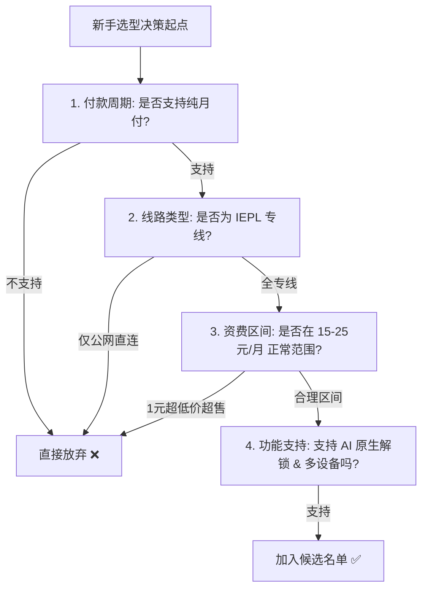

## 引言：面对上千家机场，新手该如何快速筛出靠谱选择？

在网上搜索“机场推荐”，你会看到铺天盖地的推广返利链接与各种玄学评测。许多新手由于缺乏基本的辨别能力，往往被“几块钱一年”、“千兆光纤秒开”的夸张文案吸引，购买后才发现晚高峰完全卡死，客服失联，最后只能自认倒霉。

选择机场其实并不神秘。只要你对照以下 **7 大核心指标清单** 进行逐项核对，就能在 3 分钟内精准剔除绝大多数劣质与高风险平台。

---

## 一、新手选型 7 步核心核验清单

### 1. 付款周期核验：必须支持真实「按月付费」
- **为什么重要**：网络服务受上游线路与政策影响极大。按月付费是你对服务商最具约束力的监督手段。
- **合格标准**：提供单月 15–25 元的标准月付选项，且月付套餐没有被恶意阉割核心节点。

### 2. 线路类型核验：优先选择「IEPL 专线」
- **为什么重要**：公网中继在每晚 20:00–23:00 国际出口拥堵时会严重丢包（丢包率 15%–30%）；IEPL 专线走内网专用物理光缆，全天候零拥堵。
- **合格标准**：节点列表中明确标明 IEPL / IPLC 专线。

### 3. 流量配额核验：100GB–150GB 是黄金区间
- **为什么重要**：普通用户每月查资料、聊天和看高清视频的真实消耗在 60GB–100GB 之间。
- **合格标准**：月付 15–20 元提供 100GB–150GB 流量，单价在 ¥0.10–¥0.15/GB 之间。

### 4. 设备限制核验：至少支持 3–5 台并发
- **为什么重要**：个人通常拥有手机、电脑、平板等多台设备，需避免出现“电脑连上手机就被踢下线”的尴尬。

### 5. 客户端生态核验：提供标准通用订阅
- **合格标准**：支持直接导出 Clash / Shadowrocket / Sing-box / v2rayN 通用格式，不强制绑定任何来源不明的闭源定制客户端。

### 6. AI 与流媒体支持：包含美/日/新低风控出口
- **合格标准**：节点能够流畅进入 `chatgpt.com` 与 `claude.ai`，不频繁跳出验证码或 Access Denied 报错。

### 7. 客服与公告机制：社群与工单响应正常
- **合格标准**：拥有活跃的官方 Telegram 频道或响应及时的网站工单系统，遇到网络波动能提前发布维护公告。

---

## 二、总结与下一步

将这 7 项标准作为你的过滤器，你可以直接前往 [机场手册品牌资料库](/brands/)，查看经过我们实测核验的 16 家正规服务商，挑选适合你预算的最佳方案！
