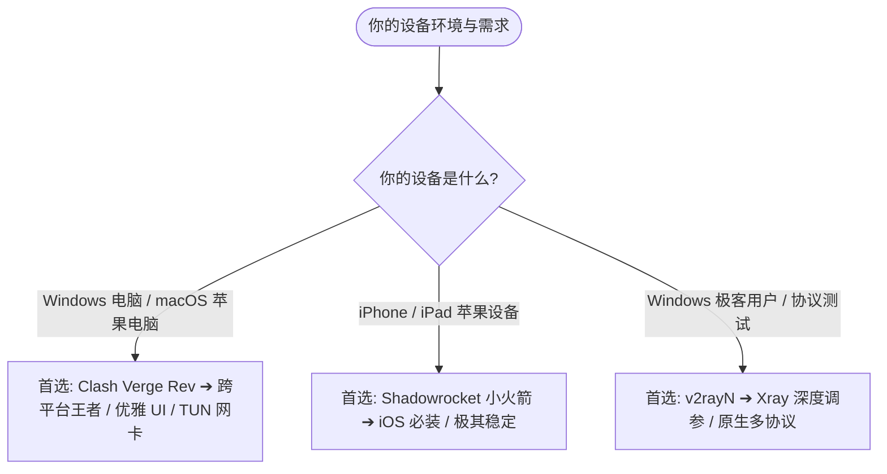

## 引言：出海三大神器，究竟谁更适合你？

在代理技术交流群里，你听到最多的三个名字必定是：**Clash**、**小火箭 (Shadowrocket)** 和 **v2rayN**。

很多刚入坑的新手常常会问：
- “为什么大家在电脑上都推荐 Clash，在手机上都推荐小火箭？”
- “这三款软件到底哪一个速度最快？”
- “我需要三个软件都学会吗？”

本指南为你从**支持系统、核心架构、分流能力和使用难度**全方位横向对比这三大神器。

---

## 一、三大客户端全维度技术参数对比矩阵

| 评测维度 | Clash (Clash Verge Rev) | Shadowrocket (小火箭) | v2rayN 7.x |
| :--- | :--- | :--- | :--- |
| **支持平台** | **Windows, macOS, Linux** | **iOS, iPadOS (苹果专享)** | **Windows (专属)** |
| **软件定位** | 跨平台现代化图形客户端 | iOS 移动端统治级神器 | Windows 极客级协议工作站 |
| **默认内核** | Mihomo (Clash.Meta) | 自研高性能 iOS 网络内核 | Xray-Core / Sing-box Core |
| **协议支持** | VLESS, Hys2, TUIC, SS, Trojan | VLESS, Hys2, TUIC, SS, Trojan | VLESS (Reality), Hys2, SS, Trojan |
| **分流与规则** | 强大的 YAML 策略组 + 远程规则集 | 可视化「配置 (Config)」智能分流 | PAC 模式 + 路由白名单规则 |
| **获取费用** | 100% 免费开源 | 外区 App Store 买断 (约 $2.99) | 100% 免费开源 |
| **上手难度** | ⭐⭐ 低至中等 (UI 现代化) | ⭐ 极低 (一键导入即连) | ⭐⭐ 中等 (菜单选项丰富) |

---

## 二、三大客户端核心优势与最佳场景

### 1. Clash Verge Rev（电脑端首选）
- **核心亮点**：基于 Rust + Tauri 开发，内存开销极小；支持一键安装 Service 模式与 TUN 虚拟网卡，无论浏览器还是命令行均可透明加速。
- **最佳场景**：Windows 和 Mac 用户的首选主力工具。

### 2. Shadowrocket 小火箭（苹果手机首选）
- **核心亮点**：在 iOS 系统中具备极佳的后台保活与低功耗控制；一键添加订阅后自动识别格式并开启规则分流。
- **最佳场景**：所有 iPhone 与 iPad 用户的出海标配。

### 3. v2rayN（Windows 深度玩家首选）
- **核心亮点**：支持直接下载测速（Ctrl+T 查看真实 MB/s 带宽）；内核更新极其迅速，适合需要精确调优与测试新协议的 Windows 用户。

---

## 三、总结建议

- **iPhone / iPad 用户**：无需犹豫，直接下载 **Shadowrocket**；
- **PC 电脑端用户 (Win / Mac)**：直接使用 **Clash Verge Rev**；
- **追求原生协议参数调试的 Windows 极客**：选用 **v2rayN**。

查阅详细图文教程：
- [Clash Verge Rev 完整教程](/tutorials/clash/clash-verge-starter-guide/)
- [Shadowrocket 小火箭保姆级教程](/tutorials/shadowrocket/import-subscription/)
- [v2rayN 7.x 深度使用指南](/tutorials/v2rayn/starter-guide/)
