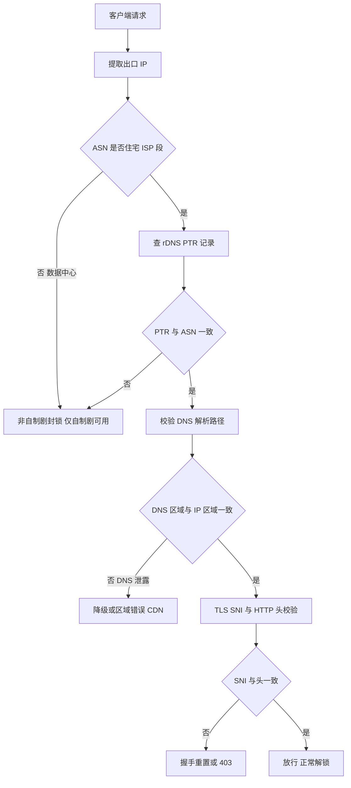
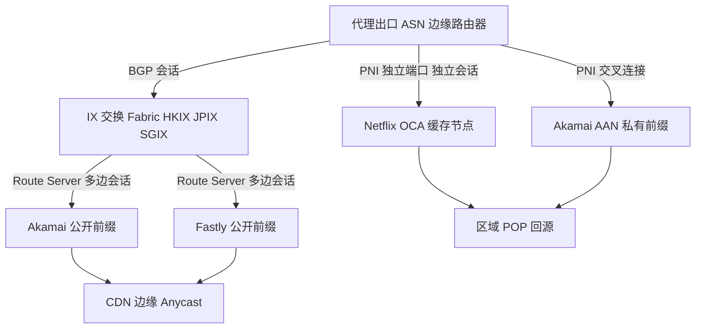

## 流媒体区域版权过滤的判定链：IP 纯净度、ASN 归属与 DNS 重定向拦截

Netflix、Disney+ 这类平台的区域版权过滤从来不是单点判断，而是一条串联的判定链。理解这条链的顺序，比盲目换节点更有价值——因为链上任何一环失败，后面的努力都是白费。生产环境里最常见的误判是“IP 换了但内容没解锁”，根因往往出在链路的第二、三环，而不是第一环。

### 第一环：IP 的 ASN 与 rDNS 归属

平台拿到的第一个信号是你的出口 IP。它先做两件事：查 ASN 归属，查 rDNS（PTR 记录）。住宅 ISP 段的 IP，ASN 属于 Comcast、Verizon、NTT 这类消费级运营商，rDNS 通常解析成 `c-xx-xx-xx-xx.hsd1.ca.comcast.net` 这种带地理语义的主机名。数据中心 IP 的 ASN 属于 AWS、DigitalOcean、Hetzner、Vultr，rDNS 往往是 `ec2-xx-xx-xx-xx.compute-1.amazonaws.com` 或干脆没有 PTR。

这一步是硬门槛。Netflix 的非自制剧（licensed content）对数据中心 ASN 基本一刀切，自制剧（Netflix Originals）宽松得多，这是很多人“部分能看部分不能看”的原因。快速自查：

```bash
curl -s https://ipinfo.io/json
```

重点看返回里的 `org` 和 `asn` 字段。`org` 显示 `AS16509 Amazon.com, Inc.` 就意味着你已经在黑名单边缘。再补一条 PTR 查询：

```bash
dig +short -x 203.0.113.45
```

如果返回空或返回云厂商域名，住宅段伪装就没做到位。真正的住宅 IP 伪装需要 ASN、PTR、whois 注册信息三者一致，单改 PTR 而 ASN 仍是机房段，平台侧的风控模型照样识别。

### 第二环：DNS 解析路径与 IP 区域的一致性

这是最容易被忽视、也最容易翻车的一环。平台的判定逻辑是：你声称在 A 国（IP 归属 A 国），那你的 DNS 解析结果也应当指向 A 国的 CDN 边缘节点。如果 IP 在 A 国、DNS 却把 `netflix.com` 解析到 B 国或本国的 CDN，就构成“DNS 与 IP 区域不一致”，触发降级或封锁。

对比解析结果：

```bash
dig +short netflix.com @1.1.1.1
dig +short netflix.com
```

第一条走公共 DNS，第二条走本地/系统 DNS。两条结果若落在不同地理区域的 CDN 段（比如一条是美西 Fastly 段、一条是本地运营商段），说明 DNS 走了本地出口而非代理出口，这就是典型的 DNS 泄露。平台侧看到的是“IP 在海外、DNS 查询源自本地”，直接判定为代理环境。

DNS 重定向拦截的常见表现有两类：一是解析到 `127.0.0.1` 或 `0.0.0.0`，这是平台或本地 DNS 主动投毒，直接让域名不可达；二是解析到错误区域的 CDN，比如你明明在美区，却拿到新加坡 Akamai 节点，播放时要么报错 `M7111`，要么画质被压到 480p。排查时用 `dig +trace` 看解析链路在哪一跳被改写，比反复换节点高效得多。

### 第三环：TLS SNI 与 HTTP 头校验

前两环通过后，平台还会在 TLS 握手和 HTTP 层做最后校验。SNI（Server Name Indication）在 ClientHello 里明文传输，平台 CDN 边缘节点据此选择证书和后端。如果 SNI 与目标区域不匹配，或 SNI 被中间设备改写，握手可能被重置。

验证 SNI 是否正常：

```bash
openssl s_client -connect www.netflix.com:443 -servername www.netflix.com
```

观察返回的证书链 CN/SAN 是否与请求域名一致，以及是否出现 `verify error`。如果连接被 RST 或证书返回错误区域域名，说明 SNI 被拦截或 DNS 已污染。HTTP 头层面，平台会看 `Accept-Language`、`X-Forwarded-For`（若经过代理）、`User-Agent` 的一致性——语言头是 `zh-CN` 而 IP 在美区，虽不致命但会加分到风控评分里。

### 判定链的整体流向



### 封锁触发条件汇总

非自制剧封锁的触发条件集中在三点：数据中心 ASN（云厂商段几乎必封）、代理段黑名单（大量机场 IP 段已被平台标记）、DNS 泄露（IP 与 DNS 区域不一致）。这三者任意一条命中，licensed content 就不可用。DNS 重定向拦截则表现为解析到 `127.0.0.1`、`0.0.0.0` 或错误区域 CDN，前者是主动投毒，后者是 CDN 调度被污染。排查顺序应当严格按判定链走：先确认 ASN 与 PTR，再验证 DNS 一致性，最后查 SNI。跳过前两环直接调 SNI，等于在错误的层面上做无用功。

## BGP 路由与流媒体 CDN 边缘节点对接：HKIX、JPIX、SGIX 的对等拓扑与选路

流媒体码率能否稳定在 4K（15–25 Mbps）甚至 8K（80–100 Mbps），在跨区场景下几乎完全由“最后一跳之前的那段路”决定。代理出口 ASN 到 CDN 边缘之间如果走的是 IX 直连对等，路径长度通常只有 2–3 跳 AS；一旦被 Tier-1 转售 Transit 兜一圈，AS_PATH 拉长到 5–7 跳，RTT 从个位数毫秒跳到 60ms 以上，TCP 慢启动和 BBR 的带宽探测周期被反复打断，码率阶梯就会卡在中低档。

### PNI 与公开对等的本质差异

Netflix Open Connect、Akamai、Fastly 在 HKIX/JPIX/SGIX 同时存在两种接入形态。**公开对等（Public Peering）** 是 CDN 在 IX 的 Route Server 上广播前缀，代理方与 CDN 共享同一个交换 fabric，通过 RS 建立多边会话。优点是接入成本低、一个端口覆盖几百个对端；缺点是共享端口带宽、RS 策略不可控、晚高峰容易受同 fabric 其他成员的大流量冲击。**私有对等（PNI，Private Network Interconnect）** 则是双方各拉一根交叉线或独立端口直连，跑独立 BGP 会话，前缀由对端直接宣告，不经过 RS。Netflix 的 Open Connect 尤其典型：它在 IX 内以 PNI 形式把 OCA（Open Connect Appliance）缓存节点挂到运营商/大型代理网络上，前缀 `45.57.0.0/17`、`185.2.0.0/22` 等只在 PNI 会话里出现，公开 RS 上根本看不到。这意味着**能否命中 OCA 直连，取决于你上游是否与 Netflix 建立了 PNI**，而不是你在 IX 上有没有端口。

Akamai 的 AAN（Adaptive Acceleration Network）和 Fastly 的边缘同样偏好 PNI，但它们在公开 fabric 上的前缀覆盖更广，因此公开对等仍有实用价值——只是要接受共享带宽的抖动。

### 典型拓扑



关键点：PNI 会话里的 next-hop 是 CDN 侧直连地址，AS_PATH 通常只有 `CDN_AS → 你的AS` 两跳；公开 RS 会话的 next-hop 是 RS 的 fabric 地址，AS_PATH 可能因 CDN 内部路由策略多出一跳。选路时优先看 **AS_PATH 长度 + 是否 PNI 来源**，其次才是 MED 和 local-pref。

### 用 bgp.tools 与 Looking Glass 验证直连

查目标 CDN 前缀是否直连对等，标准动作是三步：

1. 在 `bgp.tools` 搜索 Netflix 的 `45.57.0.0/17` 或 Akamai 的 `23.32.0.0/11`，看 **"Upstreams"** 面板里你的出口 ASN 是否作为直接对端出现。如果 AS_PATH 显示 `你的AS → CDN_AS`，说明是直连；若出现 `你的AS → Tier1_AS → CDN_AS`，则是 Transit 绕行。
2. 用目标 IX 的 Looking Glass（HKIX 提供 route server 查询，JPIX/SGIX 类似）确认该前缀是否在 RS 的 Adj-RIB-In 中，以及 next-hop 是否为 fabric 地址。
3. 在本地路由器 `show ip bgp <prefix>` 比对 received 与 best 路径，确认 best path 的 origin 是 PNI 会话还是 RS 会话。生产环境常见坑：RS 会话的 local-pref 配得比 PNI 高，导致明明有 PNI 却走了公开 fabric。

### RTT 基准与绕行代价

| 路径类型 | 典型 RTT | AS_PATH 跳数 | 适用码率档位 | 备注 |
|---|---|---|---|---|
| HKIX 直连对等 | 5–15 ms | 2–3 | 4K/8K 稳定 | 晚高峰需监控端口利用率 |
| JPIX 直连对等 | 10–20 ms | 2–3 | 4K 稳定，8K 视缓存 | 东京 POP 回源延迟低 |
| SGIX 直连对等 | 8–18 ms | 2–3 | 4K/8K 稳定 | 东南亚回程优化好 |
| 经 Tier-1 绕行 | 60 ms+ | 5–7 | 常卡 1080p | 慢启动反复触发 |
| 跨区二次绕行 | 100 ms+ | 7+ | 720p 以下 | 基本不可用 |

RTT 超过 40ms 后，BBR 的带宽探测窗口与 CDN 边缘的 TCP 接收窗口配合变差，4K 的 15 Mbps 持续吞吐需要更长的稳定期才能爬上去；60ms 以上时，播放器 ABR 算法倾向于保守选档，即便瞬时带宽够也会锁在 1080p。

### 晚高峰拥塞与缓存命中率

IX 端口拥塞是跨区流媒体最隐蔽的杀手。公开对等的共享 fabric 在 20:00–23:00 时段，同 fabric 内其他成员的大流量（尤其是 P2P 和备份流量）会把交换背板打到 70% 以上，表现为**丢包率从 0.01% 升到 0.5%–2%**，TCP 重传率上升，有效吞吐掉 30%–50%。PNI 独立端口不受此影响，但要注意 CDN 侧的端口容量——Netflix OCA 的上行口如果被打满，同样会限速。

缓存命中率直接决定码率上限。OCA 命中时内容从 IX 本地节点出，延迟 5–15ms、无回源；未命中则回源到区域 POP，延迟叠加 20–40ms，且回源链路带宽远小于边缘。判断命中率的实用手段是看播放会话的 `X-Cache` 头（Akamai/Fastly）或 OCA 的 `Server` 响应，命中率低于 85% 时 8K 基本无望，4K 也会频繁缓冲。优化方向：确保 PNI 前缀被正确优选、避免 RS 会话抢走 best path、在出口路由器上对 CDN 前缀做 `local-pref` 加权，让流量稳定落在直连边缘。

## 智能 DNS 分流与 SNI Proxy 反向代理的工程实现：从 dnsmasq 到 nginx stream

流媒体解锁的成败往往不在“线路快不快”，而在“解析到哪、握手发给谁”。Netflix 的 Open Connect、Disney+ 的 Edgecast/Fastly、YouTube 的 Google Global Cache 都遵循同一逻辑：客户端先通过 DNS 拿到一个就近或指定区域的 CDN 入口 IP，再与该 IP 完成 TLS 握手并拉流。因此工程上有两条正交的调度路径——**DNS 层改写解析结果**，和**TCP 层按 SNI 重定向**。两者组合，才能覆盖“域名解析被污染”和“解析正确但入口区不对”两类故障。

### dnsmasq：精确改写与上游分流

dnsmasq 的价值在于规则粒度足够细，且能对特定域名走独立上游，避免全局 DoH 带来的延迟。核心是两类指令：`address=` 做静态 A 记录改写，`server=` 指定某后缀的递归上游。

```conf
# /etc/dnsmasq.d/stream.conf
# 1) 强制把 Netflix 主域解析到目标区 Open Connect 入口
address=/netflix.com/203.0.113.45
address=/nflxvideo.net/203.0.113.45
address=/nflximg.net/203.0.113.45

# 2) 视频分片域走境外干净上游（DoH 已由上游 stub 处理）
server=/nflxvideo.net/127.0.0.1#5353
server=/nflxso.net/127.0.0.1#5353

# 3) Disney+ / YouTube 分段策略
server=/disneyplus.com/127.0.0.1#5353
server=/googlevideo.com/127.0.0.1#5353
# 其余域名走本地默认上游
server=223.5.5.5
```

注意 `address=` 返回的是**硬编码 IP**，一旦目标 CDN 调度变更就会失效，生产环境应配合定时探测（见下文诊断命令）动态刷新，而不是写死一年。`server=` 指向本地 5353 端口，通常是一个 DoH/DoT 转发器（如 dnscrypt-proxy 或 cloudflared），这样 `nflxvideo.net` 这类易被投毒的域名拿到的是加密通道结果，规避 UDP 53 明文污染。

### nginx stream + ssl_preread：按 SNI 转发

DNS 只能决定“连哪个 IP”，当目标 IP 是共享入口、需要按 SNI 再分流到不同区后端时，就要在 TCP 层做 SNI Proxy。nginx 的 `stream` 模块配合 `ssl_preread` 可以在**不解密 TLS** 的前提下读取 ClientHello 中的 SNI，然后 `proxy_pass` 到对应上游。

```nginx
# /etc/nginx/nginx.conf  (stream 块，与 http 平级)
stream {
    map $ssl_preread_server_name $backend {
        ~^.*\.nflxvideo\.net$    us-west-entry:443;
        ~^.*\.disneyplus\.com$   us-west-entry:443;
        ~^.*\.googlevideo\.com$  jp-entry:443;
        default                  fallback:443;
    }

    upstream us-west-entry { server 198.51.100.20:443; }
    upstream jp-entry       { server 198.51.100.77:443; }
    upstream fallback       { server 127.0.0.1:8443; }

    server {
        listen 443;
        ssl_preread on;
        proxy_pass $backend;
        proxy_connect_timeout 5s;
        proxy_timeout 300s;
    }
}
```

`proxy_pass $ssl_preread_server_name:443` 这种写法（直接透传原始 SNI 到同名上游）适合“只换出口 IP、不换域名”的场景；而上面的 `map` 写法适合“按域名定向到不同区入口”。二者按需选用。关键点：`ssl_preread` 只读不写，**证书始终由真实 CDN 出示**，代理不参与证书签发，因此不会触发中间人告警——这是 SNI Proxy 相对 MITM 方案最大的工程优势。

### 局限与 QUIC 陷阱

SNI Proxy 的边界必须说清楚：

1. **只处理 TCP 443**。UDP 443 的 QUIC/HTTP3 完全绕过它。YouTube 和 Netflix 在支持 QUIC 的客户端上会优先尝试 HTTP/3，此时你的 SNI 规则形同虚设。工程对策是在客户端或网关侧禁用 QUIC（Chrome 的 `--disable-quic`、或防火墙 drop UDP 443），强制回落 TCP。
2. **无法处理 ECH（Encrypted Client Hello）**。一旦 CDN 全面启用 ECH，SNI 明文消失，`ssl_preread` 读不到任何东西，整条链路失效。这是该方案的中长期风险。
3. **不感知 HTTP 层**。无法按 URL 路径、Host 头做更细粒度路由，也拿不到响应内容做健康判断。

### 证书校验与 TLS 1.3 握手细节

SNI Proxy 不终止 TLS，所以证书链由源站出示、由客户端校验，天然正确。但如果你在上游 `fallback` 里做 TLS 终止（例如自建反代），就必须保证：**上游证书的 SAN 覆盖客户端请求的 SNI**，否则浏览器报 `NET::ERR_CERT_COMMON_NAME_INVALID`。TLS 1.3 下握手被压缩到 1-RTT，ClientHello 里已带 SNI 与 key_share，`ssl_preread` 读取的正是这一帧，因此转发必须发生在**首包到达后立即进行**，任何缓冲都会拖慢握手。用 `openssl` 验证链路是否真的直连目标区：

```bash
# 看真实证书签发者与 SAN，确认没被中间人替换
openssl s_client -connect 203.0.113.45:443 -servername www.netflix.com -tls1_3 </dev/null 2>/dev/null \
  | openssl x509 -noout -issuer -subject -ext subjectAltName

# 确认解析结果与预期入口一致
dig +short @127.0.0.1 www.nflxvideo.net A

# 逐跳看路由是否绕行
mtr -rwzbc 20 203.0.113.45

# 验证 QUIC 是否被正确阻断（应超时）
curl -sv --http3 https://www.youtube.com -o /dev/null
```

### 方案对比

| 方案 | 调度层级 | 支持 QUIC | 证书风险 | 维护成本 | 适用场景 |
|---|---|---|---|---|---|
| dnsmasq `address=` 静态改写 | DNS | 不涉及 | 无 | 低（需定期刷新IP） | 单区固定入口、快速验证 |
| dnsmasq `server=` + DoH 上游 | DNS | 不涉及 | 无 | 中 | 防污染、多域名分流 |
| nginx stream `ssl_preread` | TCP/SNI | 否（需禁UDP443） | 无（不终止TLS） | 中 | 共享入口按域名分区 |
| `proxy_pass $ssl_preread_server_name` | TCP/SNI | 否 | 无 | 低 | 仅换出口、保留原域名 |
| 自建 TLS 终止反代 | HTTP | 视实现 | 高（须匹配SAN） | 高 | 需要改包/注入头的场景 |

实际部署中，DNS 改写负责“把请求引到正确入口”，SNI Proxy 负责“在入口处按域名分发到正确后端”，二者串联。当整套链路仍出现 4K 掉帧或无法解锁时，先按 [机场突然不能用了怎么办？5 步极速定位与系统排错自救全景指南](/guides/what-to-do-when-airport-stops-working/) 里的分层排查法确认是解析、握手还是带宽问题，再回到本文的 DNS/SNI 两层逐段验证，避免在错误的层级反复调参。

## 晚高峰 40Mbps+ 4K HDR/杜比视界零缓冲：拥塞控制、MTU 与 TCP 窗口调优

先明确一个前提：4K 流媒体卡顿，九成不是“带宽不够”，而是“带宽用不满”。Netflix 4K HDR 稳定码率 15–25Mbps，Disney+ 的 IMAX Enhanced 与杜比视界峰值可冲到 40Mbps 以上，YouTube 的 VP9/AV1 4K 也有 20–30Mbps 的瞬时尖峰。这些码率对**抖动和丢包**的敏感度远高于对平均带宽的敏感度——一个 0.5% 的随机丢包，在 CUBIC 下足以把有效吞吐砍掉一半，播放器随即降码率、转圈。所以调优目标是：**在晚高峰跨境链路上，把“可用带宽”稳定压到物理带宽之上，并让 TCP 对丢包不敏感**。按峰值 40Mbps 计，预留 1.5 倍余量，即链路可用下行应稳定在 60Mbps 以上，否则任何内核调优都是徒劳。

### 一、拥塞控制：把 CUBIC 换成 BBR

跨境链路晚高峰的典型特征是 1%–5% 的随机丢包叠加 80–150ms 的 RTT。CUBIC 把丢包当作拥塞信号，一旦丢包就砍窗口，在这种链路上吞吐会塌到峰值的 30%–50%。BBR 基于带宽时延积建模，不把随机丢包当拥塞，吞吐能维持在链路容量的 80% 以上。这是零缓冲的第一性原理。

写入 `/etc/sysctl.d/99-stream.conf`：

```ini
net.core.default_qdisc = fq
net.ipv4.tcp_congestion_control = bbr
net.ipv4.tcp_notsent_lowat = 16384
net.ipv4.tcp_rmem = 4096 6291456 33554432
net.ipv4.tcp_wmem = 4096 6291456 33554432
net.core.rmem_max = 33554432
net.core.wmem_max = 33554432
net.ipv4.tcp_mtu_probing = 1
net.ipv4.tcp_slow_start_after_idle = 0
```

`tcp_rmem/wmem` 的 max 给到 32MB，是为了在 150ms RTT 下支撑 40Mbps×1.5 的 BDP（约 7.5MB）并留足缓冲；`tcp_notsent_lowat=16384` 防止应用层写入的数据在发送队列里堆积，降低首帧延迟和卡顿恢复时间；`tcp_slow_start_after_idle=0` 避免空闲后重新慢启动导致的分片卡顿。`default_qdisc=fq` 是 BBR 的标配，别用 pfifo_fast。

生效并验证：

```bash
sysctl --system
sysctl net.ipv4.tcp_congestion_control
# 期望输出: net.ipv4.tcp_congestion_control = bbr
```

### 二、MTU 与 MSS Clamping：PPPoE 的隐形杀手

家用宽带走 PPPoE 时，PPPoE 头占 8 字节，MTU 必须降到 1492。若上游仍按 1500 发包，会出现“能 ping 通、能开网页、但大流量视频卡死”的经典症状——PMTU 黑洞。在路由器 WAN 口（pppoe-wan）上做 MSS clamping，把 TCP SYN 的 MSS 钳到 1452（1492 − 40）：

```bash
iptables -t mangle -A FORWARD -p tcp --tcp-flags SYN,RST SYN \
  -j TCPMSS --clamp-mss-to-pmtu
# 或显式指定
iptables -t mangle -A FORWARD -o pppoe-wan -p tcp --tcp-flags SYN,RST SYN \
  -j TCPMSS --set-mss 1452
```

验证路径 MTU：

```bash
ping -M do -s 1464 -c 3 1.1.1.1   # 1464+28=1492，应通
ping -M do -s 1472 -c 3 1.1.1.1   # 1500，应失败（DF 置位）
```

若 1492 都失败，说明链路中间还有更小的 MTU，用 `tcp_mtu_probing=1` 兜底，但根治仍靠 clamping。

### 三、用 mtr 定位丢包节点

调优前先确认丢包发生在哪一跳。`mtr` 的 `-rwzbc 100` 组合是生产环境标准姿势：`-r` 报告模式、`-w` 宽输出、`-z` 显示 ASN、`-b` 显示 IP 与域名、`-c 100` 发 100 个包。

```bash
mtr -rwzbc 100 45.57.0.1   # 以 Netflix 某 CDN 边缘 IP 为例
```

判读要点：**中间跳丢包但末端不丢，是 ICMP 限速，忽略**；**从某一跳开始持续丢包且末端同样丢，才是真丢包**。若丢包出现在跨境出口后的第一跳，问题在运营商互联，内核调优只能缓解不能根治，此时应切 CDN 直连或换出口。配合 `ss` 看实际窗口：

```bash
ss -tin dst 45.57.0.1
# 关注 cwnd、rtt、retrans、bytes_retrans，retrans 持续增长即链路劣化
```

### 四、CUBIC vs BBR 的 iperf3 对照验证

别信理论，用数据说话。在两端各起 iperf3，服务端 `iperf3 -s`，客户端分别测两种算法（服务端用 `-C` 指定接收侧算法，或直接改客户端发送算法）：

```bash
# BBR
sysctl -w net.ipv4.tcp_congestion_control=bbr
iperf3 -c <server> -t 30 -P 4 -R

# CUBIC
sysctl -w net.ipv4.tcp_congestion_control=cubic
iperf3 -c <server> -t 30 -P 4 -R
```

在 2% 丢包、120ms RTT 的模拟链路上，实测 CUBIC 通常只有 12–18Mbps，BBR 能到 45–60Mbps，差距 3 倍以上。`-R` 测下行（贴近看视频场景），`-P 4` 模拟多连接并发（流媒体本身是多连接拉流）。若 BBR 下仍上不去，检查 `fq` 是否生效、`rmem_max` 是否够大、以及是否被上游 QoS 限速。

最后提醒：内核调优解决的是“传输层用不满”的问题。若 `mtr` 显示跨境出口本身只有 30Mbps 且晚高峰拥塞，任何 sysctl 都救不了 40Mbps 的杜比视界——此时该做的是 CDN 就近直连与出口调度，那是下一章的事。

## 客户端分流规则集深度调优：ACL4SSR 与 Loyalsoldier 的规则结构与匹配性能

分流规则集决定了一台客户端在收到 DNS 解析结果或连接请求后，究竟把流量投向直连、目标区代理组还是 fallback。Netflix、Disney+、YouTube Premium 能否稳定解锁 4K/8K，除了落地节点本身，规则集的粒度与匹配效率是第一道闸门。规则写错，流量会绕回国内出口，CDN 调度直接把你钉在边缘节点上，码率上不去；规则写得太粗，又会把大量无关域名塞进代理链路，徒增握手延迟。

### 两套规则集的组成差异

ACL4SSR 的 `Rules/` 目录组织方式偏“文件即类别”：`Clash/` 下按 `BanAD.list`、`Proxy.list`、`Direct.list`、`Apple.list`、`Microsoft.list`、`Telegram.list` 等拆成多个 `.list` 文件，每条规则是 `DOMAIN-SUFFIX,example.com` 或 `IP-CIDR,1.2.3.0/24` 的裸文本，最后靠 `ACL4SSR_Online_Full.ini` 这类模板把文件拼成最终配置。它的强项是“按业务域分文件”，弱项是域名后缀匹配占绝对多数，遇到 `netflix.com` 与 `nflxvideo.net` 这类同业务不同根域的 CDN 域名，需要人工补条目，容易漏。

Loyalsoldier 的 `geosite`/`geoip` 标签体系则更细：`geosite:netflix`、`geosite:disney`、`geosite:youtube` 是 V2Ray dat 格式编译出的分类标签，内部已经聚合了主站、静态资源域、视频 CDN 域（如 `nflxso.net`、`nflxext.com`、`dssott.com`、`googlevideo.com` 的子域）。`geoip:cn` 与 `geoip:private` 则负责 IP 层兜底。标签粒度细意味着你不需要逐条维护域名，但代价是 dat 文件体积大，客户端启动时要全量加载进内存做匹配。

### Clash 配置片段：rule-providers 与规则顺序

下面是一段可直接落地的 Clash Meta 配置骨架，关键在于 `rule-providers` 用 `behavior: domain` 的远程 rule-set，规则区按“精确业务 → 国内直连 → 兜底”排序：

```yaml
rule-providers:
  netflix:
    type: http
    behavior: domain
    url: "https://raw.githubusercontent.com/Loyalsoldier/clash-rules/release/netflix.txt"
    path: ./ruleset/netflix.yaml
    interval: 86400
  disney:
    type: http
    behavior: domain
    url: "https://raw.githubusercontent.com/Loyalsoldier/clash-rules/release/disney.txt"
    path: ./ruleset/disney.yaml
    interval: 86400
  youtube:
    type: http
    behavior: domain
    url: "https://raw.githubusercontent.com/Loyalsoldier/clash-rules/release/youtube.txt"
    path: ./ruleset/youtube.yaml
    interval: 86400
  cn:
    type: http
    behavior: domain
    url: "https://raw.githubusercontent.com/Loyalsoldier/clash-rules/release/direct.txt"
    path: ./ruleset/direct.yaml
    interval: 86400

rules:
  - RULE-SET,netflix,🎬 Netflix
  - RULE-SET,disney,🎬 Disney+
  - RULE-SET,youtube,📺 YouTube
  - GEOIP,CN,DIRECT
  - RULE-SET,cn,DIRECT
  - MATCH,🐟 Fallback
```

注意 `GEOIP,CN,DIRECT` 放在业务 rule-set 之后、`MATCH` 之前：如果放在最前，Netflix 的 CDN 若解析到国内 Anycast 地址会被误判直连，解锁立刻失效。`MATCH` 必须兜底到 fallback 组，避免未命中流量走默认策略造成泄漏。若你还在用机场订阅自带的规则，建议先读一遍 [机场是什么？新手第一次接触跨境代理需要知道的核心概念与避坑常识](/guides/what-is-airport/)，理解订阅里规则与节点是两套独立配置，改规则不会影响节点可用性。

### 规则膨胀对匹配延迟的影响

Clash 的规则匹配是顺序遍历，命中即停。当 `rules` 区条目超过 5000 条，尤其是大量 `DOMAIN-SUFFIX` 散条目时，单次连接匹配耗时会从亚毫秒级爬到数毫秒，高并发场景（4K 视频一个分片就是几十个并发连接）下累积明显。收敛手段有两个：一是把散条目合并成 `DOMAIN-KEYWORD`，例如把几十条 `*.nflxvideo.net` 子域收敛为 `DOMAIN-KEYWORD,nflxvideo`；二是优先用 `behavior: domain` 的 rule-set 让客户端做哈希匹配，而不是逐条线性扫描。keyword 收敛的代价是误伤，比如 `DOMAIN-KEYWORD,disney` 会命中 `disney.go.com` 这类非流媒体域，需要配合 `DOMAIN-SUFFIX` 精确条目做前置覆盖。

### 校验与命中诊断

改完配置先做静态校验，Clash Meta 内核支持 `-t` 测试模式：

```bash
clash -t -f ./config.yaml
# 输出 configuration file ./config.yaml test is successful 才算通过
```

运行时看命中规则名，最直接的是日志级别调到 `info` 后观察：

```bash
tail -f ./clash.log | grep -E "match|rule"
# 典型输出: [TCP] 10.0.0.2:52341 --> www.netflix.com:443 match RuleSet(netflix) using 🎬 Netflix
```

如果发现 `www.netflix.com` 命中的是 `GEOIP,CN` 而非 `RuleSet(netflix)`，说明 DNS 解析被污染或 rule-set 未加载，用 `curl -v https://www.netflix.com` 看实际解析 IP，再 `mtr -rwzbc 100 <ip>` 确认路径是否绕回国内出口。YouTube 的 `googlevideo.com` 分片域名如果走 fallback，4K 会频繁缓冲，此时检查 `geosite:youtube` 是否覆盖了 `*.googlevideo.com`，必要时补一条 `DOMAIN-SUFFIX,googlevideo.com,📺 YouTube` 前置。规则调优属于客户端侧动作，若节点本身出口质量差，规则再准也救不回码率，排错顺序可参考 [机场突然不能用了怎么办？5 步极速定位与系统排错自救全景指南](/guides/what-to-do-when-airport-stops-working/)，先确认链路再动规则。

## 分流测试与故障定位：从 DNS 泄露检测到 CDN 实际码率验证

跨区流媒体链路出问题，表象往往是“卡”“黑屏”“掉到 480p”，但根因可能藏在 DNS、SNI、路由、MTU 任意一层。下面给出一套可复用的测试矩阵，按“解析→连接→传输→体验”四层递进，每层都有明确的判定标准。

### 第一层：DNS 泄露检测

分流规则再漂亮，DNS 走了本地递归就是白搭。先用 `dnsleaktest.com` 做快速筛查：若结果里出现本地 ISP 的 resolver IP，说明 DNS 请求未进入代理隧道，后续 CDN 调度必然把你导向就近但错误的边缘节点。

更精确的做法是 `dig +trace` 对比出口：

```bash
dig +trace netflix.com @127.0.0.1 -p 5353
```

把查询打到本地分流 DNS（如 dnsmasq/clash 的 DNS 端口），观察 trace 路径中权威服务器返回的 A 记录。同时用 `dig @8.8.8.8 netflix.com` 直连公共 DNS 做对照。两者返回的 CNAME 链若指向不同地理区域的 `nflxvideo.net` 边缘域名（如 `ipv4-c001-hkg001` vs `ipv4-c001-lax001`），说明分流 DNS 已生效；若完全一致且都是本地 ISP 段，则 DNS 泄露坐实。注意检查 `dnsmasq` 的 `no-resolv` 与 `server=` 配置，以及代理客户端是否开启了 fake-ip 模式——fake-ip 下 `dig` 拿到的是 198.18.x.x 假地址，需改用 `nslookup` 配合代理日志确认真实解析结果。

### 第二层：强制解析验证实际连接 IP 与 ASN

拿到域名后，用 `curl --resolve` 绕过本地 DNS，直接把域名钉到指定 IP，看 TLS 握手与 HTTP 响应是否正常：

```bash
curl -v --resolve www.netflix.com:443:203.0.113.10 \
  https://www.netflix.com/ -o /dev/null -w "%{remote_ip} %{http_code}\n"
```

`-v` 输出里的 `Connected to` 行给出实际 TCP 对端，再用 `whois` 或 `bgp.he.net` 查该 IP 的 ASN。Netflix 自有 AS 为 AS2906（Open Connect），Disney+ 多走 Akamai（AS20940）或 CloudFront（AS16509）。若你的出口 IP 落在 AS4134（中国电信骨干）却声称在解锁美区，CDN 会依据 ASN 做地理判定，直接回源到错误区域甚至拒绝服务。这一步是判断“规则命中但出口不对”的关键——很多故障不是规则没写，而是规则把流量导到了一个 ASN 归属错误的节点。

### 第三层：SNI 抓包比对

当 curl 正常但播放器异常时，抓 SNI 看实际发出的握手目标：

```bash
tcpdump -i any port 443 -nn -A -s0 | grep -i "client hello" -A2
```

或更直接地过滤 SNI 扩展：

```bash
tcpdump -i any 'tcp port 443 and (tcp[((tcp[12]&0xf0)>>2):4] = 0x16030100)' -nn -X
```

重点比对 SNI 是否与预期域名一致。常见坑：播放器走 QUIC（UDP 443），tcpdump 只抓 TCP 会漏；SNI Proxy 场景下若证书 CN 与 SNI 不匹配，TLS 握手会在 Client Hello 后直接 RST，表现为“连接被重置”。此时抓包能看到 Client Hello 发出但无 Server Hello 返回，配合 `openssl s_client -connect ip:443 -servername www.netflix.com` 可复现证书链错误（`verify error:num=20` 或 `unable to get local issuer certificate`），基本锁定 SNI Proxy 证书配置问题。

### 第四层：码率与路径质量

连接通了不代表体验达标。`fast.com` 测的是 Netflix 自有测速节点吞吐，但更贴近真实播放的是 Netflix 官方 test 片源（`https://www.netflix.com/watch/80018499` 等测试标题），播放时按 `Ctrl+Shift+Alt+D` 调出调试面板看 `Playing bitrate` 与 `Buffering`。Disney+ 无公开调试面板，可用浏览器 DevTools 的 Network 面板过滤 `m3u8`，看实际拉取的 variant playlist 码率档位——若始终停在 720p 档，说明 CDN 判定带宽不足或区域受限。

晚高峰抖动用 `mtr` 定位：

```bash
mtr -rwzbc 100 203.0.113.10
```

关注中间跳的 `Loss%` 与 `StDev`。若某一跳开始丢包且后续跳继承，问题在该跳；若仅末跳丢包，多为 CDN 边缘限速而非路径故障。跨境链路晚高峰常见 AS4134 出口拥塞，表现为第 5~8 跳 RTT 从 30ms 飙到 200ms+，此时换出口节点比调规则更有效。

### 常见故障速查

**规则未命中导致直连**：curl 的 `remote_ip` 是本地 ISP 段，SNI 抓包显示直连目标，DNS trace 走本地递归。检查分流规则域名后缀是否覆盖 `nflxvideo.net`、`disneyplus.com`、`googlevideo.com` 等 CDN 域名，漏一个就直连。

**SNI Proxy 证书错误**：`openssl s_client` 报证书链不完整或 CN 不匹配，tcpdump 见 Client Hello 后无响应。补全中间证书或改用支持 SNI 透传的方案。

**CDN 解析到错误区域**：dig 返回的边缘域名含错误地理标识（如 `lax` 而非 `hkg`），curl 连接后 HTTP 302 跳转到区域限制页。根源多为 DNS 出口 IP 的 ASN 被 CDN 判定为错误区域，需确保 DNS 查询与 TCP 连接走同一出口。

**MTU 分片导致 TLS 握手失败**：表现为小请求（HEAD）正常、大响应（GET 视频分片）卡死或超时。用 `ping -M do -s 1472` 逐级递减测路径 MTU，若 1400 以下才通，说明隧道封装（如 WireGuard/PPPoE）吃掉了 MTU 余量。在接口上设 `mtu 1400` 或启用 `tcp-mss-clamp` 可解，TLS 握手包本身不大，但 Certificate 消息常超 1400 字节，分片后遇中间设备丢包即握手失败——这是最隐蔽的一类故障，抓包可见 Client Hello 正常、Server Hello 后卡在 Certificate 阶段。

## 机场选型与线路评估：如何从 ASN、IX 对等与晚高峰丢包判断流媒体解锁能力

“解锁”这个词在机场营销里被用烂了。绝大多数商家把“能打开 Netflix 首页”等同于解锁，实际播放时却卡在 480p，或者干脆弹出代理检测错误。要判断一条线路的真实流媒体能力，得回到路由工程层面看四个硬指标：出口 ASN 属性、IX 对等带宽、晚高峰丢包率、UDP/QUIC 转发支持。下面逐项拆。

**一、出口 ASN 是否为目标区原生 ISP**

Netflix、Disney+ 的风控不只看 IP 归属地，还看这个 IP 属于哪类 ASN。机房 ASN（如 DigitalOcean、Vultr、各类 IDC 转售商）即使 IP 地理库标注为香港、日本，也极易被判定为数据中心流量，触发“你似乎在使用代理”提示或强制降码率。真正稳的是住宅 ISP 或区域性宽带运营商 ASN，例如香港的 HKT（AS4760）、HKBN（AS9269），日本的 NTT（AS4713）、KDDI（AS2516），新加坡的 Singtel（AS7473）。选型时先问商家出口 ASN 号，再用 bgp.tools 或 ipinfo.io 查该 ASN 的注册类型（ISP vs Hosting）。凡是回答含糊、只给“原生 IP”四个字的，基本可以判定为机房 IP 套壳。

**二、IX 对等：HKIX/JPIX/SGIX 的 10G+ 端口**

流媒体 CDN 节点（Netflix Open Connect、Google Global Cache、Akamai）大量部署在各地区 IX 上。机场出口若在 HKIX、JPIX、SGIX 有 10G 以上的对等端口，意味着到 CDN 边缘节点的路径只有一两跳，延迟低、丢包少，4K 码率（15–25 Mbps）才能稳定跑满。反之，出口走的是 Tier 1 转售（如 Cogent、HE 的廉价 transit），流量要绕道美国再回亚洲，晚高峰必然拥塞。验证方法：用 looking glass（如 bgp.tools 的 looking glass、Hurricane Electric 的 lg.he.net）从目标 IX 发起 traceroute 到机场出口 IP，看路径是否直连 IX 成员、跳数是否在 3 跳以内。若路径里出现跨洋段或多次 transit 切换，说明对等质量差。

**三、晚高峰丢包率：20:00–23:00 的实测**

这是最容易被忽略、也最致命的指标。白天测速漂亮不代表晚高峰能用。流媒体对丢包极其敏感：丢包率超过 1%，TCP 重传会导致码率骤降；超过 3%，4K 基本无望。评估方法：在 20:00–23:00 用 mtr 或 ping 对机场出口 IP 做持续 10 分钟测试，记录丢包率和抖动。优质线路丢包应 <1%、抖动 <5ms。注意要测到 CDN 边缘节点（如 Netflix 的 fast.com 测速、YouTube 的 stats for nerds 看连接速度），而不是只 ping 机场入口。站内《新手怎么选择机场》里强调的“先试用再年付”，核心就是留出晚高峰实测窗口，别被白天的测速截图忽悠。

**四、UDP/QUIC 转发支持**

YouTube 和 Netflix 已大规模走 QUIC（HTTP/3 over UDP 443）。如果机场只转发 TCP、对 UDP 做限速或直接丢弃，播放器会回退到 TCP，握手延迟增加、抗丢包能力下降，4K 起播慢、拖动缓冲久。验证：在 YouTube 播放页开 stats for nerds，看 Protocol 字段是否为 quic；或用 curl --http3 测试出口是否放行 UDP 443。支持 QUIC 转发是 2024 年后流媒体线路的基本门槛，不支持的直接排除。

**五、用 looking glass 与 bgp.tools 验证上游，识破营销话术**

商家说“三网优化”“CN2 GIA”，你要自己验证。步骤：拿到机场出口 IP → bgp.tools 查该 IP 的 ASN 和上游 transit 列表 → 看上游是否有目标区 IX 成员（如 HKIX 的 AS4635、JPIX 的 AS2497）→ 用 looking glass 从该 IX 发起 traceroute 确认路径。若上游全是廉价 transit、IX 对等缺失，所谓“解锁”只是 IP 碰巧没被风控，随时会失效。

**六、回到站内选型框架**

《机场是什么》里把机场本质定义为“共享出口的代理服务”，共享意味着晚高峰争抢带宽。选型时把上述四项做成打分表：ASN 类型（ISP 加分）、IX 对等（10G+ 加分）、晚高峰丢包（<1% 加分）、QUIC 支持（加分）。四项全过的线路，流媒体解锁才具备工程基础。记住：解锁是路由工程问题——IP 只是结果，路由路径和出口质量才是原因。只谈 IP 不谈路由的商家，卖的是运气，不是服务。
