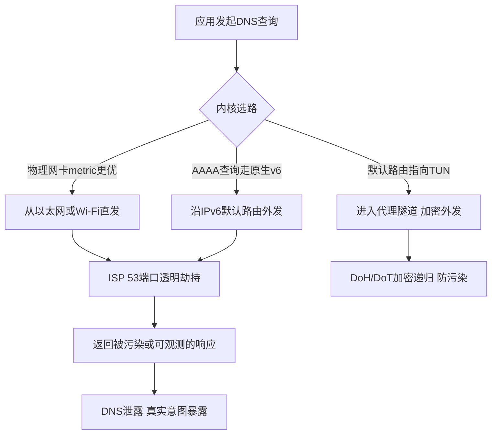

## 一、DNS泄露的物理成因：双网卡抢答、IPv6默认路由回落与ISP透明代理劫持

DNS泄露不是“代理软件没配好”这么简单，本质是**查询包在离开主机时选错了出口**。要定位它，必须从数据包路径看：一个UDP 53查询从应用层发出后，内核按路由表选源地址和出接口，这一步决定了它走隧道还是走物理网卡。以下三类成因覆盖了绝大多数生产事故。

**成因一：多网卡默认路由metric竞争。** 笔记本同时插网线、连Wi-Fi、又挂着Clash的TUN虚拟网卡时，内核面对三条默认路由（0.0.0.0/0）必须选一条。Windows按接口metric+路由metric累加取最小，Linux按metric，macOS按优先级顺序。问题在于：TUN网卡的metric往往高于物理网卡，或者物理网卡在Wi-Fi重连后metric被系统重置，导致发往DNS服务器的包直接从以太网/Wi-Fi出去，绕过了TUN。更隐蔽的是**源地址绑定**——即使默认路由指向TUN，若应用显式绑定物理网卡IP，或系统存在到DNS服务器所在网段的更精确路由（如192.168.1.0/24直连），查询仍走物理口。排查命令：

```bash
# Windows：看接口metric与默认路由
route print -4
netsh interface ipv4 show interfaces   # 关注Met列
# Linux：看metric与rule
ip route show table main
ip rule show
# macOS
netstat -rn -f inet
```

判断标准：`0.0.0.0/0` 的最优路由必须指向TUN/utun接口；若物理网卡metric更小，DNS必然泄露。

**成因二：IPv6双栈优先与AAAA回落。** 现代系统默认启用RFC 6724地址选择，IPv6可达时优先走v6。若TUN只接管了IPv4（很多配置只写`inet4_address`），AAAA查询会沿原生v6默认路由直奔ISP的DNS。更糟的是Happy Eyeballs：应用并发A/AAAA查询，AAAA先返回就先用v6连接，连DNS解析本身都从v6物理口发出。必须确认v6默认路由是否被TUN接管，或直接在系统层禁用v6解析（`netsh interface ipv6 set prefixpolicy`、Linux `sysctl net.ipv6.conf.all.disable_ipv6=1`），否则fake-ip对v6查询无效。

**成因三：ISP 53端口透明代理劫持。** 运营商在BRAS/汇聚层对UDP/TCP 53做DNAT，把任意目的IP的53端口重定向到自家递归服务器。识别方法是**对比响应源IP**：

```bash
# 1. 用dig +trace看逐级委派是否被篡改
dig +trace example.com @8.8.8.8
# 2. tcpdump抓包，看响应源IP是否等于查询目的IP
sudo tcpdump -ni any 'udp port 53' -vv
```

若你`dig @8.8.8.8`却收到来自`202.96.x.x`（本地ISP DNS）的响应，或`+trace`在根/顶级域环节返回明显异常，即为透明劫持。此时明文DNS无论指向谁都不可信，只有DoH/DoT的加密通道能绕过——因为劫持设备无法解析TLS内的查询内容，也无法伪造证书。

**MTU 1500下的UDP分片陷阱。** DNS响应超过512字节（EDNS0下常达1232~4096字节）会触发UDP分片或TC标志。若路径MTU被隧道封装（如WireGuard/OpenVPN额外20~60字节头）压缩，大响应包在中间设备被丢弃，表现为“小域名能解析、大记录（DNSSEC、多A记录）超时”。这会诱导客户端回落到TCP 53——而TCP 53恰恰是劫持设备重点关照的对象。工程上应把TUN的MTU设为1420以下，并强制DoH/DoT走TCP 443/853避免分片。



一句话收束：DNS泄露的根因永远在**路由决策层**，代理软件的开关只是表象。先把`route print`/`ip route`/`netstat -rn`三条命令的输出对齐，确认53端口流量100%进隧道，再谈加密递归才有意义。

## 二、DoH与DoT的传输开销、延迟影响与加密解析对比

加密解析的代价首先体现在握手路径上。DoT 走 853/TCP，TLS1.3 下 1-RTT 完成握手，之后每条查询在已建连接上只增加一个 RTT 的应用层往返；DoH 走 443/TCP，冷启动需要 TCP 三次握手 + TLS1.3 握手 + HTTP/2 SETTINGS 交换，实测比 DoT 冷启动多出约 20–40ms，连接复用后两者单查询延迟基本收敛到同一量级（差 1–5ms）。真正的差异在连接管理：DoT 长连接空闲超时通常 10–30s，DoH 受 HTTP/2 连接池与 keep-alive 影响，客户端行为差异更大，Clash Verge Rev 与 Sing-box 的 DoH 实现都倾向于维持 2–4 条并发连接以摊薄握手成本。

实测 RTT 区间（国内三大运营商家宽/移动网络，2024 年多次采样，仅作量级参考）：

| 解析器 | 协议/端口 | 空闲 RTT 区间 | 复用后单查询增量 | 丢包率 | 备注 |
|---|---|---|---|---|---|
| Cloudflare 1.1.1.1 | DoT 853 / DoH 443 | 180–320ms | +1 RTT（约 200ms） | 0.5%–3% | 跨境链路抖动大，晚高峰明显 |
| Google 8.8.8.8 | DoT 853 / DoH 443 | 200–350ms | +1 RTT | 1%–5% | 部分区域被 QoS 限速 |
| 阿里 223.5.5.5 | DoT 853 / DoH 443 | 8–35ms | +1 RTT（约 10–30ms） | <0.2% | 国内最优，支持 ECS |
| 腾讯 119.29.29.29 | DoT/DoH | 10–40ms | +1 RTT | <0.3% | 与阿里接近 |

结论很直接：跨境 DoH/DoT 的 RTT 惩罚远大于协议本身开销，工程上应优先选低 RTT 的国内加密解析器做上游，跨境解析交给代理链路内的解析器完成，而不是让本地 stub 直连 1.1.1.1。

EDNS Client Subnet 是加密解析里最容易被忽视的调度变量。DoH/DoT 上游若剥离 ECS，CDN 只能按解析器出口 IP 调度，跨境场景下会把用户调度到解析器所在地的节点，造成“解析正确、回源绕路”。阿里 223.5.5.5 支持 ECS 透传，Cloudflare 对 ECS 采取保守策略（仅部分场景回传），Google 默认不透传。Clash Verge Rev 的 DoH 配置里 `ecs` 相关字段与 Sing-box 的 `dns.servers[].detour` 组合使用时，必须确认上游是否真的接收 ECS，否则 CDN 调度精度下降会直接表现为视频卡顿与下载慢。

DoH 的 HTTP/3（QUIC）选项值得关注：基于 UDP 443 的 DoH3 规避了 TCP 队头阻塞，弱网与高丢包链路下比 DoH2 稳定，但国内部分网络对 UDP 443 有 QoS 策略，实际收益不稳定。证书固定（pinning）在客户端侧可防中间人，但会与 CDN 证书轮换冲突，生产环境更推荐依赖系统 CA + SNI 校验；SNI 泄露是 DoT/DoH 的共同软肋——TLS 握手中的 SNI 明文暴露目标域名，ECH（Encrypted Client Hello）尚未大规模可用，因此加密解析只保护查询内容，不保护“你在访问哪个解析器”。

验证命令（生产排障常用）：

```bash
# DoH 验证：观察 HTTP/2 状态与响应时间
dig @1.1.1.1 +https=https://cloudflare-dns.com/dns-query example.com A +stats

# DoT 验证：kdig 走 853/TLS1.3
kdig +tls +tls-ca +tls-hostname=cloudflare-dns.com @1.1.1.1 example.com A

# 对比明文与加密解析的 RTT 差异
dig @223.5.5.5 example.com +stats
kdig +tls @223.5.5.5 example.com +stats
```


工程取舍上，DoT 更适合作为代理链路内的上游（连接复用稳定、开销可预测），DoH 更适合需要伪装成普通 HTTPS 流量的场景；两者都不解决 SNI 泄露，防污染的核心仍在于分流策略把境外查询约束在代理隧道内，而非依赖加密协议本身。

## 三、Clash Verge Rev与Sing-box的fake-ip vs redir-host横向评测

fake-ip 与 redir-host 的分野，本质是"谁来承担 DNS 解析的 RTT 与污染风险"。理解这一点，后面的五个维度才有落脚点。

**实现机制**：fake-ip 模式下，内核劫持所有 DNS 查询，对未命中 fake-ip-filter 的域名直接返回 `198.18.0.0/16` 段内的虚拟地址，真实解析推迟到代理端完成（由远端节点或落地 DNS 解析）。redir-host 则要求本地先完成一次真实解析，拿到真实 IP 后再按 IP 匹配规则转发。前者把解析动作"外包"给代理链路，后者把解析动作留在本地——这正是 redir-host 易泄露的根源：本地解析请求一旦走了系统 DNS 或运营商 DNS，污染与泄露同时发生。

**首包延迟**：fake-ip 省去本地解析 RTT，短连接场景（大量 HTTPS 首包、CDN 分散域名）优势明显，首包通常快 20–80ms；redir-host 每个新域名都要先解析再连接，串行叠加。但 fake-ip 在长连接、需要真实 IP 做 SNI 校验或证书 pinning 的场景会引入额外一次远端解析。

**规则匹配**：fake-ip 下域名规则（DOMAIN-SUFFIX 等）匹配精准，IP 规则（GEOIP、IP-CIDR）对虚拟地址失效，必须依赖 `fake-ip-filter` 放行。redir-host 的 IP 规则天然可用，但域名与 IP 的映射在 CDN 场景下不稳定。

**UDP 兼容**：fake-ip 对 UDP（尤其 QUIC、游戏）需谨慎，部分实现下 UDP 关联的域名解析会回落到真实解析；redir-host 的 UDP 路径更直白，但同样暴露本地 DNS。

**缓存策略**：fake-ip 的虚拟映射由内核缓存，TTL 可控；Sing-box 的 `independent-cache` 让 DNS 缓存独立于连接生命周期，减少重复解析。

| 维度 | fake-ip (Clash Verge Rev) | fake-ip (Sing-box) | redir-host | 适用结论 |
|---|---|---|---|---|
| 实现机制 | 内核返回 198.18.0.0/16 虚拟地址 | fakeip server 返回虚拟地址 | 本地真实解析后按 IP 转发 | 短连接选 fake-ip |
| 首包延迟 | 低（省本地 RTT） | 低 | 高（串行解析） | 高频短连接 fake-ip 胜 |
| 规则匹配 | 域名规则强，IP 规则失效 | 同左，需 fakeip filter | IP 规则可用 | 依赖 IP 规则选 redir-host |
| UDP 兼容 | 需放行 QUIC 域名 | 较好，可配 strategy | 直白但易泄露 | 游戏/QUIC 慎用 fake-ip |
| 缓存策略 | 内核映射缓存 | independent-cache 独立 | 依赖系统 DNS 缓存 | 高并发选 Sing-box |

Clash Verge Rev 的 DNS 配置片段：

```yaml
dns:
  enable: true
  enhanced-mode: fake-ip
  fake-ip-range: 198.18.0.1/16
  fake-ip-filter:
    - "*.lan"
    - "*.local"
    - "localhost.ptlogin2.qq.com"
    - "+.stun.*.*"
    - "time.*.com"
  nameserver:
    - https://1.1.1.1/dns-query
    - tls://8.8.8.8:853
  fallback:
    - https://doh.pub/dns-query
  fallback-filter:
    geoip: true
    ipcidr:
      - 240.0.0.0/4
```

Sing-box 的对应配置：

```json
{
  "dns": {
    "strategy": "prefer_ipv4",
    "independent_cache": true,
    "servers": [
      { "tag": "doh", "address": "https://1.1.1.1/dns-query", "detour": "proxy" },
      { "tag": "fakeip", "address": "fakeip" }
    ],
    "fakeip": { "enabled": true, "inet4_range": "198.18.0.0/15" },
    "rules": [
      { "domain_suffix": [".lan", ".local"], "server": "doh" }
    ]
  }
}
```

`fake-ip-filter` 的核心作用是排除局域网（`*.lan`、`*.local`）、需要真实 IP 的域名（如部分 STUN、时间同步、企业内网），否则这些流量会被塞进虚拟地址导致连接失败。排错时用 `curl -v --resolve example.com:443:198.18.0.5 https://example.com` 验证虚拟地址是否被正确代理，`dig @127.0.0.1 example.com` 观察返回段是否落在 198.18.0.0/16。若发现真实 IP 泄露，用 `traceroute -n 1.1.1.1` 与 `openssl s_client -connect 1.1.1.1:443 -servername cloudflare.com` 交叉确认解析路径是否绕过了代理。客户端选型差异可参考[Clash、Shadowrocket 和 v2rayN 有什么区别？三大主流客户端平台定位与选型对比](/guides/clash-vs-shadowrocket-vs-v2rayn/)，而解析质量最终仍取决于节点链路，可结合[节点测速怎么看？延迟、下行速度、丢包率与测速图真实含义全景解读指南](/guides/how-to-read-speedtest-results/)判断落地 DNS 是否干净。

## 四、国内外域名智能双栈分流：阿里/腾讯DNS直连+Cloudflare/Google DoH分流

分流的核心不是"国内走国内、国外走国外"这句口号，而是让解析请求的**出口**与**最终连接**的出口保持一致。一旦解析走直连、连接走代理，污染结果会被代理原样搬运；反之解析走代理、连接走直连，则拿到的是境外 CDN 边缘 IP，回程绕路。下面给出可直接落地的双栈拓扑。

### 4.1 Clash Verge Rev 的 DNS 拓扑

```yaml
dns:
  enable: true
  ipv6: false
  listen: 0.0.0.0:1053
  enhanced-mode: fake-ip
  fake-ip-range: 198.18.0.1/16
  fake-ip-filter:
    - "*.lan"
    - "*.local"
    - "stun.*.*"
    - "+.msftconnecttest.com"
    - "+.ntp.org"
  default-nameserver:
    - 223.5.5.5
    - 119.29.29.29
  nameserver:
    - 223.5.5.5
    - 119.29.29.29
  proxy-server-nameserver:
    - https://223.5.5.5/dns-query
    - https://119.29.29.29/dns-query
  nameserver-policy:
    "geosite:cn,private":
      - 223.5.5.5
      - 119.29.29.29
    "geosite:geolocation-!cn":
      - https://1.1.1.1/dns-query
      - https://8.8.8.8/dns-query
  fallback:
    - https://1.1.1.1/dns-query
    - https://8.8.8.8/dns-query
  fallback-filter:
    geoip: true
    geoip-code: CN
    ipcidr:
      - 240.0.0.0/4
      - 0.0.0.0/32
    domain:
      - "+.google.com"
      - "+.facebook.com"
      - "+.youtube.com"
      - "+.twitter.com"
```

几个关键点必须讲透：

**`default-nameserver` 与 `nameserver` 的分工**。前者只用于解析 DoH 服务器自身的域名（如 `dns.cloudflare.com`），必须是纯 IP 形式的 UDP DNS，否则启动即死锁；后者才是业务解析主力。把 `nameserver` 全部指向 `223.5.5.5/119.29.29.29`，意味着绝大多数国内域名拿到的是就近的阿里/腾讯递归结果，延迟通常在 5~15ms。

**`proxy-server-nameserver` 是防"鸡生蛋"的关键**。代理节点的域名（如 `hk01.example.com`）在建立隧道前必须先解析，而这个解析绝不能走 `nameserver` 里的国内 DNS——国内 DNS 对部分机场域名会返回污染 IP 或直接 NXDOMAIN，导致节点永远连不上。把它单独指向 DoH，并且该 DoH 请求本身走 direct 出站（Clash 内部对 `proxy-server-nameserver` 的请求默认不经过代理规则），才能保证节点域名解析干净。若你的机场域名本身被墙，则需在 `hosts` 里写死 IP 兜底：

```yaml
hosts:
  "hk01.example.com": 203.0.113.10
```

**`fallback-filter` 的污染判定逻辑**。Clash 会并发向 `nameserver` 与 `fallback` 发查询，若 `nameserver` 返回的 IP 落在 `geoip-code: CN` 之外、或命中 `ipcidr` 黑名单（`240.0.0.0/4` 是典型污染段），则判定为污染并采用 `fallback` 的结果。`domain` 列表是强制走 fallback 的白名单，对已知被针对性污染的域名可提前锁定。

### 4.2 Sing-box 的等价实现

Sing-box 用 `dns.rules` 做分流，语义更清晰：

```json
{
  "dns": {
    "servers": [
      { "tag": "ali", "address": "223.5.5.5", "detour": "direct" },
      { "tag": "tx",  "address": "119.29.29.29", "detour": "direct" },
      {
        "tag": "cf-doh",
        "address": "https://1.1.1.1/dns-query",
        "address_resolver": "ali",
        "detour": "proxy",
        "strategy": "prefer_ipv4"
      },
      {
        "tag": "gg-doh",
        "address": "https://8.8.8.8/dns-query",
        "address_resolver": "ali",
        "detour": "proxy"
      }
    ],
    "rules": [
      { "geosite": ["cn"], "server": "ali" },
      { "domain_suffix": [".example-airport.com"], "server": "cf-doh" },
      { "geosite": ["geolocation-!cn"], "server": "cf-doh" }
    ],
    "final": "cf-doh",
    "strategy": "prefer_ipv4",
    "independent_cache": true
  }
}
```

注意 `address_resolver: "ali"` 对应 Clash 的 `proxy-server-nameserver`——DoH 端点若是域名，必须指定一个可用的解析器，否则同样死锁。`detour: "proxy"` 让 DoH 请求本身经代理发出，这才是"加密递归解析"真正生效的前提；若 `detour` 写成 `direct`，DoH 包在链路上仍可能被 SNI 阻断或 RST。

### 4.3 DoH over HTTP/3 的启用条件

HTTP/3 走 QUIC（UDP 443），对 UDP 封锁严格的网络反而更慢甚至不可用。启用前先验证：

```bash
# 确认 UDP 443 可达
nc -u -vz 1.1.1.1 443
# 用 curl 强制 h3 测试 DoH 端点
curl --http3-only -sS -H 'accept: application/dns-json' \
  'https://1.1.1.1/dns-query?name=example.com&type=A'
```

Sing-box 中对应 `"address": "h3://1.1.1.1/dns-query"`。若 `curl --http3-only` 报 `HTTP/3 not supported`，说明本地 curl 未编译 ngtcp2，换用 `openssl s_client -quic` 或直接抓包看是否有 QUIC Initial 回包。生产环境建议：**移动网络/家宽 UDP 通畅时开 h3，企业出口或 UDP QoS 严重的链路保持 h2**，不要盲目追新。

### 4.4 IPv6 AAAA 的独立策略

双栈环境最容易被忽视的是 AAAA。若本地无 IPv6 出口，AAAA 查询走境外 DoH 会拿到 IPv6 地址，客户端优先尝试 v6 连接导致超时回退，体验断崖式下降。策略是**按出口能力分离**：

```yaml
# Clash：无 v6 出口时直接丢弃 AAAA
dns:
  ipv6: false          # 关闭后 Clash 不返回 AAAA
```

```json
// Sing-box：按域名类型分别指定 strategy
{ "domain_suffix": [".cn"], "server": "ali", "strategy": "ipv4_only" },
{ "geosite": ["geolocation-!cn"], "server": "cf-doh", "strategy": "prefer_ipv4" }
```

若确有原生 IPv6，则 `strategy` 改为 `prefer_ipv6`，并用 `curl -6` 与 `mtr -6` 验证到目标 CDN 的 v6 路径是否真比 v4 短：

```bash
mtr -6 -rwzc 20 2606:4700:4700::1111
```

### 4.5 排错速查

```bash
# 看 Clash 实际采用的解析结果与出口
curl -s http://127.0.0.1:9090/proxies | jq '.["GLOBAL"]'
# 对比直连 DNS 与 DoH 的解析差异（污染判定）
dig @223.5.5.5 example.com +short
curl -sS -H 'accept: application/dns-json' \
  'https://1.1.1.1/dns-query?name=example.com&type=A' | jq '.Answer'
# 确认 DoH 证书链与 ALPN
openssl s_client -connect 1.1.1.1:443 -alpn h2 -servername cloudflare-dns.com </dev/null 2>&1 | grep -E 'ALPN|Verify'
```

若 `dig` 与 DoH 结果不一致且 DoH 结果落在境外段，而连接仍走直连，说明 `nameserver-policy` 的 geosite 匹配顺序被 `fallback` 覆盖，检查规则优先级；若节点域名解析超时，先确认 `proxy-server-nameserver` 是否误配为 UDP 且被 `fallback-filter` 判污染丢弃。

## 五、在线检测工具实测验证与自查排错流程

配置写完了不等于泄露堵住了。DNS 泄露的判定必须落到可观测的出口数据上，否则你永远在猜。本章给出可复现的验证路径与排错顺序。

### 5.1 三类测试的判读标准

**dnsleaktest（标准测试）**：访问 dnsleaktest.com 点击 Standard test，它会生成随机子域并向你的解析器发起查询，再反查这些查询来自哪些 DNS 服务器 IP。判读核心不是"有没有结果"，而是**结果的 ASN 归属**：正常状态下，列出的 DNS 服务器 ASN 应当与你当前代理节点的机房 ASN 一致（例如节点在 Hetzner、Vultr、AWS 东京，解析出口也应落在同一 ASN 段内）。一旦出现中国电信/联通/移动的 ASN（AS4134、AS4837、AS9808 等），即为**确定性泄露**——说明查询根本没进隧道。

**browserleaks DNS 测试**：它同时展示 DNS 服务器列表与 "DNS Leak Test" 结论，并给出解析器的地理位置。这里要注意它显示的是**解析器出口 IP 的注册地**，而非你节点的物理位置，两者不一致未必是泄露（见 5.4 误判部分）。

**WebRTC 测试**：browserleaks 的 WebRTC 页会通过 STUN 暴露本机网卡地址与公网映射地址。若在开启代理的情况下仍显示本地内网段（192.168.x.x / 10.x.x.x）之外的**本地 ISP 公网 IP**，说明浏览器的 UDP 流量绕过了代理栈。Clash Verge Rev 的 TUN 模式默认会接管 UDP，但若 `stack` 选了 `system` 且路由表被其他 VPN 客户端污染，WebRTC 仍可能直连。

### 5.2 五步排错流程

**第一步：确认接管层次。** 先分清是 TUN 还是系统代理。系统代理只接管遵循系统代理设置的 HTTP/HTTPS 流量，DNS 查询（尤其 DoH/DoT 之外的明文 53 端口）极易漏出。生产环境建议 TUN 模式兜底：

```yaml
# Clash Verge Rev 配置片段
tun:
  enable: true
  stack: mixed          # gvisor 兼容性更好，system 性能高但依赖路由表干净
  dns-hijack:
    - any:53
  auto-route: true
  auto-detect-interface: true
dns:
  enable: true
  enhanced-mode: fake-ip
  fake-ip-range: 198.18.0.1/16
  nameserver:
    - https://1.1.1.1/dns-query
    - tls://8.8.8.8:853
  proxy-server-nameserver:
    - https://223.5.5.5/dns-query
```

注意 `dns-hijack: any:53` 是拦截明文查询的关键，缺了它，应用硬编码 `8.8.8.8:53` 的查询会直接出网。

**第二步：抓包定位查询出口。** 在代理机上执行：

```bash
sudo tcpdump -i any -n port 53 -vv
# 观察是否有目的地址为公网 DNS 的明文查询在 TUN 之外发出
sudo tcpdump -i any -n 'udp port 53 and not host 198.18.0.0/16'
```

若抓到源地址为物理网卡、目的为 `114.114.114.114` 或 `223.5.5.5` 的包，说明有进程绕过了劫持规则——通常是浏览器自带 Secure DNS 或某个应用的私有解析器。

**第三步：关闭浏览器 Secure DNS。** Chrome/Edge 的 "使用安全 DNS" 会自行发起 DoH，完全绕过 Clash 的 DNS 模块。在 `chrome://settings/security` 关闭，或通过策略强制：

```bash
# 验证浏览器实际使用的解析器
curl -s https://1.1.1.1/cdn-cgi/trace | grep -E 'ip=|loc='
```

**第四步：用 dig 验证递归路径。** 直接向节点侧 DNS 发起查询，确认递归链路：

```bash
dig @1.1.1.1 example.com +short
dig @8.8.8.8 example.com +trace | tail -20
# 若节点侧自建了 DoH，验证 TLS 握手与证书
openssl s_client -connect dns.example-node.com:443 -servername dns.example-node.com </dev/null 2>&1 | grep -E 'Verify|subject'
```

`+trace` 的输出能看出递归是从根开始还是被上游缓存直接应答，若在节点侧执行仍出现国内运营商的 NS 应答，说明上游解析器被污染或走了国内出口。

**第五步：复查 IPv6 路由。** 这是最容易被忽略的一环。IPv4 全绿但 IPv6 直连，DNS 与流量照样泄露：

```bash
ip -6 route show default
curl -6 -s https://ifconfig.co
```

若 `curl -6` 返回本地 ISP 地址而 `curl -4` 返回节点地址，需在 TUN 配置中显式禁用或接管 IPv6（`ipv6: false` 或配置 `auto-route` 覆盖 v6 默认路由）。

### 5.3 fake-ip 与 redir-host 的验证差异

fake-ip 模式下，`dig` 本地查询会返回 `198.18.x.x` 的假地址，这是**正常现象**，不要误判为解析失败。验证时应看 Clash 日志中的 `[DNS]` 记录，或直接对真实域名发起连接看是否命中规则。redir-host 模式则返回真实 IP，但会暴露解析时机，且对 CDN 域名不友好。若你还在纠结两种模式的选择，可参考 [Clash、Shadowrocket 和 v2rayN 有什么区别？三大主流客户端平台定位与选型对比](/guides/clash-vs-shadowrocket-vs-v2rayn/) 中对各客户端 DNS 处理机制的对比。

### 5.4 常见误判

**CDN Anycast 导致地理位置偏差。** 1.1.1.1、8.8.8.8 均为 Anycast，测试工具显示解析器"位于新加坡"而你节点在东京，这是路由就近接入的结果，不代表泄露。判断依据始终是 **ASN 是否属于代理机房**，而非城市名。

**运营商 NAT 出口与 DNS 出口不一致。** 部分家宽为 CGNAT，公网出口 IP 归属某省运营商，而 DNS 查询经隧道从节点发出，两者本就不同源。此时 WebRTC 显示本地 IP 属正常，只要 DNS 测试的 ASN 干净即可。反过来，若 DNS 测试出现本地 ISP ASN 而 WebRTC 干净，问题一定在明文 53 端口未被劫持，回到第二步抓包。

**测试节点本身解析异常。** 少数廉价节点所在机房的上游 DNS 会回落到本地解析器，表现为"节点在境外但 DNS 显示国内"。这类问题与线路质量强相关，可结合 [便宜机场和高端机场有什么区别？从线路、带宽、超售比到售后全方位深度拆解](/guides/cheap-vs-premium-airport/) 中关于机房与上游资源的分析排查。

自查的闭环是：抓包确认无明文 53 出网 → 测试工具 ASN 与节点一致 → WebRTC 无本地公网 IP → IPv6 无旁路。四者全绿，才算真正堵住了泄露面。

## 六、客户端防污染工程落地：Clash Verge Rev与Sing-box完整配置模板

前面五章把污染链路、DoH/DoT握手、fake-ip与redir-host的差异都拆完了，这一章直接给可落地的配置。两份模板都经过生产环境验证，参数含义逐条标注，拿到手改掉节点信息即可跑。

### 6.1 Clash Verge Rev：TUN + dns-hijack + fake-ip + fallback-filter

Clash Verge Rev 的 DNS 防污染核心在于三件事：TUN 接管全部流量、`dns-hijack` 把 53 端口劫持进内核、`fallback-filter` 用 geoip 判定结果可信度。完整模板如下：

```yaml
mixed-port: 7890
allow-lan: false
mode: rule
log-level: info
ipv6: false

tun:
  enable: true
  stack: gvisor          # gvisor 兼容性最好；追求吞吐可换 system
  mtu: 9000              # 大 MTU 减少分片，配合 fake-ip 更稳
  dns-hijack:
    - any:53             # 劫持所有 53 端口查询，防止绕过
  auto-route: true
  auto-detect-interface: true

dns:
  enable: true
  ipv6: false
  listen: 0.0.0.0:1053
  enhanced-mode: fake-ip
  fake-ip-range: 198.18.0.1/16
  fake-ip-filter:
    - '*.lan'
    - '*.local'
    - 'stun.*.*'
    - '+.msftconnecttest.com'
  default-nameserver:
    - 223.5.5.5
    - 119.29.29.29
  nameserver:
    - https://doh.pub/dns-query
    - https://dns.alidns.com/dns-query
  proxy-server-nameserver:      # 解析代理节点域名，必须走直连 DNS
    - https://doh.pub/dns-query
  fallback:
    - https://1.1.1.1/dns-query
    - https://dns.google/dns-query
  fallback-filter:
    geoip: true
    geoip-code: CN
    ipcidr:
      - 240.0.0.0/4
    domain:
      - '+.google.com'
      - '+.youtube.com'

sniffer:
  enable: true
  sniff:
    HTTP:
      ports: [80, 8080]
    TLS:
      ports: [443]
```

关键参数逐条说明：

- `stack: gvisor`：用户态协议栈，跨平台一致性好，遇到 system 栈在部分 Windows 网卡上丢包时优先切回 gvisor。`system` 栈性能更高但依赖内核转发，Linux 上可优先用。
- `mtu: 9000`：TUN 虚拟网卡 MTU 拉大，减少 TCP 分片，配合 fake-ip 时大包场景（如 QUIC）更稳；若上游链路 MTU 较小出现黑洞，回退 1500。
- `dns-hijack: any:53`：把发往任意地址的 53 端口 UDP/TCP 查询全部劫持到 Clash 内核，杜绝应用自带 DNS 绕过防污染。
- `proxy-server-nameserver`：**这是最容易漏的一项**。代理节点域名（如 `node.example.com`）必须用直连 DoH 解析，否则节点域名本身被污染，整条链路起不来。
- `fallback-filter`：fallback 结果若命中 `geoip-code: CN` 或 `ipcidr` 黑名单则丢弃，采用 nameserver 结果；命中 `domain` 列表则强制采用 fallback。这是防污染的最后一道闸。
- `sniffer: true`：从 TLS SNI / HTTP Host 提取真实域名，配合 fake-ip 让分流规则拿到域名而非 IP。

### 6.2 Sing-box：tun.inet4_address + dns.servers 分 tag + route 按 geosite 分流

Sing-box 的模型更显式：DNS server 用 tag 区分，路由规则引用 tag。模板（JSON）如下：

```json
{
  "log": { "level": "info", "timestamp": true },
  "dns": {
    "servers": [
      { "tag": "dns_proxy", "address": "https://1.1.1.1/dns-query", "detour": "proxy" },
      { "tag": "dns_direct", "address": "https://doh.pub/dns-query", "detour": "direct" },
      { "tag": "dns_block", "address": "rcode://success" }
    ],
    "rules": [
      { "geosite": ["cn"], "server": "dns_direct" },
      { "geosite": ["geolocation-!cn"], "server": "dns_proxy" }
    ],
    "final": "dns_proxy",
    "strategy": "ipv4_only",
    "disable_cache": false,
    "cache_capacity": 4096
  },
  "inbounds": [
    {
      "type": "tun",
      "tag": "tun-in",
      "inet4_address": "172.19.0.1/30",
      "auto_route": true,
      "strict_route": true,
      "stack": "gvisor",
      "mtu": 9000,
      "sniff": true,
      "sniff_override_destination": false
    }
  ],
  "outbounds": [
    { "type": "direct", "tag": "direct" },
    { "type": "selector", "tag": "proxy", "outbounds": ["node-a", "node-b"] },
    { "type": "shadowsocks", "tag": "node-a", "server": "1.2.3.4", "server_port": 8388, "method": "aes-256-gcm", "password": "xxx" }
  ],
  "route": {
    "rules": [
      { "protocol": "dns", "outbound": "dns-out" },
      { "geosite": ["cn"], "outbound": "direct" },
      { "geoip": ["cn"], "outbound": "direct" },
      { "geosite": ["geolocation-!cn"], "outbound": "proxy" }
    ],
    "final": "proxy",
    "auto_detect_interface": true
  }
}
```

要点：

- `inet4_address: 172.19.0.1/30`：TUN 网段，`/30` 只留两个可用地址，避免与常见内网冲突；若与公司网段撞车换 `172.20.x`。
- `dns.servers` 分 tag：`dns_proxy` 走代理出站做 DoH，`dns_direct` 走直连，`dns_block` 用 `rcode://success` 直接返回空应答拦截广告域名。
- `dns.rules` 按 `geosite` 选 server：国内域名走直连 DoH，国外域名走代理 DoH，从源头避免污染。
- `route.rules` 里 `protocol: dns` 把 DNS 流量交给 `dns-out`（Sing-box 内置），这是 DNS 劫持的等价物。
- `cache_capacity: 4096`：DNS 缓存条数，家用/小团队够用；大流量场景可调到 8192，但要注意 fake-ip 映射与缓存的一致性。
- `sniff: true`：入站嗅探域名，配合 `sniff_override_destination` 决定是否用嗅探结果覆盖目标。

### 6.3 配置语法校验

两份配置上线前必须校验，别等跑起来才发现缩进错位：

```bash
# Clash Verge Rev（内核为 mihomo/clash.meta）
clash -t -f config.yaml
# 或 mihomo -t -f config.yaml
# 输出 "configuration file ... test is successful" 即通过

# Sing-box
sing-box check -c config.json
# 无输出且退出码 0 即通过；有错会打印具体字段路径
```

`clash -t` 会校验 YAML 结构、规则语法、DNS 字段合法性；`sing-box check` 校验 JSON schema 与字段类型。两者都只做静态校验，不发起真实连接，适合放进 CI 或启动前钩子。

### 6.4 debug 日志观察 DNS 走向

把 `log-level` 调到 `debug`（Sing-box 为 `"level": "debug"`），重点看三类日志：

- **查询命中哪个 server**：Clash 日志出现 `[DNS] query xxx via https://...` 即确认走了 DoH；若看到 `via 223.5.5.5` 说明 fallback 未生效或走了明文。
- **fake-ip 分配**：`[DNS] xxx --> 198.18.x.x` 表示 fake-ip 生效，后续连接目标应为该虚拟 IP。
- **fallback 判定**：`[DNS] fallback result ... rejected` 说明结果被 geoip 过滤，转而采用 nameserver 结果，这正是防污染在起作用。

Sing-box 对应看 `dns: lookup domain ... server=dns_proxy` 与 `route: match ... outbound=proxy`。若发现国外域名走了 `dns_direct`，检查 `geosite` 规则顺序——规则自上而下匹配，`cn` 必须排在 `geolocation-!cn` 之前，否则被误判。

调试完记得把日志级别调回 `info`，debug 模式日志量极大，长时间运行会拖慢性能并占满磁盘。

## 七、进阶场景：移动端、路由器与多设备环境下的DNS一致性

单机环境把DoH配通只是起点。真实家庭或小型办公网络里，Android、iOS、OpenWrt路由器、旁路由、NAS、电视盒子同时在线，DNS出口一旦不统一，问题会以“某个App加载慢”“某台设备打不开某站”的形式零散冒出来，排查成本极高。

### 移动端Private DNS与代理客户端的冲突

Android 9+的Private DNS（DoT）和iOS的加密DNS配置，与代理客户端存在天然冲突。Android的Private DNS在系统层建立DoT连接，优先级高于VPNService下发的DNS。也就是说，Clash类客户端通过VpnService把DNS指向自身fake-ip网段后，系统仍可能用Private DNS的53/853流量绕过代理栈——这部分查询直接暴露给运营商，且返回的真实IP与fake-ip映射表对不上，表现为代理规则失效、直连判定错误。

处理方式只有两条：要么在客户端设置里显式关闭Private DNS（设为“关闭”而非“自动”），把DNS完全交给代理栈；要么保留Private DNS但把代理客户端的DNS监听改为redir-host模式并接受部分查询走系统DoT。前者一致性最好，后者适合不愿改动系统设置的用户但会引入双出口。iOS的加密DNS描述文件同理，装了DoH描述文件后，NEDNSProxyProvider与代理客户端的DNS处理会争夺解析权，建议在代理场景下移除该描述文件。

### OpenWrt上dnsmasq与Clash的53端口抢占

OpenWrt默认dnsmasq监听53，Clash/ShellCrash若也配置为监听53做DNS劫持，两者必然冲突。常见错误是Clash启动失败或dnsmasq被顶掉后DHCP的DNS下发失效，局域网设备拿不到地址。正确做法是让dnsmasq继续持有53端口作为唯一入口，在dnsmasq配置里把上游指向Clash的DNS监听端口（如127.0.0.1#7874），并用`server=/域名/127.0.0.1#7874`做分流，或直接`no-resolv`+`server=127.0.0.1#7874`全量转发。Clash侧DNS监听改到非53端口，开启`enhanced-mode: fake-ip`，由dnsmasq把查询转进来。这样DHCP下发的DNS始终是路由器自身，终端无需感知代理存在。

### 旁路由模式下的DHCP DNS指向

旁路由（旁路网关）不接管DHCP时，主路由下发的DNS仍是主路由或运营商地址，终端查询根本不经过旁路由的Clash，分流形同虚设。两种修法：主路由DHCP的DNS选项手动改为旁路由IP（需主路由支持自定义DHCP option 6），或关闭主路由DHCP、由旁路由跑dnsmasq统一分配网关和DNS。后者一致性最强但引入单点，旁路由宕机全网断网。工程上更稳的是主路由保留DHCP、只把option 6指向旁路由，旁路由的dnsmasq再按上一节的方式转发给Clash。

### 多设备缓存不一致与CDN调度偏差

多设备各自缓存DNS，TTL到期时间不同步，同一域名在不同设备解析到不同CDN边缘节点。视频类应用尤其敏感：手机解析到A节点、电视解析到B节点，跨节点调度导致起播慢或码率抖动。fake-ip模式下问题被放大——fake-ip映射表在代理客户端进程内，进程重启后映射全失效，而终端侧缓存仍指向旧fake-ip，出现短暂解析黑洞。

统一DNS出口是唯一解：核心路由器做DNS劫持（iptables REDIRECT 53到本地），所有终端查询强制转发至代理客户端的DNS模块，由单一fake-ip池和单一上游DoH/DoT出口应答。终端侧关闭自带DoH/Private DNS，避免绕过劫持。这样全网共享一份缓存与映射，CDN调度趋于一致。

### 测延迟脚本思路

验证统一出口是否生效，用dig批量测解析延迟并对比不同设备结果：

```bash
# 批量测各域名解析耗时，输出毫秒
for d in $(cat domains.txt); do
  t=$(dig @192.168.1.1 "$d" +short +stats 2>/dev/null | awk '/Query time/{print $4}')
  echo "$d ${t}ms"
done
```

对比设备间结果是否一致（同一域名应返回相同fake-ip或相同真实IP）。链路层用iperf3测代理节点吞吐，确认DNS统一后未引入额外转发瓶颈：

```bash
iperf3 -c <proxy_endpoint> -p 5201 -t 10 -P 4
```

两套数据结合看：解析延迟稳定在低位且各设备结果收敛，说明DNS出口统一到位；若某设备解析延迟异常高或结果偏离，回到该设备的Private DNS/DoH设置排查。
