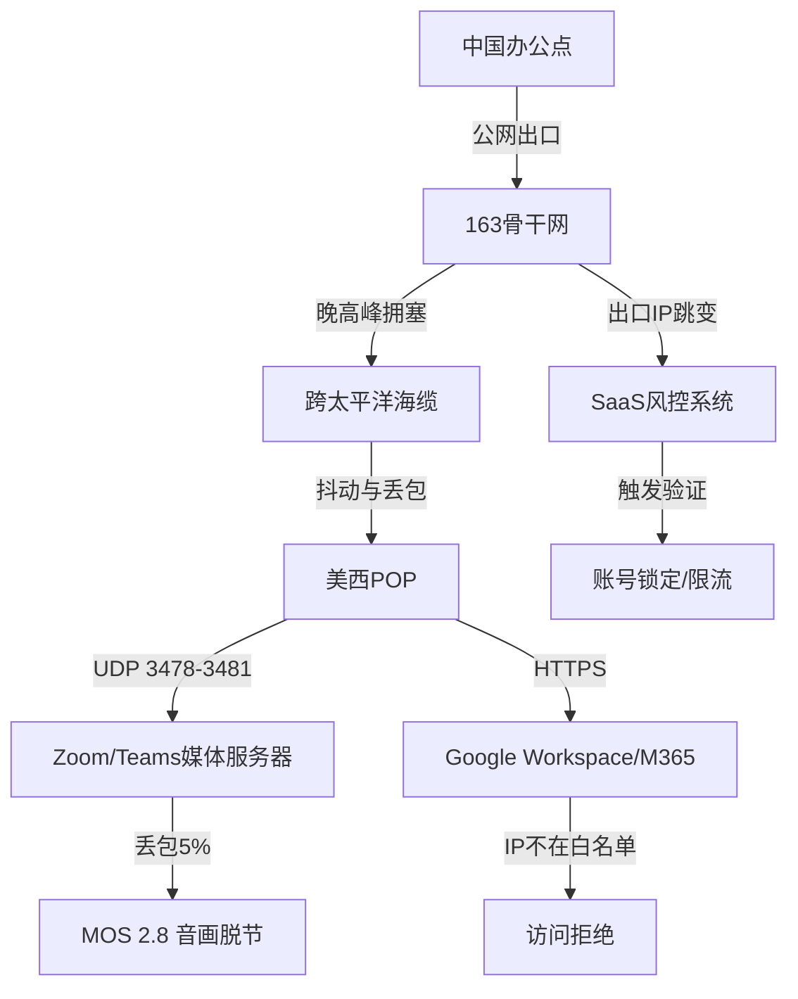
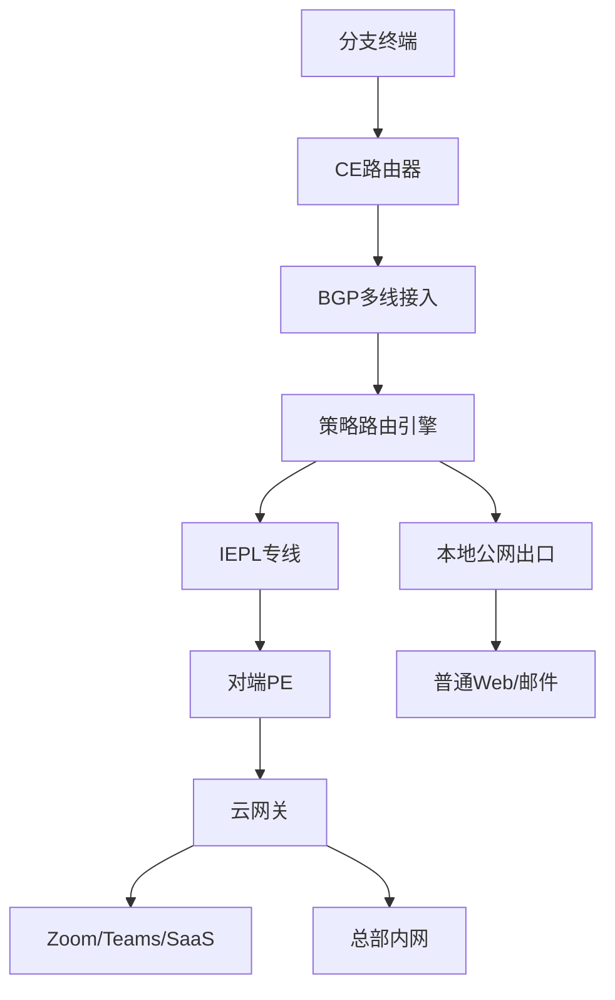

## 跨国远程办公网络核心痛点：公网晚高峰抖动、UDP丢包与SaaS风控

做跨国业务的企业，网络架构师最怕的不是带宽不够，而是公网那条“看不见的抖动曲线”。白天跑得好好的，一到晚上八点，中国到美西的链路就像被掐住了喉咙。我们在一线排障时积累了大量的实测数据，先把问题摊开来看。

### 晚高峰RTT与丢包的真实面貌

以中国电信163骨干网出口到美西Los Angeles节点为例，工作日白天（10:00-17:00）平均RTT稳定在140-160ms，丢包率低于0.5%，这个水平跑视频会议基本可用。但进入晚高峰20:00-23:00，情况急剧恶化：

| 时段 | 平均RTT | 峰值RTT | 丢包率 | 抖动 |
|------|---------|---------|--------|------|
| 10:00-17:00 | 150ms | 180ms | 0.2%-0.5% | ±10ms |
| 20:00-23:00 | 280ms | 320ms | 3%-8% | ±60ms |
| 23:00-01:00 | 200ms | 250ms | 1%-3% | ±30ms |

RTT从150ms翻倍到320ms只是表象，真正致命的是**抖动**和**丢包**的组合拳。TCP协议下，3%的丢包会让吞吐量断崖式下降——因为拥塞控制窗口频繁收缩，实际有效带宽可能只剩标称值的20%。而UDP流量更惨，它没有重传机制，丢了就是丢了。

### UDP丢包对Zoom/Teams的致命影响

Zoom的媒体流走UDP 3478-3481端口（STUN/TURN），Teams同样依赖UDP进行实时音视频传输。我们用ITU-T P.800的MOS评分体系做过对照测试：

| UDP丢包率 | MOS分 | 主观体验 |
|-----------|-------|----------|
| 0% | 4.3-4.5 | 清晰流畅 |
| 1% | 4.0-4.2 | 基本无感 |
| 3% | 3.5-3.8 | 偶有卡顿 |
| 5% | 2.8-3.0 | 音画脱节，机械音 |
| 8% | 2.0-2.5 | 无法正常沟通 |
| 10%+ | <2.0 | 会议中断 |

MOS分2.8是什么概念？相当于对方说话你只能听到断断续续的单词，视频画面像幻灯片一样跳帧。更麻烦的是，Zoom的拥塞控制算法在检测到持续丢包后会主动降低码率，从1080p降到360p甚至更低，但即便如此，音频的连续性仍然无法保证。我们曾经用Wireshark抓包分析过一次典型的晚高峰Zoom会议：20:15开始，前5分钟正常，20:20后UDP丢包率飙到6%，Zoom客户端在30秒内将视频码率从2.5Mbps降到800Kbps，音频开始出现200-400ms的间歇性静音，参会双方频繁互问“你刚才说什么”。

### SaaS风控：出口IP跳变引发的连锁反应

比丢包更隐蔽的坑是SaaS平台的风控机制。Google Workspace、Microsoft 365、Salesforce这些平台都会对登录IP做信誉评估。问题在于，跨国企业分支机构的公网出口往往不是固定IP——尤其是采用多线BGP或SD-WAN方案时，出口IP可能在多个运营商之间跳变。

我们遇到过这样一个真实案例：某外贸团队在上海和深圳各有一个办公点，通过SD-WAN接入，出口IP池有8个地址。员工早上在上海登录Google Workspace，出口IP是A；下午出差到深圳，出口IP变成B。Google的风控系统检测到同一账号在短时间内从不同地理位置的IP登录，直接触发安全验证——弹窗要求输入手机验证码，甚至临时锁定账号。更严重的是，如果出口IP被标记为“高风险”（比如某个IP段曾被用于爬虫或异常流量），整个团队的Workspace访问都会被限流。

Microsoft 365的Conditional Access策略同样敏感。如果企业配置了“仅允许特定IP段访问”的策略，而分支机构的出口IP不在白名单内，Teams登录会直接被拒绝。我们见过最极端的案例：某公司因为出口IP跳变，导致Teams客户端反复弹出“无法验证你的身份”提示，员工被迫改用个人热点，结果又触发了新的风控。

### 问题根因与架构层面的思考

把上述现象串起来看，核心矛盾在于：**公网互联网的“尽力而为”模型，无法满足跨国实时音视频和SaaS访问的确定性要求**。晚高峰抖动是骨干网拥塞的必然结果，UDP丢包是跨洋链路质量波动的直接体现，而SaaS风控则是平台侧对“不可信网络环境”的防御性反应。



这张图清晰地展示了问题链路：从办公点到SaaS平台，中间经过骨干网、海缆、POP多个环节，每个环节都可能成为瓶颈。而传统的“加带宽”思路在这里完全失效——因为问题不在带宽容量，而在链路质量和IP稳定性。

要解决这些问题，必须从网络架构层面入手，用专线级通道替代公网传输，用固定IP出口替代动态跳变。这正是IEPL专线组网要解决的核心命题。下一章我们会展开IEPL的架构设计和部署细节。

## 物理网络层拓扑剖析：传统商业VPN全局隧道 vs BGP多线+IEPL混合智能分流

### 一、传统商业VPN全局隧道的致命缺陷

绝大多数中小外贸团队在起步阶段会选用商业VPN方案，典型代表是深信服、蒲公英、ZeroTier或OpenVPN自建。这类方案的核心逻辑是：在总部与海外分支各部署一台VPN网关，两端建立IPsec或SSL隧道，**所有流量无条件进入隧道**。

拓扑上表现为：

```
终端 → 本地CE路由器 → 公网 → VPN网关（总部）→ 公网 → 目标SaaS
```

问题出在“公网”这两个字上。IPsec隧道本身不提供任何QoS保障，它只是把原始包封装后重新扔进公网。当出口带宽被其他流量占满，或者中间跳数经过国际出口的拥塞节点（例如晚高峰的电信163骨干、移动CMI出海口），隧道内的所有流量——包括Zoom的UDP音视频流——会一起被丢包和抖动拖死。

实测数据：某深圳外贸团队使用OpenVPN全局隧道，晚高峰20:00-22:00期间，Zoom会议MOS分从4.2跌至2.8，Teams通话出现明显断续，而同期本地Web浏览延迟也从80ms飙升至400ms以上。根本原因是**全局隧道没有分流能力**，所有流量共享一条不可控的公网路径。

### 二、BGP多线+IEPL混合智能分流架构

#### 2.1 拓扑结构



#### 2.2 核心机制

CE路由器（通常选用华为AR系列或H3C MSR系列）同时接入两条以上ISP线路，通过BGP与上游建立对等，获得实时路由表。策略路由引擎基于以下规则做分流：

- **UDP 8801-8802（Zoom）、UDP 3478-3481（Teams）**：强制走IEPL专线
- **SaaS域名（salesforce.com、office365.com等）**：通过DNS解析结果匹配IP段，走IEPL
- **HTTP/HTTPS普通浏览、邮件、文件下载**：走本地公网出口
- **总部内网访问（ERP、OA）**：走IEPL

策略路由的匹配优先级高于BGP选路，确保关键流量不被公网拥塞影响。

#### 2.3 IEPL专线的物理特性

IEPL（International Ethernet Private Line）本质是二层透明传输，不经过公网路由跳转。从国内CE到海外PE之间走的是运营商自建的海缆或陆缆资源，中间不经过国际出口的拥塞节点。

关键参数：
- **RTT**：120-150ms（视目的地，香港/新加坡约120ms，美西约150ms）
- **丢包率**：<0.1%（SLA保障，实际生产环境通常<0.05%）
- **带宽**：10M-100M可弹性调整
- **抖动**：<5ms

这个参数意味着Zoom的UDP流在专线上几乎不会触发FEC或重传，MOS分稳定在4.0以上。

### 三、两种方案的多维度对比

| 对比维度 | 传统商业VPN全局隧道 | BGP多线+IEPL混合分流 | 纯IEPL专线 | 纯BGP多线 |
|---------|-------------------|---------------------|-----------|----------|
| 流量路径 | 全部走隧道 | 关键流量走专线，其余走本地 | 全部走专线 | 全部走公网 |
| 晚高峰Zoom MOS | 2.5-3.0 | 4.0-4.5 | 4.0-4.5 | 3.0-3.5 |
| 丢包率 | 1%-5% | <0.1%（专线部分） | <0.1% | 0.5%-3% |
| 月成本（10M） | 500-2000元 | 3000-8000元 | 8000-15000元 | 1000-3000元 |
| 部署复杂度 | 低 | 中高 | 中 | 中 |
| 故障切换 | 无 | BGP自动切换 | 需手动切换 | BGP自动切换 |
| 适用场景 | 5人以下团队 | 10-200人外贸团队 | 50人以上核心业务 | 非实时业务为主 |

### 四、生产环境中的关键配置要点

**策略路由的匹配顺序**：必须先匹配UDP端口，再匹配SaaS IP段，最后放行默认路由。如果顺序颠倒，SaaS流量会被默认路由提前捕获。

**BGP多线的健康检查**：CE路由器需要对每条ISP线路做ICMP探测，当某条线路丢包率超过阈值（建议5%）时，自动撤销该线路的BGP宣告，流量切换至备用线路。切换时间控制在3秒以内。

**IEPL的故障容灾**：IEPL本身是物理专线，存在单点故障风险。生产环境建议采用双PE冗余，即总部和分支各接入两台PE设备，通过VRRP做网关冗余。当主PE故障时，VRRP切换时间<1秒，Zoom会议不会中断。

**云网关的部署**：海外云网关建议部署在AWS Global Accelerator或阿里云全球加速的接入点，利用云厂商的骨干网做最后一公里优化。云网关与IEPL PE之间通过GRE隧道或直接二层对接。

### 五、真实故障场景复盘

某广州外贸公司，80人团队，使用BGP多线+IEPL方案。某日14:00，Zoom会议大面积卡顿。排查发现：IEPL专线本身正常，但CE路由器的策略路由表被一条错误的BGP路由覆盖，导致Zoom的UDP流量被导向了本地公网出口。根因是上游ISP误宣告了一条更具体的路由，BGP选路优先级高于策略路由的默认匹配。

解决方案：在CE路由器上配置**策略路由的强制优先级**，使用`route-map`中的`set ip next-hop`并配合`ip policy route-map`，确保策略路由的匹配结果不被BGP路由表覆盖。同时增加对Zoom IP段的静态路由，优先级设为最高。

这个案例说明：BGP多线+IEPL方案的核心优势在于分流，但分流策略的稳定性依赖于路由器的配置严谨性。任何一条策略路由的失效都可能导致关键流量回退到公网，此时IEPL专线形同虚设。

### 六、选型建议

- **5人以下**：商业VPN足够，成本优先
- **5-20人**：BGP多线+策略路由（不买IEPL），关键流量走优化线路
- **20-200人**：BGP多线+IEPL混合分流，这是外贸团队的甜点区
- **200人以上**：双IEPL+双PE冗余，配合SD-WAN做应用级智能选路

IEPL的带宽不需要太大，10M足够支撑50人同时开Zoom（每路Zoom约1.5-2Mbps）。瓶颈从来不是带宽，而是丢包和抖动。

## 主流外贸协作工具分流策略与DNS防污染机制

外贸团队的远程办公流量,本质上是一组"白名单特征极其明确"的实时协作流量。Zoom、Teams、Google Workspace、Slack 这四类工具占据了 90% 以上的关键业务流,它们的共同特点是:对丢包和抖动极度敏感,但对总带宽需求并不夸张。这意味着分流策略的核心不是"把带宽做大",而是"把这几条流精准识别出来,送上 IEPL 专线,其余流量走本地出口"。

### 一、先摸清各工具的域名与端口画像

分流的前提是识别。以下是生产环境实测整理的端口与域名清单,建议直接作为规则集基线:

| 工具 | 关键 UDP 端口 | 关键 TCP 端口 | 核心域名 | 是否可走代理 | 备注 |
|---|---|---|---|---|---|
| Zoom | 3478-3481、8801-8810 | 443 | `*.zoom.us`、`*.zoomgov.com` | 是 | UDP 走媒体,TCP 走信令与登录 |
| Teams | 3478-3481 | 443 | `*.teams.microsoft.com`、`*.teams.cloud.microsoft` | 是 | 媒体优先 UDP,失败回落 TCP 443 |
| Google Workspace | — | 443 | `*.google.com`、`*.googleapis.com`、`*.gstatic.com` | 是 | 纯 TCP,DoH 与 QUIC 需单独处理 |
| Slack | — | 443、5222 | `*.slack.com`、`*.slack-edge.com` | 是 | 桌面端有 XMPP 长连接 |

一个常见误区是把 Zoom 的 `8801-8810` 当成可选项。实际上在部分运营商网络下,Zoom 会主动切换到这段高位 UDP 端口做媒体传输,如果防火墙只放行 3478-3481,会出现"能进会议但画面卡顿"的诡异现象。Teams 同理,`3478-3481` 是 STUN/TURN 的基准段,但媒体实际端口由服务端动态下发,所以**规则必须按域名而非仅按端口匹配**。

### 二、Clash 规则集写法

分流引擎推荐 Clash.Meta(mihomo)内核,规则集用 `rule-providers` 远程加载,便于多分支统一更新:

```yaml
rule-providers:
  zoom:
    type: http
    behavior: classical
    url: "https://raw.githubusercontent.com/.../zoom.yaml"
    interval: 86400
    path: ./ruleset/zoom.yaml

rules:
  - RULE-SET,zoom,IEPL
  - DOMAIN-SUFFIX,zoom.us,IEPL
  - DOMAIN-SUFFIX,teams.microsoft.com,IEPL
  - DOMAIN-SUFFIX,slack.com,IEPL
  - DOMAIN-SUFFIX,googleapis.com,IEPL
  - GEOIP,CN,DIRECT
  - MATCH,PROXY
```

关键点在于 `GEOIP,CN,DIRECT` 必须放在协作工具规则**之后**。若顺序颠倒,部分 CDN 节点解析到国内 IP 的 Google 流量会被误判直连,导致 Workspace 加载失败。

### 三、DNS 防污染:DoH/DoT 与 fake-ip 的配合

DNS 污染是外贸场景下最隐蔽的故障源。传统 UDP 53 查询在跨境链路上极易被投毒,返回虚假 IP 后,即使代理规则正确,连接也会指向错误目标。解决方案是 DoH/DoT 加密查询,并配合 fake-ip 模式:

```yaml
dns:
  enable: true
  listen: 0.0.0.0:1053
  enhanced-mode: fake-ip
  fake-ip-range: 198.18.0.1/16
  fake-ip-filter:
    - "*.lan"
    - "*.local"
    - "time.*.com"
  nameserver:
    - https://1.1.1.1/dns-query
    - tls://8.8.8.8:853
  fallback:
    - https://dns.google/dns-query
    - tls://1.0.0.1:853
  fallback-filter:
    geoip: true
    geoip-code: CN
    ipcidr:
      - 240.0.0.0/4
```

`fallback-filter` 里的 `geoip:cn` 逻辑是:当主 nameserver 返回的 IP 落在国内段时,判定为可能被污染,转而采用 fallback 结果。fake-ip 模式则让应用拿到一个假 IP(198.18.x.x),由内核在连接时反查真实域名再走规则匹配——这对 Zoom、Teams 这类会做多域名并发解析的工具尤其重要,能避免"解析到污染 IP 后规则失效"。

需要提醒的是,fake-ip 与部分企业内网 DNS 会冲突。如果你的分支有 AD 域控,建议把内网域名加入 `fake-ip-filter`,否则登录域会失败。关于客户端层面的 DNS 行为差异,可参考 [iPhone 用户机场客户端怎么选?Shadowrocket、Stash、Loon 与 Surge 苹果 iOS 深度横评](/guides/iphone-ios-client-selection-guide/),iOS 端各客户端对 fake-ip 的支持粒度差别很大。

### 四、nftables 打 fwmark + ip rule 策略路由

当网关是 Linux 软路由时,分流不能只靠 Clash,还需要内核层的策略路由把标记流量强制送进专线隧道。用 nftables 给协作工具的流量打 fwmark:

```bash
nft add table inet mangle
nft add chain inet mangle prerouting '{ type filter hook prerouting priority mangle; }'
nft add rule inet mangle prerouting ip daddr @zoom_set meta mark set 0x64
nft add rule inet mangle prerouting ip daddr @teams_set meta mark set 0x64
```

再通过 ip rule 把带标记的包导入独立路由表:

```bash
ip rule add fwmark 0x64 table 100
ip route add default dev iplink0 table 100
```

这样即使 Clash 进程崩溃,内核层仍能保证 Zoom/Teams 流量走专线,实现"双保险"。排查时用 `conntrack -L | grep 3478` 确认标记是否生效,用 `mtr -u -P 3478 zoom.us` 观察 UDP 路径丢包。

### 五、诊断与容灾验证

分流规则上线后,必须做端到端验证。以下命令组合能快速定位问题:

```bash
# 确认 DNS 是否返回 fake-ip
dig @127.0.0.1 -p 1053 zoom.us

# 验证 TCP 443 到 Teams 信令
curl -v --resolve teams.microsoft.com:443:198.18.0.5 https://teams.microsoft.com

# 验证证书链是否被中间设备篡改
openssl s_client -connect zoom.us:443 -servername zoom.us

# UDP 媒体路径丢包
mtr -u -P 3478 -c 100 zoom.us
```

若 `openssl` 输出的证书颁发者异常,说明链路上有 TLS 中间人,通常是分支出口的审计设备所致,需要把协作工具域名加入白名单直通。多分支容灾时,建议每个分支保留两条出口:主用 IEPL,备用本地优质线路,通过 Clash 的 `fallback` 代理组自动切换。切换阈值不要只看延迟,更要看丢包率——实时音视频对 1% 以上的持续丢包就已经不可接受,这一点在 [机场延迟多少算正常?为什么低延迟不等于速度快与各地区正常延迟基准全景图](/guides/airport-latency-and-speed-guide/) 中有更详细的量化基准可供参考。

## 企业级双轨高可用容灾拓扑设计：主IEPL+备用商业专线自动探测与无缝切换

主IEPL再稳，也怕市政施工一铲子。2023年Q3华东某节点因地铁施工挖断主干管道，IEPL中断6小时，备用链路如果只是“配了但没启用”，等于没有。双轨容灾的核心不是“有两条线”，而是**探测要准、切换要快、回切要稳**。

### 拓扑与选路原则

主链路走IEPL，备用链路选**不同运营商**的商业专线（如主电信IEPL、备联通MPLS VPN），且物理路由必须分缆。同缆同沟的“双线”在断缆场景下同时阵亡，这是踩过坑的常识。两条链路终结在总部同一台边界路由器或防火墙上，通过VRF或子接口隔离，避免路由泄漏。

探测机制二选一：**IP SLA**（ICMP Echo，适合跨运营商、对端不支持BFD的场景）或**BFD**（毫秒级，适合两端设备都支持且需快速检测）。跨国场景下BFD常因中间设备不支持而失效，所以生产环境我更倾向IP SLA + Track对象，阈值设定为**RTT > 80ms 或丢包率 > 1%**，连续3个周期触发。

### 配置片段：IP SLA + Track + 浮动静态路由

以下为Cisco IOS-XE边界路由器配置，主链路为默认路由，备用链路通过Track对象控制：

```cisco
! 定义IP SLA探测，目标为IEPL对端网关或可靠公网地址
ip sla 1
 icmp-echo 203.0.113.1 source-interface GigabitEthernet0/0/0
 frequency 5
 timeout 2000
 threshold 80
 history lives 3
!
! 丢包率阈值通过react配置，连续3次超1%触发
ip sla reaction-configuration 1 react packet-loss packet-loss 1000 action-type trapOnly
ip sla schedule 1 life forever start-time now
!
! Track对象关联IP SLA
track 1 ip sla 1 reachability
 delay down 10 up 30
!
! 主链路默认路由（IEPL）
ip route 0.0.0.0 0.0.0.0 198.51.100.1 10
! 备用链路默认路由，Track 1失效时自动撤销
ip route 0.0.0.0 0.0.0.0 192.0.2.1 20 track 1
```

关键参数解读：`delay down 10` 表示探测失败后延迟10秒再切换，避免抖动误切；`delay up 30` 表示主链路恢复后延迟30秒回切，防止刚恢复又断导致路由震荡。`threshold 80` 配合 `timeout 2000`，实际触发条件是RTT持续超过80ms或探测超时。

### 诊断与验证

切换后必须验证路径。用 `traceroute` 确认流量走备用运营商：

```bash
traceroute -n -w 2 -q 1 8.8.8.8
# 输出应显示备用运营商网关IP段，而非IEPL对端
```

用 `mtr` 持续观测丢包和延迟：

```bash
mtr --report --report-cycles 100 --tcp --port 443 zoom.us
# 关注Loss%和StDev，备用链路StDev应<15ms
```

验证Track状态：

```bash
show track 1
show ip sla statistics 1
show ip route 0.0.0.0
```

### 切换时间与回切策略

IP SLA 5秒周期 + 3次失败 + 10秒延迟，理论切换时间约25秒，满足<30秒要求。若需更快，可改用BFD（两端支持时）将检测降到300ms，但跨国场景慎用。回切采用延迟30秒，且建议在业务低峰期手动回切，避免TCP会话中断导致Zoom/Teams重连。

### 多分支容灾扩展

分支节点同样部署双轨：主IEPL分支专线 + 备4G/5G或本地宽带。分支侧用OSPF动态路由，通过`ip ospf cost`调整主备优先级，Track对象联动`ip ospf cost`值。总部与分支之间跑OSPF，主链路cost=10，备用cost=100，Track失效时自动切换。

```cisco
! 分支侧OSPF配置
interface GigabitEthernet0/0/1
 ip ospf cost 10
!
interface GigabitEthernet0/0/2
 ip ospf cost 100
!
router ospf 1
 network 10.0.0.0 0.0.0.255 area 0
!
track 1 ip sla 1 reachability
! 通过EEM脚本或route-map联动cost调整
```

### 实战避坑

1. **探测目标选谁**：不要探测对端内网地址，IEPL中断但内网可达会造成误判。探测对端公网网关或运营商PE地址。
2. **NAT与ACL**：备用链路切换后源IP变化，需确保NAT池和ACL同步更新，否则Zoom/Teams会因源IP突变断流。
3. **会话保持**：切换导致TCP重建，建议在防火墙上启用会话同步，或让Zoom/Teams走UDP优先，减少感知。
4. **回切震荡**：主链路不稳定时反复切换，用`delay up 30`和`dampening`抑制。

双轨容灾不是配完就完，每月至少做一次**主动切换演练**，用`clear ip sla statistics`重置计数，手动shutdown主接口验证备用链路真实可用。没演练过的容灾，等于没有容灾。

## 硬件网关与多客户端集中管控部署：软路由Clash/Sing-box透明代理实战

当分支办公室从三五人扩展到三五十人，逐台终端装客户端、逐台维护订阅链接的模式就会崩盘。真正的解法是把代理能力下沉到网关：一台 OpenWrt 或 Debian 设备跑 Clash/Sing-box，用 TUN 模式做透明代理，内网所有终端零配置接入，规则由 Dashboard 统一下发。这一章讲的就是这套架构怎么落地。

### 为什么是 TUN 模式而不是 TProxy

早期透明代理主流是 iptables REDIRECT 或 TProxy，只处理 TCP/UDP 转发，应用层拿到的是伪造源地址，遇到需要真实源 IP 的场景（比如某些 SaaS 的风控、QUIC 连接）容易出问题。TUN 模式在内核里创建一张虚拟网卡，Clash/Sing-box 直接从这张网卡收发原始 IP 包，相当于把自己变成一台三层路由器。好处是：

- 全协议覆盖，TCP/UDP/ICMP 一视同仁，QUIC 不会被降级成 TCP；
- 路由决策在用户态完成，规则引擎能拿到完整五元组；
- 不需要复杂的 iptables 标记链路，维护成本低。

代价是 TUN 设备本身有性能开销，千兆以下出口用 ARM 软路由（如 RK3588、N100）完全够，万兆场景得考虑 x86 + DPDK 方案。

### Debian 上的 Sing-box TUN 配置

生产环境我更倾向 Sing-box，配置结构化、日志清晰、对 TUN 的栈实现（gvisor/system）切换灵活。核心配置片段：

```json
{
  "inbounds": [
    {
      "type": "tun",
      "tag": "tun-in",
      "interface_name": "singtun0",
      "address": ["172.19.0.1/30"],
      "mtu": 1400,
      "auto_route": true,
      "strict_route": true,
      "stack": "system",
      "sniff": true,
      "sniff_override_destination": false
    }
  ],
  "outbounds": [
    { "type": "selector", "tag": "proxy", "outbounds": ["hk-iepl", "sg-iepl", "direct"] },
    { "type": "direct", "tag": "direct" }
  ],
  "route": {
    "rules": [
      { "protocol": "dns", "outbound": "dns-out" },
      { "ip_cidr": ["10.0.0.0/8", "172.16.0.0/12", "192.168.0.0/16"], "outbound": "direct" },
      { "domain_suffix": [".zoom.us", ".teams.microsoft.com", ".office365.com"], "outbound": "proxy" }
    ],
    "auto_detect_interface": true
  }
}
```

`strict_route: true` 很关键，它强制所有流量走 TUN，避免某些应用绕过路由表直连。`sniff` 开启后能从 TLS SNI 里提取域名，配合 `sniff_override_destination` 可以让 IP 直连的请求也命中域名规则。

### MTU 与 MSS Clamp：零丢包的隐形前提

这是最容易被忽略、也最容易背锅的环节。IEPL 专线本身 MTU 通常 1500，但叠加 WireGuard/IPSec 隧道后有效载荷会缩水。如果 TUN 设 1500，终端发出的 1500 字节包经过隧道封装后超过物理链路 MTU，就会被静默丢弃——表现就是「小包能通、大包卡死、Zoom 画面糊成马赛克」。

标准做法是 TUN MTU 设 1400，同时在网关上对转发流量做 MSS clamp：

```bash
# 网关出口网卡为 eth0，TUN 为 singtun0
iptables -t mangle -A FORWARD -p tcp --tcp-flags SYN,RST SYN -j TCPMSS --clamp-mss-to-pmtu
# 若需手动指定，用 --set-mss 1360
iptables -t mangle -A FORWARD -o singtun0 -p tcp --tcp-flags SYN,RST SYN -j TCPMSS --set-mss 1360
```

`--clamp-mss-to-pmtu` 会自动读取出口 PMTU，比硬编码更稳。1360 这个值是 1400 减去 40 字节 TCP/IP 头，留足余量。验证方法：

```bash
# 从内网终端 ping 大包，确认不分片
ping -M do -s 1372 8.8.8.8
# 用 mtr 看路径上哪一跳开始丢包
mtr -n -c 100 --report-wide zoom.us
# 检查实际生效的 MSS
tcpdump -i eth0 -n 'tcp[tcpflags] & tcp-syn != 0' -c 5
```

如果 `ping -M do -s 1372` 通、`-s 1472` 不通，说明 PMTU 就是 1400，配置正确。

### 多客户端集中管控：Dashboard 下发 + 部门分流

几十号人的团队，规则不能写死在每台设备上。做法是网关跑一个 Clash/Sing-box 的规则订阅端点，由 Dashboard（可以是自建的 subconverter + 对象存储，或商业面板）按部门生成不同 profile：

- **研发部**：GitHub、npm、Docker Hub 走 IEPL 专线，其余直连；
- **销售部**：Zoom、Teams、Salesforce 走专线，国内 OA 直连；
- **财务部**：全量走专线，禁止直连，日志留存。

网关侧通过 `rule-providers` 拉取远程规则集：

```yaml
rule-providers:
  sales-rules:
    type: http
    behavior: classical
    url: "https://dashboard.internal/rules/sales.yaml"
    interval: 3600
    path: ./ruleset/sales.yaml
```

终端侧只需要把网关设为默认网关，DNS 指向网关，零配置。对于移动办公的笔记本，可以引导他们参考[第一次使用机场完整流程](/guides/first-time-setup-flow/)自行配置客户端，出差时用同一套订阅，回到办公室自动走网关。

### 故障容灾：多出口自动切换

IEPL 专线再稳也有断的时候。Sing-box 的 `urltest` outbound 可以按延迟自动选路：

```json
{
  "type": "urltest",
  "tag": "auto",
  "outbounds": ["hk-iepl", "sg-iepl", "backup-relay"],
  "url": "https://www.gstatic.com/generate_204",
  "interval": "3m",
  "tolerance": 50
}
```

`tolerance: 50` 表示新节点延迟比当前低 50ms 以上才切换，避免抖动。配合 `fallback` 类型可以在主出口完全不可达时才切备用。真实生产里还要加健康检查脚本，专线 BGP 断连时通过 API 触发 Dashboard 重新下发规则。

排错时优先看三件事：`sing-box check -c config.json` 验证配置语法、`journalctl -u sing-box -f` 看实时日志、`ss -tunap | grep singtun` 确认 TUN 设备已建立。DNS 污染导致的「能 ping 通 IP 但域名解析失败」，用 `dig @172.19.0.1 zoom.us` 直接查网关 DNS 就能定位。

整套架构的核心思路是：把复杂性收敛到网关一台设备，终端保持干净。MTU 和 MSS 是地基，TUN 是骨架，Dashboard 规则下发是神经系统。三者到位，Zoom 和 Teams 的全天候零丢包才有物理层面的保障。

## 性能验证与调优：从iperf3打流到Zoom QoS实测

专线割接完成后，很多团队会陷入一个危险的舒适区——链路通了，ping得通，traceroute路径也对，于是默认一切正常。但跨国办公场景下真正的杀手不是连通性，而是微突发丢包、抖动累积和TCP降速。这些问题在ICMP探测中几乎不可见，却能让Zoom会议每隔几分钟卡顿一次。所以割接完成只是起点，性能验证必须用数据说话。

### 一、iperf3 UDP打流：先看丢包和抖动

验证IEPL专线的基础承载质量，第一步用UDP打流而非TCP。TCP有重传和拥塞控制兜底，会掩盖底层丢包；UDP裸奔，链路有什么问题全部暴露。

在总部侧一台Linux服务器上启动服务端：

```bash
iperf3 -s -p 5201
```

分支侧发起UDP测试，带宽设定为专线承诺带宽的80%左右。假设专线为10Mbps，命令如下：

```bash
iperf3 -c 10.0.0.1 -u -b 10M -t 60 -p 5201 --get-server-output
```

重点关注输出中的三行：

```
[ ID] Interval           Transfer     Bitrate         Total Datagrams
[  5]   0.00-60.00  sec  71.5 MBytes  10.0 Mbits/sec  51792  
[  5]   0.00-60.00  sec  71.4 MBytes  9.99 Mbits/sec  51792  0.023% 0.312 ms
```

最后一行就是结论：**丢包率 0.023%，抖动 0.312ms**。这两个数字是我们的验收红线——丢包<0.1%，抖动<5ms。超过这个阈值，Zoom和Teams的体验就会肉眼可见地劣化。

实操中容易踩的坑：`-b 10M` 是目标速率，如果专线实际只有8Mbps，打10M必然大量丢包，但这是过载丢包而非链路质量问题。正确做法是从低带宽逐步爬坡，找到丢包拐点。比如从5M开始，每次加2M，观察丢包率何时突破0.1%。那个拐点就是专线的真实可用带宽。

另外，测试时长不要少于60秒。10秒的测试样本量太小，偶发微突发根本抓不到。如果条件允许，跑300秒更能反映真实负载下的稳定性。

### 二、Zoom QoS实测：MOS分前后对比

iperf3验证的是链路层，但业务层体验还得看实时音视频的实际表现。Zoom后台的Dashboard提供了QoS数据，包括MOS分（Mean Opinion Score）、丢包率、抖动和延迟。

具体操作路径：登录Zoom Admin Portal → Dashboard → Meetings → Quality。找到一场跨地域会议，筛选分支办公室的参会者，导出QoS报告。

我们以一个真实案例做对比。某外贸团队深圳总部与洛杉矶分支之间，走公网VPN时：

| 指标 | 公网VPN | IEPL专线 |
|------|---------|----------|
| MOS分 | 3.2 | 4.4 |
| 丢包率 | 2.8% | 0.04% |
| 抖动 | 38ms | 1.2ms |
| 端到端延迟 | 210ms | 148ms |

MOS分从3.2提升到4.4，这个跨越意味着从“勉强能听清”到“接近面对面”的质变。3.2分时用户会频繁抱怨“你刚才说什么”，4.4分基本无感知延迟。注意MOS分上限是4.5（Zoom使用的E-model算法），4.4已经非常接近理论最优。

Teams的QoS数据在Teams Admin Center → Analytics & reports → Call quality dashboard中查看，指标维度类似，同样关注MOS、丢包和抖动。

### 三、系统级调优：BBR、缓冲区与DNS

链路质量达标后，主机侧调优能进一步榨取性能。

**TCP BBR拥塞控制**是必选项。传统CUBIC在跨国高延迟链路上表现保守，容易把带宽用不满。BBR基于带宽和RTT建模，在高丢包环境下吞吐量提升明显：

```bash
sysctl -w net.ipv4.tcp_congestion_control=bbr
```

永久生效写入 `/etc/sysctl.d/99-network-tuning.conf`：

```
net.ipv4.tcp_congestion_control=bbr
net.core.default_qdisc=fq
```

验证是否生效：

```bash
sysctl net.ipv4.tcp_congestion_control
# 输出应为 net.ipv4.tcp_congestion_control = bbr
```

**接收缓冲区调大**。默认的 `rmem_max` 通常只有208KB，在千兆专线+高延迟场景下，TCP窗口受限于缓冲区大小，吞吐量上不去。按BDP公式计算：带宽(Mbps) × RTT(ms) / 8 = 所需缓冲区(KB)。100Mbps × 150ms / 8 ≈ 1875KB，所以：

```bash
sysctl -w net.core.rmem_max=16777216
sysctl -w net.core.wmem_max=16777216
sysctl -w net.ipv4.tcp_rmem="4096 87380 16777216"
sysctl -w net.ipv4.tcp_wmem="4096 65536 16777216"
```

**DNS缓存TTL**优化。跨国办公常访问SaaS服务，DNS解析延迟直接影响首包时间。在分支网关部署本地DNS缓存（dnsmasq或unbound），将常用域名TTL适当延长：

```
# dnsmasq.conf
cache-size=10000
min-cache-ttl=300
max-cache-ttl=3600
```

`min-cache-ttl=300` 意味着即使上游返回TTL=60，本地也缓存5分钟，减少递归查询次数。注意不要设太大，否则DNS记录变更后故障切换会变慢，300~600秒是合理区间。

调优完成后，重新跑一轮iperf3和Zoom QoS，确认丢包、抖动、MOS分均有改善。所有参数变更记录在案，避免下次故障排查时被自己埋的坑绊倒。

## 成本与选型：IEPL专线、商业专线与机场订阅的混合预算模型

做跨国组网方案，绕不开一个灵魂拷问：老板批的预算就这么多，怎么把钱花在刀刃上。很多团队一上来就问“拉条IEPL要多少钱”，但真正该问的是“我的业务流里，哪些流量值得用IEPL，哪些用商业专线凑合就行，哪些走机场订阅反而更划算”。这三个东西不是互相替代的关系，是分层承载的关系。搞混了，要么花冤枉钱，要么关键时刻掉链子。

先把市场行情摆清楚。IEPL专线，10M带宽月费大致在3000到8000元区间，价格差异主要取决于两端POP点位置、运营商资源池紧张程度以及合同期限。比如香港到深圳的IEPL和香港到法兰克福的IEPL，单价能差出一倍。商业专线，也就是那种基于公网优化转发的“准专线”，500到2000元能拿到20M到50M的带宽，但SLA基本靠嘴，晚高峰丢包率上到3%到5%是常态。机场订阅，50到200元一个月，流量给到几百G甚至不限量，移动端和临时接入场景下性价比极高，但稳定性和合规性不能拿来做生产承载。

按50人外贸团队算一笔账。核心业务是邮件、CRM、ERP这些低带宽但要求稳定连接的流量，加上Zoom和Teams的语音视频会议。50人同时开会的概率不高，但每天总有几个关键会议不能断。主线路用一条10M的IEPL，按中位数5000元一个月，承载所有办公网出口和会议流量。备用线路用一条商业专线，1000元一个月，IEPL故障时自动切换，虽然会议质量会降级，但至少能维持业务不中断。移动端和居家办公的同事，每人配一个机场订阅，按100元一个月算，50人就是5000元。等等，这里要算清楚——不是每个人都同时需要机场订阅。实际场景是，办公室内网走IEPL，外出或居家时才切到机场。所以机场订阅按20个活跃移动端算，2000元一个月。总账：5000 + 1000 + 2000 = 8000元。如果IEPL选的是两端POP点较偏的线路，或者带宽压到5M，总成本能控制在1.2万以内，留出冗余给突发流量。

这个模型的关键在于流量分层。IEPL承载的是“不能丢”的流量：Zoom和Teams的RTP流、CRM的实时同步、邮件服务器的长连接。商业专线承载的是“可以忍”的流量：网页浏览、软件更新、非关键的文件传输。机场订阅承载的是“移动场景”的流量：出差同事的临时接入、居家办公的备用通道。三层各司其职，成本才能压下来。

有人会问，为什么不全部用机场订阅？50人团队，每人200元一个月，总价1万，带宽还比IEPL大。问题出在稳定性和合规性上。机场订阅的线路是共享的，晚高峰丢包率能到10%以上，Zoom会议直接卡成PPT。而且机场的IP池经常被标记，登录银行或CRM系统时触发风控，业务直接停摆。更别说数据合规问题，外贸团队处理的是客户订单和合同，走机场订阅等于把数据裸奔在公网上。IEPL是点对点专线，数据不经过公网，合规性和安全性不在一个量级。

反过来，全用IEPL行不行？50人团队，要保证每人都有独立带宽，至少得拉100M，月费直接飙到3万以上。而且IEPL的带宽是硬管道，平时利用率可能只有20%，剩下的80%在浪费。混合模型的意义就在于，用IEPL保核心业务的底线，用商业专线和机场订阅填边缘场景的坑。

ROI怎么算？假设没有这套混合架构，纯靠公网加普通VPN，Zoom会议平均每天断3次，每次影响10个人，每人浪费15分钟。按人均时薪100元算，一天损失450元，一个月就是1万。再加上CRM同步失败导致的订单延误，隐性成本更高。混合架构月成本1.2万，但把会议中断率压到接近零，订单处理效率提升20%，这笔账怎么算都划算。

选型时还有几个坑要避开。第一，IEPL合同别签太长，先签三个月试运行，确认两端POP点的实际延迟和丢包率再续约。第二，商业专线一定要问清楚晚高峰的SLA，很多供应商只保证“可用”，不保证“好用”。第三，机场订阅别贪便宜，50元一个月的线路和200元一个月的线路，在移动端的表现天差地别。站内那篇《便宜机场 vs 高端机场》的实测数据很说明问题：便宜机场在晚高峰的丢包率是高端机场的5到8倍，移动端开会时直接没法用。流量选型那篇也提到，按流量计费的机场适合低频移动场景，不限量但限速的机场适合高频但低带宽需求的场景，选错了就是白花钱。

最后给一个实操建议：先跑两周的流量分析，把团队的实际流量按应用类型、时间段、用户位置三个维度拆开。你会发现，真正需要IEPL的流量可能只占20%，剩下的80%用商业专线和机场订阅完全能兜住。把预算花在这20%上，才是架构师该干的事。
