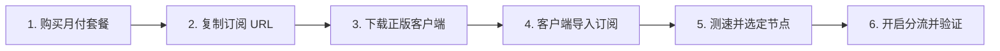

## 引言：6 步打通出海全流程

对于第一次接触代理网络的用户，最容易在“买完之后不知道去哪找客户端”或“链接粘贴错误导致节点不显示”等环节卡壳。

本教程将把整个流程精简为标准化的 **6 个确定性步骤**，无论你使用的是 Windows 电脑、Mac 还是 iPhone/安卓手机，跟着操作都能在 5 分钟内顺利连通全球网络。

---

## 一、第 1 步：挑选服务商并购买月付入门套餐

1. **选择正规专线服务商**：参考 [机场手册品牌资料库](/brands/)，选择支持真实按月付费且经过实机测速核验的品牌（如 [U1S1](/brands/u1s1/)、[宇宙云](/brands/yuzhouyun/) 或 [灵猫网络](/brands/lingmao/)）。
2. **注册账户**：使用常用邮箱注册账号并登录用户中心后台。
3. **选购套餐**：在「购买订阅 / 商店」页面，选择 **15–20 元/月（100GB–150GB 流量）** 的入门档位，完成结算。

> [!TIP]
> **新手准则**：第一次使用任何新机场，坚决只买 1 个月，切勿直接年付，待实际体验满意后再做后续规划。

---

## 二、第 2 步：在后台复制你的专属订阅链接

购买成功后，返回机场控制台首页：
1. 找到 **「快速导入 / 便捷订阅」** 区域。
2. 优先点击 **「复制 Clash 订阅」** 或 **「复制通用订阅」**。
3. 此时你的剪贴板中已保存了一串以 `https://` 开头的加密链接。

---

## 三、第 3 步：根据设备下载对应的正版开源客户端

根据你当前正在使用的操作系统，选择并下载对应的正版客户端工具：

| 操作系统 | 推荐客户端 | 下载渠道与正版辨识 |
| :--- | :--- | :--- |
| **Windows** | **Clash Verge Rev** / v2rayN | 认准官方 GitHub 仓库 `clash-verge-rev`，下载 `x64-setup.exe` |
| **macOS** | **Clash Verge Rev** | 苹果 M系列芯片下载 `aarch64.dmg`，Intel 芯片下载 `x64.dmg` |
| **iPhone / iPad** | **Shadowrocket (小火箭)** | 登录外区 Apple ID 从 App Store 购买（开发者为 Pan） |
| **Android 安卓** | **Clash Meta for Android** / SFA | 从 GitHub Releases 或 Google Play 下载官方 APK |

---

## 四、第 4 步：在客户端中导入订阅链接

### 以 Windows / Mac (Clash Verge Rev) 为例：
1. 打开 Clash Verge Rev 软件。
2. 点击左侧菜单栏的 **「订阅 (Profiles)」**。
3. 在上方文本框中粘贴刚才复制的订阅链接，点击 **「导入 (Import)」**。
4. 鼠标左键点击下载成功的订阅卡片，卡片左侧亮起绿色竖条即代表激活。

### 以 iPhone (Shadowrocket) 为例：
1. 打开小火箭，点击右上角 **「+」** 加号。
2. 类型切换为 **`Subscribe`**。
3. 在 URL 栏长按粘贴链接，点击右上角 **「保存」**。

---

## 五、第 5 步：批量测速并选定活动专线节点

1. 进入客户端的 **「代理 (Proxies)」** 或节点列表页面。
2. 点击右上角的 **⚡ 闪电测速图标**（或小火箭的「连通性测试」）。
3. 列表右侧将显示各节点的实时毫秒延迟。
4. 鼠标单击选择一个延迟在 **30ms–60ms** 之间的香港或日本专线节点。

---

## 六、第 6 步：开启系统代理并验证出海网络

1. **开启连接**：
   - Clash Verge：在「设置」中将 **「系统代理」** 开关推至开启。
   - Shadowrocket：将全局路由保持在 **「配置 (Config)」**，打开最顶部的连接总开关并授权 iOS VPN 配置。
2. **打开浏览器进行双向验证**：
   - 打开 `https://www.google.com`（能秒开搜索页面即代表出海成功）；
   - 打开 `https://www.baidu.com`（能正常访问说明国内直连分流正常）。

---

## 七、总结与后续学习

恭喜你！通过以上 6 步，你已经成功掌握了跨境网络代理的核心使用链路。

如需进一步探索更高级的规则分流、TUN 虚拟网卡或遇到网络报错，可继续阅读：
- [Clash Verge Rev 完整实战教程](/tutorials/clash/clash-verge-starter-guide/)
- [ChatGPT 1020 报错与风控排查手册](/answers/chatgpt-blocked-solution/)
- [机场网络延迟高与晚高峰卡顿优化指南](/answers/peak-hours-lag-troubleshoot/)
