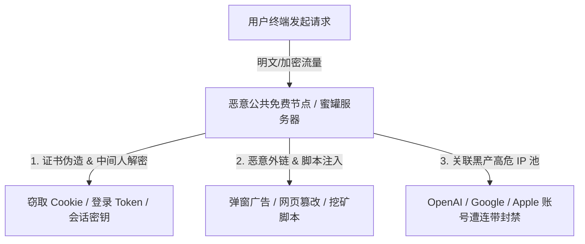

## 引言：天下没有免费的午餐，网络代理亦是如此

在各大技术论坛、社交群组中，经常可以看到“每天免费更新 500+ 节点”、“永久白嫖高速订阅”等分享。对于许多刚接触跨境网络的新手而言，看似节省了十几元的月费，实则付出了巨大的**个人隐私与数字资产安全代价**。

网络代理的核心原理是：**你的全部网络流量都必须经过代理服务器进行转发**。当你在使用一台完全不知道由谁搭建、由谁掌控的公共免费服务器时，你的数据安全底线已经被彻底打破。

---

## 一、公共免费节点背后的四大致命安全黑幕

### 1. 中间人攻击 (MITM) 与 Cookie 凭证劫持
代理服务器的搭建者拥有对转发流量的最高分析权限。攻击者可以通过自签证书劫持或利用部分未开启 HSTS 强制加密的网站，将 HTTPS 请求降级为 HTTP 明文，从而直接抓取你传输的 Cookie、Session ID 与个人资料。

### 2. 账号连带封禁（IP 污染严重）
各大跨国互联网巨头（Google、OpenAI、Meta、Apple）均接入了全球威胁情报风控网络。免费节点的公共 IP 通常被用于批量发送垃圾邮件、撞库扫描或爬虫攻击，早已在 IP 欺诈库（Fraud Score）中被打上满分高危标签。一旦你使用该 IP 登录正常个人账号，风控系统会判定你的设备为黑产机器人，直接触发账号永久冻结。

### 3. 网页劫持、暗刷广告与恶意挖矿
部分黑产通过提供所谓的“免费节点”，在用户浏览普通网页时动态注入 JavaScript 恶意脚本，不仅弹窗不断，还会在后台静默利用你电脑的 CPU 算力进行加密货币挖矿，导致设备严重发热卡顿。

### 4. 蜜罐节点与网络行为监控
部分公网免费节点实际上由网络安全研究机构甚至黑客设置的“蜜罐系统（Honeypot）”。你在网络上的所有访问记录、域名清单和时间戳都会被完整记录并归档，隐私荡然无存。

---

## 二、免费节点与正规专线服务商全维度对比

| 对比维度 | 公共免费节点 / 免费订阅池 | 正规客观核验专线服务商 |
| :--- | :--- | :--- |
| **运营实体与信用** | 匿名搭建 / 责任主体缺失 | 长期运营品牌 / 具备明确商业条款 |
| **晚高峰稳定性** | 极差 (频繁断流、拥挤超时) | 极佳 (IEPL 专线保障，丢包率 < 0.5%) |
| **IP 纯净度与信誉** | 极脏 (已被各大平台拉黑) | 高 (提供独立出口 / 原生住宅 IP) |
| **数据加密与安全性** | 存在中间人嗅探与篡改风险 | 端到端专线加密传输，无数据劫持 |
| **AI / 流媒体支持** | 100% 触发 1020 报错 / 访问拒绝 | 针对 ChatGPT、Claude、Netflix 专项优化 |

---

## 三、个人安全防护与正确出海网络配置建议

为了保障你的数字资产与账号安全，请务必执行以下安全准则：

1. **坚决执行“三不用”原则**：
   - 不在免费节点下输入任何账号密码；
   - 不在免费节点下进行任何资金转账与网银操作；
   - 不在免费节点下登录核心个人账号（如 Apple ID、Google、OpenAI）。
2. **启用客户端智能白名单分流**：
   在 Clash Verge Rev 或 Shadowrocket 中严格开启「规则模式 (Rule)」，国内银行、微信、支付宝流量强制走直连通道，严禁走代理。
3. **选择支持月付的正规商业专线**：
   每月仅需 15–20 元（如 [U1S1](/brands/u1s1/)、[宇宙云](/brands/yuzhouyun/)），即可获得由电信级 IEPL 专线保障的高速纯净通道，彻底消除安全顾虑。

---

## 四、总结与下一步

网络安全无小事。切勿为了贪图微小的费用节省，而将个人隐私和核心账号置于不可控的风险之中。

建议前往 [机场手册品牌库](/brands/) 了解更多经过真实性与客观测速核验的正规服务商！
