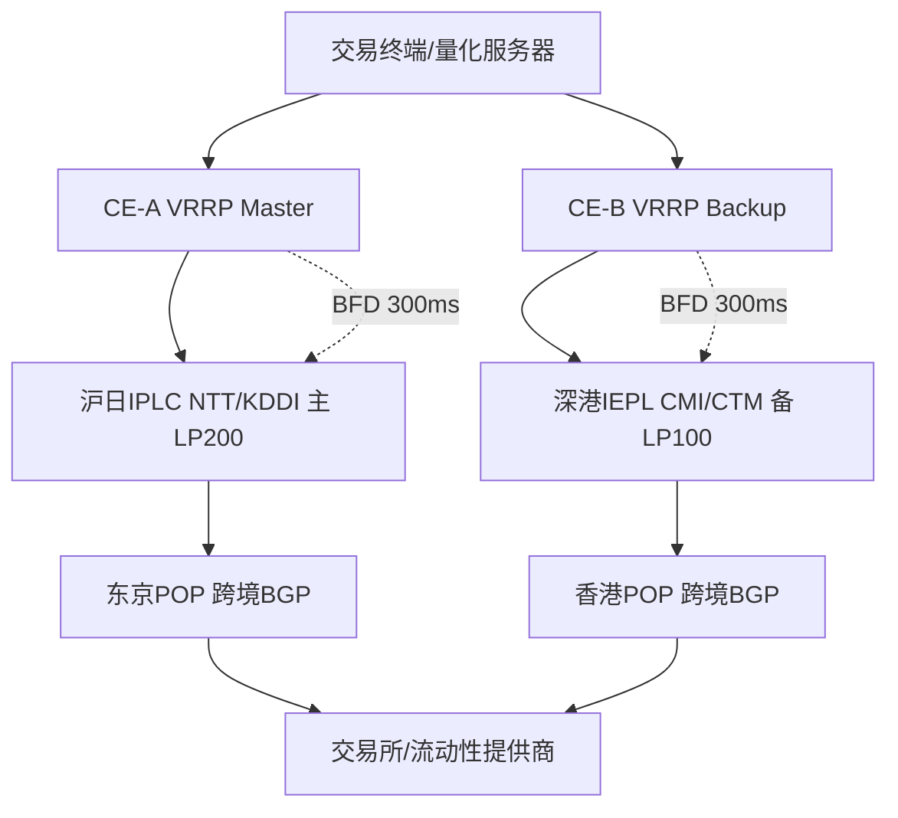

## 一、金融行情与量化交易对毫秒级链路的真实要求：从Bloomberg到币安API的延迟预算拆解

做量化的人嘴里的“低延迟”，和运维监控面板上的“平均延迟”，往往不是一回事。行情链路真正的敌人不是均值，而是尾部——P99.9 的 RTT 抖动和丢包重传。一笔套利信号从交易所撮合引擎发出，到你的策略进程读到，中间任何一跳的毛刺都可能让价差被吃掉。先把四类典型数据源的协议特征摆清楚，延迟预算才有意义。

**Bloomberg Terminal** 走的是私有协议 + 本地缓存架构，终端本身维护大量静态与准实时数据，真正的实时敏感点是 B-PIPE / EMSX 的订阅流。它对链路的要求是“稳定优先”：单条消息体小、频率中等，但对连接中断极敏感，重连会触发全量快照同步，几十秒的恢复窗口足以让盘中决策失明。**盈透 TWS** 的 API 是典型的请求-响应 + 回调混合模型，TWS 客户端作为本地网关再连 IB 服务器，多了一层进程内排队；它的延迟瓶颈常在客户端 tick 合并与限流（默认 50 msg/s 级别），链路本身反而不是主要矛盾，但跨太平洋 RTT 会直接放大订单确认的往返。**TradingView WebSocket** 是标准 WSS 长连接，服务端按订阅推送 K 线与成交，协议开销小、易部署，但公网路径不可控，适合做辅助看盘而非执行信号源。**币安现货/合约 API** 才是量化主战场：REST 下单 + WebSocket 行情（`@depth`、`@aggTrade`、`@bookTicker`），撮合引擎在东京/新加坡等区域，国内直连公网 RTT 动辄 80–150ms 且抖动剧烈，这是必须用专线拉平的对象。

把端到端延迟拆成可核算的预算，才有优化抓手：

| 环节 | 典型耗时 | 说明 |
|---|---|---|
| 本地策略处理 + 序列化 | <1ms | 含 JSON/Protobuf 解析、风控校验，避免 GC 停顿 |
| 专线传输（沪日 RTT） | 28–35ms | IEPL 直连东京，单程约 14–17ms |
| 专线传输（深港 RTT） | 3–8ms | 同城/跨境短距，深港专线优势明显 |
| 交易所网关排队 + 撮合 | <5ms | 取决于网关负载与下单类型（限价/市价） |

需要强调的是，这张表里的传输数字是**正常态**。参考站内《机场延迟多少算正常》给出的基准：跨境普通线路 RTT 60–120ms 属常见，优质专线可压到 30ms 量级——但那只说明“平均够快”。量化场景必须再往下看一层：**低延迟 ≠ 低抖动**。一条平均 30ms、P99.9 却飙到 200ms 且伴随 0.5% 丢包的链路，对高频策略是灾难，因为 TCP 重传（RTO 最小 200ms 起）会让行情断档、订单确认超时。生产验收标准应写成：P99.9 RTT 稳定在基准值 1.5 倍以内，端到端丢包率 < 0.01%，且连续 24 小时无重传尖峰。

实测要用组合拳，单看 ping 会被 ICMP 限速骗过去：

```bash
# 长周期采样看尾部，而非均值
ping -c 1000 -i 0.2 203.0.113.10 | tail -5
# 逐跳定位抖动与丢包发生在哪一段
mtr -rwzbc 500 203.0.113.10
# 打满带宽验证专线是否真有承诺的 CIR，观察是否被整形
iperf3 -c 203.0.113.10 -p 5201 -t 60 -P 4 -R
```

结果解读的关键在分布：`ping` 的 `mdev` 若接近或超过均值的一半，说明抖动不可接受；`mtr` 要盯每一跳的 `Loss%` 与 `StDev`，跨境段某跳开始丢包且后续跳延续，基本可判定该运营商出口拥塞；`iperf3` 反向测试（`-R`）若吞吐远低于正向，往往是回程路由绕行或 QoS 限速。把这些数据按小时归档，才能和 SLA 条款里的 99.99% 对得上账。

整体链路的分层与热备关系如下：

```mermaid
graph TD
    A[策略进程 本地处理小于1ms] --> B[主用 IEPL 沪日专线]
    A --> C[备用 IEPL 深港专线]
    A --> D[公网 BGP 兜底]
    B --> E[交易所接入网关 排队小于5ms]
    C --> E
    D --> E
    E --> F[撮合引擎]
    B -. 健康探测 P99.9 与丢包 .-> G[路由调度器]
    C -. 健康探测 .-> G
    D -. 健康探测 .-> G
    G --> A
```

热备不是配两条线就完事，核心是**探测粒度与切换判据**：用应用层心跳（WebSocket ping/pong + 下单探针）而非纯 ICMP 做健康判断，连续 3 个周期 P99.9 超阈值或丢包率突破 0.01% 即触发切换，切换动作在路由层完成，策略进程无感。下一章展开专线选型与 SLA 条款的逐条核验方法。

## 二、专线物理冗余架构设计：沪日IPLC + 深港IEPL + 跨境BGP混合热备拓扑

金融行情链路的第一原则不是“带宽够用”，而是“任何单点物理失效不引发交易中断”。我们把冗余拆成三层：接入层双CE做VRRP网关冗余，汇聚层IPLC与IEPL走两条物理分离的国际路径，出口层用跨境BGP多线做策略选路。三层各自独立失效域，避免“一台设备挂全楼断”的连锁反应。

**选型依据。** 沪日方向选IPLC（上海—东京，NTT与KDDI双骨干承载），原因是日本是CME、OSE及大量亚太流动性提供商的落地枢纽，IPLC提供端到端固定时延与带宽承诺，抖动可控在亚毫秒级；深港方向选IEPL（深圳—香港，CMI与CTM双运营商），香港是外资券商与交易所托管密集区，IEPL的以太网专线形态便于在深港两地做二层延伸与快速扩容。两者一北一南、一IPLC一IEPL，运营商、登陆站、海缆系统全部错开，这是物理冗余的根基。

**光缆路由分离原则。** 同沟同缆是伪冗余的头号杀手——两条“独立”专线若共用同一段海缆或同一登陆站，一次渔船锚害就双断。落地要求：沪日路径避开与深港路径共用的海缆系统（如APG/APCN2段落），登陆站分别落在崇明/南汇与深圳大铲湾不同机房；国内段要求运营商提供光缆路由图并做段落比对，重合段超过20%即判不合格。每半年复核一次路由变更，海缆维修窗口期提前切换主备。

**BGP主备策略。** 主用沪日IPLC，local-preference 200；备用深港IEPL，local-preference 100。同一前缀双路宣告，靠LP值天然主备，无需复杂AS-Path操纵。BFD检测间隔设300ms×3，即900ms内判定邻居失效，配合BGP fast-external-failover实现秒级收敛。关键配置片段：

```cisco
interface GigabitEthernet0/1
 description To-IPLC-NTT
 ip address 10.10.1.1 255.255.255.252
 bfd interval 300 min_rx 300 multiplier 3

router bgp 65001
 neighbor 10.10.1.2 remote-as 2914
 neighbor 10.10.1.2 bfd
 neighbor 10.10.1.2 fall-over bfd
 neighbor 10.10.1.2 route-map RM-IPLC-PRIMARY in
 neighbor 10.20.1.2 remote-as 58453
 neighbor 10.20.1.2 bfd
 neighbor 10.20.1.2 fall-over bfd
 neighbor 10.20.1.2 route-map RM-IEPL-BACKUP in

route-map RM-IPLC-PRIMARY permit 10
 set local-preference 200
route-map RM-IEPL-BACKUP permit 10
 set local-preference 100
```

**切换时序与验证。** 故障注入采用拔纤与关端口两种方式：CE检测到BFD超时（约900ms）→BGP会话Down→撤销主路路由→备用路LP 100生效→流量切换，端到端实测<1.5s。验证方法：在两端部署持续ping与行情快照比对脚本，以1ms粒度记录序列号缺口，统计切换窗口内丢包数与行情乱序数；同时抓取BGP update时间戳，确认从BFD Down到备用路转发的实际耗时。下表为两条路径的关键参数对比。

| 维度 | 沪日IPLC（主） | 深港IEPL（备） | 验收标准 |
|---|---|---|---|
| 承载运营商 | NTT / KDDI | CMI / CTM | 双运营商互备 |
| 链路形态 | 端到端专线 | 以太网专线 | 均承诺带宽 |
| BGP local-pref | 200 | 100 | 主备明确 |
| BFD参数 | 300ms×3 | 300ms×3 | 900ms判定 |
| 实测切换时间 | — | — | <1.5s |
| 光缆重合度 | 独立路由 | 独立路由 | <20% |



出口层跨境BGP多线在东京与香港POP分别与多家上游建立会话，通过AS-Path prepend与community做次级选路，确保单运营商骨干故障时仍有第三路径兜底。整套架构的验收不看“设计图漂亮”，只看故障注入下的实测切换曲线与丢包序列——这才是SLA 99.99%能被核验的地方。

## 三、WebSocket / FIX长连接防中断优化：Keep-Alive心跳、TCP超时与内核参数调优

在跨洲专线场景下，链路本身丢包率可能已经压到 0.01% 以下，但长连接仍然会断——断的原因往往不在物理链路，而在**协议层心跳缺失、NAT/防火墙会话老化、内核 TCP 重传超时过长**这三处。行情链路一旦中断，哪怕只丢 3 秒 tick，量化策略的盘口快照就会失真。这一节按“应用层保活 + 内核层兜底”两条线拆解。

### 3.1 三类长连接的真实断连机理

**币安 WebSocket**：官方文档明确连接最长存活 24 小时，服务端会主动下发 close 帧；同时若 3 分钟内无任何数据往来（含订阅推送），连接也会被回收。这意味着客户端必须自行维护 ping/pong，且要在 24h 到期前主动重连，而不是等它断。

**FIX 4.4**：会话层靠 `HeartBtInt` 控制心跳，行业惯例 30s。双方各自在 `HeartBtInt + 合理传输延迟` 内未收到任何报文，即发 `TestRequest`，对方须回 `Heartbeat` 且携带 `TestReqID`；超时未回则判定会话死亡，走 `Logout` 并重连。序列号断裂时不能简单重连，必须用 `ResendRequest` 补洞。

**盈透 API（TWS/IB Gateway）**：客户端与 Gateway 之间是本地 socket，但 Gateway 到 IB 后台是另一段。常见故障是 Gateway 侧 `Read-Only` 模式切换或每日重启窗口导致断连，客户端需要检测 `nextValidId` 回调并做幂等重连，避免重复下单。

### 3.2 内核参数：让 TCP 层先于应用层发现死链

应用层心跳周期若为 15s，内核 keepalive 必须更激进，否则一个半开连接会挂很久。以下 sysctl 片段适用于专线两端 Linux 网关与交易节点：

```ini
# /etc/sysctl.d/99-trading-keepalive.conf
net.ipv4.tcp_keepalive_time   = 30     # 空闲 30s 即发起首个探测
net.ipv4.tcp_keepalive_intvl  = 10     # 探测间隔 10s
net.ipv4.tcp_keepalive_probes = 3      # 3 次无响应判定死亡，总窗口约 60s
net.ipv4.tcp_retries2         = 5      # 数据重传上限，缩短死链判定
net.ipv4.tcp_user_timeout     = 5000   # 未确认数据 5s 后强制关闭（毫秒）
net.ipv4.tcp_slow_start_after_idle = 0 # 空闲后不重置拥塞窗口，避免行情突发时慢启动
net.core.somaxconn            = 4096
net.ipv4.tcp_fastopen         = 3
```

关键点：`tcp_user_timeout` 是 Linux 3.10+ 才有的“已发送未确认数据”超时，比 `tcp_retries2` 更精确，5s 足以覆盖跨太平洋 RTT 的 3~4 倍。`tcp_slow_start_after_idle=0` 对行情场景尤其重要——夜间低峰后开盘瞬间的 tick 洪峰，若拥塞窗口被重置回 10，前几百毫秒的推送会明显滞后。

### 3.3 应用层心跳与重连策略

WebSocket 侧：客户端每 15s 发一次 `ping`，30s 内未收到 `pong` 即判定链路异常，主动 `close` 并重连。不要依赖服务端推送作为存活依据，因为订阅品种在非交易时段可能长时间无推送。

FIX 侧：`HeartBtInt=30`，本地维护 `lastRecvTime`，超过 30s + 5s 缓冲即发 `TestRequest`；连续两次 `TestRequest` 无 `Heartbeat` 回应则断开会话。重连后先比对 `ExpectedSeqNum` 与本地 `NextSenderSeqNum`，缺口用 `ResendRequest(BeginSeqNo, EndSeqNo)` 补齐，`EndSeqNo=0` 表示补到最新。

重连退避采用指数退避：1s → 2s → 4s → 8s → 16s → 30s 封顶，并加 ±20% 抖动，防止多节点同时重连打爆网关。序列号补洞期间暂停策略信号输出，避免用残缺盘口做决策。

### 3.4 多方案参数对比

| 方案 | 心跳周期 | 死链判定窗口 | 重连策略 | 适用场景 | 代价 |
|---|---|---|---|---|---|
| 纯应用层心跳 | WS 15s / FIX 30s | 30~45s | 指数退避 1s→30s | 云上托管、NAT 稳定 | 半开连接发现慢 |
| 纯内核 keepalive | 30s 探测 | 约 60s | 无（依赖应用） | 裸金属直连 | 无法感知应用层假死 |
| 应用+内核双保活 | 15s / 30s | 15~30s | 退避+序列号补洞 | 高频量化生产环境 | 参数调优成本 |
| 双保活+用户态超时 | 15s / 30s | 5~15s | 退避+补洞+幂等 | 跨洲专线、SLA 99.99% | 需精细压测 |
| 双保活+多路由热备 | 15s / 30s | 5~15s | 退避+补洞+主备切换 | 交易所直连核心链路 | 架构复杂度高 |

### 3.5 Wireshark 抓包核验心跳间隔

调优后必须抓包验证，而非只看日志。在交易节点执行：

```bash
tcpdump -i eth0 -w /tmp/ws_heartbeat.pcap 'tcp port 9443 and host 52.x.x.x'
tshark -r /tmp/ws_heartbeat.pcap -Y 'websocket' -T fields \
  -e frame.time_delta_displayed -e websocket.opcode
```

在 Wireshark 中过滤 `websocket.opcode == 0x9 || websocket.opcode == 0xA`（ping/pong），观察 `frame.time_delta_displayed` 是否稳定在 15s 附近。若出现 15s 后紧跟 30s 的间隔，说明 pong 丢失触发了一次重连，需回查专线丢包。FIX 会话则过滤 `fix` 协议，核对 `35=0`（Heartbeat）与 `35=1`（TestRequest）的时间差是否落在 `HeartBtInt` 容差内。

需要提醒的是，心跳参数与链路质量强相关，跨洲专线的 RTT 抖动会直接影响判定阈值，建议结合 [机场延迟多少算正常？为什么低延迟不等于速度快与各地区正常延迟基准全景图](/guides/airport-latency-and-speed-guide/) 中的延迟基准，先确认链路 RTT 分布，再反推心跳容差，而不是照搬 30s 一刀切。

## 四、运营商SLA深度拆解：99.99%可用率、MTTR≤15分钟与独立核验方法论

专线合同里那行“99.99%可用率”几乎没人认真读过脚注。真出事时，运营商拿出的统计口径往往和你理解的完全不是一回事。这一节把条款逐条拆开，再给出一套不依赖运营商自报数据的独立核验方案。

**可用率定义：先看计划维护是否剔除。** 标准合同通常写“月度可用率 = (总分钟数 − 不可用分钟数) / 总分钟数”，但“不可用”的口径差异巨大。要盯三处：其一，计划维护窗口（Maintenance Window）是否计入分母——多数运营商把每月4~8小时的计划维护排除在不可用之外，等于白送你0.5%~1%的“合法中断额度”；其二，不可用的判定粒度是“链路Down”还是“丢包率>X%”，只认物理Down的条款对高频交易毫无意义，因为50%丢包的链路在业务上已等同中断；其三，统计周期是自然月还是账单周期，跨月故障容易被拆成两段各自“达标”。99.99%意味着每月不可用上限仅4.32分钟，这个数字必须和“单次故障最短计费时长”（常见15分钟起算）对照看——一次15分钟的故障就足以让当月SLA彻底失守。

**MTTR计算起点：报障时间 vs 首次响应。** 合同里的MTTR≤15分钟，绝大多数指的是“首次响应时间”（First Response），而非“业务恢复时间”。这两者能差出几个小时。谈判时要争取写入“恢复时间（Time to Restore）”条款，并明确计时起点为**你方通过指定渠道（工单系统时间戳/邮件）发出报障的时刻**，而非运营商NOC确认故障的时刻。口头电话报障不留痕，事后无法举证，务必走工单。

**赔偿条款：credits比例低得可怜。** 典型阶梯是：可用率99.9%~99.99%赔月费10%，99%~99.9%赔25%，低于99%赔50%，且常设“赔偿上限为当月月费”的封顶条款。对交易业务而言，一次断线损失的可能是几十倍月费，credits只是象征性补偿。真正有价值的是**终止权条款**：连续三个月或单季度累计未达标即可无罚金解约，这才是约束运营商的实际杠杆。

**独立核验方案。** 不要相信运营商月报，自己建证据链。核心是双探针：在链路两端各部署一台探针（如两台VPS或树莓派），用SmokePing以5秒间隔做ICMP+TCP SYN双探测，TCP探测目标选业务实际端口（如443/8443），因为部分运营商对ICMP做QoS降级，ICMP正常不代表TCP正常。SmokePing配置片段：

```perl
*** Targets ***
+ Financial_DC
menu = DC Link
title = TCP 443 Probe
host = 203.0.113.10
probes = TCP
port = 443
alerts = someloss
```

同时开启BGP flap日志（`show log messages | match BGP`或采集BMP流），记录每次session reset的时间戳；光功率监控用SNMP轮询OLT/光模块的Rx Power，健康区间收光-8~-20dBm，低于-25dBm即劣化预警，这是物理层故障的早期信号，比业务层告警早数小时。

**月度可用率计算公式与取证模板：**

```
可用率 = (月总分钟数 − Σ不可用分钟数) / 月总分钟数 × 100%
不可用分钟数 = Σ(每次故障恢复时间戳 − 首次探测失败时间戳)
```

取证模板字段：故障编号、首次探测失败时间（UTC+8）、恢复时间、持续分钟、探测类型（ICMP/TCP）、丢包率、BGP事件、光功率读数、工单号、运营商回复。全部落表，月度导出PDF存档。

**用MTR历史数据反驳“链路正常”。** 运营商最常用的话术是“我们监控显示链路正常”。此时拿出双向MTR：在两端探针上以`mtr -rwzc 100 --tcp --port 443 203.0.113.10`定时采样，保留每跳丢包率。若中间某跳持续丢包而末跳正常，说明是QoS限速而非物理故障；若末跳丢包随时间呈周期性（如整点），可指向运营商汇聚层拥塞。把连续72小时的MTR丢包曲线和SmokePing的RTT抖动图并列，运营商无法再用“单次ping正常”搪塞。

这套“自己留证、多维交叉、时间戳对齐”的思路，与站内《怎么判断机场是否靠谱》的核验清单一脉相承：不看宣传看实测，不看单点看趋势，不看口头看工单。专线SLA谈判和事后索赔，本质上是同一套证据工程。

## 五、本地交易终端硬件加速与专用分流规则隔离

专线把 RTT 压到 1ms 以内，如果终端这一侧还在丢包、抖动、被办公流量抢占，前面的 SLA 核验就白做了。生产环境里最常见的翻车点不是运营商，而是交易机自己：网卡默认中断全打到 CPU0、C-state 让核心在行情突发时"睡醒"要几百微秒、Windows 更新或 Chrome 在后台抢带宽。本章按硬件、系统、应用三层把终端侧的可控变量全部收口。

### 硬件层：网卡选型与内核旁路准备

万兆卡优先选支持 SR-IOV 的型号：Intel X710（i40e 驱动）或 Mellanox ConnectX-5（mlx5_core）。X710 胜在生态成熟、价格低，适合 FIX 网关这类单流低并发场景；ConnectX-5 的 RDMA 与硬件时间戳能力更强，做 DPDK 或需要 PTP 硬件打戳的行情回放时更合适。SR-IOV 的价值在于把 VF 直通给虚拟机或容器，绕过宿主 vSwitch，省掉一层软转发——如果交易终端跑在虚拟化环境里，这一层不做，前面所有调优都是给 hypervisor 打工。

上电后先关节能：

```bash
ethtool --set-eee eth0 eee off
ethtool -s eth0 wol d
ethtool -K eth0 gro off gso off tso off lro off
ethtool -G eth0 rx 4096 tx 4096
ethtool -L eth0 combined 16
```

`-K` 关掉 GRO/GSO/TSO 是为了让时间戳和包序可控——聚合卸载会让抓包和延迟测量失真，做行情延迟归因时必须关。`-G` 加大 ring buffer 抗突发，`-L` 把队列数拉到与物理核数匹配，后面 RSS 绑核才有意义。

### 系统层：队列、命名空间与策略路由

**RSS 绑核与 isolcpus。** 中断分散是低延迟的第一原则。用 `irqbalance --banirq` 或直接写 `/proc/irq/*/smp_affinity` 把每个 RX 队列的中断绑到独立物理核，交易线程用 `isolcpus=2-7 nohz_full=2-7 rcu_nocbs=2-7` 从调度器手里抢出来。C-state 必须关：`intel_idle.max_cstate=0 processor.max_cstate=1`，否则行情突发时核心从 C6 唤醒的延迟足够吃掉半个 tick。

**tc HTB 给 FIX 与 WebSocket 分独立队列。** 交易流量和行情推送要跟办公流量物理隔离，HTB 按端口分类并给最低保证带宽：

```bash
tc qdisc add dev eth0 root handle 1: htb default 30
tc class add dev eth0 parent 1: classid 1:10 htb rate 500mbit ceil 1gbit prio 0
tc class add dev eth0 parent 1: classid 1:20 htb rate 300mbit ceil 1gbit prio 1
tc class add dev eth0 parent 1: classid 1:30 htb rate 100mbit ceil 1gbit prio 7
tc filter add dev eth0 parent 1: protocol ip prio 1 u32 match ip dport 9878 0xffff flowid 1:10
tc filter add dev eth0 parent 1: protocol ip prio 2 u32 match ip dport 443 0xffff flowid 1:20
```

FIX 9878 走 prio 0 的 1:10，WebSocket 443 走 1:20，办公默认落 1:30。注意 `rate` 是最低保证、`ceil` 是上限，办公流量在空闲时可以借满，但交易流量一上来立刻被 prio 抢占。

**network namespace 隔离。** 更彻底的做法是把交易链路塞进独立 netns，办公流量根本看不到这张网卡：

```bash
ip netns add trade
ip link set eth1 netns trade
ip netns exec trade ip addr add 10.10.1.2/30 dev eth1
ip netns exec trade ip route add default via 10.10.1.1
```

**iptables MARK + ip rule 策略路由。** 多路由热备时，靠 fwmark 决定走主专线还是备份：

```bash
iptables -t mangle -A OUTPUT -p tcp --dport 9878 -j MARK --set-mark 0x64
ip rule add fwmark 0x64 table 100
ip route add default via 10.10.1.1 dev eth1 table 100
```

主链路探测失败时，把 table 100 的默认路由切到备份网关即可，应用层无感。这套"标记—策略表—热切换"的思路和住宅多 ISP 链路做故障切换是同一套机制，区别只在探测目标换成了交易所网关的 TCP 握手时延，可参考 [ChatGPT 4o 与 Claude 3.5 全天候高频访问实战：纯净住宅双ISP链路架构、Cloudflare 1020拦截消解与风控对抗全书](/guides/ai-tools-network-optimization-and-clean/) 里链路健康探测的实现细节。

### 应用层：绑核、大页与 DPDK

交易进程用 `taskset -c 2-3` 绑到隔离核，配合 `numactl --cpunodebind=0 --membind=0` 保证网卡与内存同 NUMA 节点。行情解析这类高频分配场景开大页：`echo 1024 > /proc/sys/vm/nr_hugepages`，JVM 加 `-XX:+UseLargePages`，C++ 用 `mmap(MAP_HUGETLB)`。

DPDK 是可选路径：当单核软中断处理已到瓶颈（`mpstat -P ALL 1` 看到某核 softirq 打满 100%），才值得上 poll-mode driver 把收包从内核栈里拿出来。代价是这张卡被 DPDK 独占，SSH、监控全得走另一张管理网卡，运维复杂度陡增，非极端场景不建议。

### 验证

调优后必须实测，不能只看配置：

```bash
taskset -c 2 mtr -rwzc 100 10.10.1.1
curl -w "connect:%{time_connect} ttfb:%{time_starttransfer}\n" -o /dev/null -s https://gw.exchange.example/ws
ss -tin dst :9878
```

`ss -tin` 看 Send-Q/Recv-Q 是否堆积、cwnd 是否正常增长；mtr 关注 max 与 avg 的差值，抖动比均值更能暴露队列配置问题。延迟基准怎么判读，可对照 [机场延迟多少算正常？为什么低延迟不等于速度快与各地区正常延迟基准全景图](/guides/airport-latency-and-speed-guide/) 里的方法论——金融场景下 P99 与 P99.9 才是 SLA 核验的真实抓手，平均值没有意义。

## 六、端到端监控与故障演练：从SmokePing到混沌工程的双活验证

专线切了BGP、挂了BFD，不代表业务真的无损。金融行情链路的验收标准从来不是“链路up”，而是“tick不丢、重连不断、切换无感”。这一章讲怎么把这句话变成可测量、可复现的工程事实。

### 6.1 监控栈：三层探针，各管一段

单靠一种探针会漏。我们的做法是三层并行，职责不重叠：

**第一层，SmokePing做高频基线。** ICMP 5s一轮、TCP 5s一轮（对行情网关的行情端口和WebSocket端口分别探测），RRD落盘保留90天。SmokePing的价值在于“便宜且密”，5s粒度足以在分钟级窗口内看出抖动形态——是锯齿状（队列拥塞）还是台阶状（路由切换），一眼能分辨。注意ICMP在部分运营商侧会被限速甚至丢弃，所以TCP探测才是主判据，ICMP只作辅助。SmokePing的Alerts配置里，我们设了两条硬阈值：连续3个周期RTT超过基线1.5倍、连续2个周期TCP探测失败，分别触发不同等级的告警。

**第二层，Prometheus + Blackbox Exporter做结构化指标。** Blackbox的icmp、tcp_connect、http_2xx三个probe模块分别对应链路层、传输层、应用层。关键是relabel配置要把`instance`打上机房和线路标签（如`sh-iepl-a`、`hk-iplc-b`），否则多路由环境下指标会糊成一团。采集间隔15s，配合`probe_success`、`probe_duration_seconds`、`probe_icmp_duration_seconds{phase="rtt"}`三个核心指标，再叠加node_exporter的网卡错包计数和BGP exporter的peer状态（`bgp_peer_up`、`bgp_peer_prefixes`），链路健康度就完整了。

**第三层，Grafana看板做决策视图。** 我们不堆图，只放四块：RTT P99（按线路分面，用`histogram_quantile`从Blackbox的duration直方图算）、丢包率（`1 - probe_success`的滑动窗口）、BGP peer状态时序、以及WebSocket重连次数。P99比均值有用得多——行情链路的痛点是尾部延迟，均值好看但P99飙到200ms，撮合侧就已经吃亏了。看板上给每条线路画一条SLA基线（比如RTT P99 < 40ms），越线变红，值班同学不需要理解PromQL也能判断。

### 6.2 故障演练：把“假设”打成“事实”

监控只能告诉你“现在怎样”，演练才能告诉你“坏了会怎样”。我们按季度做一轮，三个场景固定跑：

**场景一：手动shutdown主链路。** 在核心交换机上`shutdown`主用IEPL接口，观察BFD从检测到切换的完整时序。BFD配50ms×3（检测时间150ms），BGP hold timer压到3s以内。实测从接口down到备用链路承载流量，端到端约800ms~1.2s，其中BFD检测150ms、BGP收敛约600ms、剩余是转发表更新和TCP重传窗口。这个数字必须实测，不能信厂商PPT。

**场景二：注入100ms延迟 + 1%丢包。** 用`tc netem`在备用链路入口打`delay 100ms loss 1%`，模拟劣化而非中断。这个场景最阴险——链路没断，BFD不触发，但行情推送已经开始卡顿。此时验证的是应用层：WebSocket心跳超时（我们设15s）是否触发重连、重连后是否从正确的sequence号续传、有没有重复tick。1%丢包在TCP上会被重传掩盖，但会让P99 RTT明显抬升，正好检验看板告警是否灵敏。

**场景三：双活切换下的WebSocket重连时序。** 主备同时可用时，用DNS/Anycast把流量切到备用集群，记录客户端从收到FIN到重新订阅成功的完整链路。我们的目标是把这段压进2s内：连接建立<300ms、鉴权<200ms、订阅回放<1s，剩余是客户端退避重试的余量。

这里可以类比站内《ChatGPT 4o与Claude 3.5全天候高频访问实战》里的链路冗余思路——那篇文章处理的是“上游API抖动时如何靠多出口+重试退避保住可用性”，本质和我们做多路由热备是同一套哲学：**冗余不是目的，快速失败+确定性切换才是**。区别在于行情链路对“零丢失”的要求更硬，所以我们的重试必须带sequence对齐，不能像普通HTTP那样无状态重放。

### 6.3 演练Checklist与RTO/RPO

每次演练前过一遍清单：确认演练窗口已通知交易侧、备用链路带宽余量>40%、BFD/BGP配置已备份、抓包点（主备入口各一个）已就位、回滚脚本已dry-run。演练中记录：切换触发时刻、BFD down时刻、BGP withdraw时刻、首包到达备用侧时刻、WebSocket重连成功时刻。演练后核对行情sequence连续性——这是RPO的唯一硬证据。

指标口径定死：**RTO < 2s**（从主链路故障到业务恢复推送），**RPO = 0**（行情tick零丢失，靠sequence gap检测兜底，一旦发现gap立即触发全量快照重同步）。达不到就回炉改BFD参数或应用层重连逻辑，不接受“偶发超时”这种解释。

混沌工程不是炫技，是把“我们以为的高可用”变成“我们验证过的高可用”。行情系统里，没演练过的冗余，等于没有冗余。

## 七、成本与选型权衡：专线、跨境BGP与高品质中转的适用边界

把三条链路摆到同一张表上，差距不是“贵一点、便宜一点”，而是数量级。

| 类型 | 典型月费 | 单向延迟（深港/沪日参考） | 抖动(P99) | 承诺SLA | 故障定位能力 |
|---|---|---|---|---|---|
| IPLC/IEPL专线 | 万元级（2M~10M带宽） | 深港 1.5~3ms，沪日 25~30ms | <0.3ms | 99.9%~99.99%，带赔付条款 | 运营商端到端，可开Case追到单跳 |
| 跨境BGP多线 | 千元级 | 深港 3~8ms，沪日 35~55ms | 1~5ms | 99.5%左右，多数无赔付 | 只能看到自己这侧，跨境段靠猜 |
| 高品质中转 | 百元级 | 深港 5~15ms，沪日 50~90ms | 3~15ms | 无合同SLA，靠口碑 | 基本没有 |

延迟这一列要拆开看。专线的价值不在“平均快几毫秒”，而在**方差**。高频策略里，抖动直接吃掉你的滑点模型：一条平均8ms、P99抖到40ms的BGP链路，和一条稳定3ms的IEPL，对挂单撤单的成功率影响是决定性的。撮合所在深港这条线上，1ms的稳定优势意味着排队位置前移，而排队位置在逐笔撮合里就是成交概率。

**成本结构要算全生命周期，不是只看月费。** 专线万元月费背后是：运营商电路开通周期2~6周、需要两端机房落地（机柜+交叉连接往往另计）、带宽按2M起步阶梯计价。跨境BGP千元级胜在开通快、可自助调整，但跨境段走公网，晚高峰拥塞、路由抖动、被QoS降级都是常态，你得自己写探测脚本做实时切换。中转百元级本质是“别人帮你优化过的公网路径”，入口入口质量取决于上游，一旦上游换线或被打，你没有任何追责手段。

选型决策树按**日成交额**切最实用：

- **日资金规模 > 100万美元**：直接上IPLC/IEPL专线，且至少双运营商双路由。这个量级下，一次因抖动导致的错单或延迟成交，损失就够付一年专线费。SLA 99.99%的核验方式不是看合同，而是自己部署双向探针（两端各一台低配VPS跑mtr+自定义心跳），按分钟粒度统计可用率与P99延迟，月度对账时拿数据找运营商谈赔付。
- **中等规模（日10万~100万美元）**：跨境BGP做主链路 + 高品质中转做热备，用BGP的BFD或自研健康检查做秒级切换。主链路承担日常流量，备链路平时跑心跳和影子订单验证可用性，别让它“备而不用、用时才发现是死的”。
- **个人量化/小资金**：深港IEPL共享带宽是性价比拐点。共享意味着邻居可能拖累你，所以要选能提供独立VLAN隔离、且明确标注“共享比”的服务商，并自建延迟基线监控，一旦P99劣化超过阈值就换。

这里必须引用站内两篇的判断逻辑。《机场价格多少比较合理》给出的资费阶梯说明了一个规律：价格低到脱离成本结构的产品，一定在某个看不见的维度上偷工——要么超售带宽，要么跨境段走廉价中转，要么根本没有冗余。金融场景把这条规律放大十倍：你省下的那几千块月费，会在某次开盘跳空时以滑点形式还回去。《机场节点是什么》里的节点选型逻辑同样适用——节点质量看的是入口线路类型、出口落地机房等级、以及是否独享，而不是看标称带宽数字。专线之所以贵，贵在“确定性”这三个字：确定的路由、确定的带宽、确定的故障响应人。

最后一句实话：金融网络选型不该问“哪家最便宜”，而该问“我的策略在多大抖动下开始亏钱”。把这个问题量化出来，预算上限自然就有了，剩下的只是在边界内挑最稳的那条路。
