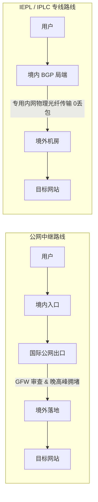
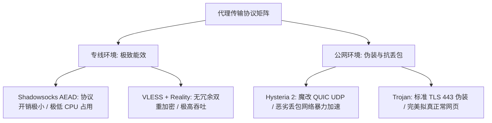

## 引言：为什么你需要一套系统化的机场选型方法论？

在跨境网络访问领域，信息严重不对称。“千兆秒开”、“晚高峰不限速”、“永久解锁 8K”等夸张宣传随处可见。很多用户在盲目购买了低价年付套餐后，往往在晚高峰遭遇频繁断流、大面积节点超时甚至服务商跑路的沉没成本。

网络代理服务本质上是一项由**机房入口、过境光缆、跨境带宽、落地出口 IP 及运维调度**共同构成的分布式网络工程。本指南不为任何单一服务商背书，旨在为你拆解底层网络物理架构、协议加解密开销、成本定价模型及真实使用场景，帮助你建立一套可复用、可验证的科学选型决策体系。

```mermaid
graph TD
    User([用户真实需求画像]) --> Budget{月度预算与支付方式}
    Budget -->|< 10元/月 (年付折算)| Tier1[轻度/备用型: 飞猫云 / 星岛梦]
    Budget -->|15-20元/月 (纯月付专线)| Tier2[主流高性价比: U1S1 / 宇宙云 / 一翻云]
    Budget -->|25元+/月 (大流量/AI旗舰)| Tier3[旗舰综合型: 光速云 / 速界 / 快狸]
    
    Tier1 --> Route{线路核心诉求}
    Tier2 --> Route
    Tier3 --> Route
    
    Route -->|日常网页/轻度社交| R1[BGP 中继 / 优质公网优化]
    Route -->|4K 影音 / 晚高峰不卡| R2[IEPL 商业专用光纤]
    Route -->|外服电竞 / AI 生产力| R3[IPLC 物理裸纤 + 原生住宅 IP]
```

---

## 一、2026 年机场选型的四大核心误区

在做出选择之前，首先必须识别并避开市场上最常见的四大认知误区：

### 误区 1：节点数量越多越好
许多低质服务商宣称拥有“300+ 全球节点”，实际上是通过单台 VPS 虚拟机伪造出几十个同 IP 端口，或者将廉价公网中继节点大量复制。这类节点在晚高峰时段由于入口带宽拥挤，往往全线崩溃。真正高质量的服务商通常将节点精简至 30–60 个，集中带宽资源保障核心地区的独立千兆冗余。

### 误区 2：盲目迷信“测速图跑满千兆”
单次 Speedtest 测速图仅反映该节点在非高峰期单线程爆发性能，不能代表持续连接稳定性。更为关键的指标是**晚高峰丢包率（Packet Loss < 0.5%）**与**延迟抖动（Jitter < 5ms）**。

### 误区 3：贪图低价年付与永久套餐
部分不良商家以“88 元买三年”或“128 元永久不限时”吸收资金池，运营数月后便关闭网站跑路。对消费者而言，最强有力的风控手段永远是**按月付费**。

### 误区 4：认为所有节点都能完美支持 AI 与流媒体
ChatGPT、Claude、Netflix 和 Disney+ 对机房 IP 的封锁策略极为动态。普通数据中心机房 IP 极易被标记并拦截，只有配备**原生住宅 IP 或经过清洗的纯净出口**才能稳定直达。

---

## 二、线路底层架构深度剖析：公网中继 vs IEPL 商业专线 vs IPLC 物理专线

判断一家机场的核心质量，线路物理架构占据了 70% 的决定性权重。

| 线路类型 | 物理传输路径 | 晚高峰稳定性 | 过境延迟 | 成本等级 | 核心适用人群 |
| :--- | :--- | :--- | :--- | :--- | :--- |
| **公网直连 / 中继 (Relay)** | 境内入口 ➔ 公网互联网 ➔ GFW 审查 ➔ 境外落地 | ⭐⭐ 易受国际公网拥堵与审查干扰 (丢包率 15%-30%) | 波动较大 (80-200ms) | 💵 低廉 | 预算极度严苛、仅在白天非高峰期轻度查阅资料的用户 |
| **IEPL 商业专线 (内网互联)** | 境内 BGP 机房 ➔ 电信内网专用光纤 ➔ 境外机房落地 | ⭐⭐⭐⭐ 极高稳定 (丢包率 < 0.5%) | 极低且恒定 (30-60ms) | 💵💵 中等合理 | **绝大多数主流用户的优质平衡选择** |
| **IPLC 国际专线 (点对点裸纤)** | 境内特定机房 ➔ 点对点物理光缆 (不过 GFW) ➔ 境外机房 | ⭐⭐⭐⭐⭐ 极致稳定 (0 丢包) | 物理极限超低延迟 (10-35ms) | 💵💵💵 昂贵 | 外服电竞玩家、高频跨国金融交易、对断网零容忍的跨国商务 |



### 1. 公网中继为什么会在晚高峰卡顿？
在每晚 20:00–23:00 的用网高峰期，民用国际互联网骨干网出口流量饱和，TCP 数据包在公网路由器排队丢弃，触发客户端频繁重传降速。

### 2. IEPL 专线的优势机制
IEPL 专线租用了电信运营商的内网传输通道，数据在境内打包后走专属内网光纤直接送达香港或东京机房，完全不走民用公网国际出口，从而实现全天候无拥堵。

---

## 三、主流传输协议全景对比：VLESS、Shadowsocks、Hysteria 2 与 Trojan

不同传输协议决定了数据在传输过程中的加密损耗、CPU 资源消耗以及抵御主动探测的能力。



### 1. VLESS 协议（现代代理标杆）
- **特点**：去除了 VMess 繁琐的握手时间戳与多次无意义加密，设计极致轻量。配合 Reality 伪装技术，能够直接借用合法的境外大厂 TLS 证书（如 Apple、Microsoft），抗封锁能力位居行业前列。
- **推荐场景**：主力出海节点、PC 与手机端综合日常使用。

### 2. Shadowsocks 2022 / AEAD（专线最佳拍档）
- **特点**：在 IEPL/IPLC 内网专线环境中，由于无需应对公网的深度包检测（DPI），Shadowsocks 的低封包头部开销能够带来最极致的单核转发吞吐与最低的延迟抖动。

### 3. Hysteria 2 协议（公网抗丢包神器）
- **特点**：基于 UDP/QUIC 协议开发，内置自研拥塞控制算法。在丢包率高达 25% 的劣质公网环境中，依然能够强制拉满下行带宽。但在部分对 UDP 进行 QoS 限速的省份，其表现可能不如 TCP 专线平稳。

---

## 四、预算梯队与资费陷阱（年付折算 vs 真实月付）

在评估机场资费时，必须警惕营销文案中的“数字游戏”。

### 1. 10 元以内年付折算档（适合轻度/备用用户）
- **典型品牌**：飞猫云（年付折算约 ¥7.0/月，50GB）、星岛梦（年付折算约 ¥8.0/月，60GB）。
- **定位分析**：单月平均成本极低，适合日常仅查阅文档、收发邮件或作为主力断网时的第二梯队备用。
- **购买建议**：需一次性支付 80–100 元年费，务必确认自己能接受较长的服务周期。

### 2. 15 元～20 元主流专线档（黄金平衡点，兼顾预算与稳定性的推荐梯队）
- **典型品牌**：
  - **15 元档**：宇宙云（¥14.9/月，100GB 专线）、唯兔云（¥14.9/月，100GB 智能调度）。
  - **18–20 元档**：极连云（¥18.0/月，100GB）、光年梯（¥18.0/月，110GB）、灵猫网络（¥19.0/月，150GB）、U1S1（¥20.0/月，120GB）、一翻云（¥20.0/月，150GB）、二猫云（¥20.0/月，130GB）、全球云（¥20.0/月，120GB）。
- **定位分析**：提供标准按月付费，全量配备 IEPL 专线，流量在 100GB–150GB 之间，完美兼顾资金灵活性、晚高峰稳定度与充沛流量。

### 3. 25 元及以上旗舰综合档（AI 生产力与 4K/8K 极致影音）
- **典型品牌**：光速云（老牌综合专线）、速界（AI 工具专研出口）、快狸（150GB 综合专线）、可信云（多设备高并发）、SOGO 云（2026 新兴专线）。
- **定位分析**：单月流量高达 150GB–300GB，配备原生纯净住宅 IP，针对 ChatGPT、Claude、Midjourney 及 Netflix 4K HDR 提供长期专项维护。

---

## 五、AI 工具与流媒体解锁专项核验

```mermaid
graph TD
    UserReq[用户访问海外服务] --> CheckType{访问目标分类}
    CheckType -->|OpenAI / Claude / Gemini| AIRules[AI 规则分流 ➔ 检测 IP 欺诈分 Fraud Score]
    CheckType -->|Netflix / Disney+ / HBO| StreamRules[流媒体分流 ➔ 检测 IP 住宅属性与版权库]
    
    AIRules -->|机房广播 IP (Datacenter)| Err1[报错: 1020 Access Denied / 验证码卡死]
    AIRules -->|原生住宅 IP (Residential)| Ok1[200 OK 秒进对话]
    
    StreamRules -->|非原生广播 IP| Err2[仅限自制剧 (Originals Only)]
    StreamRules -->|当地原生本土 IP| Ok2[解锁全地区完整版权影视库]
```

### 1. ChatGPT 与 Claude 的风控底层机制
OpenAI 和 Anthropic 接入了 Cloudflare 等高级欺诈防护体系。机房公共 IP 段由于被大量自动化脚本复用，信誉分（Trust Score）极低，极易触发 `Error 1020: Access Denied` 拦截。选择具有**原生住宅 IP (Residential IP)** 落地节点的服务商是解除风控的核心方案。

### 2. 海外流媒体跨区解锁要素
Netflix 等流媒体平台通过版权库比对 IP 归属。使用原生落地节点的香港、新加坡、日本服务器，能够解锁包含当地版权剧集的完整影片库。

---

## 六、全场景 4 步选型实操决策流程

```text
第一步：明确核心用途与场景画像
├─ 经常使用 ChatGPT / Claude ➔ 优先选择【速界】或【光速云】AI 专研节点
├─ 追剧看 Netflix 4K / YouTube 8K ➔ 选择【灵猫网络】或【一翻云】150GB 大流量专线
└─ 仅日常查阅 Google / GitHub 资料 ➔ 选择【宇宙云】或【唯兔云】15元性价比专线

第二步：确立付款周期与风险底线
├─ 追求灵活无风险 ➔ 坚决选择 15–20 元「真实月付」套餐
└─ 备用机低频防失联 ➔ 选择【星岛梦】按量不限时包或【飞猫云】年付轻量包

第三步：匹配客户端与多端操作系统
├─ Windows / macOS ➔ 优先使用 Clash Verge Rev 并开启 TUN 模式
└─ iOS 苹果手机 ➔ 使用 Shadowrocket（小火箭）配置智能分流

第四步：构建双轨防断网容灾组合
└─ 采用「主力月付专线 + 备用不限时流量包」组合，彻底告别突发断网焦虑。
```

---

## 七、总结与下一步

选择机场不是寻找所谓“绝对完美”的神仙服务商，而是**在清晰掌握自身预算与场景的前提下，通过科学的线路判断选择不过度超售的专线，并用月付原则将风险牢牢掌控在自己手中**。

你可以立即进入 [机场手册品牌资料库](/brands/) 查阅 16 家服务商的最新测速实测图谱，或使用 [智能选型推荐器](/recommend/#selector) 一键生成专属匹配方案！
