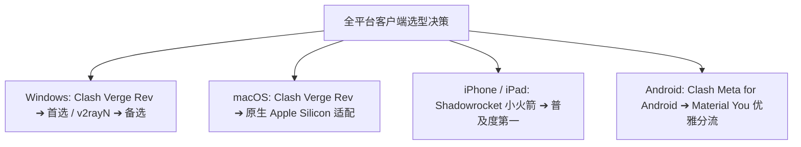

## 引言：选对客户端，出海体验事半功倍

很多新手在机场官网购买了套餐后，经常迷茫：“我到底该去哪里下载软件？哪个软件最好用？”

在代理技术生态中，**“机场提供节点线路，客户端负责本地调度”**。选择一款轻量、稳定、支持现代协议且易于上手的客户端，是保障长期流畅出海的关键一步。

本指南为你梳理目前全球主流操作系统的最优客户端选择。

---

## 一、全平台主流客户端一览矩阵表

| 操作系统 | 首选推荐客户端 | 备选推荐 | 核心技术优势 | 难度等级 |
| :--- | :--- | :--- | :--- | :--- |
| **Windows 10/11** | **Clash Verge Rev** | v2rayN / Sing-box | Rust+Tauri 打造，内存低至 50MB，一键 TUN 虚拟网卡 | ⭐ 入门友好 |
| **macOS (苹果电脑)** | **Clash Verge Rev** | Clash Nyanpasu / Surge | 原生 ARM64 架构，零 CPU 占用，优雅状态栏托盘 | ⭐ 入门友好 |
| **iOS (iPhone/iPad)**| **Shadowrocket (小火箭)** | Stash / Loon / Sing-box | 仅需 $2.99 买断，后台驻留节能极佳，支持规则集 | ⭐ 入门友好 |
| **Android (安卓手机)**| **Clash Meta for Android** | SFA (Sing-box) / v2rayNG | Material You 动态主题，支持按应用单独分流 | ⭐ 入门友好 |
| **Linux (Ubuntu/Arch)**| **Sing-box Core / Mihomo** | Clash Verge Rev AppImage | 极速轻量，支持透明代理服务与 systemd 守护 | ⭐⭐⭐ 极客玩家 |

---

## 二、各平台客户端核心使用原则

### 1. 坚持使用「规则模式 (Rule / Config)」
无论在哪个平台，切勿盲目开启“全局模式 (Global)”。规则模式能保证国内应用（微信、淘宝、国内视频）直接走本地宽带，既不消耗机场流量，也不会降低国内网速。

### 2. 优先开启「TUN 虚拟网卡模式」
在 Windows 和 macOS 上，开启 TUN 模式后，电脑将生成一张系统级虚拟网卡。即便是不遵循系统代理设置的命令行终端（CMD / PowerShell / Terminal）、Git 提交或外服网游，都能享受透明加速。

---

## 三、各操作系统实操教程直达

- 电脑端用户阅读：[Clash Verge Rev 完整实战教程](/tutorials/clash/clash-verge-starter-guide/)
- 苹果手机用户阅读：[Shadowrocket 小火箭保姆级图文教程](/tutorials/shadowrocket/import-subscription/)
- Windows 进阶用户阅读：[v2rayN 7.x 深度使用手册](/tutorials/v2rayn/starter-guide/)
- 下一代协议用户阅读：[Sing-box 跨平台上手指南](/tutorials/singbox/singbox-starter-guide/)
