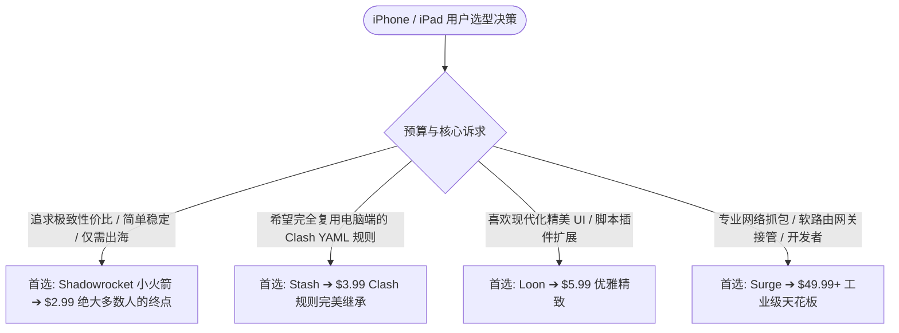

## 引言：iOS 平台四大出海神器，谁是性价比之王？

在 iOS 生态中，受限于苹果严格的沙盒机制与审核规范，代理客户端主要以独立的买断制 App 形式存在。

从国民级普及的“小火箭 (Shadowrocket)”，到完美移植 Clash 生态的 Stash，再到高端开发者专属的 Surge，不同的工具在价格与功能定位上有着巨大的分野。

本指南帮助苹果用户理清四大软件的核心差异，避免盲目跟风花冤枉钱。

---

## 一、iOS 四大主流客户端横向对比矩阵

| 评测维度 | Shadowrocket (小火箭) | Stash (Clash for iOS) | Loon | Surge 5 |
| :--- | :--- | :--- | :--- | :--- |
| **应用售价** | **$2.99 (约 ¥21)** | **$3.99 (约 ¥28)** | **$5.99 (约 ¥42)** | **$49.99 起 (约 ¥350+)** |
| **生态兼容** | 标准 Base64 / 通用订阅 | 原生 Clash YAML 规则 | 自定义规则集 / 脚本插件 | 原生 Surge 专属配置 |
| **后台保活与电量** | ⚡ **极优 (系统级节能)** | ⚡ 极优 | ⚡ 极优 | ⚡ 极优 (专业网络拓展) |
| **协议支持** | SS, VLESS, Hys2, TUIC, Trojan | SS, VLESS, Hys2, TUIC, Trojan | SS, VLESS, Hys2, Trojan | SS, Trojan, VMess, Snell |
| **上手难度** | 🟢 **极低 (一键导入即用)** | 🟢 低至中等 | 🟡 中等 | 🔴 偏高 (专业配置) |
| **核心推荐人群** | **绝大多数日常普通用户** | Clash 资深重度玩家 | 追求界面美学极客 | 专业网络工程师/极客 |

---

## 二、选型终极建议

1. **绝对首选**：直接在美区 App Store 购买 **[Shadowrocket (小火箭)](/tutorials/shadowrocket/import-subscription/)**。价格亲民、教程最全、全协议通吃，是 iPhone 出海的无脑之选。
2. **Clash 爱好者**：选择 **Stash**，无需任何格式转换即可直接读取电脑端的 Clash 订阅配置。
