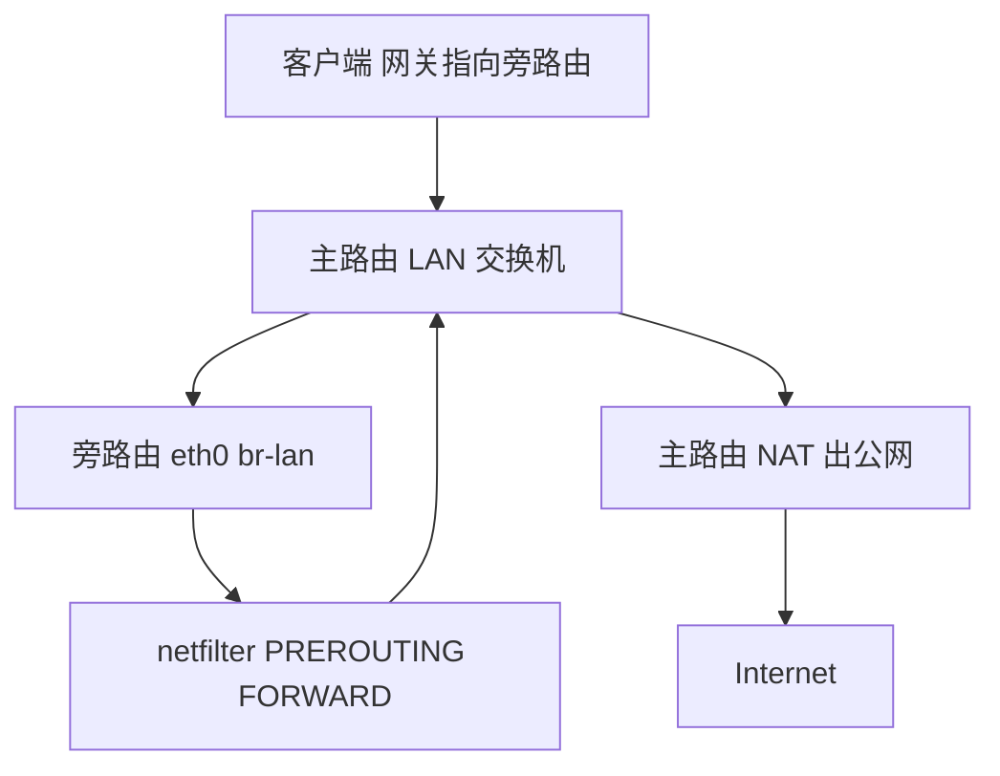
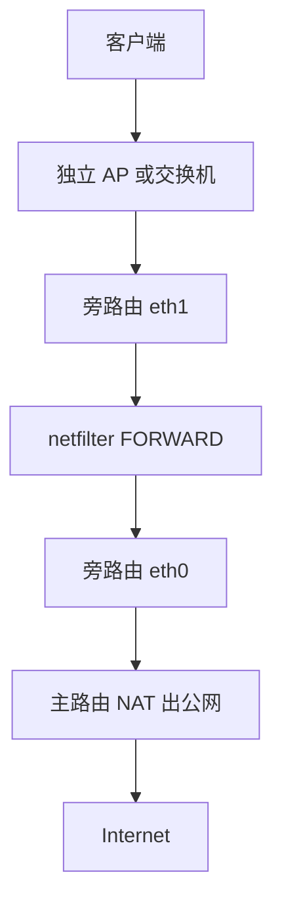
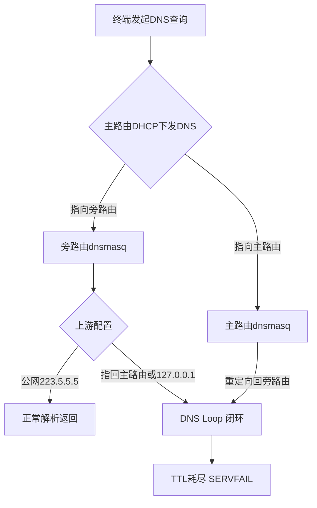

## 主路由 + 旁路由拓扑与报文转发路径全解析：单臂路由 vs 双网口直通

旁路由的本质是“客户端把默认网关指向一台不负责 NAT 的 Linux 主机”，它只做转发与策略，出口仍由主路由完成。这个结构决定了报文必然两次穿过同一台主路由的 LAN 侧，也决定了两种物理接法在性能与排障复杂度上的分野。

### 单臂路由：一个 LAN 口进出

OpenWrt 仅一个口（如 `eth0`）桥进 `br-lan`，接主路由 LAN。客户端网关指向旁路由 LAN IP，旁路由自身网关指向主路由。



逐跳看：客户端发出目的为公网的帧，目的 MAC 是旁路由；帧进入主路由 LAN 交换机后被泛洪/转发到旁路由 `eth0`，`br-lan` 收帧后进入 `PREROUTING`（`raw`/`mangle`/`nat` 链），路由判定为转发，走 `FORWARD`，`POSTROUTING` 后从**同一个 `eth0`** 发出，目的 MAC 改为主路由 LAN 口。此时报文再次回到主路由交换机，主路由 `PREROUTING`→`FORWARD`→`POSTROUTING` 做 SNAT 后出 WAN。

关键代价在第二跳：同一物理口既收又发，报文在 `br-lan` 上被**二次经过**（一次入桥、一次出桥），桥接代码与 netfilter 各跑两遍；且单口的中断全部压在一个 CPU 队列上，软中断（`ksoftirqd`）容易打满，表现为 `top` 中 `si` 偏高、`/proc/interrupts` 里该网口中断集中在一核。千兆满速时这是最先撞墙的地方。

观察点：

```bash
ip route            # 默认路由是否指向主路由 LAN IP，勿指向自身
ip -s link show br-lan   # 收发包计数应约为转发量的两倍
iptables -t nat -L -n -v # 旁路由上不应有 SNAT 命中，计数为 0
conntrack -L | wc -l     # 双向流均在此建立，注意表满
```

### 双网口直通：eth0 上行、eth1 下行

`eth0` 接主路由 LAN，`eth1` 接独立 AP/交换机，两个口分属不同网桥或直接路由，客户端挂在 `eth1` 侧。



报文从 `eth1` 进、`eth0` 出，`br-lan` 只经过一次，转发路径干净。若两块网卡支持多队列，`ethtool -l eth0` 可看到多组 RX/TX 队列，配合 `RPS/RSS` 把软中断分摊到多核，`/proc/interrupts` 中各队列中断分布在不同 CPU 上，这是单臂结构拿不到的收益。代价是需要多一个物理口和一段独立布线，且下行侧若用独立网段，客户端网关与 DHCP 都要跟着调整。

### MTU 与 MSS clamping

主路由 PPPoE 时 WAN 有效 MTU 为 1492，旁路由若仍按 1500 转发，大包在 PPPoE 封装处被丢弃且 PMTUD 常被中间设备阻断，表现为“能 ping 通、打不开网页”。处理方式是在旁路由 `FORWARD` 链对 TCP SYN 做 MSS 钳制：

```bash
iptables -t mangle -A FORWARD -p tcp --tcp-flags SYN,RST SYN \
  -j TCPMSS --clamp-mss-to-pmtu
```

若 `--clamp-mss-to-pmtu` 因路由 MTU 不准而失效，直接写死 `--set-mss 1452`（1492 − 20 IP − 20 TCP）。同时确认旁路由 `eth0` MTU 与主路由 LAN 一致（1500），不要在下行口盲目改小，否则会引入分片。验证用 `ping -M do -s 1472` 逐级探测，配合 `conntrack -L` 观察是否有 `[UNREPLIED]` 长期挂起的半连接，那通常就是 MTU 黑洞的现场。

## DNS 循环解析（DNS Loop）成因与彻底根治方案

DNS Loop 是透明网关/旁路由拓扑里最隐蔽也最致命的故障之一。它的典型表现是：终端能拿到 IP，能 ping 通网关，但网页打开极慢或直接超时，`nslookup` 卡住十几秒后返回 `SERVFAIL`，而旁路由的 CPU 单核被打满。根因几乎都出在 dnsmasq 的转发链路上形成了闭环，查询在几个解析器之间来回弹跳，直到超时或 TTL 耗尽。

### 三类典型成因

**成因一：旁路由 dnsmasq 上游指向自身 127.0.0.1。** 这在照抄网上教程时极常见。配置里写了 `list server '127.0.0.1#53'`，本意是想让 dnsmasq 走本机的另一个解析服务（如 smartdns、AdGuard Home），但那个上游根本没起，或者端口写错，于是 dnsmasq 把查询发给自己监听的 53 端口，形成自己转发给自己的死循环。抓包会看到同一源端口对 127.0.0.1:53 反复发包，且没有对应响应。

**成因二：主路由 DHCP 下发 DNS 为旁路由，而旁路由上游又指回主路由。** 主路由 `dhcp-option` 把 DNS 设成旁路由 IP，旁路由 dnsmasq 的 `server` 又填了主路由 IP（比如 `192.168.1.1`）。查询路径变成：终端 → 旁路由 → 主路由 → 主路由的 dnsmasq 若也把查询转回旁路由（或主路由开启了 DNS 重定向把 53 端口劫持回旁路由），闭环成立。这种双向依赖在双 dnsmasq 环境里最容易踩。

**成因三：双 dnsmasq 互相转发导致 TTL 耗尽。** 主路由和旁路由各跑一个 dnsmasq，A 的上游是 B，B 的上游是 A。查询在两者之间来回，每跳一次 TTL 减一，最终 `dig` 返回 `communications error` 或超时。抓包特征是同一查询 ID 在两个网段间反复出现，TTL 逐次递减。

### 抓包与验证

在旁路由上执行：

```bash
tcpdump -i br-lan port 53 -nn
```

正常情况应看到终端 → 旁路由的查询，以及旁路由 → 公网 DNS 的转发，源/目的清晰。若出现旁路由自己对自己、或旁路由与主路由之间同一查询反复往返，即为 Loop 特征。配合 `tcpdump -i any port 53 -nn -c 50` 可快速定位往返两端。

验证步骤：

```bash
dig +trace www.baidu.com        # 看解析在哪一跳断掉
nslookup www.baidu.com 192.168.1.1   # 直指主路由测试
nslookup www.baidu.com 192.168.1.2   # 直指旁路由测试
```

若直指某一方正常、经终端默认 DNS 异常，说明下发链路有问题；若两方互指后都超时，闭环成立。

### 根治配置

核心原则：**旁路由 dnsmasq 的上游必须是公网 DNS，绝不能指向内网任何一台跑着 dnsmasq 的设备。**

旁路由 `/etc/config/dhcp` 关键片段：

```
config dnsmasq
    option domainneeded '1'
    option noresolv '1'
    option cache_size '1000'
    list server '223.5.5.5'
    list server '119.29.29.29'
```

`noresolv '1'` 让 dnsmasq 忽略 `/etc/resolv.conf` 里的上游，杜绝系统残留配置把查询导回内网；`cache_size '1000'` 提升命中率，减少回源。同时**关闭主路由的 DNS 重定向**（OpenWrt 的 `dhcp` 里 `option dns_redirect` 或防火墙 53 端口劫持规则），避免主路由把终端查询强行拉回自己。若主路由 DHCP 下发 DNS 为旁路由，则主路由自身不要再做任何 DNS 转发。

改完务必校验：

```bash
dnsmasq --test
```

返回 `dnsmasq: syntax check OK` 才重启服务。最后用 `logread | grep dnsmasq` 确认无 `failed to send packet` 或 `loop` 告警。



### 方案对比

| 方案 | 上游配置 | 主路由DNS重定向 | 适用场景 | 风险点 |
|------|----------|----------------|----------|--------|
| 纯旁路由转发 | 公网223.5.5.5/119.29.29.29 | 关闭 | 单旁路由，追求简单稳定 | 无内网DNS需求时最省心 |
| 旁路由+AdGuard | 上游公网，AGH监听5335 | 关闭 | 需要去广告/分流域名 | 端口写错即Loop |
| 双dnsmasq主备 | 各自上游公网，互不指认 | 关闭 | 高可用双网关 | 配置漂移易互指 |
| 主路由统管DNS | 主路由上游公网 | 开启但仅限自身 | 旁路由只做转发 | 重定向规则误伤旁路由 |
| 本机127.0.0.1链 | 127.0.0.1#5335 | 关闭 | 单机多解析器串联 | 上游未起即自环 |

生产环境优先选第一或第二种，把“上游只写公网 IP”作为铁律写进变更规范，DNS Loop 基本可以绝迹。

## 客户端免修改网关：DHCP Option 3 / Option 6 自动化下发实操

旁路由方案能否在生产环境落地，很大程度取决于“客户端要不要动”。手工给每台 PC、手机、电视盒子改网关和 DNS，在几十台终端的家庭或小型办公网里必然失控——访客连上 WiFi 后走的还是主路由，策略分流形同虚设。DHCP Option 3（Router）与 Option 6（Domain Name Server）就是解决这个问题的标准化手段：由主路由的 DHCP 服务统一下发“网关指向旁路由、DNS 指向旁路由”，客户端零配置接入即被接管。

### 一、为什么是 Option 3 和 Option 6，而不是只改一个

DHCP 报文里 Option 3 携带默认网关地址，Option 6 携带 DNS 服务器列表。透明网关的接管逻辑是：客户端把**所有出网流量**交给 Option 3 指定的下一跳（旁路由），旁路由再按策略决定直连还是代理；而 DNS 查询交给 Option 6 指定的解析器（通常也是旁路由上的 dnsmasq 或 AdGuard Home），由它完成分流解析与 Fake-IP / 真实 IP 的决策。

两者必须**同向**。实践中常见的“半旁路”故障是这样产生的：Option 3 指向旁路由、Option 6 仍是主路由或运营商 DNS。此时客户端 DNS 由主路由解析出真实 IP，流量却绕到旁路由，旁路由上基于域名匹配的规则拿不到解析上下文，Fake-IP 池与真实 IP 混用，出现“部分域名走代理、部分直连泄漏”，甚至旁路由回程时因缺少对应会话而丢包。反过来，Option 6 指向旁路由而 Option 3 仍是主路由，DNS 被接管但流量不经过旁路由，解析结果与出口路径不一致，CDN 就近调度失效，表现为“能解析、能 ping、网页却打不开”。所以配置时把两条 Option 当成一个原子操作来改。

### 二、OpenWrt / iStoreOS 配置实操

主路由（承担 DHCP 的那台）上编辑 `/etc/config/dhcp`，在 `config dhcp 'lan'` 段内追加：

```uci
config dhcp 'lan'
    option interface 'lan'
    option start '100'
    option limit '150'
    option leasetime '12h'
    option dhcpv4 'server'
    list dhcp_option '3,192.168.1.2'
    list dhcp_option '6,192.168.1.2'
```

`192.168.1.2` 即旁路由 LAN IP。若希望 DNS 走公共解析器而网关仍指向旁路由，可写 `list dhcp_option '6,223.5.5.5,119.29.29.29'`，但要注意此时旁路由上的域名分流规则会失去解析来源，除非旁路由自身做 DNS 劫持（防火墙 DNAT 53 端口），否则不建议拆开。改完执行：

```bash
uci commit dhcp
/etc/init.d/dnsmasq restart
```

iStoreOS 的图形路径为：**网络 → 接口 → LAN → DHCP 服务器 → 高级设置 → DHCP 选项**，逐行填入 `3,192.168.1.2` 与 `6,192.168.1.2`，保存并应用。注意 iStoreOS 部分版本把该字段放在“DHCP/DNS → 高级设置”下，找不到时以 UCI 为准。

### 三、静态租约：为策略分流打地基

动态池下发只能保证“默认走旁路由”，但分流策略往往需要按设备身份区分——NAS 走直连、办公笔记本走代理、IoT 设备限速。这要求 IP 稳定。在主路由上按 MAC 绑定：

```uci
config host
    option name 'nas'
    option mac 'aa:bb:cc:dd:ee:01'
    option ip '192.168.1.50'
    option leasetime 'infinite'

config host
    option name 'work-laptop'
    option mac 'aa:bb:cc:dd:ee:02'
    option ip '192.168.1.51'
```

静态租约本身也会携带 Option 3/6（继承自所在网段），所以绑定后设备依旧被旁路由接管。后续在旁路由的 Clash / Sing-box 配置里就可以用 `SRC-IP-CIDR,192.168.1.50/32,DIRECT` 这类规则做源地址分流，规则稳定性直接取决于这里的 MAC-IP 绑定是否做全。设备规模上去后，建议把租约表纳入版本管理，避免换路由器时策略全丢。

### 四、Android 私有 DNS 会绕过 Option 6

这是最容易被忽略的坑。Android 9 起系统设置里的“私人 DNS”（Private DNS）使用 DoT（853 端口）直连指定域名，完全不走 DHCP 下发的 DNS。用户或厂商预置开启后，Option 6 形同虚设，解析在客户端侧完成，旁路由的域名规则失效，表现为“同一 WiFi 下 iPhone 正常、Android 部分应用异常”。排查时在客户端执行 `nslookup example.com` 看返回的解析器地址，若不是你下发的 IP，基本可确认。处置方式：旁路由防火墙对 853 端口做 DNAT 重定向到本地 53，或在 DHCP 侧配合 RA/DNS 通告并推动终端关闭私人 DNS；企业环境可用 MDM 强制策略。

### 五、多方案参数对比

| 方案 | Option 3 | Option 6 | 客户端改动 | 适用场景 | 主要风险 |
|---|---|---|---|---|---|
| 全量旁路由 | 旁路由 IP | 旁路由 IP | 无 | 家庭/小办公统一接管 | 旁路由单点故障即全网断网 |
| 网关旁路+DNS主路由 | 旁路由 IP | 主路由/公共 DNS | 无 | 仅需流量分流 | 半旁路，域名规则失效、易泄漏 |
| DNS旁路+网关主路由 | 主路由 IP | 旁路由 IP | 无 | 仅需去广告/分流解析 | 解析与出口不一致，CDN 调度异常 |
| 静态租约+源IP分流 | 旁路由 IP | 旁路由 IP | 无 | 多设备差异化策略 | 租约表维护成本，MAC 伪造可绕过 |
| 手工指定网关 | 手动 | 手动 | 需逐台改 | 调试、单机验证 | 不可规模化，访客设备失控 |

### 六、下发后的验证命令

在客户端侧确认租约与路径：

```bash
# 查看实际拿到的网关与 DNS
ip route | grep default
cat /etc/resolv.conf

# 确认流量确实经过旁路由（第一跳应为 192.168.1.2）
traceroute -n -m 5 1.1.1.1
mtr -rw -c 20 1.1.1.1

# 校验 DNS 解析器归属
dig +short whoami.akamai.net @192.168.1.2
curl -s -o /dev/null -w '%{http_code} %{time_total}\n' https://www.baidu.com
```

`traceroute` 第一跳不是旁路由 IP，说明 Option 3 未生效（检查客户端是否缓存旧租约，可 `dhclient -r && dhclient` 或重连 WiFi）；`dig` 指定旁路由 IP 能解析但默认解析失败，说明 Option 6 未生效。旁路由侧再用 `tcpdump -i br-lan port 53` 观察是否有 DNS 请求真正抵达，能快速区分“没下发”和“下发了但被绕过”。

需要提醒的是，透明网关只解决“流量怎么走”，不解决“出口质量”。若旁路由上游依赖机场节点，节点本身的延迟与带宽基准会直接决定体验，可参考[机场延迟多少算正常？为什么低延迟不等于速度快与各地区正常延迟基准全景图](/guides/airport-latency-and-speed-guide/)建立判断标准；而对代理来源的安全性评估，则建议先读[免费节点能用吗？Clash Verge 免费节点风险揭秘、公共代理危害与安全防坑指南](/guides/free-nodes-security-risks/)，避免把不可信出口接进内网网关。

## 区分设备智能分流：电视盒子/游戏主机/工作电脑/移动设备策略组绑定

按设备分流的根基是**地址稳定**。透明网关一旦靠 DHCP 动态分配，租约续期、设备休眠重连都会让 IP 漂移，策略组随之错位。所以第一步在 dnsmasq 里做静态租约，把 MAC 与 IP 钉死：

```bash
# /etc/config/dhcp
config host
    option name 'tv-box'
    option mac 'a4:5e:60:xx:xx:01'
    option ip '192.168.10.31'
    option leasetime 'infinite'

config host
    option name 'ps5'
    option mac 'bc:60:6b:xx:xx:02'
    option ip '192.168.10.41'

config host
    option name 'workstation'
    option mac '3c:7c:3f:xx:xx:03'
    option ip '192.168.10.51'
```

`leasetime infinite` 比默认 12h 更省心，避免设备长期离线后租约被回收再分配。改完 `/etc/init.d/dnsmasq restart`，用 `cat /tmp/dhcp.leases` 核对绑定结果。

### 策略组划分思路

四类设备诉求完全不同，硬塞进一个全局代理只会互相拖累：

- **电视盒子**：需要流媒体落地 IP，Netflix/Disney+ 对机房 IP 敏感，走专门的解锁落地组，且必须保证 DNS 也解析到落地侧，否则 CDN 调度错位导致卡顿。
- **游戏主机**：UDP 为主，对延迟和抖动极敏感，走直连或低延迟专线组，**绝不能进 TUN**。
- **工作电脑**：需要稳定全局代理，走全局组，规则简单。
- **移动设备**：场景多变，走规则组（GEOIP/GEOSITE 分流）。

mihomo 的 `proxy-groups` 用 `use` 引用 provider，或直接列节点。关键在 `rules` 里用 `SRC-IP-CIDR` 匹配源地址，**顺序即优先级**，具体 IP 规则必须排在 `MATCH` 之前：

```yaml
proxy-groups:
  - name: "TV-Unlock"
    type: select
    proxies: ["Netflix-落地-A", "Disney-落地-B", "DIRECT"]
  - name: "Game-LowLatency"
    type: url-test
    url: "http://www.gstatic.com/generate_204"
    interval: 300
    tolerance: 30
    proxies: ["专线-HK-01", "专线-JP-02", "DIRECT"]
  - name: "Work-Global"
    type: select
    proxies: ["Global-01", "Global-02"]
  - name: "Mobile-Rule"
    type: select
    proxies: ["Auto-Select", "DIRECT"]

rules:
  - SRC-IP-CIDR,192.168.10.31/32,TV-Unlock,no-resolve
  - SRC-IP-CIDR,192.168.10.41/32,Game-LowLatency,no-resolve
  - SRC-IP-CIDR,192.168.10.51/32,Work-Global,no-resolve
  - SRC-IP-CIDR,192.168.10.0/24,Mobile-Rule,no-resolve
  - GEOIP,CN,DIRECT
  - MATCH,Mobile-Rule
```

`no-resolve` 必须加，否则匹配源 IP 时触发 DNS 解析，在透明网关场景下极易形成解析回环。若用 sing-box，等价写法是 `route.rules` 里的 `source_ip_cidr`：

```json
{
  "route": {
    "rules": [
      { "source_ip_cidr": ["192.168.10.31/32"], "outbound": "tv-unlock" },
      { "source_ip_cidr": ["192.168.10.41/32"], "outbound": "game-direct" },
      { "source_ip_cidr": ["192.168.10.51/32"], "outbound": "work-global" }
    ],
    "final": "mobile-rule"
  }
}
```

### 为什么游戏主机不能进全局 TUN

TUN 模式下所有流量进用户态栈再转发，UDP 要经历一次内核→TUN→mihomo→上游的拷贝与调度。实测 PS5/Xbox 联机场景，全局 TUN 相比直连会增加 **30–80ms** 的 RTT，且抖动明显放大——对 FPS 和竞技类游戏是致命的。正确做法是让游戏主机走 `Game-LowLatency` 组，组内节点用 `DIRECT` 或专线，并在 mihomo 的 `tun` 配置里用 `route-exclude-address` 把游戏机 IP 排除出 TUN：

```yaml
tun:
  enable: true
  stack: system
  route-exclude-address:
    - 192.168.10.41/32
```

这样游戏机的包不进 TUN，直接在网关做 NAT 转发，延迟回到物理链路水平。

### 验证分流是否真正生效

光看配置不够，要实测。**验证电视盒子走解锁组**：在盒子上（或从网关用 `--interface` 指定源）执行

```bash
curl --resolve www.netflix.com:443:203.0.113.10 https://www.netflix.com/title/80057281 -o /dev/null -w "%{http_code} %{time_total}s\n"
```

返回 200 且耗时正常，说明落地 IP 被 Netflix 接受；若 403 或跳转解锁页，说明该组节点 IP 已被风控。

**验证游戏机延迟**：从网关向游戏服务器或公共 DNS 做持续探测，对比走代理与直连：

```bash
ping -c 20 -i 0.2 192.168.10.41        # 先确认主机在线
mtr -rwzc 50 1.1.1.1                    # 观察丢包与抖动
```

若游戏机流量误入 TUN，`mtr` 会在第一跳看到网关后出现异常延迟跳变。**验证工作电脑全局组**：在工作电脑上 `curl ifconfig.me` 应返回代理出口 IP，而非本地公网 IP。**验证规则组**：移动设备访问国内站点应直连（`traceroute` 首跳为网关后直达运营商），访问境外站点才走代理。

最后在 mihomo 日志里开 `log-level: info`，用 `grep` 过滤 `match` 关键字，能直接看到每条连接命中了哪个规则、落到哪个组，这是排查"策略没生效"最快的手段——十有八九是 `SRC-IP-CIDR` 写错网段，或规则顺序被 `MATCH` 提前截胡。

## 性能瓶颈压测：CPU 软中断、NAT 转发速率与 Flow Offloading 开启条件

透明网关/旁路由上线后，第一件要确认的事不是“能不能上网”，而是“能跑多快”。很多单臂旁路由在千兆宽带下只能跑到 500–700Mbps，用户第一反应是运营商缩水，实际瓶颈往往在软中断（softirq）单核打满。压测方法要固定：在 LAN 侧一台 PC 上执行

```bash
iperf3 -c 192.168.1.1 -P 4 -t 30
```

`-P 4` 用四条并发流，避免单流受 TCP 窗口与路径 RTT 限制；`-t 30` 给够时间让 conntrack 表、连接调度进入稳态。压测同时另开一个 SSH 窗口：

```bash
top -H -p $(pgrep -f 'ksoftirqd|softirq')
# 或直接看整体
top -d 1        # 关注 %si 这一列
watch -n1 'cat /proc/interrupts | grep -E "eth|enp|wan|lan"'
```

判断依据很直接：`%si` 长时间贴着单核 100%，`/proc/interrupts` 里某个网卡队列的中断计数几乎全部落在 CPU0（或某一个核），说明 RSS/RPS 没铺开，多核转发退化成单核。旁路由单臂拓扑尤其明显——同一块网卡既收又发，收包中断和协议栈处理挤在同一个核上，NAT 转发速率自然上不去。

三档配置的实测数据（千兆环境、MTU 1500、iperf3 四流）：

| 配置档位 | NAT 吞吐 | %si 峰值 | 说明 |
|---|---|---|---|
| 未加速（纯 netfilter） | 500–700Mbps | 单核 90–100% | 每包走完整钩子链，conntrack + NAT 逐包处理 |
| 软件 Flow Offloading | 850–920Mbps | 单核 40–60% | 首包建流，后续包走 fast path |
| 硬件 NAT（MT7621/MT7981 等 SoC HNAT/PPE） | 约 940Mbps 线速 | 个位数 | 转发完全卸载到交换芯片/PPE |

千兆线速的理论上限约 940Mbps（扣除以太网前导码、帧间隙与 IP/TCP 头开销），硬件 NAT 能贴着这个数跑。软件 Flow Offloading 在 x86 或较强 ARM 上也能接近线速，但代价必须讲清楚。

**Flow Offloading 的本质是“跳过 netfilter 钩子”**。首包仍然完整经过 `PREROUTING → FORWARD → POSTROUTING`，一旦 conntrack 建立并打上 offload 标记，后续同流报文直接走 fast path，绕过 `iptables/nftables` 的 mangle、filter、nat 表。这意味着：

- **SQM / tc 整形失效**：cake、fq_codel 挂在 qdisc 上，offload 后的包不再经过协议栈的 qdisc 路径，限速与抗 bufferbloat 全部失灵；
- **策略路由失效**：`ip rule`、`ip route add ... table` 依赖逐包查路由表，fast path 命中后不再走策略匹配，多 WAN 分流、按域名/源地址选路会错乱；
- **依赖 conntrack 标记的功能失效**：`-m mark`、`connmark`、mwan3 的粘滞路由、部分透明代理的 TPROXY 分流规则都可能被跳过。

因此开启条件必须同时满足：**纯 NAT 转发场景、没有 tc 整形/SQM、没有依赖 conntrack mark 的策略路由**。在 LuCI 里对应“网络 → 防火墙 → 软件流量分载”，命令行等价于：

```bash
uci set firewall.@defaults[0].flow_offloading='1'
uci set firewall.@defaults[0].flow_offloading_hw='1'   # 硬件 offload，需 SoC 支持
uci commit firewall && /etc/init.d/firewall restart
```

开了 SQM 就别开 offload，二者是互斥的；要做多 WAN 策略路由，也只开软件 offload 并逐条验证分流是否仍然正确。

最后是 MTU 与分片排查。PPPoE 环境 WAN 口 MTU 应为 1492，若 LAN 侧仍按 1500 下发，大包会在 PPPoE 封装处被分片或丢弃，表现为“小包通、大包卡、网页半开”。定位手段：

```bash
# 探测路径最大不分片载荷（DF 置位）
ping -M do -s 1472 -c 3 223.5.5.5     # 1472+28=1500，通则 1500 可用
ping -M do -s 1464 -c 3 223.5.5.5     # 1464+28=1492，PPPoE 正确值
# 看是否出现分片与重传
mtr -n -r -c 50 223.5.5.5
netstat -s | grep -E 'frag|retrans|reasm'
```

若 `-s 1472` 不通而 `-s 1464` 通，说明路径 MTU 是 1492，需在 WAN 口 `option mtu '1492'`，并确保 LAN 侧 DHCP 下发的 MTU 一致（DHCP Option 26），必要时在防火墙加 `TCPMSS --clamp-mss-to-pmtu`。重传计数持续增长而链路无丢包，多半就是 MTU 不匹配导致的分片重组失败。压测数据、软中断分布、offload 开关状态三者要一起看，才能把“跑不满千兆”这件事定位到具体那一层。

## 故障排查清单与回滚策略：从 ping 不通到策略失效的逐层定位

透明网关/旁路由最麻烦的地方在于它不改变物理链路，只改变“下一跳语义”。一旦出问题，现象往往表现为“能 ping 通但上不了网”“部分设备正常部分设备异常”“DNS 超时但 IP 直连正常”。下面按 OSI 自下而上给出可复制的定位命令，再落到三类高频故障，最后给出可执行的回滚路径。

### 逐层定位命令清单

**L2/L3 地址与路由**：在旁路由上执行 `ip addr` 确认 LAN 口地址与主路由同网段且无冲突，`ip route` 确认默认路由指向主路由（`default via 192.168.1.1 dev br-lan`）。若默认路由缺失或指向错误，回注必然失败。客户端侧 `ip route get 8.8.8.8` 确认网关是否已切到旁路由。

**L3/L4 会话跟踪**：`conntrack -L | grep <客户端IP>` 观察是否存在双向会话。若只有 `SYN_SENT` 方向的单向条目，说明回程未经过旁路由，conntrack 无法完成状态机，这是非对称路由的典型信号。`conntrack -S` 看 `insert_failed` 是否增长。

**L3 回注抓包**：`tcpdump -i any -nn host <客户端IP> and port 53` 或对目标端口抓包，重点看请求是否从旁路由出、响应是否回到旁路由。若请求出得去、响应不回来，问题在主路由回程路由或防火墙。

**L4 策略与 NAT**：`nft list ruleset`（或 `iptables-save`）核对 `forward` 链是否放行、`postrouting` 是否有 masquerade、策略路由 `ip rule` 是否把特定流量导向旁路由。透明网关若未做 SNAT，主路由必须知道回程走旁路由。

**L7 DNS**：`dig @<旁路由IP> example.com` 验证旁路由 DNS 服务本身可用；再 `dig @<主路由IP> example.com` 对比。若旁路由直查正常而客户端经 DHCP 下发的 DNS 超时，问题在 Option 6 下发或主路由 DNS 重定向劫持。

### 三类典型故障

**一、旁路由回注主路由失败**。旁路由默认路由指向主路由，但主路由 LAN 侧未配置回程路由（`ip route add <客户端网段> via <旁路由IP>`），或旁路由未开启 SNAT。表现为客户端能发出请求、旁路由抓包见请求、但响应不回。解决：主路由加静态回程路由，或旁路由 `nft` 中对出接口做 masquerade，把回程强制拉回旁路由。

**二、主路由防火墙拦截 FORWARD**。主路由把旁路由当普通终端，FORWARD 链默认 DROP，导致旁路由转发的包被丢。`nft list ruleset` 可见 `forward` 链无放行规则。解决：主路由放行 `iif <LAN> oif <LAN>` 的转发，或对旁路由 IP 做信任放行。

**三、非对称路由导致 conntrack 失效**。客户端网关指向旁路由，但主路由 DHCP 仍下发自己为网关，部分设备走主路由、部分走旁路由，回程路径不一致，conntrack 状态机断裂，表现为“时通时断”。根治：统一 DHCP Option 3 指向旁路由，或主路由关闭 DHCP 由旁路由统一下发，确保网关语义唯一。

### 回滚策略

故障不可快速定位时，按“最小影响面”回滚：① 客户端手动改回主路由网关（`ip route replace default via <主路由IP>`），恢复单跳上网；② 关闭旁路由 DHCP 服务（`/etc/init.d/dnsmasq stop` 或关闭对应实例），避免新设备继续被错误下发；③ 恢复主路由 DNS 重定向（若此前为旁路由接管而关闭），确保客户端 DNS 解析回到主路由。三步完成后验证 `ping`、`dig`、`curl` 均正常，再逐项排查旁路由配置。回滚不是失败，而是把故障域收敛到可控范围后再做灰度验证。

## 与代理节点选型衔接：旁路由分流后的线路质量与延迟基准

旁路由把拓扑和分流规则理顺之后，很多人的第一反应是“网络问题解决了”，但实际体验的瓶颈往往在这一刻才真正暴露出来。分流规则只决定一个包走哪条路径，路径另一端的节点线路质量才是决定游戏是否掉帧、视频是否转圈、SSH 是否卡顿的根本因素。同一套 OpenWrt/iStoreOS 旁路由配置，换一个落地节点，体验可以从“可用”直接跌到“不可用”。所以这一章我们把话说透：分流之后，不同终端该配什么样的节点，以及免费节点在旁路由全局代理场景下为什么是个陷阱。

### 分流之后，终端需求并不等价

旁路由分流的价值在于“按需选路”，但前提是你得知道每类终端对线路的真实诉求。把游戏主机、电视盒子、工作电脑混用同一个节点，是最常见的错误。

**游戏主机（PS5/Xbox/Switch）** 对延迟和抖动极其敏感，带宽反而次要。分流规则把游戏流量打到代理后，节点的 RTT 直接叠加在游戏服务器 RTT 之上。站内延迟基准测试的数据很明确：亚洲区游戏服务器本身 RTT 在 20–40ms 区间，节点如果引入 80ms 以上额外延迟，联机对战就会出现明显的命中判定偏差和回弹。所以游戏主机应锁定 **30–60ms 的低延迟节点**，优先选同区域（如日韩、香港）的中转或直连落地，并且要关注**抖动**而非只看平均延迟——一个平均 45ms 但抖动 ±30ms 的节点，体验远不如稳定 55ms 的节点。分流上建议给游戏主机单独建策略组，走低延迟专线，不要和下载流量共享。

**电视盒子（Apple TV / 各类 Android TV）** 的核心诉求不是延迟，而是**流媒体解锁能力**。Netflix、Disney+、YouTube 的区域内容库依赖落地的 IP 归属和流媒体解锁质量，一个延迟 20ms 但 IP 被判定为机房段的节点，照样播不了 4K。这类终端应选**明确标注流媒体解锁的落地节点**，带宽要能稳定跑满 4K 所需的 25–50Mbps，且要验证解锁不是“能打开首页但播放报错”的伪解锁。延迟在 150ms 以内对点播几乎无感，不必为它挤占低延迟资源。

**工作电脑** 的需求最杂：查资料、开视频会议、跑 Git、连公司内网。这类场景对**稳定性和丢包率**的要求高于纯延迟。跨境办公、大文件同步、长时间 SSH 会话，建议按需选 **IPLC/IEPL 专线**——这类线路走私有国际链路，不经过公网拥塞点，晚高峰丢包率显著低于普通中转，代价是单价高。日常轻量使用普通中转即可，但涉及长连接和实时协作时，专线的稳定性溢价是值得付的。

### 免费节点在旁路由全局代理下会放大风险

这是必须重点提醒的一点。旁路由一旦配置为全局代理或大范围分流，**所有终端的 DNS 查询和流量都经过节点**，免费节点的风险会被成倍放大：

- **DNS 污染与劫持**：免费节点常搭配不可信的 DNS 解析，旁路由全局模式下，污染结果会直接下发给内网所有设备。你在第 3、4 章辛苦用 DHCP Option 6 下发的干净 DNS，可能被节点侧的劫持解析覆盖，表现为“部分域名解析到广告页或错误 IP”。分流规则再精细，也挡不住 DNS 层被投毒。
- **流量嗅探与注入**：免费节点运营方对经过的明文流量有完全可见性，全局代理意味着你的办公、登录、内网访问全部暴露在不可信链路上。
- **稳定性不可预期**：免费节点随时限速、断连，旁路由全局模式下一次断连就是全家断网，排查成本极高。

结论很直接：**旁路由全局/大范围分流场景，不要用免费节点**。至少要用有明确运营主体、支持加密协议、DNS 走独立可信解析的付费节点。

### 用流量计费机制反推月消耗

选节点前先算账，否则要么买少了月中限速，要么买多了浪费。旁路由分流后，流量消耗要按“哪些终端走代理、走多少”来估：

- 游戏主机：联机流量小，每月通常几 GB，但**延迟优先于流量**，选低延迟小流量套餐即可。
- 电视盒子：4K 流媒体是流量大户，一小时 4K 约 7–10GB，重度用户月消耗轻松破 300GB，必须选**大流量或流媒体专用套餐**。
- 工作电脑：视用途差异极大，视频会议每小时 1–2GB，大文件同步可能单次几十 GB。

建议在旁路由上开启按终端的流量统计（nlbwmon 或类似工具），跑一周拿到真实基线，再对照节点的**计费方式**（按月流量包 / 按峰值带宽 / 不限量限速）选型。很多“不限量”节点在晚高峰限速到无法看 4K，实际体验不如明码标价的流量包。

一句话收尾：旁路由解决的是“包往哪走”，节点选型解决的是“走得顺不顺”。把终端需求分层、把免费节点的 DNS 风险挡在分流之外、用真实流量数据反推套餐，这三步做完，旁路由的价值才真正落地。
