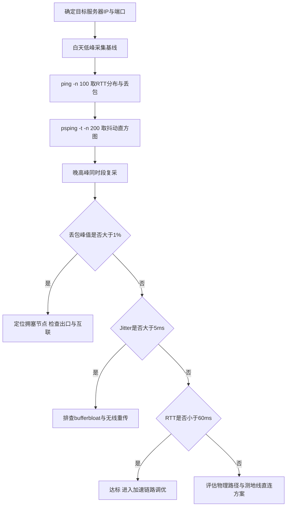
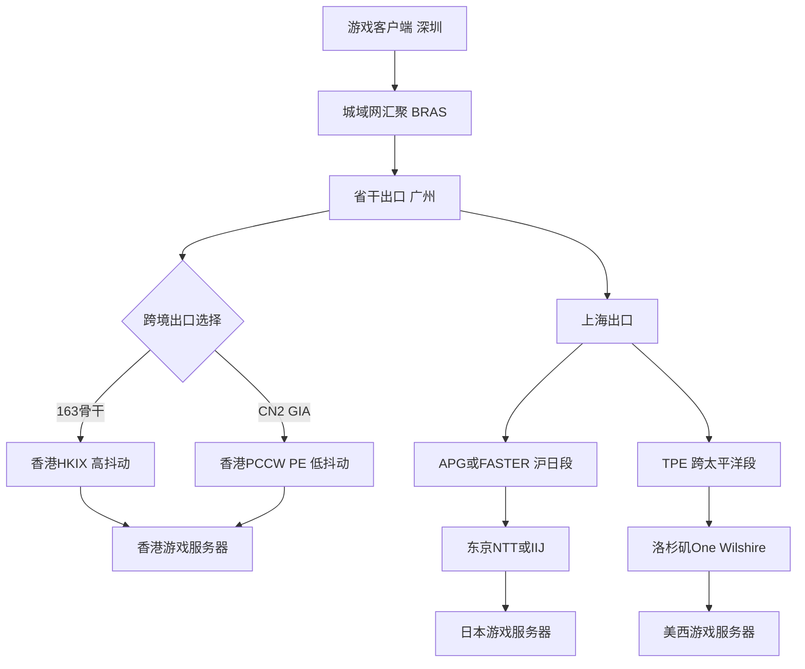

## 竞技类网游网络指标基线：RTT、Jitter与晚高峰丢包的硬性阈值

谈加速之前，先把“好网络”量化。电竞场景里，带宽几乎从来不是瓶颈——一局Apex的上下行各自不超过200Kbps，真正决定手感的是三个量：RTT、Jitter、丢包率。这三个指标的阈值不是拍脑袋定的，而是由游戏服务端的判定模型倒推出来的。

### RTT：命中判定的第一道门槛

绝大多数竞技FPS采用服务端权威（server-authoritative）的命中判定，客户端上报射击时刻，服务端回溯该时刻的玩家位置做命中检测。这意味着你的RTT直接决定了“你看到的敌人”和“服务端认为的敌人”之间的位置差。以Apex为例，角色横移速度约6.4m/s，RTT 60ms时位置偏差约0.38m，仍在角色碰撞体积内；RTT超过120ms，偏差接近0.8m，就会出现“准星明明在头上却判定空枪”的经典现象。Valorant的peeker's advantage更敏感，因为它的tick rate高达128，服务端对时间戳的容错窗口更窄。

实测可玩阈值可以这样划：

- **RTT < 60ms**：竞技级。压枪、甩狙、瞬镜的输入-反馈闭环在人类感知阈值（约100ms）以内，操作与画面基本同步。
- **60–100ms**：可接受。需要靠预瞄和前压补偿，职业选手在跨区比赛时也常处于此区间。
- **100–120ms**：临界。拉枪需要明显提前量，近身对枪胜率下降可感知。
- **> 120ms**：命中判定偏差常态化，不建议排位。

LoL韩服/日服的情况稍宽松，MOBA的技能弹道有飞行时间，RTT 80ms内补刀与技能命中基本无感，但超过150ms时闪现躲技能的窗口会被压缩到不可靠。官方推荐值方面，Riot对韩服标注的是“建议50ms以内”，Valorant官方支持页给的是“低于60ms为理想”，CS2的匹配系统则按ping分池，>90ms会被优先匹配到同延迟区间。

### Jitter：回拉与压枪的隐形杀手

Jitter是RTT的方差。它的危害不在于“慢”，而在于“不稳定”——服务端插值算法（interpolation）依赖稳定的包间隔来预测对手位置，抖动一大，插值就会过冲或滞后，表现为角色“回拉”“瞬移”。更致命的是对压枪的影响：CS2的弹道补偿依赖你按住鼠标时的连续输入采样，Jitter > 20ms时，客户端输入与服务端帧对齐错位，弹道散布会明显发散。

- **Jitter < 5ms**：无感，插值平滑。
- **5–15ms**：可感知，快速转身时偶见轻微回拉。
- **> 20ms**：压枪手感劣化，长点射弹道不可控。

Jitter的根源通常是排队延迟（bufferbloat）和无线链路重传，而不是物理距离。这也是为什么很多玩家“ping不高但手感飘”——均值好看，方差爆炸。

### 晚高峰丢包：1%就是红线

UDP没有重传机制，游戏层自己做。丢包一旦超过1%，就会触发客户端的输入重发与服务端的位置修正（position reconciliation），表现为“打中了没伤害”“走位被拽回”。晚高峰（20:00–23:00）是家宽出口拥塞、运营商互联带宽打满的时段，丢包往往呈突发性，均值0.5%但瞬时峰值5%的情况极常见。工程上要看的是**峰值丢包**而非平均丢包，`ping`的汇总行会骗人。

### 服务器IP段与端口速查

采集基线前先确认目标。以下为常用段（以官方公布与实测为准，会随版本调整）：

| 游戏 | 区域 | 典型IP段 | 端口 |
|---|---|---|---|
| Valorant | 港/日 | 103.10.124.0/22 | UDP 7000–8000 |
| Apex Legends | 港/日 | 52.80.0.0/16 内EA分配段 | UDP 37015, 1024–11224 |
| CS2 | 港/新 | 155.133.248.0/24 | UDP 27015–27050 |
| LoL韩服 | 首尔 | 121.78.0.0/16 内Riot段 | UDP 5000–5500, 8080 |

注意Valorant的7000–8000是区间，实际会话端口在握手时动态分配，防火墙必须整段放行，这也是后文“UDP全端口转发”的由来。

### 基线采集方法

不要用游戏内显示的ping，那是平滑后的估计值。用系统工具打原始样本：

```bat
:: Windows，100个包，看丢包率与RTT分布
ping -n 100 103.10.124.1

:: 更精确：psping输出延迟直方图与抖动
psping -t -n 200 103.10.124.1
```

`ping -n 100`给出最小/最大/平均RTT和丢包计数，重点看**最大值与平均值的差**，差值大即Jitter高。`psping -t`持续打流，能抓到晚高峰的突发丢包，配合`-n 200`取足够样本。采集时务必在晚高峰时段（20:30–22:30）做一轮，白天做一轮对照，两轮的差值就是你的“拥塞税”。站内《家庭宽带延迟基准与出口质量评估》一文给出了更细的分时段采样模板与运营商出口对照表，建议先按那套方法建立本地基线，再进入加速调优。



三个指标要联合看：RTT达标但Jitter超标，问题在本地或接入段；Jitter正常但晚高峰丢包，问题在运营商互联；三者同时劣化，才轮到考虑跨境专线与物理路径优化。基线没打准，后面所有加速手段都是盲调。

## 海底光缆物理测地线：广深港、沪日与TPE的延迟极限推算

光纤中的光速不是真空光速。标准单模光纤（G.652.D）在1310nm窗口的群折射率约1.467，1550nm窗口约1.468，对应传播速度约 **2.04×10⁸ m/s**，工程上取 2×10⁸ m/s 做快速估算。这个系数决定了任何海缆路径的物理延迟下限——RTT 的理论值等于 `2 × 距离 ÷ 2×10⁸`，即每 100km 单向贡献约 0.5ms、RTT 约 1ms。所有实际测量值高于理论值的部分，来自路由绕行、光电转换、再生中继与排队。

### 广深港：30km 的“最后一公里”陷阱

深圳到香港的直线距离约 30km，理论 RTT 为 `2×30km ÷ 2×10⁸ ≈ 0.3ms`。但实际 IPLC/IEPL 专线测量普遍落在 **2–4ms**，差距达一个数量级。原因不在光纤本身，而在两端：深圳侧的游戏服务器出口通常要经过城域网汇聚—BRAS/BNG—省干出口三层跳转，每跳引入 0.1–0.3ms 的存储转发与排队；香港侧登陆后需经 HKIX 或 Equinix HK 机房内的 PE 路由器再做一次策略路由。此外，深港跨境链路多为 DWDM 系统承载，OTN 再生段的光-电-光转换在两端各贡献约 0.05–0.1ms。

典型 traceroute 表现为 5–8 跳，AS 路径大致为 `AS4134（电信163）/AS4809（CN2）→ AS4766（KT）或 AS3491（PCCW）→ 香港本地 ISP`。若走 CN2 GIA，跳数可压到 4–5 跳，RTT 稳定在 2ms 出头；走普通 163 骨干则因跨境出口拥塞，晚高峰可飙至 8–15ms 并伴随抖动。**这条路径的优化空间不在物理层，而在选路与出口 QoS。**

### 沪日：2000km 与 APG/FASTER 的现实

上海至东京直线约 2000km，理论 RTT `≈ 20ms`。实际经 APG（Asia Pacific Gateway）或 FASTER 海缆的测量值为 **25–35ms**。APG 于 2016 年投产，上海南汇登陆站至日本千叶/志摩登陆站的主干段设计容量大、再生中继间距约 60–80km，每段中继的 EDFA 放大不引入显著延迟，但登陆后的 backhaul 是主要增量：上海侧从南汇登陆站到张江/外高桥 IDC 约 60–90km 陆地光纤，东京侧从千叶到 Otemachi 机房约 40km，两端合计贡献 3–5ms。

traceroute 典型 8–12 跳，AS 路径为 `AS4134/AS4809 → AS2914（NTT）或 AS2497（IIJ）→ 日本本地 ISP`。FASTER 路径（上海—志摩—洛杉矶方向）在沪日段与 APG 接近，但登陆站不同，backhaul 距离差异会带来 1–2ms 的浮动。**选 APG 还是 FASTER，取决于你落地的日本机房位置：千叶侧走 APG 更短，志摩侧走 FASTER 更优。**

### 跨太平洋 TPE：10000km 的 100ms 天花板

上海至洛杉矶直线约 10000km，理论 RTT `≈ 100ms`。TPE（Trans-Pacific Express）海缆全长约 17000km（含分支），上海—洛杉矶主干段实际光路长度约 11000–12000km，对应理论 RTT 110–120ms，实测 **120–150ms**。增量来源清晰：TPE 在关岛、韩国釜山设有分支登陆点，主干路由并非严格测地线；跨太平洋段每隔 60–80km 设一个 ROP（Repeater Optical Pump），虽为光放大，但线路色散补偿模块与 FEC 编解码在两端终端设备引入约 1–2ms；洛杉矶登陆后经 Morro Bay/圣路易斯奥比斯波 backhaul 至 One Wilshire 或 Equinix LA，再叠加 2–4ms。

traceroute 典型 12–18 跳，AS 路径为 `AS4134/AS4809 → AS2914（NTT）或 AS6461（Zayo）→ AS3356（Lumen）→ 美国本地 ISP`。晚高峰跨太平洋出口拥塞时，排队延迟可使 RTT 上探至 180–200ms，抖动（jitter）从常态 1–2ms 恶化到 15–30ms——这正是外服电竞最致命的场景。

### 路径与延迟对照

| 路径 | 物理距离 | 理论RTT | 实测RTT | 典型跳数 | 主要AS路径 | 主要增量来源 |
|------|---------|---------|---------|---------|-----------|-------------|
| 广深港 IPLC | ~30km | <1ms | 2–4ms | 5–8 | 4134/4809→4766/3491 | 城域网跳转、OTN再生、跨境出口QoS |
| 广深港 CN2 GIA | ~30km | <1ms | 2–3ms | 4–5 | 4809→3491 | 省干出口、香港PE策略路由 |
| 沪日 APG | ~2000km | ~20ms | 25–30ms | 8–12 | 4134/4809→2914/2497 | 两端backhaul 3–5ms、登陆站汇聚 |
| 沪日 FASTER | ~2000km | ~20ms | 27–35ms | 8–12 | 4134/4809→2914 | 志摩侧backhaul、分支路由绕行 |
| 跨太平洋 TPE | ~11000km | ~110ms | 120–150ms | 12–18 | 4134/4809→2914/6461→3356 | 分支登陆绕行、FEC/色散补偿、洛杉矶backhaul、出口拥塞 |

### 从物理极限到工程调优的映射



这张图揭示了一个关键事实：**理论 RTT 是硬下限，工程调优只能压缩“增量”部分**。广深港的增量主要是城域网与出口策略，可通过 CN2 GIA 选路与 BGP 社区调优压到 2ms 级；沪日的增量是两端 backhaul，选对登陆站与落地机房可省 3–5ms；跨太平洋的增量中，分支绕行与 backhaul 是固定成本，唯一可调的是出口拥塞导致的排队延迟——这需要 QoS 标记、UDP 优先级队列与多线 BGP 分流配合，也正是后续章节 UDP 全端口转发调优要解决的问题。把每条路径的理论值与实测值拆开看，才能判断哪一段值得投入，哪一段是物理定律收的“过路费”。

## 商业游戏加速器 vs IPLC纯物理裸光纤专线：底层传输机制差异

要理解两类方案的本质分野，先看数据包在链路上到底经历了什么。

商业加速器的典型路径是：本地客户端 → 就近入口节点（公网）→ 中转跳点（可能 1~3 跳）→ 落地节点 → 游戏服务器。每一段都跑在公网 BGP 之上，隧道协议多为 WireGuard 或 OpenVPN。以 WireGuard 为例，每个 UDP 包要额外背 60 字节开销（20 字节 IPv4 头 + 8 字节 UDP 头 + 32 字节 WireGuard 头，含 counter、receiver index、认证标签等）。这意味着 1420 的 MTU 下，实际载荷被压缩，且一旦路径 MTU 探测失败，分片重传会直接把抖动拉高。更关键的是，公网 BGP 的选路只对"可达性"负责，不对"队列时延"负责——晚高峰核心路由器出方向的 FIFO/WRED 队列一拥塞，UDP 包被无差别丢弃或排队，游戏这种小包高频流没有任何 QoS 优先级可言。加速器厂商能做的是"多跳中转 + 动态路由选优"，本质是在公网里挑一条当下相对不堵的路，但这条路随时会变，端到端延迟方差通常在 5~30ms 量级波动。

IPLC（International Private Leased Circuit）是另一套物理逻辑：点对点专线电路，从 A 端到 B 端是一条固定的、不经过公网路由器的物理通道，带宽固定（常见 10M/50M/100M），二层透传，UDP 全端口原样通过，**零额外封装**，MTU 保持 1500。因为没有公网拥塞点，端到端延迟方差可以压到 1ms 以内，这对电竞的"手感一致性"是决定性的——玩家感知的不是平均延迟，而是延迟的抖动。

| 维度 | 商业加速器（WireGuard 隧道） | 商业加速器（OpenVPN/UDP） | IPLC 纯物理专线 | 公网直连（无加速） |
|---|---|---|---|---|
| 封装开销 | 60 字节/包 | 约 69 字节（含 TLS 头） | 0（二层透传） | 0 |
| 有效 MTU | 1420 | 约 1400~1450 | 1500 | 1500 |
| 端到端延迟方差 | 5~30ms（随公网波动） | 8~40ms | <1ms | 10~80ms |
| UDP QoS 保障 | 无（尽力而为） | 无 | 物理带宽独占 | 无 |
| 故障切换 | 动态路由秒级切换 | 秒级重连 | 需人工/协议倒换，分钟级 | 依赖 BGP 收敛 |
| 晚高峰表现 | 明显劣化 | 明显劣化 | 基本无影响 | 严重劣化 |
| 成本 | 低（订阅制） | 低 | 高（按带宽月租） | 零 |

封装与 MTU 的差异会直接反映在诊断数据上。用 `mtr` 对比两条路径，专线的每一跳 RTT 几乎是一条直线，加速器则会在中转节点处出现周期性尖峰：

```bash
# 对比路径稳定性：观察 Loss% 与 StDev 列
mtr -u -P 3074 -c 200 -r game-server.example.com

# 验证 MTU：专线应能 1500 不分片，WireGuard 隧道通常卡在 1420
ping -M do -s 1472 game-server.example.com   # 1500-28=1472，专线应通
ping -M do -s 1392 game-server.example.com   # 1420-28=1392，隧道内应通

# 抓包看封装：WireGuard 流量在物理网卡上可见 32 字节额外头
tcpdump -i eth0 -n 'udp port 51820' -c 20 -vv
```

如果你在客户端侧用 Clash 做分流，隧道 MTU 与 UDP 转发策略必须显式声明，否则游戏 UDP 会被错误地走 TCP 代理或触发分片：

```yaml
# Clash Meta 片段：游戏 UDP 走专线节点，显式设置 MTU 与 UDP 透传
tun:
  enable: true
  stack: system
  mtu: 1420          # WireGuard 隧道下必须下调，专线可设 1500
  auto-route: true
proxies:
  - name: "IPLC-Game"
    type: ss
    server: 10.0.0.1
    port: 8388
    cipher: aes-128-gcm
    udp: true        # 关键：开启 UDP 全端口透传
rules:
  - AND,((NETWORK,UDP),(DST-PORT,3074)),IPLC-Game   # 电竞常用端口定向
  - MATCH,DIRECT
```

需要强调的是，低延迟数字本身并不等于体验好，抖动和丢包才是电竞联机的真正杀手，这一点在[机场延迟多少算正常？为什么低延迟不等于速度快与各地区正常延迟基准全景图](/guides/airport-latency-and-speed-guide/)里有更系统的量化讨论。选型上的现实结论是：预算允许且对局稳定性要求高的场景（如外服排位、赛事训练），IPLC 专线的物理确定性无可替代；而日常娱乐、多区服切换，商业加速器的动态多跳仍有其灵活性与成本优势。两者并非替代关系，而是按"抖动容忍度"分层部署。

## 客户端配置实战：TUN虚拟网卡、UDP Full-Cone NAT与强制代理规则

前几章把物理路径和链路层抖动压到了极限，但真正决定一局 Valorant 或 Apex 能不能稳在 30ms 以内的，往往是客户端最后那 20 厘米——TUN 网卡怎么接管流量、NAT 类型映射成什么样、哪些进程被强制塞进隧道。这一章全部是落地配置，不讲原理铺垫。

### TUN 网卡：让游戏流量无感穿透

传统 SOCKS5 代理对游戏基本无效，因为绝大多数竞技游戏走裸 UDP，根本不认代理协议。TUN 模式在系统层虚拟出一块三层网卡，把游戏发出的原始 IP 包整包接管，这才是电竞场景唯一可靠的入口。

Clash Meta（mihomo）核心配置片段：

```yaml
tun:
  enable: true
  stack: system          # Windows 用 system，Linux 可换 gvisor
  dns-hijack:
    - any:53
  auto-route: true
  auto-detect-interface: true
  mtu: 1420
```

`stack: system` 在 Windows 上走的是 Wintun 驱动，吞吐和延迟都优于 gvisor 的用户态协议栈，代价是依赖内核转发、偶发兼容性问题；如果遇到蓝屏或驱动冲突再退回 gvisor。`auto-route: true` 会自动写入 0.0.0.0/1 与 128.0.0.0/1 两条半区路由覆盖默认网关，比直接改 default route 更不容易被系统网络切换冲掉。`dns-hijack: any:53` 把游戏客户端硬编码的 DNS 查询（很多反作弊和登录服会绕过系统 DNS）一并劫持进隧道，避免解析泄漏到本地 ISP 导致登录服走直连。

Sing-box 等价配置（JSON）：

```json
{
  "inbounds": [{
    "type": "tun",
    "tag": "tun-in",
    "address": ["198.18.0.1/16"],
    "mtu": 1420,
    "auto_route": true,
    "strict_route": true,
    "stack": "system",
    "sniff": true
  }]
}
```

`198.18.0.1/16` 是保留测试网段，用它做 TUN 网关不会和任何真实内网冲突，这也是后面路由表要指向它的原因。

### UDP NAT 类型：必须打到 Full-Cone

这是整章最容易被忽略、却直接决定“能不能连上队友”的一环。游戏语音、组队匹配、P2P 大厅依赖 UDP 打洞，如果你的出口 NAT 是 Symmetric（对称型），每个目标地址端口都分配独立映射，打洞直接失败，表现为“能进游戏但组队语音断、匹配大厅转圈”。

Clash Meta 里显式声明：

```yaml
listeners:
  - name: udp-gateway
    type: mixed
    port: 7890
    udp: true
```

并在出站侧确保 NAT 行为为 full-cone。mihomo 本身对 UDP 采用 endpoint-independent mapping，但前提是**不要**开启 `udp-over-tcp`（后文细说），且上游节点必须是原生 UDP 转发而非 TCP 伪装。Sing-box 侧对应：

```json
{
  "type": "direct",
  "tag": "game-out",
  "udp_fragment": false
}
```

`udp_fragment: false` 让分片在本地重组后再发，避免上游节点对分片包处理不一致造成的丢包。验证 NAT 类型最直接的办法是在游戏机上跑 STUN 探测，或用 `natty` 之类的工具确认映射为 Endpoint-Independent Mapping + Endpoint-Independent Filtering，两项都满足才是真正的 Full-Cone。

### 强制进程走代理与路由表兜底

规则层面用进程名精确命中，避免全局代理把系统更新、浏览器流量一起拖进隧道污染带宽：

```yaml
rules:
  - PROCESS-NAME,VALORANT-Win64-Shipping.exe,GAME
  - PROCESS-NAME,r5apex.exe,GAME
  - PROCESS-NAME,TslGame.exe,GAME
  - DOMAIN-SUFFIX,riotgames.com,GAME
  - GEOIP,CN,DIRECT
  - MATCH,GAME
```

`PROCESS-NAME` 在 Windows 上依赖 mihomo 的进程匹配能力，注意进程名大小写和 `.exe` 后缀必须完全一致，反作弊重命名进程时规则会失效，需要同步更新。

有些游戏（尤其是带独立启动器 + 反作弊双进程的）会绕过 TUN 的进程识别，此时用路由表硬兜底，把游戏服务器网段直接钉到 TUN 网关：

```cmd
route add 103.10.124.0 mask 255.255.252.0 198.18.0.1 metric 1
```

`103.10.124.0/22` 是 Riot 部分对局服的地址段，`198.18.0.1` 即 TUN 网关。`metric 1` 保证优先级高于物理网卡默认路由。这条命令重启失效，生产环境写进启动脚本或用 `route -p add` 持久化。注意网段要按实际抓包结果填，别照抄——Riot 的服地址段会随区域和赛季调整，用 `netstat -ano | findstr <游戏PID>` 或 Wireshark 抓一次登录流量确认。

### MTU 1420：分片的隐形杀手

公网路径 MTU 通常是 1500，但隧道封装（WireGuard、IPIP、部分 UDP 隧道）会额外吃掉 20~80 字节头部。如果 TUN 仍设 1500，大包在出口被分片，任一分片丢失整包重传，表现为“平时 20ms，一交火瞬间飙到 200ms 并伴随丢包”。

设 `mtu: 1420` 留出 80 字节余量，覆盖绝大多数封装开销。验证方法：

```bash
ping -M do -s 1392 103.10.124.1   # Linux，1392+28=1420
ping -f -l 1392 103.10.124.1      # Windows
```

能通说明路径 MTU ≥1420，不通就继续下调到 1400 甚至 1380。别迷信固定值，跨国线路的 PMTU 经常比理论值更低。

### UDP 快速老化与 udp-over-tcp 的取舍

NAT 会话老化时间是隐形炸弹。默认 conntrack 或家用路由的 UDP 超时可能只有 30 秒，游戏空闲期（比如死亡观战、加载界面）会话被回收，重回对局时首包触发重建，产生一次 100ms+ 的握手延迟。在能控制的网关上把 UDP 老化拉到 300 秒以上：

```bash
sysctl -w net.netfilter.nf_conntrack_udp_timeout=300
sysctl -w net.netfilter.nf_conntrack_udp_timeout_stream=600
```

客户端侧 mihomo 保持默认即可，重点在出口节点和中间网关。

最后说 `udp-over-tcp`。它的价值只有一个：当上游节点或中间链路封锁 UDP 时，把 UDP 包塞进 TCP 隧道强行穿透。代价极其惨重——TCP 的队头阻塞会让一个丢包卡住后续所有游戏包，抖动从个位数毫秒劣化到几十甚至上百毫秒，对 FPS 游戏是灾难。**只要 UDP 能通，绝对不要开**。仅在 UDP 被完全阻断、且你打的是回合制或对延迟不敏感的联机时才作为最后手段启用，并在配置里明确标注：

```yaml
# 仅 UDP 被封时启用，FPS 游戏禁用
# udp-over-tcp: true
```

配置落地后，用 `mtr -u -P <游戏端口> 103.10.124.1` 连续跑 5 分钟看丢包和抖动曲线，配合游戏内网络统计面板交叉验证。配置对不对，数据说话，别靠体感。

## 复杂网络环境下的游戏报文排查：MTR、Wireshark与PingPlotter联合作战

外服游戏联机卡顿的锅，九成不在"带宽不够"，而在丢包、抖动、乱序这三件事上。带宽只决定你下载更新包的速度，而游戏对局走的是每秒几十到上百个小包，任何一个环节的微突发都会让角色瞬移、技能判定失效。排查这类问题，靠单一工具必然误判，必须把 MTR 的路径定位、Wireshark 的报文级证据、PingPlotter 的时间维度观测三者拼成一条证据链。

先明确一个前提：游戏流量几乎全是 UDP。以常见的外服节点 `103.10.124.1` 为例，游戏端口假设为 7000，那么 ICMP 探测和 TCP 探测的结果都不能直接代表游戏体验。所以 MTR 必须带 `-u` 走 UDP，并指定目标端口：

```bash
mtr -u -P 7000 -c 100 --report-wide 103.10.124.1
```

`-c 100` 发 100 个探测包，`--report-wide` 输出完整主机名不截断。看报告时只盯三列：Loss%、StDev、Avg。关键判断逻辑是**逐跳对比**——如果第 5 跳丢 30% 而第 6 跳及之后全部 0%，那基本是中间路由对 UDP 探测做了 ICMP 限速（rate-limit），属于"假丢包"，不影响实际转发；反之，如果从第 7 跳开始丢包率一路爬到末跳都是 8%，那才是真丢包，问题出在第 7 跳之后的那段链路。这里有个容易踩的坑：MTR 的 UDP 探测包和游戏真实报文在 DSCP 标记、包长上并不一致，运营商可能对探测包和业务包区别对待，所以 MTR 只能定位"嫌疑跳"，不能定案。

定案要靠 Wireshark 抓包。在客户端侧抓取，过滤条件直接锁定目标：

```text
udp.port==7000 && ip.addr==103.10.124.1
```

抓够 3 到 5 分钟对局流量后，重点看三样东西。第一是**序列号跳变**：游戏协议通常自带递增序号，在 Wireshark 里用 `udp.payload` 配合自定义解析，或直接看 `Sequence` 字段，若出现 100→101→105 这种缺口，说明中间丢了 3 个包且未重传（UDP 无重传机制，只能靠应用层补）。第二是**重传间隔**：部分游戏有应用层重传，观察同一逻辑包的两次发送时间差，若稳定在 200ms 以上，说明 RTT 已经劣化到触发重传阈值。第三是 **RTT 分布**：用 `Statistics → Flow Graph` 或导出 `udp.time_delta` 做直方图，正常对局 RTT 应集中在 40–80ms 的窄带内，若出现双峰（比如 60ms 和 220ms 各占一半），说明存在两条路径或队列积压，这就是抖动的直接来源。顺带一提，判断延迟是否"正常"不能只看绝对值，不同地区基准差异极大，可参考[机场延迟多少算正常？为什么低延迟不等于速度快与各地区正常延迟基准全景图](/guides/airport-latency-and-speed-guide/)里的基准表来校准预期。

MTR 和 Wireshark 都是"点"上的证据，PingPlotter 补的是"时间轴"。设置采样间隔 5 秒、总包数 1000，覆盖约 83 分钟，正好横跨一个晚高峰窗口（19:00–21:00）。观察两条曲线：Jitter 曲线和路径变化。晚高峰 Jitter 从 5ms 突然抬到 40ms 以上并持续，同时 MTR 显示某跳延迟同步上涨，基本可判定为路径拥塞（通常是国际出口的汇聚层排队）。若 PingPlotter 显示路由跳数在中途发生变化（比如原本 12 跳变成 14 跳），说明 BGP 发生了路由切换，新路径可能绕行，RTT 会整体抬升。

把三者结论汇总成判断矩阵，落地时按这个表走：

| 现象组合 | 判定 | 处置 |
|---|---|---|
| 中间跳丢包，末跳 Loss=0%，Jitter 平稳 | ICMP/UDP 探测限速 | 忽略，不构成故障 |
| 末跳丢包 >1%，Jitter 突增且与晚高峰重合 | 路径拥塞 | 换出口节点或错峰 |
| UDP 乱序率 >0.5%（Wireshark 序列号逆序统计） | 多路径转发或队列乱序 | 需换专线，普通中转无法解决 |
| 末跳 RTT 双峰分布 | 存在备用路径或 QoS 降级 | 结合 MTR 确认跳数变化 |

乱序率这个指标最容易被忽视，但它是"换专线"的硬信号。普通公网中转在拥塞时会因多队列调度产生乱序，而游戏协议对乱序的容忍度极低——一个乱序包就可能触发客户端的位置回滚。统计方法是在 Wireshark 里用 `udp.port==7000` 过滤后，导出序列号列做逆序计数，超过 0.5% 就别再折腾参数了，直接上专线。专线的价值不在于"更快"，而在于路径固定、队列可控，从物理层消灭乱序和微突发。

最后提醒一个工程细节：抓包和 MTR 尽量在**同一时间段、同一出口**执行，否则证据链断裂。如果客户端本身经过代理软件转发，务必确认代理的 UDP 转发策略没有引入额外 NAT 或分片——很多 Clash 配置默认对 UDP 走 `redir-host` 而非 `fake-ip`，会导致目标地址解析偏差，抓包看到的对端 IP 和真实游戏服务器对不上。排查前先 `curl -x socks5h://127.0.0.1:7890 https://api.ip.sb/ip` 确认出口 IP 与预期一致，再开始上述三步联合作战。

## 晚高峰抖动压制：QoS标记、缓冲区调优与多路径冗余

晚八点到十一点是外服联机的“死亡时段”。出口带宽被视频流和下载任务挤占，游戏UDP包在队列里排队几十毫秒，抖动从个位数飙到60ms以上，表现就是人物瞬移、技能延迟。这一节讲的是如何在出口路由器上把游戏流量从拥塞中“捞”出来，并用多路径兜底。

### DSCP标记与LLQ优先队列

第一步是让游戏UDP流在网络设备里被识别并打上DSCP EF（46）。在Linux出口网关上，用`iptables`配合`mangle`表按端口和包长特征标记。游戏UDP包通常小于200字节且端口固定，用`--dport`匹配比用`-m length`更稳：

```bash
iptables -t mangle -A OUTPUT -p udp -m multiport --dports 27015:27050,3478:3480,3074 -j DSCP --set-dscp-class EF
```

标记之后，在出口网卡上挂`tc`的LLQ。Linux没有思科那种现成的`priority`队列，用`tc`的`prio` qdisc配合HTB实现等效的严格优先：EF流量进最高优先级band，只要该band有包就优先出队，低优先级band在EF空闲时才获得带宽。

```bash
# 根队列：HTB总带宽设为物理出口的95%，留余量防突发
tc qdisc add dev eth0 root handle 1: htb default 30 r2q 100
tc class add dev eth0 parent 1: classid 1:1 htb rate 95mbit ceil 95mbit

# EF游戏流：保证20Mbit，允许借用，优先级0
tc class add dev eth0 parent 1:1 classid 1:10 htb rate 20mbit ceil 95mbit prio 0
# 普通流量
tc class add dev eth0 parent 1:1 classid 1:30 htb rate 60mbit ceil 95mbit prio 2

# EF子队列用fq_codel压抖动，避免单一FIFO造成排队延迟累积
tc qdisc add dev eth0 parent 1:10 handle 10: fq_codel
tc qdisc add dev eth0 parent 1:30 handle 30: fq_codel

# 按DSCP把EF包分类到1:10
tc filter add dev eth0 parent 1: protocol ip prio 1 u32 match ip tos 0xb8 0xfc flowid 1:10
```

`fq_codel`在这里是关键：它用流哈希把不同五元组分到独立子队列，配合CoDel的主动丢弃控制排队时延，比纯FIFO在微突发下抖动低一个量级。

### 内核缓冲区调优

默认的`rmem_max`/`wmem_max`（通常212KB）在晚高峰微突发下会触发丢包。调到4MB给socket留足吸收空间：

```bash
sysctl -w net.core.rmem_max=4194304
sysctl -w net.core.wmem_max=4194304
sysctl -w net.core.rmem_default=262144
sysctl -w net.core.wmem_default=262144
```

`tcp_low_latency`这个参数在新内核里已移除，老内核上设为1会禁用TCP的延迟合并，对UDP无影响，但会拖累同机TCP吞吐，建议保持0。真正对UDP生效的是应用层`setsockopt`的`SO_RCVBUF`，设为256KB（262144）——太小扛不住突发，太大会引入bufferbloat式延迟。256KB在千兆出口、平均包长150字节下约能吸收1700个包，足够覆盖晚高峰的毫秒级突发。

### 多路径冗余与按延迟选路

单条IPLC在晚高峰可能因运营商互联拥塞RTT抬升。主备双路径：主用IPLC专线，备用商业加速器隧道。用`mwan3`做健康探测与切换，探测目标选游戏服务器同区域的Anycast节点，间隔1秒，连续3次RTT>80ms或丢包>2%触发切换：

```bash
# mwan3配置片段
config interface 'iplc'
    option enabled '1'
    list track_ip '203.0.113.10'
    option track_method 'ping'
    option reliability '2'
    option count '3'
    option timeout '1'
    option interval '1'
    option failure_latency '80'
    option failure_loss '2'

config interface 'accel'
    option enabled '1'
    list track_ip '198.51.100.20'
    ...
```

`mwan3`基于`ip rule`和`ip route`做策略路由，切换在秒级完成，但会断流几百毫秒。对延迟极敏感的场景，用BGP多宿主更平滑：两条上游各宣告同一前缀，本地用`bgp bestpath`的`lowest-latency`（部分厂商支持）或自定义route-map按探测RTT调整local-preference，实现亚秒级收敛且不丢会话。

实际部署中，主备切换的抖动往往比拥塞本身更伤体验。折中方案是双路径同时活跃，游戏UDP流走IPLC，加速器仅作为探测备用，切换阈值设得保守些（RTT>80ms持续5秒），避免晚高峰频繁乒乓。

## 从测地线到客户端：外服电竞联机全链路调优检查清单

前面六章把物理路径、隧道封装、NAT 与转发逐层拆开讲，这一章不再引入新概念，只做一件事：把散落在各层的动作收敛成一张可执行、可验收的清单。真实排障里最耗时间的从来不是“不知道怎么配”，而是“配了但不知道对不对”。下面每一项都给出命令或配置片段，以及明确的验收阈值——RTT ≤ 物理极限 + 15ms、Jitter < 5ms、丢包 < 0.5%，三项同时成立才算该项通过。

**1. 物理路径选择（广深港 / 沪日 / TPE）**

先定测地线，再谈优化。广深港走陆缆，深圳到香港 POP 的物理 RTT 约 3~5ms；沪日走中日海缆，上海到东京约 25~30ms；TPE 海缆（跨太平洋直达）上海/青岛到洛杉矶西岸约 130~140ms。选路的判据是目标游戏服务器所在区域，而不是“哪条便宜”。

```bash
# 对候选入口分别做 100 包探测，取中位数而非平均值
mtr -rwzc 100 -i 0.2 <game-server-ip>
# 记录每跳 AS 与延迟增量，确认没有绕行第三国
```

验收：实测 RTT 与上表物理极限之差 ≤ 15ms。若超出，说明存在绕路或拥塞，换入口而非加钱升带宽。

**2. IPLC 带宽与 SLA**

电竞联机对带宽需求极低（单局上下行通常 < 200Kbps），但对**丢包与抖动**的 SLA 极敏感。选 IPLC/IEPL 时看的是“丢包承诺 ≤ 0.1%”和“抖动承诺”，不是标称带宽。带宽按峰值并发 × 1.5 冗余即可，盲目堆到 100M 纯属浪费。

```bash
# 持续 10 分钟双向压测，观察丢包与抖动分布
iperf3 -c <peer> -u -b 2M -t 600 -l 1200 --get-server-output
```

验收：10 分钟 UDP 压测丢包 < 0.1%，抖动 p99 < 3ms。达不到就换供应商，调优救不了劣质线路。

**3. 出口 NAT 类型：Full-Cone**

对称 NAT 会让 P2P 打洞失败、被迫走中继，RTT 直接翻倍。出口必须是 Full-Cone（或至少 Restricted-Cone）。

```bash
# 用 STUN 判定 NAT 类型
stunclient --mode behavior stun.l.google.com 19302
# 期望输出：Behavior test: endpoint independent（即 Full-Cone）
```

验收：behavior 为 endpoint independent。若是 symmetric，检查是否有多层 NAT 叠加，或运营商 CGNAT——后者无解，只能换出口。

**4. TUN MTU 1420**

UDP 隧道封装（WireGuard/IPSec）会吃掉 60~80 字节，MTU 不调会导致大包分片、丢包率虚高。统一设 1420，留足余量。

```bash
ip link set dev tun0 mtu 1420
# 验证不分片可达
ping -M do -s 1392 -c 10 <peer>   # 1392 + 28 = 1420
```

验收：1392 字节不分片 ping 全通，且游戏内无“大包丢失”型卡顿。

**5. 游戏进程强制代理**

分流规则必须按进程/五元组精确匹配，避免游戏流量走直连、更新流量走代理的错配。

```bash
# nftables 按 cgroup 标记游戏进程流量
nft add rule inet proxy output socket cgroupv2 level 2 "game.slice" meta mark set 0x1
ip rule add fwmark 0x1 table 100
ip route add default dev tun0 table 100
```

验收：`ss -tunp` 确认游戏 UDP 五元组全部落在 tun0，无泄漏到物理网卡。

**6. DSCP 标记**

给游戏 UDP 打 EF（46），让沿途队列优先调度，压制抖动。

```bash
nft add rule inet proxy output udp dport { 27015-27050 } ip dscp set ef
```

验收：`tcpdump -v` 抓到游戏包 DSCP 为 0x2e，且端到端 Jitter < 5ms。

**7. MTR 基线存档**

每次变更前后各存一份基线，出问题时对比定位。

```bash
mtr -rwzc 200 <ip> > baseline_$(date +%F_%H%M).txt
```

验收：基线文件入库，变更后 RTT 增量 ≤ 5ms、无新增丢包跳。

**8. Wireshark 抓包留存**

争议时刻（掉线、瞬断）必须有权威证据。

```bash
tcpdump -i tun0 -w game_$(date +%s).pcap -s 0 'udp and port 27015'
```

验收：保留 ≥ 72 小时环形抓包，关键帧可回溯到具体丢包时刻。

**冗余配置与订阅周期**

单线路再优也有维护窗口。生产环境至少做“主备双入口 + 自动切换”，主备走不同物理路径（如广深港主、沪日备），切换阈值设为丢包 > 1% 持续 10s。选型与订阅周期上，短周期（月付）适合验证新线路，稳定后转年付锁定成本——具体对比见站内《外服加速线路选型矩阵》与《订阅周期与成本模型》两篇，此处不重复展开。

清单的价值在于**可验收**。八项逐条打勾、三项阈值逐条达标，链路才算真正调通；任何一项“差不多”，都会在关键团战的那 200ms 里现形。
