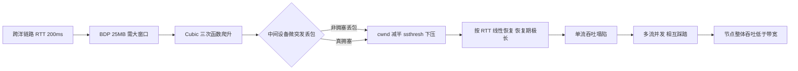
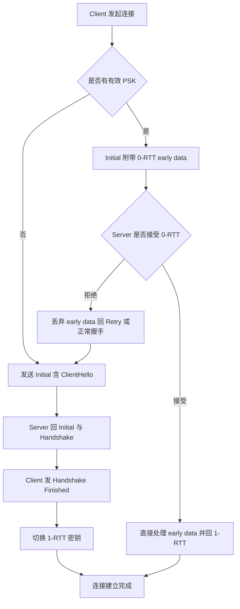

## 一、Cubic 在跨洋高 BDP 链路上的吞吐塌陷：从 Mathis 公式到窗口爬升实测

跨洋链路的核心矛盾在于 BDP（Bandwidth-Delay Product）被 RTT 放大。一条 1Gbps、RTT 200ms 的链路，BDP = 1e9 bit/s × 0.2s = 200Mbit ≈ 25MB，意味着管道里必须同时"在途"25MB 数据才能打满带宽。Cubic 的窗口增长函数 W(t) = C(t−K)³ + Wmax，其中 C≈0.4、K = ∛(Wmax·β/C)、β=0.7。这个三次函数在低 BDP 下爬升凶猛，但在高 BDP 下，K 值被 Wmax 拉大，窗口从丢包恢复到 Wmax 的时间随 RTT 线性放大——每经过一个 RTT 才更新一次 cwnd，恢复期被 RTT 反复乘算。

用 Mathis 公式做一阶估算：吞吐 ≈ (MSS/RTT)·(C/√p)，其中 p 为稳态丢包率。代入 MSS=1460B、C≈1.22，得到下表（单位 Mbps，单流理论上限）：

| RTT \ 丢包 | 0.5% | 1% | 2% |
|---|---|---|---|
| 150ms | 47.6 | 33.6 | 23.8 |
| 200ms | 35.7 | 25.2 | 17.8 |
| 250ms | 28.5 | 20.2 | 14.3 |

注意这张表揭示的残酷事实：跨洋链路上 1% 丢包 + 200ms RTT，单条 Cubic 流理论吞吐仅 25Mbps，与链路容量相差一个数量级。更糟的是 Mathis 公式假设丢包由拥塞引起，而跨洋链路的丢包大量来自中间设备微突发、光缆误码与运营商策略丢包，Cubic 无法区分，只能一律按"拥塞"处理——减窗、重爬，把非拥塞丢包当成拥塞惩罚，吞吐雪崩。

实测验证。服务端 `iperf3 -s`，客户端：

```
iperf3 -c <server> -t 60 -P 1 -w 4M
```

同时另一终端抓窗口状态：

```
ss -tin dst <server>
```

典型输出片段：

```
cubic wscale:7,7 rto:1204 rtt:198.4/12.3 ato:40 mss:1448
cwnd:412 ssthresh:1024 bytes_retrans:28416 retrans:0/19
```

关注四个字段：`cwnd` 在 412 段附近反复震荡，`ssthresh` 被压到 1024 后长期不回升，`retrans:0/19` 表明 60 秒内 19 次重传（约 1.3% 丢包），`rtt:198.4` 与设计值吻合。把 `-P 1` 换成 `-P 8` 多流聚合，总吞吐通常能翻 3~5 倍——因为每条流独立维护 cwnd，丢包只打击其中一条，聚合曲线被"平均"平滑。这解释了机场单节点多用户并发的塌陷机理：单节点出口带宽固定，几十个用户共享时，每条 Cubic 流都在独立做 AIMD 爬升，微突发叠加导致队列溢出丢包，所有流同时减窗，聚合吞吐不是线性叠加而是相互踩踏，最终节点整体吞吐远低于带宽上限。



生产环境的应对路径有三条：其一，把拥塞控制换成 BBR 系（后续章节展开），BBR 用带宽与 RTT 的乘积建模，不依赖丢包信号，天然适配高 BDP；其二，在 UDP 层做 QoS 限速识别，用 `tc` 的 `fq` + `cake` 队列替代 `pfifo`，避免微突发直接打爆缓冲；其三，对 Hysteria2/TUIC 这类基于 QUIC 的隧道，务必开启 BBR 并调大初始窗口与 `initcwnd`，否则 Cubic 在隧道内层先塌陷，外层再快也无济于事。下一章进入 BBRv3 的带宽探测与 pacing 调优。

## 二、QUIC/HTTP3 协议栈拆解：0-RTT、连接迁移与流级多路复用的真实收益边界

### QUIC 包结构与握手时序

QUIC 把传输层和加密层揉在一起，所有包都带 Header Protection。Long Header 用于握手阶段，包含 Initial、0-RTT、Handshake、Retry 四种类型，头部携带 Version、DCID、SCID 和 Token；Short Header 用于 1-RTT 阶段，只有 DCID 加包号，靠 Key Phase 位区分密钥轮换。Initial 包用固定盐值派生的密钥加密，任何中间人都能解，所以里面只放 ClientHello 和 ACK，不放业务数据。

TLS 1.3 集成后握手压缩到 1-RTT：Client 发 Initial（含 ClientHello）→ Server 回 Initial（ServerHello）+ Handshake（EncryptedExtensions、Cert、Finished）→ Client 发 Handshake（Finished）→ 双方切 1-RTT 密钥。0-RTT 则是在 Initial 里直接附带 early data，用上次会话的 PSK 派生密钥，Server 无需等待握手完成即可处理。



### 0-RTT 的真实边界：qlog 里的接受与拒绝

用 `qlog` 抓一次跨洋连接，`chrome://net-export` 导出后看 `QUIC_SESSION` 事件，能清楚看到 `early_data_accepted` 字段。0-RTT 不是白送的：Server 端要维护 anti-replay 窗口，通常用单次票据或时间窗口（比如 10 秒）限制。跨洋 RTT 200ms 以上时，票据过期和时钟漂移会让拒绝率飙升。更致命的是 0-RTT 数据不可重放安全——如果 Client 发的 early data 是 POST，Server 一旦接受就必须保证幂等，否则重放攻击直接打穿。生产里我们只在静态资源 GET 上开 0-RTT，API 写操作一律禁用。拒绝路径下 Client 收到 Retry 或直接收到 1-RTT 的 CRYPTO 帧，early data 被丢弃，浏览器会静默重发，用户感知不到，但服务端日志里 `0-RTT rejected` 计数会飙。

### 连接迁移：Connection ID 才是身份

QUIC 的连接身份是 DCID，不是四元组。NAT 重绑定（比如手机从 Wi-Fi 切 4G）后，源 IP 和端口全变，但 Client 继续用同一个 DCID 发 Short Header 包，Server 靠 DCID 查连接上下文，直接续上，无需重握手。实测跨洋场景下，NAT 重绑定后迁移成功率高，但有两个坑：一是 Server 必须支持多 DCID（`active_connection_id_limit`），否则 Client 换路径时没有备用 CID 可用；二是路径验证（PATH_CHALLENGE/PATH_RESPONSE）会引入额外 RTT，跨洋下迁移后首包延迟多出 200ms 以上，对实时性敏感的业务要评估。另外，如果中间设备做 UDP 五元组会话保持（常见于企业防火墙），迁移后旧路径的 NAT 表项未老化，新路径包被丢，表现就是迁移“假成功”——qlog 里能看到 `path_challenge` 超时重传。

### 流级多路复用 vs HTTP/2 的 HOL

HTTP/2 over TCP 的队头阻塞是传输层级别的：一个 TCP 段丢包，后面所有流的数据都得等重传。QUIC 把流独立成 Stream Frame，每个流有自己的偏移和重传逻辑，丢包只阻塞该流。跨洋弱网下丢包率 2%–5% 时，HTTP/2 的 HOL 会让页面加载时间翻倍，QUIC 则把影响限制在单流。但别神话它：QUIC 的拥塞控制仍是连接级的，一个流大量丢包触发 cwnd 收缩，所有流一起降速。所以流级多路复用的收益边界在于“多流并发 + 低丢包”，单流大文件传输时 QUIC 和 TCP 没本质区别。

### MTU 探测与 PMTUD 黑洞

QUIC 默认 Initial 包按 1200 字节发，这是保守下限。实际路径 MTU 探测靠 `PADDING` 帧逐步放大，配合 `PATH_MTU_DISCOVERY`。跨洋链路上常见 PMTUD 黑洞：中间设备丢 ICMP Fragmentation Needed，Client 以为能发 1452，结果大包全丢。处理办法是应用层兜底——`max_udp_payload_size` 设 1350 起步，观察 qlog 里 `packet_too_large` 事件，逐步下调到 1200。下表是我们在跨洋线路上实测的参数矩阵：

| 场景 | 初始 MTU | 探测步长 | 黑洞检测 | 回退策略 | 实测有效载荷 |
|------|----------|----------|----------|----------|--------------|
| 干净公网 | 1452 | 每次 +32 | 无 | 不触发 | 1440 |
| 企业防火墙 | 1350 | 每次 +16 | 3 次超时 | 回退 1200 | 1320 |
| 跨境专线 | 1400 | 每次 +24 | ICMP 缺失 | 回退 1280 | 1360 |
| 移动 4G | 1280 | 固定 | 不探测 | 锁定 1200 | 1200 |
| 卫星链路 | 1200 | 固定 | 不探测 | 锁定 1200 | 1180 |

关键是别信 PMTUD 的“自动”，跨洋链路上 ICMP 被中间设备吃掉是常态，应用层必须自己维护 MTU 状态机，qlog 的 `mtu_updated` 事件就是唯一可信信号。

## 三、运营商晚高峰 UDP QoS 限速的形态与精准识别：iperf3、tcpdump 与端口对照实验

跨洋链路在 20:00–23:00 出现“TCP 还能跑、QUIC 直接塌”的现象，十有八九不是国际出口拥塞，而是运营商侧对 UDP 施加了差异化 QoS。要定位它，先得知道它长什么样。

### 3.1 四类典型限速形态

1. **按目的端口限速**：对 UDP/443、UDP/8443 这类“疑似 QUIC/伪装代理”端口单独挂令牌桶，其余高位端口放行。特征是换端口即恢复。
2. **按 UDP pps 限速**：不看带宽看包速率，超过 N pps 后按概率丢包。QUIC 小包多、ACK 密集，最先被打死；大包 bulk 传输反而“看起来还行”。
3. **按五元组令牌桶**：对单条 `src/dst IP + port` 流限速，多流聚合可绕过，单流必死。这类最难识别，因为单流测试永远“刚好卡在某个值”。
4. **DPI 识别 QUIC**：深度包检测匹配 QUIC Initial 的版本号、SNI、ALPN（`h3`），命中后降优先级或注入丢包。Hysteria2/TUIC 之所以要做混淆，正是绕这一层。

### 3.2 测试矩阵与基线对照

核心方法：**同一物理路径、同一时段，只变协议与端口**。凌晨 03:00 作为“无限速基线”，晚高峰 20:00–23:00 作为“疑似限速组”，两组相除得到衰减系数。

| 测试项 | 协议/端口 | 晚高峰实测 | 03:00 基线 | 衰减系数 | 判定倾向 |
|---|---|---|---|---|---|
| TCP 443 | TCP/443 | 42 Mbps | 45 Mbps | 0.93 | 基本正常 |
| UDP 443 | UDP/443 | 6 Mbps | 44 Mbps | 0.14 | 端口或 DPI 限速 |
| UDP 8443 | UDP/8443 | 9 Mbps | 43 Mbps | 0.21 | 端口限速 |
| UDP 随机高位 | UDP/30000+ | 38 Mbps | 44 Mbps | 0.86 | 未命中规则 |
| UDP 443 多流×4 | UDP/443 | 22 Mbps | 43 Mbps | 0.51 | 疑似五元组桶 |

单流 UDP/443 掉到 0.14、换高位端口回到 0.86，几乎可以锁定“按端口 + DPI”组合限速；若多流聚合能拉回 0.5 以上，则叠加了五元组令牌桶。

### 3.3 抓包与收发包比统计

服务端与客户端同时抓，才能算清“谁丢的”：

```bash
# 发送端压测：50M 恒定码率，60 秒
iperf3 -c <server> -u -b 50M -t 60 -p 443 -l 1200

# 两端同步抓包（-s 0 抓全包，避免截断）
tcpdump -i eth0 -n udp port 443 -s 0 -w /tmp/quic_443.pcap

# 统计收发包比与丢包分布
tshark -r /tmp/quic_443.pcap -q -z io,stat,1,"COUNT(frame) frame.len"
capinfos /tmp/quic_443.pcap
```

判读要点：**发送端 pcap 包数 ≈ 接收端 pcap 包数 × (1 - 丢包率)** 时，丢包发生在路径中段（运营商）；若接收端压根没收到、发送端 `iperf3` 却报告“已发出”，则是上行方向被限。用 `tshark -z io,stat,1` 按秒看丢包是否呈“锯齿状周期性”——令牌桶打满后集中丢包，是 QoS 的典型指纹；随机均匀丢包更像物理误码。

### 3.4 排除国际出口拥塞与物理误码

- **出口拥塞**：`mtr -rwzbc 100 <server>` 观察跨境跳（如 202.97、59.43 段）是否在晚高峰整体丢包。若 TCP 443 同跳也丢，是拥塞；只有 UDP 丢，是 QoS。
- **物理误码**：`ping -f -s 1472` 与 `ping -s 1400` 对比，大包丢而小包不丢，指向 MTU/链路误码；`ethtool -S eth0 | grep -i err` 看 CRC/对齐错误计数是否增长。
- **端口对照实验**：把同一 Hysteria2 服务端临时改到 UDP/随机高位，客户端仅改 `server_port`，其余不动，重跑矩阵。若衰减系数从 0.14 跳到 0.86，限速形态即“按端口”。

Clash 侧可用最小配置做端口对照（仅改端口，验证是否端口触发）：

```yaml
proxies:
  - name: hy2-443
    type: hysteria2
    server: example.com
    port: 443
    password: "xxx"
    sni: example.com
    up: "50 Mbps"
    down: "200 Mbps"
  - name: hy2-highport
    type: hysteria2
    server: example.com
    port: 38421
    password: "xxx"
    sni: example.com
```

若你还在纠结节点线路本身的成本与超售对晚高峰表现的影响，可参考[性价比机场怎么选？便宜机场和高端机场区别深度拆解](/guides/cheap-vs-premium-airport/)，但请记住：**先证明是 QoS 还是拥塞，再谈换线路**，否则换十家机场也照样在 21:00 掉速。识别清楚形态后，第 4 章再谈 BBRv3 参数与 Hysteria2/TUIC 的混淆对抗策略。

## 四、BBRv3 编译、部署与参数调优：从 fq 队列到 tcp_wmem 的 BDP 匹配

跨洋链路单程 RTT 普遍在 150–220ms，1Gbps 带宽下 BDP 高达 20–27MB。默认 5.15 内核自带的 BBRv1 在高丢包（>1%）长肥管道上吞吐塌陷明显，BBRv3 通过 `inflight_hi` 持久化与更激进的丢包探测显著改善。但前提是队列、内存、拥塞控制三者匹配，否则调参无效。

### 4.1 编译 tcp_bbr 模块（Ubuntu 22.04 / Debian 12，5.15+）

官方发行版内核通常将 BBR 编为模块，但版本停留在 v1。要上 v3，最稳妥是编译 Google 官方 `net-next` 分支的 `tcp_bbr` 单模块，避免整核替换风险：

```bash
sudo apt install -y build-essential libncurses-dev bison flex \
  libssl-dev libelf-dev dwarves git
git clone --depth=1 -b v6.9 https://git.kernel.org/pub/scm/linux/kernel/git/netdev/net-next.git
cd net-next
make olddefconfig
make modules_prepare
make M=net/ipv4 modules   # 只编 tcp_bbr.ko
```

替换前先确认内核版本与符号匹配（`modinfo tcp_bbr` 看 vermagic），然后：

```bash
sudo cp net/ipv4/tcp_bbr.ko /lib/modules/$(uname -r)/kernel/net/ipv4/
sudo depmod -a
sudo modprobe -r tcp_bbr && sudo modprobe tcp_bbr
dmesg | grep -i bbr
sysctl net.ipv4.tcp_available_congestion_control
```

输出应含 `bbr`。若模块加载失败，检查 `CONFIG_TCP_CONG_BBR=m` 是否在 `/boot/config-$(uname -r)` 中开启——很多云厂商内核直接编入内核而非模块，此时只能整核升级。

### 4.2 sysctl 清单：按 2×BDP 匹配

以 1Gbps、RTT 200ms 为例，BDP≈25MB，2×BDP≈50MB。写入 `/etc/sysctl.d/99-bbr.conf`：

```ini
net.core.default_qdisc = fq
net.ipv4.tcp_congestion_control = bbr
net.core.rmem_max = 67108864
net.core.wmem_max = 67108864
net.ipv4.tcp_rmem = 4096 131072 67108864
net.ipv4.tcp_wmem = 4096 262144 67108864
net.ipv4.tcp_notsent_lowat = 131072
net.ipv4.tcp_mtu_probing = 1
net.ipv4.tcp_slow_start_after_idle = 0
```

关键点：`tcp_notsent_lowat` 限制未发送数据堆积，防止应用层写入过快导致 `cwnd` 与 pacing 失配；`tcp_slow_start_after_idle=0` 避免空闲后重新慢启动；`fq` 是 BBR pacing 的硬性依赖，`fq_codel` 会削弱 pacing 精度。`rmem/wmem` 上限取 2×BDP 是经验值——太小限制窗口，太大引发 bufferbloat 与内存压力。

### 4.3 用 ss -tin 观察真实状态

```bash
ss -tin dst 203.0.113.10
```

输出关注四字段：

```
bbr wscale:7,7 rto:204 rtt:198.4/12.3 ato:40 mss:1448
cwnd:2841 ssthresh:1024 bytes_acked:... bytes_received:...
pacing_rate 42.1Mbps delivery_rate 38.7Mbps
```

- `pacing_rate` 应稳定在链路带宽的 90% 以上，若远低于 `delivery_rate` 说明 pacing 被 `fq` 队列或网卡限速卡住；
- `delivery_rate` 是 BBR 实测交付速率，与 `pacing_rate` 长期背离说明丢包或 ACK 压缩异常；
- `cwnd` 在稳态应接近 BDP/mss（本例约 17000），若长期停在几百说明 `inflight_hi` 被历史丢包压死。

### 4.4 BBRv3 的 inflight_hi 与丢包阈值

BBRv3 引入 `inflight_hi` 持久化：一旦探测到丢包，将当时的 inflight 记为上限并保持，直到连续 RTT 无丢包才缓慢抬升。跨洋链路 0.5%–2% 的随机丢包会让 v1 反复回退，v3 则通过 `bbr_inflight_hi` 的指数退避避免吞吐震荡。若 `ss` 显示 `cwnd` 长期低于 BDP 的 60%，可适度放宽丢包判定：

```bash
sysctl -w net.ipv4.tcp_bbr_bw_lo=... # 视内核版本而定
```

多数 v3 补丁未暴露 sysctl，需通过 `bbr` 模块参数或 `tc` 侧调整。更实用的做法是配合 `tc qdisc` 在出口做 `fq` 的 `maxrate` 软限速，让 BBR 感知到真实瓶颈，而非被上游交换机静默丢包误导。

### 4.5 与网卡多队列 RSS 的配合

国际中继服务器常配 10G/25G 网卡，单队列中断会打满一个 CPU 核，导致 pacing 抖动。检查：

```bash
ethtool -l eth0
ethtool -S eth0 | grep -E 'rx_queue_[0-9]+_packets'
```

确保 `Combined` 队列数 ≥ 物理核数，并开启 RPS/RFS：

```bash
echo f > /sys/class/net/eth0/queues/rx-0/rps_cpus
sysctl -w net.core.rps_sock_flow_entries=32768
```

同时关闭 `irqbalance` 的自动迁移，用 `set_irq_affinity.sh` 将队列中断绑定到固定核，避免跨 NUMA 抖动。RSS 队列与 `fq` 队列是两层概念：前者分发到 CPU，后者做 pacing 排队，二者需同时正确配置，BBRv3 的 pacing 精度才能落地。

### 4.6 诊断命令组合

```bash
# 端到端丢包与路径
mtr -rwzc 100 203.0.113.10
# 验证 TLS/QUIC 握手与 ALPN
curl -v --http3 https://example.com -o /dev/null
# 观察 pacing 与 delivery 的实时差
watch -n1 "ss -tin dst 203.0.113.10 | grep -E 'pacing|delivery|cwnd'"
```

若 `mtr` 显示中间跳丢包但末跳正常，属 ICMP 限速，不影响 TCP；若末跳丢包 >1% 且 `delivery_rate` 持续低于 `pacing_rate`，优先排查网卡 offload（`ethtool -k eth0 | grep -E 'gso|gro|tso'`）与 `fq` 是否真正生效（`tc -s qdisc show dev eth0`）。BBRv3 不是银弹，队列、内存、RSS 三处任一失配，跨洋吞吐都会卡在 30–50Mbps 上不去。

## 五、Hysteria2 与 TUIC 实战：Brutal 拥塞控制、端口跳跃与防封限速策略

跨洋链路丢包 3%~8%、RTT 180ms 起步的环境里，BBR 的 probe 阶段需要多轮 RTT 才能探到可用带宽，冷启动慢、恢复更慢。Hysteria2 的 Brutal 走的是另一条路：**不做带宽探测，直接按配置的 up/down 速率发包**。它把"拥塞控制"退化成"速率整形"，代价是必须人工给准带宽值，收益是弱网下吞吐曲线几乎是一条直线。

### Brutal 与 BBR 的本质差异

BBR 是闭环：靠 ACK 采样估计 BtlBw 与 RTprop，丢包不等于拥塞，但带宽估计仍受 RTT 与采样窗口约束。Brutal 是开环：客户端与服务端各自维护一个固定发送速率（`up` 为客户端上行、`down` 为下行），丢包时按比例补发，不降速。所以：

- 链路真实可用带宽 ≥ 配置值 → 表现优于 BBR，尤其在高丢包下；
- 配置值远超真实带宽 → 自己把自己打成拥塞，UDP 队列堆积，反而触发运营商 QoS 或中间设备丢包。

配置经验：取实测峰值的 **70%~80%**，留出突发余量。跨洋单线 200Mbps 的机器，`down` 给 150Mbps 比较稳。

```yaml
# Hysteria2 服务端 config.yaml 关键片段
listen: :443
tls:
  cert: /etc/hy/fullchain.pem
  key:  /etc/hy/privkey.pem
bandwidth:
  up: 80 mbps
  down: 150 mbps
obfs:
  type: salamander
  salamander:
    password: "Kx9#mQ2vLp7R"
masquerade:
  type: proxy
  proxy:
    url: https://www.bing.com
    rewriteHost: true
```

`obfs salamander` 把 QUIC 载荷整体异或混淆，抹掉 Hysteria2 的固定特征字节，对深度包检测（DPI）的指纹匹配有效，但对基于流量行为的识别无效——后者要靠限速策略解决。

### TUIC 的多路复用与 0-RTT

TUIC 基于标准 QUIC，优势在原生多路复用与 0-RTT 握手。首次连接 1-RTT，会话票据缓存后重连可 0-RTT 直接带数据，对频繁短连接（网页、API 轮询）收益明显。Sing-box 客户端配置：

```json
{
  "type": "tuic",
  "tag": "tuic-hk",
  "server": "hk.example.com",
  "server_port": 8443,
  "uuid": "0f1e2d3c-4b5a-6978-8796-a5b4c3d2e1f0",
  "password": "p@ssw0rd-tuic",
  "congestion_control": "bbr",
  "udp_relay_mode": "native",
  "zero_rtt_handshake": true,
  "heartbeat": "10s",
  "tls": { "enabled": true, "server_name": "www.microsoft.com", "alpn": ["h3"] }
}
```

`udp_relay_mode: native` 让 UDP 走 QUIC 原生数据报，比 `quic` 模式的封装开销低；`zero_rtt_handshake` 开启后重连省一个 RTT，但要注意 0-RTT 数据存在重放风险，服务端应关闭对幂等性敏感业务的 0-RTT 接受。

### 防封：端口跳跃、SNI 伪装与限速阈值

三个动作必须同时做，缺一不可：

**1. 端口跳跃。** Hysteria2 支持 `port` 范围，客户端在范围内随机切换目标端口，服务端用 iptables 把整段重定向到监听端口：

```bash
# 服务端：20000-40000 全段 DNAT 到 443
iptables -t nat -A PREROUTING -i eth0 -p udp --dport 20000:40000 \
  -j REDIRECT --to-ports 443
```

客户端侧写 `server: hk.example.com:20000-40000`。跳跃间隔不宜过短，30s~120s 随机即可，过频反而制造异常流量特征。

**2. SNI 伪装。** TLS `server_name` 指向一个真实存在、同机房 CDN 可达的域名（如 `www.microsoft.com`），配合 `masquerade` 反代到真实站点，主动探测时返回正常 HTTP 响应。别用明显不属于该 IP 段的域名，证书链校验会露馅。

**3. 限速阈值。** 这是最容易被忽视的一环。长时间满速 UDP 是运营商 QoS 和封禁的首要触发条件。生产环境建议：单连接峰值 ≤ 30Mbps，单 IP 持续高速不超过 10 分钟，用 Hysteria2 的 `bandwidth` 或前置 tc 整形：

```bash
# 对 UDP 443 出向做 30Mbps 整形，桶深 2MB
tc qdisc add dev eth0 root handle 1: htb default 10
tc class add dev eth0 parent 1: classid 1:10 htb rate 30mbit burst 2m
tc filter add dev eth0 parent 1: protocol ip prio 1 u32 \
  match ip protocol 17 0xff match ip dport 443 0xffff flowid 1:10
```

### 用 mtr 与 iperf3 验证提升幅度

调优前后必须量化。先看路径质量：

```bash
mtr -u -P 443 -c 200 -r hk.example.com
# 关注 Loss% 与 StDev，跨洋段 StDev > 30ms 说明队列不稳定
```

再用 iperf3 打 UDP 吞吐，对比 BBR 与 Brutal：

```bash
# 服务端
iperf3 -s -p 5201
# 客户端，UDP 100Mbps 目标，10 秒
iperf3 -c hk.example.com -p 5201 -u -b 100M -t 10 -l 1200
```

实测参考：RTT 190ms、丢包 5% 的线路上，BBR 单流稳定在 35~45Mbps 且抖动大；Brutal 配 `down: 150mbps` 后单流稳定 90~110Mbps，丢包补发带来的额外开销约 8%。若你的线路本身是共享超售型，Brutal 的高速率反而会加速被限，选线逻辑可参考[性价比机场怎么选？便宜机场和高端机场区别深度拆解](/guides/cheap-vs-premium-airport/)，先确认线路是否值得开满。

最后提醒：Brutal 的固定速率在**多用户共享**场景下会互相挤占，务必按并发数分摊 `bandwidth` 值，否则单用户跑满即全节点拥塞。

## 六、端到端调优清单：从客户端 MTU、拥塞控制到服务端 qdisc 的联动验证

跨洋链路上的 QUIC/HTTP3 调优，最容易踩的坑是“单点调优”——在服务端把 BBRv3 参数拉到极限，客户端 MTU 还是 1500，中间某段 IPsec 隧道一封装就分片；或者 qdisc 换成 fq，但 pacing 与拥塞窗口根本不同步，重传率照样居高不下。真正有效的做法是把客户端、传输层、服务端队列当成一条链来验证，每一环都留可复现的基线。

### 客户端侧：先解决“包能不能过”，再谈“过得快不快”

**MTU 1400 探测**。跨洋路径上 PPPoE、GRE、WireGuard、IPsec 任意一层封装都会吃掉 8~60 字节，1500 的 QUIC Initial 包极易在中间被静默丢弃，表现为握手超时而非明确报错。不要靠猜，用 `ping -M do -s 1372`（IPv4，1372+28=1400）逐段探测，或直接用 `tracepath -n` 看 PMTU。确认路径 MTU 后，在客户端把 QUIC 的 `max_udp_payload_size` 显式压到 1400 以下，避免依赖 PMTUD 的不可靠反馈。Chrome 可用 `--enable-quic --quic-version=h3 --origin-to-force-quic-on=...` 配合 `net-internals` 的 QUIC 日志确认实际协商值。

**初始窗口与慢启动**。QUIC 的初始拥塞窗口默认约 10 个 MSS，跨洋 RTT 200ms 时首屏要等 2~3 个 RTT 才进入稳定发送，体感明显。Linux 客户端可调 `net.ipv4.tcp_slow_start_after_idle=0`（对同机 TCP 回退路径有效），QUIC 侧则通过服务端 `initial_max_data`/`initial_max_stream_data` 放大流控窗口，让首包就能灌满带宽时延积。浏览器参数上，Chrome 的 `--quic-max-packet-length`、`--quic-idle-timeout` 在弱网下值得显式设定，别指望默认值。

### 服务端侧：fq_codel 与 fq 的取舍，pacing 与 BBRv3 的协同

**qdisc 选择**。`fq` 是 QUIC/BBR 的标配——它按流哈希分桶并做 pacing，正好承接 BBRv3 输出的发送速率。`fq_codel` 多了 AQM，在拥塞队列上主动丢包降延迟，但对 QUIC 这种自带 pacing、对丢包极敏感的协议，codel 的随机丢弃会误伤，反而触发不必要的重传。跨洋高 BDP 场景下优先 `fq`，把 `flow_limit` 和 `quantum` 调大（如 `quantum 1514`、`flow_limit 1024`），让单流能占满桶；只有在共享出口、多租户争抢时才上 `fq_codel`，并调低 `target` 到 5ms 量级。

**BBRv3 与 pacing 协同**。BBRv3 的带宽估计和 pacing rate 必须与 qdisc 的发送节奏对齐。检查 `tc -s qdisc show dev eth0` 的 `backlog` 与 `drops`：如果 pacing rate 远高于实际出队速率，backlog 会持续堆积，说明 BBRv3 估高了带宽（常见于 ACK 压缩或中间设备 bufferbloat）。此时用 `ss -tin` 看 `pacing_rate` 与 `delivery_rate` 的比值，偏离 1.2 以上就要怀疑估计失真。BBRv3 的 `bw_lo`/`bw_hi` 窗口在跨洋抖动链路上可适度放宽，但别关掉 loss 响应。

### 验证闭环：tcpdump 重传率 + qlog 握手 RTT

**重传率**。用 `tcpdump -i eth0 -nn 'udp port 443' -w quic.pcap` 抓包后，按 QUIC packet number 与 ACK 帧统计：同一 stream 上相同 offset 的 STREAM 帧重复出现即为重传。脚本化统计 `重传包数/总发包数`，跨洋链路健康值应低于 2%，超过 5% 说明路径丢包或 pacing 失配。注意区分“真重传”和“探测包”，别把 PTO 探测算进去。

**qlog 握手 RTT**。开启服务端 qlog（如 quiche 的 `--qlog-dir`、nginx 的 `quic_retry` 日志），提取 `transport:packet_sent` 与对应 `packet_received` 的时间戳，算 1-RTT 握手完成时间。跨洋基线应在 1.5~2 个物理 RTT 内，若明显超出，多半是 Initial 包被分片丢弃或 Retry 触发过多。

### 基线—变更—复测，别让单点掩盖瓶颈

每次只改一个变量：先固定 MTU 1400 测基线重传率与握手 RTT，再换 qdisc，再调 BBRv3 窗口，每步跑同一组 `iperf3 -u -b` 与真实 HTTP3 拉取，记录三项指标（重传率、握手 RTT、吞吐）。若改 qdisc 后吞吐涨了但重传率也涨，说明只是把丢包从队列挪到了路径，链路瓶颈没解决——这时候该查的是中间设备的 buffer 和运营商侧的限速策略，而不是继续拧服务端参数。闭环的意义就在于：任何“变快”都必须伴随重传率不恶化，否则就是假象。

## 七、场景选型与风险边界：流媒体、游戏加速与中继节点的协议匹配

协议选型不是“谁新谁好”，而是把业务流量特征映射到传输层的可调参数上。跨洋链路典型 RTT 180–260 ms、基线丢包 0.5%–3%，再叠加运营商对 UDP 的 QoS 整形，选错协议组合的代价是卡顿、掉线或直接断流。下面按三类主场景给出可落地的组合与判定方法。

### 7.1 4K 流媒体：HTTP/3 + BBRv3

4K 单路码率 25–40 Mbps，要求的是**吞吐稳定性和首帧时延**，对单包时延抖动不敏感。首选 QUIC/HTTP3 承载，拥塞控制用 BBRv3。BBRv3 相对 v2 的核心改进在于带宽探测的公平性与对 ACK 聚合的鲁棒性，跨洋高 BDP（200 ms × 40 Mbps ≈ 1 MB）下能把 cwnd 稳定压在 BDP 的 2–3 倍，避免 v1 那种周期性排空导致的码率台阶。

服务端关键配置（以 nginx-quic / quiche 为例）：

```nginx
quic_retry on;
http3_max_concurrent_streams 256;
quic_initial_max_data 8388608;      # 8MB，覆盖 200ms RTT 的初始窗口
quic_initial_max_stream_data 2097152;
ssl_early_data on;                   # 首帧前移，配合 0-RTT
```

BBRv3 侧确认内核或用户态实现版本，`sysctl net.ipv4.tcp_congestion_control` 仅对 TCP 生效，QUIC 的 CC 由用户态栈决定，务必核对 quiche/BoringSSL 编译时的 CC 选项，别把 TCP 的 BBR 当成 QUIC 的 BBR。

判定阈值：若 30 s 窗口内**分片重传率 > 8%** 或 **播放器 rebuffer 次数 > 2**，先降码率而非换协议；若 QUIC 握手成功率 < 95%，说明 UDP 被 QoS，转 7.4 的回退逻辑。

### 7.2 电竞联机：TUIC 低开销

电竞流量包小（32–200 B）、频率高（20–60 pps）、对**单向时延和抖动**极敏感，对带宽几乎无要求。TUIC 基于 QUIC 但砍掉了 HTTP/3 的头部开销与多路复用调度，0-RTT 建连 + 原生 UDP 转发，单包封装开销比 Hysteria2 的混淆层低 20–40 B，在 60 pps 下每秒省下的不是带宽而是**处理时延**。

TUIC 配置要点：关闭拥塞控制的激进探测（`congestion_control: bbr` 但 `initial_window` 不宜过大），开启 `zero_rtt_handshake`，`heartbeat` 设 10 s 以内以便快速感知路径劣化。游戏加速节点应部署在**离玩家入口近、离游戏服出口近**的双端，中继段用 TUIC 而非 TCP，避免队头阻塞把 30 ms 的抖动放大成 200 ms。

判定阈值：连续 60 s 内 **p99 单向时延 > 120 ms** 或 **抖动 > 40 ms**，判定该路径不适合电竞，切备用节点；丢包 > 5% 时 TUIC 的 FEC 应介入（`feq` 参数），否则重传放大抖动。

### 7.3 高丢包下载：Hysteria2

大文件下载在 3%–10% 丢包链路上，BBR 类算法会把丢包误判为拥塞而收缩窗口。Hysteria2 的 Brutal 拥塞控制直接按配置带宽发送、无视丢包信号，配合可调 FEC，在弱网下吞吐可达 BBR 的 2–4 倍。代价是**对同链路其他流量不友好**，必须限速使用。

```yaml
bandwidth:
  up: 50 mbps
  down: 200 mbps
congestion:
  type: brutal
  brutal:
    up: 50
    down: 200
```

注意 Brutal 的带宽值要略低于物理链路实测值（打八折），否则持续超发会触发运营商 QoS 甚至丢包惩罚。Hysteria2 的 salamander 混淆在 UDP QoS 严重时能提升存活率，但对已识别的限速流无效。

判定阈值：下载 100 MB 测试文件，**有效吞吐 < 链路标称的 40%** 且丢包 > 5% 时启用 Hysteria2；若启用后 **UDP 丢包率反而上升 > 3 个百分点**，说明触发 QoS，立即回退。

### 7.4 UDP QoS 严重时的 TCP+TLS 回退触发条件

这是风险边界，必须写成硬规则而非经验判断。满足以下**任两条**即回退 TCP+TLS（HTTP/2 或 HTTP/1.1 over TLS 1.3）：

1. 连续 3 次 QUIC/TUIC/Hysteria2 握手在 5 s 内失败；
2. 10 min 窗口内 UDP 探测包（发往服务端 443/udp）**回包率 < 70%**；
3. 已建连会话 **RTT 方差突增 3 倍以上**且伴随重传率 > 15%；
4. 运营商侧出现明显的 UDP 限速特征：小包通、大包丢，或特定端口段 UDP 全丢。

回退后 TCP+TLS 用 BBRv3 + `tcp_notsent_lowat` 调优，牺牲部分吞吐换可达性。回退动作应由探活脚本自动触发，而非人工切换。

### 7.5 可复现测试脚本与判定阈值

节点选型前跑一轮基准，脚本输出直接喂给上面的阈值判断：

```bash
#!/usr/bin/env bash
# quic_probe.sh —— 跨洋节点 UDP 可达性与质量基准
HOST=$1; PORT=${2:-443}; DUR=${3:-30}
echo "== UDP 回包率 (${DUR}s) =="
timeout $DUR nping --udp -p $PORT -c 300 --data-length 1200 $HOST \
  | awk '/RCVD|SENT/{print}' | tail -2

echo "== QUIC 握手时延 =="
for i in 1 2 3; do
  curl -w "%{time_connect} %{time_appconnect}\n" -o /dev/null -s \
    --http3 https://$HOST/ || echo "handshake_fail"
done

echo "== 吞吐基准 (100MB) =="
curl --http3 -o /dev/null -s -w "%{speed_download}\n" \
  https://$HOST/100mb.bin
```

判定阈值汇总：UDP 回包率 ≥ 90% 且握手 < 1.5 s → 可用 QUIC 系；回包率 70%–90% → 仅 Hysteria2 混淆模式；< 70% → 回退 TCP+TLS。吞吐低于标称 40% 且丢包 > 5% → 切 Hysteria2。p99 时延 > 120 ms → 该节点不用于电竞。所有阈值以 30 s 窗口为准，单次采样不作数，避免把瞬时抖动误判为路径劣化。
