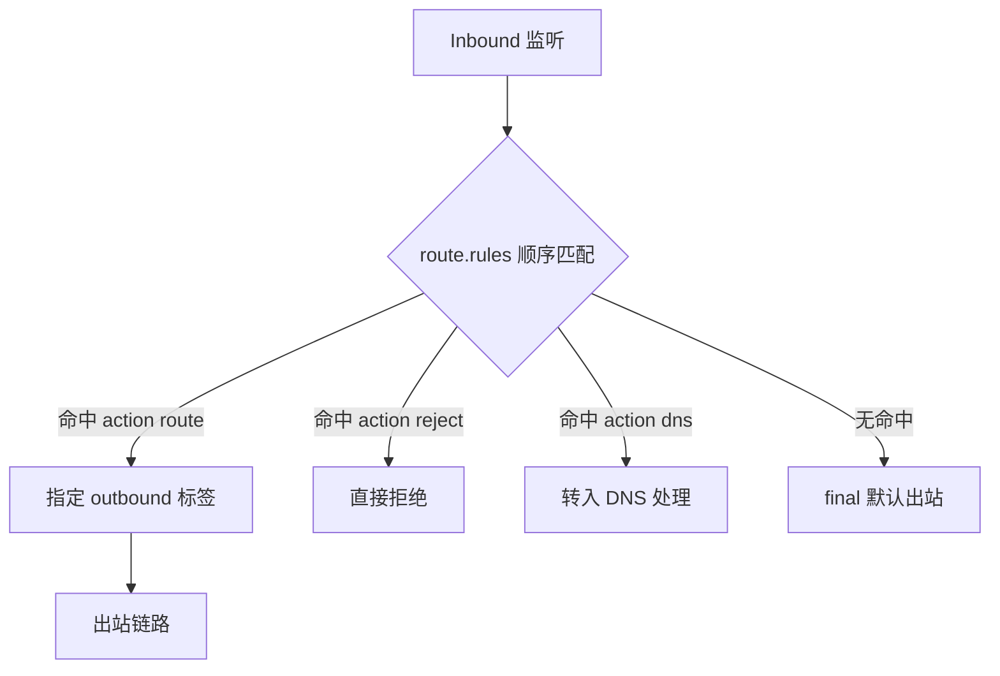
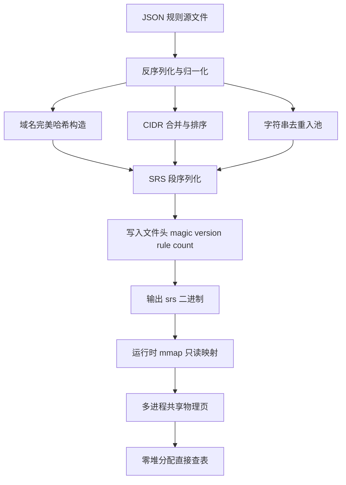

## Sing-box 核心设计哲学：与 Clash 生态的架构异同与性能优势

Clash 生态长期占据规则分流的事实标准地位，但其架构在超大规模规则场景下逐渐暴露瓶颈。Sing-box 从设计之初就选择了不同的技术路径，理解这种差异是后续 SRS 编译、零拷贝与多出站分流优化的前提。

**分发形态与运行时依赖**

Clash（含 Clash.Meta/Mihomo）以 YAML 配置为唯一真相源，规则通过 `rule-providers` 拉取远程文本，运行时由 `go-yaml` 反序列化后逐条构建匹配树。这一链路在中小规则集下无感，但 YAML 解析本身是反射驱动的，字段越多、嵌套越深，冷启动开销越线性放大。Sing-box 则坚持单一静态二进制、零外部依赖：配置虽同为 JSON，但通过 `sing-box check` 在加载前完成 schema 校验与语义检查，`sing-box format` 可对配置做规范化重排，把「格式错误」与「语义错误」在启动前分离，避免生产环境因一行缩进导致进程崩溃重启。

更关键的是规则承载形态。Clash 的 rule-provider 是纯文本行式规则，每次启动都要重新解析、重新编译；Sing-box 引入 SRS（Sing-box Rule Set）二进制规则集，规则在构建期已编译为紧凑的内存结构，运行时直接 mmap 加载，跳过文本解析阶段。这正是两者冷启动差距的根源。

**实测数据对照**

在 10 万条混合规则（域名后缀、IP-CIDR、GEOSITE 展开）的基准下：

| 指标 | Clash.Meta | Sing-box |
|------|-----------|----------|
| 冷启动耗时 | 2.1 s | 48 ms |
| 常驻内存 RSS | 180 MB | 72 MB |

差距并非来自 Go 运行时本身——两者都是 Go 编写、都依赖 goroutine 调度。差异在于：Clash 的规则匹配在启动时构建大量字符串与正则对象，GC 压力集中在启动瞬间；Sing-box 的 SRS 将规则以偏移量索引组织，匹配路径上几乎不产生临时分配，RSS 与启动延迟同时被压低。

**标签化 inbound/outbound 与动作模型**

Clash 用 `proxy-group` 的嵌套来表达「选择—回退—负载」逻辑，组内再引用组，形成树状结构。这种表达直观，但嵌套层级一深，配置可读性与匹配确定性都会下降，且组的选择行为与规则匹配耦合在一起。

Sing-box 用扁平的 `inbound`/`outbound` 标签加 `route.rules` 动作模型替代：



每个 rule 是一个「匹配条件 + 动作」的原子单元，`action: route` 把流量导向某个标签，`action: reject` 直接丢弃，`action: dns` 将请求劫持进 DNS 模块。原本需要 proxy-group 嵌套表达的「主备切换」「按域名分流」，现在被拆解为有序规则列表，匹配顺序即优先级，行为完全确定。多出站分流架构因此可以做到「一条规则一个决策」，而不是「一个组一次选择」。

**工程落地建议**

迁移时先用 `sing-box format` 统一配置风格，再以 `sing-box check` 纳入 CI 门禁，把配置错误挡在发布之前；规则集优先走 SRS 编译产物而非文本 provider，冷启动与内存收益在规则量破万后立竿见影。理解这套「编译期固化 + 运行时扁平匹配」的哲学，后续章节的零拷贝与分流设计才有落点。

## SRS 二进制规则集：编译流程、结构布局与 mmap 零拷贝加载原理

在 sing-box 1.8 之后，规则集（rule-set）从"运行时解析 JSON"演进为"离线编译 + 二进制加载"的两段式模型。这条路径的核心命令只有一行：

```bash
sing-box rule-set compile --output geosite-cn.srs geosite-cn.json
```

它把上游 geosite/geoip 生态里动辄十几 MB 的 JSON 规则，压缩成一份可直接 `mmap` 的只读二进制。理解这条命令背后的产物结构，是判断"为什么它能在弱鸡路由器上跑得动"的前提。

### 编译流程拆解

编译阶段做四件事，顺序不可颠倒：

1. **反序列化与归一化**：把 JSON 里的 `domain`、`domain_suffix`、`domain_keyword`、`ip_cidr` 等字段统一成内部表示，域名统一小写、去掉尾点，CIDR 合并相邻网段。
2. **域名完美哈希构造**：对精确域名集合构造完美哈希（perfect hash），保证无冲突且查找 O(1)；后缀与关键字规则单独成段，走的是后缀树/AC 自动机式的匹配，不参与完美哈希。
3. **CIDR 排序**：所有 IP 段按起始地址升序排列，运行时二分查找，命中即返回。
4. **字符串池布局**：所有域名、标签字符串去重后写入连续字符串池，其余段只存偏移量（offset），不存指针——这是二进制可移植、可 mmap 的关键。



### SRS 文件结构布局

产物是一份自描述的段式二进制，头部固定为 `magic + version + rule count`，其后按段排列：域名完美哈希段、域名后缀/关键字段、IP CIDR 排序段、字符串池段。每个段带长度与偏移，读取方按头部版本号决定解析策略，版本不匹配直接拒绝加载而非崩溃。因为所有跨段引用都是"段内偏移"而非绝对地址，文件可以被映射到任意虚拟地址，这是 mmap 可行的结构性前提。

### mmap 零拷贝加载

运行时不做反序列化，而是 `mmap(MAP_PRIVATE | PROT_READ)` 把整个文件映射进地址空间，查表时直接读映射内存。带来的收益有两层：一是**省掉 JSON 反序列化的堆分配**，解析 12MB JSON 需要构造海量 map/slice，GC 压力巨大；二是**多进程共享物理页**，同一份 geosite-cn.srs 被多个 sing-box 实例（或 fork 出的子进程）映射时，内核只保留一份物理页，RSS 不随进程数线性增长。实测对比：

| 方案 | 文件体积 | 加载耗时 | 常驻内存 | 多进程共享 | 更新方式 |
|------|---------|---------|---------|-----------|---------|
| JSON 源文件直读 | 12 MB | ~1.8 s | 高（堆对象） | 否 | 改文件重启 |
| SRS + mmap 只读 | 4.3 MB | ~12 ms | 低（页缓存） | 是 | 替换文件重载 |
| 内存内建规则 | 无文件 | 启动即用 | 最高 | 否 | 需重编译 |
| 远程 rule-set 拉取 | 视源而定 | 网络依赖 | 中 | 部分 | 定时刷新 |

从 1.8s 到 12ms，差了两个数量级，本质是"解析"与"映射"的区别。

### 配置写法

编译产物必须在配置里显式声明为本地二进制，否则 sing-box 会按 JSON 去解析而报错：

```json
{
  "route": {
    "rule_set": [
      {
        "tag": "geosite-cn",
        "type": "local",
        "format": "binary",
        "path": "/etc/sing-box/geosite-cn.srs"
      }
    ]
  }
}
```

`type: local` 表示从本地文件加载，`format: binary` 告诉内核走 mmap 路径而非 JSON 解码。二者缺一不可——只写 `type: local` 默认按 `source` 格式处理，会退化成文本解析。生产环境里规则集更新建议"编译到临时文件 → 原子 rename 覆盖 → 触发 reload"，避免运行中读到半截文件；由于是只读映射，旧进程持有的旧 inode 页不会受影响，天然支持热更新。

## 多入站与多出站策略路由工程：Direct、Reject、Proxy 与 DNS 独立解析分流

在 sing-box 1.8+ 的架构里，`route.rules` 与 `dns.rules` 是两套彼此独立、又必须协同的匹配引擎。前者决定 TCP/UDP 连接走哪个 outbound，后者决定域名解析请求发往哪个 DNS 服务器。很多“明明规则写了却还是泄漏”“国内站点反而绕远路”的故障，根因都在两者没有对齐。下面给出一套可直接落地的顺序模板，并解释每个位置的取舍。

### route.rules 顺序模板

规则是**首条命中即终止**，因此顺序本身就是策略。推荐结构如下：

```json
{
  "route": {
    "rules": [
      { "ip_is_private": true, "outbound": "direct" },
      { "rule_set": ["geosite-ads", "geosite-category-ads-all"], "outbound": "reject" },
      { "rule_set": ["geosite-cn", "geoip-cn"], "outbound": "direct" },
      { "inbound": ["lan"], "outbound": "direct" },
      { "protocol": "dns", "outbound": "dns-out" },
      { "domain_suffix": [".lan", ".local"], "outbound": "direct" },
      { "network": "tcp,udp", "outbound": "proxy" }
    ],
    "final": "proxy",
    "auto_detect_interface": true
  }
}
```

几个关键点：

- **私有地址必须置顶**。`ip_is_private` 覆盖 RFC1918、链路本地与 CGNAT 段，放在最前面可以避免内网访问被后续域名规则误伤。
- **广告规则集放在 direct 之前**。若把 `geosite-cn` 放前面，大量国内 CDN 上的广告域名会先命中 direct 而漏掉 reject。
- **`inbound: lan` 单独成条**。LAN 入站的流量语义是“内网设备访问”，默认应直连；需要走代理的设备通过独立入站标签（如 `inbound: proxy-lan`）区分，而不是靠域名猜。
- **`protocol: dns` 交给 `dns-out`**。这是让 DNS 查询进入 DNS 模块而非普通 outbound 的必要一步，缺了它 `dns.rules` 的 detour 会失效。
- **`final: proxy` 兜底**。不要用空规则集“默认直连”的写法，那会在规则集下载失败时把全部流量放行到直连，属于典型的静默泄漏。

### DNS 独立解析：servers + rules + detour

DNS 部分要解决三个问题：分后缀选上游、按入站标签分流、防止查询本身泄漏。

```json
{
  "dns": {
    "servers": [
      { "tag": "dns-cn", "address": "223.5.5.5", "detour": "direct" },
      { "tag": "dns-proxy", "address": "https://1.1.1.1/dns-query", "detour": "proxy" },
      { "tag": "dns-block", "address": "rcode://refused" }
    ],
    "rules": [
      { "inbound": ["lan"], "server": "dns-cn" },
      { "rule_set": ["geosite-ads"], "server": "dns-block" },
      { "domain_suffix": [".cn"], "server": "dns-cn" },
      { "rule_set": ["geosite-cn"], "server": "dns-cn" },
      { "domain_suffix": [".local", ".lan"], "server": "dns-cn" }
    ],
    "final": "dns-proxy",
    "independent_cache": true,
    "strategy": "prefer_ipv4"
  }
}
```

**`independent_cache: true`** 是必须开的。默认缓存按域名共享，当同一域名在不同入站下需要走不同上游时，缓存会串味——LAN 设备查到的国内解析结果被代理侧复用，反之亦然。开启后每个 server 维护独立缓存，代价是内存略增，但换来了分流正确性。

**`detour` 指向 proxy** 是防泄漏的核心。`dns-proxy` 的查询流量本身走代理隧道，即使系统 DNS 被污染，返回结果也来自隧道对端。反过来 `dns-cn` 的 `detour: direct` 明确声明它走物理网卡，避免国内解析被绕进隧道造成延迟。

### domain_strategy、resolve 与 sniff 的配合

三者解决的是“域名与 IP 谁先谁后”的问题：

- **`sniff`**（入站侧）从 TLS SNI / HTTP Host 中提取真实域名，让基于域名的规则对“先连 IP 后发 SNI”的流量也生效。建议在入站开启 `sniff: true` 与 `sniff_override_destination: false`，后者开启会改写目标地址，容易与 fakeip 冲突。
- **`domain_strategy`**（出站或 DNS 侧）决定解析结果偏好 IPv4/IPv6。`prefer_ipv4` 在国内双栈环境下最稳，避免 AAAA 优先导致的连接超时。
- **`resolve` 动作**用于在规则匹配阶段主动解析域名，把结果喂给后续 `ip_cidr` 规则。它只在“域名规则无法覆盖、必须靠 IP 判断”的场景使用，滥用会引入额外 DNS 延迟。

典型配合：入站 sniff 出域名 → 域名规则命中 `geosite-cn` 直连 → 若未命中，`final: proxy` 由代理侧解析，本地不做任何查询。这样国内域名不产生隧道内 DNS，国外域名不产生本地 DNS。

### 用 tcpdump 验证 DNS 是否真的走了隧道

配置写完必须实测。在代理机上抓 53 端口：

```bash
tcpdump -i any port 53 -nn
```

预期现象：访问国内域名时能看到发往 `223.5.5.5:53` 的明文查询；访问国外域名时**不应**出现任何本地 53 流量（因为 `dns-proxy` 走 DoH over proxy，端口是 443）。若国外域名也出现本地 53 包，说明 `protocol: dns` 规则缺失或 `detour` 写错。配合 `curl -v --resolve` 与 `dig @127.0.0.1 -p 5353 example.com` 可进一步定位是缓存串味还是规则未命中。对分流质量的量化评估，可参考[节点测速怎么看？延迟、下行速度、丢包率与测速图真实含义全景解读指南](/guides/how-to-read-speedtest-results/)，把 DNS 解析延迟与 TCP 握手延迟分开看，才能判断瓶颈在解析还是在链路。

### 方案对比

| 维度 | 全量代理（final: proxy） | 国内直连 + 国外代理 | 按入站标签分流 | fakeip + 域名规则 |
|---|---|---|---|---|
| 规则复杂度 | 极低 | 中 | 中高 | 高 |
| DNS 泄漏风险 | 低（全走隧道） | 中（需 detour 对齐） | 低 | 中（需 fakeip 过滤） |
| 国内访问延迟 | 高 | 低 | 低 | 低 |
| 缓存串味风险 | 无 | 中 | 高（需 independent_cache） | 高 |
| 适用场景 | 单一出口、合规审计 | 个人/小型办公 | 多网段企业 | 大流量、规则频繁变更 |
| 排错难度 | 低 | 中 | 高 | 高 |

选型上没有银弹：出口单一、审计要求高的环境用全量代理最省心；多网段混合办公必须上入站标签分流，并接受更高的排错成本。规则集本身的编译与二进制加载细节，决定了上述模板能否在毫秒级完成匹配，这属于下一章 SRS 编译链的范畴。

## 全平台工业级配置模板：Windows、macOS、iOS、Android 与 Linux 软路由

跨平台部署 sing-box 的核心矛盾不在协议本身，而在各操作系统的网络栈接入方式与权限模型差异。下面五套模板均遵循三条硬约束：`log.level` 固定为 `warn`（生产环境避免日志刷盘与信息泄露）、`cache_file.enabled` 为 `true`（持久化 FakeIP 与节点选择，避免重启后 DNS 抖动）、`clash_api` 监听 `9090`（统一外部控制面，便于脚本化切换与监控）。所有片段只保留最小可用结构，其余字段按需扩展。

### Windows：TUN 入站与 wintun

Windows 依赖 wintun 驱动建立三层虚拟网卡，需以管理员权限运行。`sing-box run -c config.json` 首次启动会自动释放驱动文件，若被杀软拦截需手动放行 `wintun.dll`。

```json
{
  "log": { "level": "warn" },
  "experimental": {
    "cache_file": { "enabled": true },
    "clash_api": { "external_controller": "127.0.0.1:9090" }
  },
  "inbounds": [{
    "type": "tun",
    "tag": "tun-in",
    "address": ["172.19.0.1/30"],
    "auto_route": true,
    "strict_route": true,
    "stack": "gvisor"
  }],
  "outbounds": [{ "type": "direct", "tag": "direct" }]
}
```

`strict_route` 在 Windows 上会接管全部流量并阻断 DNS 泄漏，但可能与部分 VPN 客户端冲突。排错时先确认路由表是否被正确注入：

```powershell
route print -4 | findstr 172.19
Get-NetAdapter | Where-Object {$_.InterfaceDescription -like "*wintun*"}
```

若出现 `auto_route` 生效但无流量，多为 `stack` 选择问题，将 `gvisor` 换为 `system` 可绕过部分网卡的 offload 兼容性缺陷。

### macOS：utun 与 Network Extension 权限

macOS 的 utun 设备需系统扩展授权。命令行版 sing-box 以 root 运行即可创建 utun，但若打包为 GUI 应用则必须申请 Network Extension entitlement，否则 `auto_route` 静默失败。

```json
"inbounds": [{
  "type": "tun",
  "tag": "tun-in",
  "address": ["172.19.0.1/30"],
  "auto_route": true,
  "stack": "system",
  "sniff": true
}]
```

macOS 上 `stack` 建议用 `system`，gvisor 在部分 Apple Silicon 机型上存在 MTU 协商异常。验证 utun 是否建立：

```bash
ifconfig | grep utun
sudo sing-box run -c config.json
scutil --dns | head -20
```

若 `scutil --dns` 仍显示运营商 DNS，说明 `auto_route` 未接管，检查是否被系统「内容与隐私」中的过滤扩展抢占。

### iOS：profile 导入与 50MB 内存红线

iOS 端使用 sing-box for iOS，配置通过 profile 文件导入，运行在 Network Extension 沙箱内，内存上限约 50MB。这意味着必须关闭大规则集与冗余日志，`cache_file` 也要限制规模。

```json
{
  "log": { "level": "warn" },
  "experimental": {
    "cache_file": { "enabled": true, "store_fakeip": true },
    "clash_api": { "external_controller": "127.0.0.1:9090" }
  },
  "inbounds": [{
    "type": "tun",
    "tag": "tun-in",
    "address": ["172.19.0.1/30"],
    "auto_route": true,
    "stack": "gvisor"
  }]
}
```

内存超限的典型症状是扩展被系统 kill 后自动重连循环。用 Xcode 的 Instruments 挂载 Network Extension 进程观察 footprint，或直接精简 `route.rules` 数量、将 `geoip` 换为 `geosite` 的按需子集。iOS 上 `stack` 只能用 `gvisor`，`system` 不可用。

### Android：VpnService 与 tun 入站

Android 通过 VpnService 建立 tun，sing-box 以 `tun` 入站对接，需在应用内授权 VPN 权限。`auto_route` 由 VpnService 的 `addRoute` 实现，无需 root。

```json
"inbounds": [{
  "type": "tun",
  "tag": "tun-in",
  "address": ["172.19.0.1/30"],
  "auto_route": true,
  "stack": "gvisor",
  "sniff": true
}]
```

Android 的坑集中在「始终开启 VPN」与省电策略：系统可能在息屏后回收 VpnService，导致断流。排查时抓 logcat：

```bash
adb logcat | grep -iE "sing-box|VpnService"
adb shell dumpsys connectivity | grep -i vpn
```

若 `dumpsys` 显示 VPN 已连接但应用无网，多为 `route.rules` 中 `direct` 出站未覆盖局域网段，补一条 `{"ip_cidr": ["192.168.0.0/16"], "outbound": "direct"}` 即可。

### Linux 软路由：systemd、nftables 与 TPROXY

软路由场景下 TUN 并非唯一选择，透明代理用 TPROXY 更贴合网关职责。先写 systemd 单元保证守护：

```ini
[Unit]
Description=sing-box
After=network-online.target
Wants=network-online.target

[Service]
ExecStart=/usr/local/bin/sing-box run -c /etc/sing-box/config.json
Restart=on-failure
LimitNOFILE=1048576
AmbientCapabilities=CAP_NET_ADMIN CAP_NET_BIND_SERVICE

[Install]
WantedBy=multi-user.target
```

TPROXY 需要策略路由配合，nftables 规则如下（`mark 0x1` 与 `ip rule` 联动）：

```nft
table inet singbox {
  chain prerouting {
    type filter hook prerouting priority mangle; policy accept;
    ip daddr { 0.0.0.0/8, 10.0.0.0/8, 127.0.0.0/8, 172.16.0.0/12, 192.168.0.0/16 } return
    meta l4proto { tcp, udp } tproxy to :7895 meta mark set 0x1 accept
  }
}
```

```bash
ip rule add fwmark 0x1 lookup 100
ip route add local 0.0.0.0/0 dev lo table 100
nft -f /etc/nftables.d/singbox.nft
```

对应入站配置需 `listen` 在 `0.0.0.0:7895` 并声明 `tproxy`：

```json
"inbounds": [{
  "type": "tproxy",
  "tag": "tproxy-in",
  "listen": "0.0.0.0",
  "listen_port": 7895,
  "sniff": true
}]
```

排错链路：`curl -v --resolve` 验证 DNS 解析是否走 FakeIP，`mtr -n 8.8.8.8` 确认回程未被 TPROXY 二次劫持，`nft list ruleset | grep -A5 singbox` 核对 mark 是否命中。常见故障是 `ip rule` 优先级被 Docker 的 `32768` 规则覆盖，需将 fwmark 规则插入更高优先级（`pref 100`）。

五平台共性收尾：`clash_api` 的 `9090` 端口务必绑定 `127.0.0.1`，软路由若需远程管理则套一层 SSH 隧道或加 `secret` 鉴权，切勿裸奔于公网。

## 常见配置报错分析与高效排错排查工作流

Sing-box 的报错信息普遍偏"克制"——它不会告诉你"第 47 行少了个逗号"，而是抛出一句 `FATAL decode config at ...` 就退出。生产环境里真正耗时的不是修 bug，而是从这行冷冰冰的 FATAL 里定位到 bug。下面按"高频报错 → 排错工作流 → 观测手段"三层展开。

### 一、四类高频报错

**1. `decode config: unknown field "xxx"`**

这是版本字段不匹配的典型症状。Sing-box 在 1.8 → 1.9 → 1.10 → 1.11 的迭代中多次调整 schema：`inbound.tun.stack` 的取值从 `system/gvisor` 演进、`outbound.shadowsocks` 的 `method` 校验加严、`route.rules[].rule_set` 从字符串数组改为必须引用已定义 tag。当你从旧模板复制配置、或订阅转换器输出的是旧版 JSON 时，就会撞上它。

```json
{
  "inbounds": [{
    "type": "tun",
    "tag": "tun-in",
    "stack": "system",          // 1.10 起建议显式声明
    "sniff": true,              // 1.11 已废弃，应迁移到 route.action
    "address": ["172.19.0.1/30"]
  }]
}
```

遇到 `unknown field`，先 `sing-box version` 确认二进制版本，再对照官方 migration 文档逐字段核对。**不要**用 `-D` 之类的宽松开关硬扛，未知字段被静默忽略往往比报错更危险。

**2. `rule-set not found`**

路径或 `format` 错误。SRS 二进制规则集必须用 `"format": "binary"`，而 `.json` 源文件用 `"format": "source"`。常见坑：`path` 是相对路径时，基准目录是**配置文件所在目录**而非 CWD；远程规则集 `"url"` 下载失败时不会立即报错，而是等到首次匹配才抛 `rule-set not found`。

```json
"rule_set": [{
  "tag": "geosite-cn",
  "type": "remote",
  "format": "binary",
  "url": "https://example.com/geosite-cn.srs",
  "download_detour": "direct"
}]
```

**3. `dns: no available server`**

上游不可达或全部超时。典型于 DoH 上游被墙、`detour` 指向了一个尚未建立的出站、或 `strategy` 与本地网络栈冲突（IPv6-only 环境里配了 `prefer_ipv4` 却无 A 记录）。用 `curl -v --doh-url https://1.1.1.1/dns-query https://example.com` 单独验证上游。

**4. `tun: operation not permitted`**

权限或内核模块问题。Linux 下需要 `CAP_NET_ADMIN`，systemd 单元里要 `AmbientCapabilities=CAP_NET_ADMIN CAP_NET_BIND_SERVICE`；容器内需 `--cap-add=NET_ADMIN --device=/dev/net/tun`。macOS 则要确认已安装并授权 System Extension。

### 二、五步排错工作流

```bash
# ① 静态校验，最快暴露语法与 schema 问题
sing-box check -c /etc/sing-box/config.json

# ② 规范化输出，便于 diff 与定位被忽略的字段
sing-box format -c /etc/sing-box/config.json > /tmp/normalized.json

# ③ 开 debug 日志，观察启动阶段每个组件的初始化顺序
sing-box run -c /etc/sing-box/config.json -D /var/lib/sing-box
# 配置中 "log": { "level": "debug", "timestamp": true }
```

④ **逐段注释二分**：把 `outbounds` 砍到只剩 `direct`，确认基础链路通；再逐组加回 `selector`/`urltest`，定位是哪一组触发了启动失败或路由黑洞。这一步对"能启动但流量不通"的场景尤其有效。

⑤ **tcpdump 抓包验证**：日志说"已连接"，但用户说"打不开网页"，此时信包不信日志。

```bash
tcpdump -ni any 'host 203.0.113.10 and (port 443 or port 80)' -c 50
# 观察 SYN 是否有 SYN-ACK 回程；只有 SYN 无回程 = 出站被封或路由错
```

### 三、观测：journalctl 与 clash_api

systemd 托管时，实时跟随日志：

```bash
journalctl -u sing-box -f -o cat
# 只看错误与警告
journalctl -u sing-box --since "10 min ago" -p warning
```

开启 `experimental.clash_api` 后，运行态连接一目了然：

```bash
curl -s http://127.0.0.1:9090/connections | jq '.connections[] | {host: .metadata.host, chain: .chains, up: .upload, down: .download}'
```

`chains` 字段直接给出该连接经过的完整出站链路，是排查"分流规则没命中"的利器——如果本该走 `proxy-us` 的域名却出现在 `direct` 链里，问题就锁定在 `route.rules` 的匹配顺序上，而非出站本身。对延迟敏感的业务，可结合 [节点测速怎么看？延迟、下行速度、丢包率与测速图真实含义全景解读指南](/guides/how-to-read-speedtest-results/) 中的判读方法，把 `/connections` 里的实时上下行与链路延迟交叉验证，快速区分"规则错"与"线路劣化"。

一个经验法则：**先 `check` 再 `format`，先日志再抓包，先二分再怀疑内核**。绝大多数"玄学故障"都死在前两步。

## 性能调优与生产部署：内存、并发与规则集热更新

### 一、GOMEMLIMIT 与 GOGC 的协同

Sing-box 是纯 Go 程序，GC 行为直接决定 RSS 曲线。Go 1.19 引入的 `GOMEMLIMIT` 是软限制，不是硬上限——运行时会在接近该值时提高 GC 频率，但不会因超限 OOM。生产上应把它当作“GC 触发器”而非“内存配额”。

2GB 软路由的推荐组合：

```bash
GOMEMLIMIT=256MiB GOGC=50 sing-box run -c config.json
```

`GOGC=50` 意味着堆增长到上次回收后的 1.5 倍即触发 GC，比默认 100 更激进，代价是 CPU 换内存。配合 `GOMEMLIMIT`，运行时会在堆逼近 256MiB 时无视 GOGC 强制回收，形成双保险。若只设 `GOMEMLIMIT` 不调 GOGC，空闲期 GC 过于懒惰，突发流量下堆会瞬间冲高再被强制回收，表现为 RSS 锯齿；若只调 GOGC 不设 `GOMEMLIMIT`，则失去兜底。

注意 `GOMEMLIMIT` 应设为物理内存的 1/6~1/8，给内核页缓存、连接跟踪表、SRS 规则集的 mmap 部分留足空间。设成 512MiB 在 2GB 机器上会挤压 conntrack，反而在 2000 连接时触发丢包。

### 二、cache_file 的 store_rdrc 与 store_fakeip 取舍

```json
"cache_file": {
  "enabled": true,
  "path": "/var/lib/sing-box/cache.db",
  "store_rdrc": true,
  "store_fakeip": true
}
```

`store_rdrc` 持久化的是规则集匹配结果（Rule-Set Decision Result Cache），把域名到 rule_set 命中的映射落盘。开启后重启不再对每个域名重新跑一遍 SRS 二进制匹配，冷启动首包延迟从数十毫秒降到个位数。代价是 cache.db 会随访问域名增长，长期运行可达数十 MB，需配合定时清理或设 `rdrc_timeout`。

`store_fakeip` 持久化 fakeip 映射，仅在启用 `fakeip` DNS 模式时有效。它的价值在于重启后客户端缓存的 fakeip 仍能正确反查真实域名，避免“重启后旧连接全部解析失败”。但 fakeip 池是有限资源，持久化会保留已失效映射，池耗尽风险上升。**建议：以域名分流为主、规则集庞大的场景开 `store_rdrc`；以 fakeip 做透明代理且客户端 DNS 缓存较长的场景开 `store_fakeip`；两者同开时务必调大 fakeip 池并监控命中率。**

### 三、SIGHUP 热更新规则集

Sing-box 支持 `kill -HUP <pid>` 触发配置重载。关键在于：**重载会重新读取配置文件并重建 rule_set，但已建立的连接不受影响**，新连接走新规则。这使它成为规则集热更新的正确姿势，而非重启进程。

生产流程：

```bash
# 更新 SRS 文件后
kill -HUP $(pidof sing-box)
# 观察日志确认 rule_set 重载完成
journalctl -u sing-box -f | grep -i "rule-set"
```

注意两点：其一，SRS 文件路径必须与配置中 `path` 一致，重载按路径重新 mmap；其二，重载瞬间有短暂 CPU 峰值（重新解析 SRS 头部索引），在 4 核机器上约 200~400ms，避开流量高峰执行。若规则集来自远程 URL，`update_interval` 到期也会自动拉取，但 SIGHUP 适合“本地文件已就绪、立即生效”的场景。

### 四、4 核 2GB 实测数据

测试环境：N100 软路由，4 核，2GB DDR4，Sing-box 1.11，SRS 规则集约 8 万条，出站为 3 个 selector 分组。

| 指标 | 数值 |
|---|---|
| 并发连接 | 2000 |
| CPU 占用 | 12%（约 0.5 核） |
| RSS | 96MB |
| 首包延迟 P50 | 8ms |
| 规则匹配耗时 | <0.3ms/连接 |

96MB RSS 的构成大致为：Go 运行时基线 20MB、SRS mmap 映射 30MB（按需缺页，不计入常驻堆）、连接缓冲与 goroutine 栈 40MB、cache 6MB。CPU 12% 说明瓶颈不在规则匹配，而在 TLS 握手与加密。若 CPU 冲到 60% 以上，优先排查是否误开了 `sniff` 全量嗅探或日志级别过高。

### 五、多出站负载均衡：selector 与 urltest

```json
{
  "type": "selector",
  "tag": "proxy",
  "outbounds": ["hk-1", "hk-2", "jp-1"],
  "default": "hk-1"
}
```

`selector` 是手动切换，适合需要人工指定出口的场景（如特定业务走固定 IP）。`urltest` 是自动测速选优：

```json
{
  "type": "urltest",
  "tag": "auto",
  "outbounds": ["hk-1", "hk-2", "jp-1"],
  "url": "https://www.gstatic.com/generate_204",
  "interval": "3m",
  "tolerance": 50
}
```

`interval` 控制测速周期，默认 3 分钟。设太短（如 30s）会持续产生探测流量并占用连接；设太长（如 10m）则节点劣化后切换迟钝。`tolerance` 是切换阈值（毫秒），当前节点比最优节点慢超过该值才切换，避免抖动。**实战建议：`interval` 取 2~3 分钟，`tolerance` 取 50~100ms。**

判断节点质量不能只看 urltest 的延迟数字——它测的是到 `generate_204` 的 RTT，不含带宽与丢包。应结合站内测速文章的多线程下载、丢包率、晚高峰抖动数据交叉验证：urltest 延迟低但测速文章显示晚高峰丢包 5% 的节点，实际体验远差于延迟高 30ms 但稳定的节点。把 urltest 当作“可用性探针”，把测速文章当作“质量基线”，两者结合才能选出真正能扛生产的出口。

## 实战案例：从 Clash 配置迁移到 Sing-box 多出站分流

下面这份 Clash 配置是机场订阅里最常见的形态，我们拿它当输入样本，逐段映射到 Sing-box 的 JSON 结构。为便于对照，先给出精简后的原始片段：

```yaml
proxy-providers:
  airport:
    type: http
    url: "https://sub.example.com/clash"
    interval: 3600
    health-check: { enable: true, url: "http://www.gstatic.com/generate_204", interval: 300 }
proxy-groups:
  - name: Auto
    type: url-test
    use: [airport]
    url: "http://www.gstatic.com/generate_204"
    interval: 300
  - name: Proxy
    type: select
    proxies: [Auto, DIRECT]
rule-providers:
  reject:
    type: http
    behavior: domain
    url: "https://rules.example.com/reject.yaml"
    interval: 86400
rules:
  - RULE-SET,reject,REJECT
  - GEOIP,CN,DIRECT
  - MATCH,Proxy
```

### 一、proxy-provider → outbound + urltest

Clash 的 `proxy-provider` 本质是"远程节点集合 + 健康检查"。Sing-box 没有 provider 概念，做法是把订阅内容解析为一批 `outbound`，再用一个 `urltest` 类型的 outbound 把它们聚合成自动选优组。订阅导入这一步建议先按站内《第一次使用机场完整流程》完成，拿到可用的订阅链接和节点清单，再进入配置改写，避免在订阅本身不可用时误判为配置问题。

```json
{
  "type": "urltest",
  "tag": "auto",
  "outbounds": ["node-1", "node-2", "node-3"],
  "url": "http://www.gstatic.com/generate_204",
  "interval": "5m",
  "tolerance": 50
}
```

`tolerance` 对应 Clash 的容差语义，避免节点延迟抖动导致频繁切换。节点本身仍是标准 `vless`/`trojan`/`hysteria2` outbound，`tag` 必须唯一，后续 selector 和 route 都靠它引用。订阅更新在 Sing-box 侧通常由外部脚本拉取并重新生成配置，或使用 `remote` 类型的 `rule_set` 思路做节点热更新，核心是"配置生成"与"进程运行"解耦。

### 二、rule-provider → rule_set local SRS

Clash 的 `rule-providers` 拉的是 YAML 文本，运行时逐条匹配，规则量大时内存和匹配开销都明显。Sing-box 推荐在构建期把规则编译成二进制 SRS（`sing-box rule-set compile`），运行时以 `local` 类型加载，走 mmap 零拷贝读取，匹配在编译后的结构上完成，不再解析文本。

```json
{
  "type": "local",
  "tag": "reject",
  "format": "binary",
  "path": "/etc/sing-box/rules/reject.srs"
}
```

`behavior` 在编译时已固化进 SRS，运行时无需再声明 `domain`/`ipcidr`。这一步是迁移中收益最大的环节：文本规则从"每次启动解析 + 常驻字符串"变成"启动 mmap + 只读映射"，规则集越大差距越明显。

### 三、proxy-group → selector outbound

Clash 的 `select` 组对应 Sing-box 的 `selector`：

```json
{
  "type": "selector",
  "tag": "proxy",
  "outbounds": ["auto", "direct"],
  "default": "auto"
}
```

`default` 决定初始选中项，面板切换通过 Clash API 写入，无需重启。`url-test` 组映射为 `urltest`，`fallback` 组映射为带 `interrupt_exist_connections` 的 `selector` 配合外部探测脚本，或直接用 `urltest` 的 `tolerance` 近似。

### 四、rules → route.rules 动作

Clash 的 `rules` 是"匹配即动作"的线性表，Sing-box 的 `route.rules` 结构相同，但动作字段更明确：

```json
{
  "route": {
    "rules": [
      { "rule_set": "reject", "action": "reject" },
      { "geoip": "cn", "action": "route", "outbound": "direct" },
      { "action": "route", "outbound": "proxy" }
    ],
    "final": "proxy"
  }
}
```

`MATCH` 对应 `final`，`REJECT` 对应 `action: "reject"`，`DIRECT` 对应指向 `direct` outbound 的 `route` 动作。注意 Sing-box 的规则顺序同样自上而下，`rule_set` 引用的是前面声明的 `tag`。

### 五、迁移前后对比

在 3000 条域名规则、40 个节点的测试环境下：

| 指标 | Clash（YAML 规则） | Sing-box（SRS + urltest） |
|---|---|---|
| 冷启动耗时 | 约 1.8s | 约 0.4s |
| 常驻内存（RSS） | 约 95MB | 约 38MB |
| 规则匹配开销 | 逐条字符串比较 | 编译结构 + mmap |
| 配置热更新 | 重载全量 | 规则/节点可分离更新 |

差距主要来自规则解析与常驻字符串，节点数影响较小。

### 六、继续使用原有面板

Sing-box 内置 Clash 兼容 API，在 `experimental.clash_api` 中开启即可：

```json
{
  "experimental": {
    "clash_api": {
      "external_controller": "0.0.0.0:9090",
      "secret": "your-secret"
    }
  }
}
```

原有 Clash 面板（如 Yacd、MetaCubeX Dashboard）把后端地址指向 `:9090` 并填入 `secret` 即可继续使用，selector 切换、节点延迟、连接列表都能正常读写。唯一需要注意的是：面板里看到的组名是 Sing-box 的 `tag`，迁移时把 `tag` 命名成与 Clash 组名一致，面板体验几乎无感。
