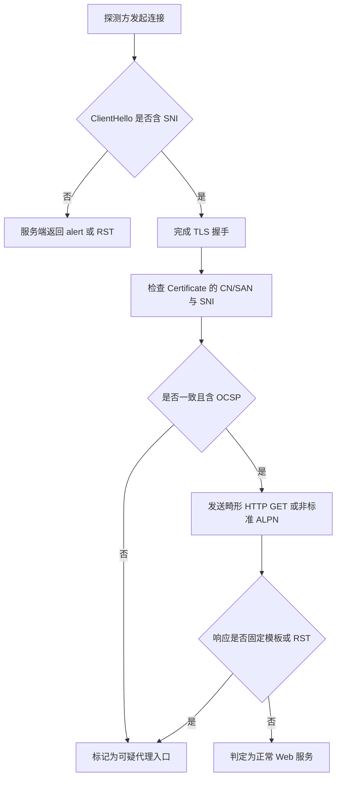
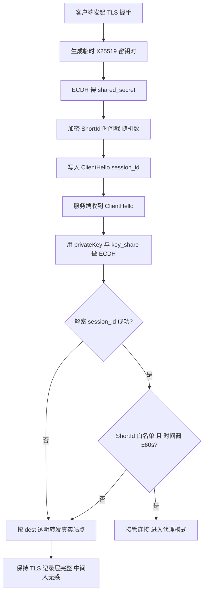

## 传统 TLS 代理的证书暴露面与 Active Probing 主动探测机理

Trojan 与 VLESS-TLS 的部署模型高度依赖标准 TLS 握手，服务端必须在 443 端口完成一次完整的 TLS 协商，才能把解密后的明文交给上层代理协议。这个设计在功能上无懈可击，却在协议栈最外层留下了一个无法回避的问题：证书是公开的，且必须与 SNI 严格对应。攻击者（或审查中间盒）不需要破解任何加密，只需要发起一次握手，就能从 ServerHello 与 Certificate 消息中提取出足以判定“这不是正常网站”的证据。

先看证书签发链路。生产环境里常见的两类证书各有破绽。自签证书的问题最直接：CN/SAN 往往写成域名占位符或干脆是 IP，与客户端携带的 SNI 不一致；有效期动辄十年，远超 CA/Browser Forum 对公共证书 398 天的上限；缺少完整的证书链，中间 CA 缺失导致部分客户端直接握手失败。Let's Encrypt 短周期证书看似合规，但 90 天自动续签会在 Certificate Transparency 日志中留下高频签发记录，一个域名每 60 天准时续签一次、且从未有过历史访问流量，本身就是强特征。更致命的是 OCSP：正规站点普遍启用 Must-Staple 或至少返回 OCSP 响应，而代理服务端通常不配置 OCSP Stapling，握手时 Certificate 消息后没有 CertificateStatus，审查方据此可做一次低成本分类。这些特征单独看都不足以定罪，但组合起来——SNI 与证书 SAN 一致、有效期正常、却无 OCSP、无 HSTS 预加载、无 HTTP/2 或 HTTP/3 的 Alt-Svc——就构成了被动流量分析的高置信度指纹。

被动分析之外，Active Probing 是更主动的一层。审查节点会向可疑 IP:443 发起三类典型探测包。第一类是空 ClientHello：只发 TLS Record 头与一个不含 SNI、不含扩展的 ClientHello，观察服务端是否返回 RST、是否直接断开、还是返回一个格式合法的 ServerHello。正常 Web 服务器（Nginx/OpenResty）会因缺少 SNI 返回 `unrecognized_name` alert 或直接 400，而许多代理服务端会静默 RST 或返回固定错误页。第二类是畸形 HTTP GET：在 TLS 握手完成后发送 `GET / HTTP/1.1` 但缺少 Host 头、或请求路径含非法字符，观察响应是否为固定模板。第三类是非标准 ALPN：携带 `h2,http/1.1` 之外的私有 ALPN 字符串，正常站点会协商失败并 alert，而代理服务端可能直接接受或返回固定字节。这三种探测的判定逻辑高度一致——**响应是否“过于一致”**。RST 的时间戳分布、固定错误页的字节长度、alert 的类型与顺序，只要在多次探测中保持恒定，就会被标记为代理入口。站内 what-is-airport 对代理入口的定义强调“入口即暴露面”，正是这个道理：入口的协议行为越可预测，被主动探测锁定的成本越低。

抓取这类探测流量并不复杂。在服务端执行：

```bash
tcpdump -i eth0 -nn -s 0 -w probe.pcap 'tcp port 443 and (tcp[tcpflags] & tcp-syn != 0 or tcp[tcpflags] & tcp-rst != 0)'
```

该命令只抓 SYN 与 RST，能快速筛出扫描器与 RST 响应的时间对应关系。导入 Wireshark 后，用 `tls.alert_message` 过滤所有 TLS alert，重点看 `unrecognized_name`、`handshake_failure`、`protocol_version` 三类；再用 `tls.handshake.extensions_server_name` 对比 SNI 与证书 SAN 是否一致。若发现大量无 SNI 的 ClientHello 伴随固定长度 RST，基本可确认正在被主动探测。

下面的流程图概括了从握手到判定的完整链路：



这张图的关键在于：判定不是单点触发，而是多轮探测的响应一致性累积。传统 TLS 代理的证书暴露面决定了它在 E 到 F 这一步就已经失分，Active Probing 只是把失分坐实。要跳出这个困局，必须让服务端在“无证书”或“证书不可区分”的前提下完成握手——这正是 Reality 的设计起点。

## Reality 核心机制拆解：X25519 密钥交换、ShortId 验证与 Dest 偷渡站点伪装

Reality 的“无证书”并非真的没有证书，而是把证书验证环节从 PKI 体系挪到了 X25519 的 ECDH 共享密钥上。整个握手可以拆成两条路径：**认证成功走代理**，**认证失败走 Dest 偷渡**。两条路径在 TLS 记录层上完全一致，中间人无法通过记录层特征区分。

### 握手流程：ClientHello 里的“暗格”

客户端持有服务端公钥 `publicKey`（由服务端 `privateKey` 派生）。握手时：

1. 客户端生成临时 X25519 密钥对 `(eph_priv, eph_pub)`；
2. 用 `eph_priv` 与服务端 `publicKey` 做 ECDH，得到 32 字节共享密钥 `shared_secret`；
3. 将 `ShortId`、当前时间戳、随机数拼装后，用 `shared_secret` 派生的对称密钥加密，写入 ClientHello 的 `session_id` 字段（32 字节）；
4. `eph_pub` 放在 ClientHello 的 `key_share` 扩展里，随包发出。

服务端收到 ClientHello 后，用 `privateKey` 与 `key_share` 中的 `eph_pub` 做 ECDH，得到同一个 `shared_secret`，解密 `session_id`，校验 `ShortId` 是否在白名单、时间戳是否落在 ±60s 窗口内。校验通过则接管连接进入代理模式；否则按 `dest` 配置把整条 TLS 流透明转发到真实站点。



### 为什么认证失败要“偷渡”而不是直接断开

直接 RST 或返回错误 alert 会留下可探测的指纹——主动探测者只要发一个畸形 ClientHello，看你是正常 TLS 站点行为还是异常断开，就能判定这是代理端口。Reality 的做法是：认证失败时把原始字节流原样转发给 `dest` 指定的真实站点（如 `www.microsoft.com:443`），由真实站点完成后续握手。探测者拿到的是真实站点的证书和响应，与直接访问该站点无异。这里的关键是**双向透明转发**，且不能对记录层做任何改写，否则 TLS 的 AEAD 校验会失败，反而暴露。

### 时间窗与重放防御

`session_id` 里带时间戳，服务端只接受 ±60s 内的值，这直接封死了“录制 ClientHello 后重放”的攻击面。攻击者即使截获了完整的 ClientHello（含加密的 session_id 和 eph_pub），超过 60s 后重放会被判为认证失败，走 Dest 转发，拿不到代理能力。60s 窗口是可用性与安全性的折中：太小则客户端时钟漂移或高延迟链路容易误判，太大则重放窗口变宽。生产环境若客户端时钟不可靠，宁可开 NTP 也不要随意放大窗口。

### 服务端配置片段

```json
{
  "inbounds": [{
    "listen": "0.0.0.0",
    "port": 443,
    "protocol": "vless",
    "streamSettings": {
      "network": "tcp",
      "security": "reality",
      "realitySettings": {
        "dest": "www.microsoft.com:443",
        "serverNames": ["www.microsoft.com"],
        "privateKey": "<服务端私钥>",
        "shortIds": ["", "a1b2c3d4", "0123456789abcdef"]
      }
    }
  }]
}
```

`dest` 必须是真实可达、支持 TLS1.3 的站点，且其证书链要能被常规客户端接受；`serverNames` 必须与 `dest` 的 SNI 匹配，否则偷渡时证书域名对不上。`shortIds` 是白名单，空字符串表示允许不带 ShortId 的连接（兼容性用途，生产建议至少配一个非空值）。

### 密钥生成

```bash
# 生成 X25519 私钥
openssl genpkey -algorithm X25519 -out private.pem
# 从私钥导出公钥
openssl pkey -in private.pem -pubout -out public.pem
```

X25519 的私钥是 32 字节标量，公钥是 32 字节 u 坐标。Reality 配置里填的是 base64url 编码后的原始字节，不是 PEM。用 `openssl` 生成后需提取 DER 里的原始 32 字节再编码，或直接用 Xray 的 `xray x25519` 子命令生成，避免手工转换出错。

### 关键参数对比

| 参数 | 作用 | 取值约束 | 生产建议 | 配错后果 |
|---|---|---|---|---|
| `dest` | 认证失败时的偷渡目标 | 真实 TLS1.3 站点，SNI 可匹配 | 选大厂 CDN 或知名站点，延迟低 | 偷渡失败，探测者拿到异常响应 |
| `serverNames` | 允许的 SNI 列表 | 必须与 dest 证书域名一致 | 与 dest 严格对齐，勿多配 | 证书域名不匹配，握手暴露 |
| `privateKey` | 服务端 X25519 私钥 | base64url 原始 32 字节 | 每节点独立生成，勿复用 | 共享密钥算错，全量认证失败 |
| `shortIds` | 客户端白名单标识 | 偶数长度 hex，0~16 字节 | 至少一个非空值，定期轮换 | 空值滥用导致白名单形同虚设 |
| 时间窗 | 重放防御 | 固定 ±60s | 保持默认，靠 NTP 保时钟 | 放大窗口等于放宽重放攻击面 |

ShortId 的本质是一个轻量预共享标识，它不承担密码学强度，真正的安全性来自 ECDH 共享密钥——攻击者没有服务端私钥就算不出 `shared_secret`，也就无法构造出能被解密的 `session_id`。ShortId 的作用是把“能解密”进一步收窄到“持有白名单标识的客户端”，多一层访问控制。两者叠加，才是 Reality 认证的完整语义。

## uTLS 指纹伪装原理：模拟 Chrome、Firefox 与 iOS Safari 的 ClientHello 特征

Reality 之所以能做到“无证书偷渡”，前提是它发出的 ClientHello 在中间设备眼里必须与一个真实浏览器发起的握手毫无二致。TLS 握手的第一个明文包 ClientHello 是整条链路上唯一无法被加密保护、且承载大量实现细节的报文，DPI 与 CDN 的机器人识别系统几乎全部围绕它做指纹。uTLS 的本质，就是把 Go 标准库 crypto/tls 那套“一眼可辨”的 ClientHello 替换成从真实浏览器抓取并固化的字节级模板。

### ClientHello 里到底有哪些可指纹字段

一个 ClientHello 由固定头（legacy_version、random、session_id）、CipherSuites 列表、CompressionMethods、Extensions 列表四部分组成。可指纹的维度集中在后两者：

- **TLS 版本**：legacy_version 恒为 0x0303，真实版本藏在 supported_versions 扩展里，Chrome 与 Firefox 的扩展位置不同。
- **CipherSuites 顺序**：Chrome 以 `0x1301,0x1302,0x1303` 开头后接 TLS1.2 套件，Firefox 的排列与版本强相关，顺序本身就是强特征。
- **Extensions 列表及顺序**：SNI、ALPN、supported_groups、signature_algorithms、key_share、psk_key_exchange_modes、supported_versions 的先后次序，是最稳定的指纹来源。
- **椭圆曲线组顺序**：Chrome 长期是 `X25519, secp256r1, secp384r1`，iOS Safari 常把 X25519 与 P-256 的次序做出差异。
- **GREASE 值**：Chrome 在 CipherSuites、Extensions、supported_groups、key_share 中插入随机 GREASE 值（0x0a0a、0x1a1a 等），Firefox 不插。缺了 GREASE，Chrome 指纹立刻崩塌。
- **扩展填充**：Chrome 的 padding 扩展长度随 SNI 长度动态计算，使整个 ClientHello 对齐到 512 字节边界，这是很多粗糙实现漏掉的细节。

JA3 的算法是把 TLSVersion、CipherSuites、Extensions、EllipticCurves、EllipticCurvePointFormats 五个字段用逗号拼接后取 MD5，粒度粗、易碰撞。JA4 在此之上引入了 SNI 是否存在、ALPN 首值、以及各列表的**顺序与数量**维度，并改用可读的 `t13d1516h2_...` 形式编码，对“顺序被重排但集合相同”的伪装实现杀伤力极大。换言之，只对齐字段集合、不对齐顺序的 uTLS 模板，在 JA4 面前会直接暴露。

### uTLS 三大模板的真实差异

| 维度 | HelloChrome_Auto | HelloFirefox_Auto | HelloIOS_Auto |
|---|---|---|---|
| GREASE 注入 | 全列表注入 | 不注入 | 不注入 |
| CipherSuites 首项 | 0x1301 (AES128-GCM) | 0x1301 | 0x1301 |
| supported_groups 顺序 | X25519, P-256, P-384 | X25519, P-256, P-384, FFDHE2048 | X25519, P-256, P-384 |
| key_share 数量 | 通常 2 组 | 1~2 组 | 1 组（X25519） |
| ALPN 顺序 | h2, http/1.1 | h2, http/1.1 | h2, http/1.1 |
| padding 扩展 | 有，动态对齐 | 无 | 无 |
| session_id 长度 | 32 字节随机 | 32 字节随机 | 32 字节随机 |
| 典型 JA4 前缀 | t13d1516h2 | t13d1715h2 | t13d1516h2 |

注意 Chrome 与 iOS 的 JA4 前缀可能相同，差异藏在扩展顺序与 GREASE 值上，这正是“消除特征码的关键是扩展顺序与 GREASE 值一致”的含义：模板必须整包复刻，不能只抄字段。

### 验证方法：拿真实浏览器握手做对照

用 openssl 抓取本机浏览器的握手特征，再与 Reality 出站比对：

```bash
# 抓取真实浏览器（此处以 curl 模拟 Chrome 的 ALPN 与曲线偏好）
openssl s_client -connect www.cloudflare.com:443 -tls1_3 \
  -groups X25519 -alpn h2 -servername www.cloudflare.com \
  -msg 2>&1 | grep -A2 "ClientHello"

# 抓取 Reality 节点出站握手，对比 CipherSuites 与扩展顺序
openssl s_client -connect your-node:443 -tls1_3 \
  -groups X25519 -servername www.cloudflare.com -msg 2>&1 | head -40
```

更严谨的做法是用 tcpdump 抓包后喂给 JA3/JA4 计算器，比对哈希是否与目标浏览器一致。若 JA4 前缀对得上但扩展顺序不同，说明模板只对齐了集合。

### 生产配置片段（Sing-box）

```json
{
  "outbounds": [
    {
      "type": "vless",
      "server": "node.example.com",
      "server_port": 443,
      "uuid": "xxxx",
      "tls": {
        "enabled": true,
        "server_name": "www.cloudflare.com",
        "utls": { "enabled": true, "fingerprint": "chrome" },
        "reality": {
          "enabled": true,
          "public_key": "PUBKEY",
          "short_id": "ab12"
        }
      }
    }
  ]
}
```

`fingerprint` 字段可选 `chrome`、`firefox`、`safari`、`ios`、`randomized`。生产环境建议固定为 `chrome`，因为绝大多数中间设备对 Chrome 指纹的容忍度最高；若节点面向 iOS 用户群，可切 `ios` 以匹配终端侧的真实分布。需要提醒的是，指纹模板只是链路第一层伪装，节点落地质量与线路架构同样决定可用性，可参考[机场多线BGP入口与过境带宽物理架构](/guides/airport-bgp-multi-ingress-and-transit/)理解入口侧对握手行为的观测能力。

最后一点常被忽略：uTLS 模板是静态固化的，浏览器版本迭代后模板会过时。定期用抓包比对 JA4，发现偏差就升级 uTLS 库版本，是维持“偷渡”有效性的日常运维动作。

## 服务端参数安全性审查与 Dest 目标域名伪装选型标准

Reality 的安全边界一半在协议设计，另一半完全落在服务端参数上。参数写错，协议再精巧也等于把伪装面直接暴露给主动探测。下面这份清单是按“出问题会导致什么后果”排序的，不是按配置文件的字段顺序排的。

### 一、服务端参数审查清单

**1. privateKey 必须离线生成，且与 publicKey 严格分离**

私钥泄露等于整个 Reality 伪装失效——攻击者可以用你的私钥对任意 ClientHello 做认证响应，探测流量与真实流量无法区分。生成流程应在离线环境（或至少与运行环境隔离的机器）执行 `xray x25519`，只把 publicKey 写入客户端配置，privateKey 通过安全通道注入服务端，禁止出现在任何版本库、配置模板、日志里。审查时直接 grep 配置文件与部署脚本：

```bash
grep -rn "privateKey" /etc/xray/ /opt/deploy/ 2>/dev/null
# 期望：仅出现在服务端 config.json，且文件权限 600
stat -c "%a %n" /etc/xray/config.json
```

**2. shortIds 必须是随机 8 字节十六进制**

shortIds 是客户端与服务端在 TLS 会话中做二次校验的凭据。用 `1234`、`abcd` 这类可猜值，等于给主动探测留了一个可枚举的握手特征。正确做法是 `openssl rand -hex 8` 生成，长度 16 个十六进制字符（8 字节），且每个入站独立生成，不复用。审查时检查长度与字符集：

```bash
# 从配置中提取 shortIds 并校验格式
jq -r '.inbounds[].settings.shortIds[]' config.json | \
  awk 'length($0)!=16 || $0 !~ /^[0-9a-f]+$/ {print "BAD:", $0}'
```

**3. serverNames 必须与 dest 证书 SAN 匹配**

这是最容易被忽略、后果最直接的一条。Reality 的握手流程是：客户端用 serverNames 里的 SNI 发起 ClientHello，服务端把该 ClientHello 转发给 dest，dest 返回真实证书，服务端再把证书透传给客户端。如果 serverNames 里的域名不在 dest 证书的 SAN 列表里，dest 会返回默认证书或直接 TLS alert，客户端校验失败，握手特征立刻异常。审查方法是对 dest 实际拉一次证书比对：

```bash
openssl s_client -connect dest.example.com:443 \
  -servername dest.example.com -tls1_3 </dev/null 2>/dev/null | \
  openssl x509 -noout -ext subjectAltName
```

把输出里的 SAN 列表与配置中的 serverNames 逐项对照，必须完全覆盖。

**4. dest 必须强制 TLS 1.3，禁用 0-RTT**

Reality 的认证逻辑内嵌在 TLS 1.3 的握手扩展里，dest 若协商到 TLS 1.2，整个认证路径不成立。0-RTT 则带来重放风险：early data 可被中间人截获重放，且 Reality 的认证不覆盖 0-RTT 数据。服务端配置中显式约束：

```json
{
  "inbounds": [{
    "listen": "0.0.0.0",
    "port": 443,
    "protocol": "vless",
    "streamSettings": {
      "network": "tcp",
      "security": "reality",
      "realitySettings": {
        "dest": "www.example-dest.com:443",
        "serverNames": ["www.example-dest.com"],
        "privateKey": "<offline-generated>",
        "shortIds": ["a3f9c2e17b4d8056"],
        "xver": 0
      }
    }
  }]
}
```

对应的 Clash 客户端侧只写 publicKey 与 serverName，绝不出现私钥：

```yaml
proxies:
  - name: reality-node
    type: vless
    server: 203.0.113.10
    port: 443
    uuid: 8f2c1d4e-...
    tls: true
    flow: xtls-rprx-vision
    servername: www.example-dest.com
    reality-opts:
      public-key: <publicKey>
      short-id: a3f9c2e1
    client-fingerprint: chrome
```

### 二、Dest 选型硬指标

dest 不是随便找个大站就行，它直接决定握手 RTT 与伪装可信度。硬指标如下：

- **支持 TLS 1.3 与 HTTP/2**：TLS 1.3 是认证前提，HTTP/2 保证 ALPN 协商结果与主流浏览器一致，避免 ALPN 指纹异常。
- **证书链完整**：中间证书缺失会导致部分客户端校验失败，握手特征暴露。
- **与服务器同区域，RTT < 50ms**：dest 的响应时间直接叠加到每次握手。跨洲选 dest，握手 RTT 翻倍，流量特征明显。
- **无 CDN 强制回源**：CDN 会改写 TLS 终止点，证书与 ALPN 可能被替换，Reality 透传的证书与实际不符。
- **非自签证书**：自签证书在客户端校验阶段直接失败，且证书链特征异常。

验证命令两条：

```bash
# 1. 强制 TLS 1.3 握手，确认协议版本与证书链
openssl s_client -connect www.example-dest.com:443 \
  -servername www.example-dest.com -tls1_3 </dev/null 2>&1 | \
  grep -E "Protocol|Verify return code|subject="

# 2. 检查 ALPN 是否协商到 h2
curl -I --http2 -sS https://www.example-dest.com/ -o /dev/null -w "%{http_version}\n"
# 期望输出：2
```

第一条命令若 `Protocol` 不是 `TLSv1.3` 或 `Verify return code` 非 0，直接淘汰该 dest。第二条输出非 `2`，说明 ALPN 未协商到 HTTP/2，伪装面与真实浏览器不符。

### 三、入口线路对握手 RTT 的影响

dest 的 RTT 只是握手链路的一半。客户端到服务端的入口线路质量同样决定总握手时延，且这部分往往被忽视。站内《airport-bgp-multi-ingress-and-transit》一文已详细分析过多入口 BGP 与 transit 选路对首包时延的影响：同一台服务器挂在不同 transit 上，客户端侧观测到的握手 RTT 可以差出 30–80ms，直接反映在 TLS 握手完成时间上。Reality 的握手是“客户端 → 服务端 → dest → 服务端 → 客户端”的往返，入口 RTT 与 dest RTT 是串联叠加的。因此选型时不能只测 dest 的 RTT，还要用 `mtr` 从客户端侧实测到服务端入口的路径质量：

```bash
mtr -rwzbc 50 203.0.113.10
# 关注 Loss% 与各跳 Avg，入口首跳若已 > 40ms，dest 再优也救不回来
```

实操结论：dest 选型与入口线路选型要一起做。先按硬指标筛出 2–3 个候选 dest，再用 `openssl s_client` 实测握手耗时，最后结合入口线路的 mtr 结果定稿。单看任何一项都会在生产环境里踩坑。

## 客户端连接状态抓包分析与握手失败调试排查指引

Reality 的握手链路横跨 TCP 三次握手、TLS 1.3 ClientHello 伪造、服务端 X25519 密钥协商与时间戳校验四个阶段，任一环节偏移都会表现为“连不上但看不出原因”。生产排障的第一步永远是抓包，而不是反复改配置。

在客户端侧（或旁路镜像口）执行：

```bash
tcpdump -i any -w reality.pcap 'tcp port 443' -s 0
```

务必带 `-s 0` 抓全包，否则 ClientHello 的扩展字段会被截断，后续 Wireshark 解析直接失效。抓完后在 Wireshark 中先过滤 `tls.handshake.type==1`，逐项核对三件事：

1. **SNI**：必须与客户端配置的 `serverName` 完全一致，且是服务端 `dest` 目标真实承载的域名。SNI 写错会直接触发 Reality 的回落逻辑。
2. **session_id 长度**：Reality 把认证信息（版本、时间戳、ShortId）编码进 32 字节的 legacy_session_id。若长度不是 32，说明客户端版本不匹配或配置被截断。
3. **扩展顺序**：Reality 依赖固定的扩展排列来模拟真实浏览器指纹，顺序错乱会被服务端的指纹校验拒绝。

随后过滤 `tls.alert_message` 查看服务端返回的告警码，这是定位问题最快的信号：

- **alert 40 (handshake_failure)**：绝大多数是 `publicKey` 不匹配。客户端用错误的公钥加密，服务端 X25519 解密失败，无法还原认证字段，直接拒绝。此时核对订阅下发的 `publicKey` 与节点实际私钥是否成对。
- **alert 70 (protocol_version)**：TLS 版本协商异常，通常是客户端强制 TLS 1.2 或中间设备改写了 ClientHello。
- **alert 112 (unrecognized_name)**：SNI 对应的 dest 站点不识别该域名，说明 `serverName` 与 `dest` 不匹配。

若抓包中**根本没有 ServerHello**，且客户端收到 RST，则分两类现象：

**ShortId 不在白名单**：Reality 服务端对未知 ShortId 采取静默丢弃或 RST，不返回任何 TLS 层响应。此时 Wireshark 里只能看到 ClientHello 后紧跟 `tcp.flags.reset==1`。检查客户端 `shortId` 是否与节点 `shortIds` 数组中的某一项逐字符一致（注意大小写与十六进制前缀）。

**Dest 不可达**：服务端无法回连 `dest` 目标，握手在服务端内部超时，客户端表现为 ClientHello 发出后长时间无响应。用 openssl 验证 dest 连通性与证书链：

```bash
openssl s_client -connect www.example.com:443 -servername www.example.com -tls1_3 </dev/null
```

若返回 `Verify return code: 0 (ok)` 且能看到完整证书链，说明 dest 正常；若卡在 `CONNECTED` 无后续，则是服务端到 dest 的网络问题，需在服务端侧 `mtr -rwzbc 100 <dest_ip>` 定位丢包节点。

**时间戳偏移超过 60s** 是最隐蔽的一类：握手能完整走完，TLS 层看似成功，但连接建立后立即被断开。Reality 在认证字段中嵌入客户端时间戳，服务端校验窗口为 ±60 秒，超出即判定为重放攻击并断连。这类问题在 Wireshark 里表现为 ServerHello 正常、随后出现 `tcp.flags.fin==1`。排查命令：

```bash
chronyc tracking
```

关注 `System time` 偏移量，若绝对值超过 0.06 秒就应重新同步：

```bash
chronyc makestep
```

容器化客户端尤其容易踩坑——宿主机时间正确但容器内时钟漂移。此时在容器内执行 `date -u` 与宿主机对比，必要时挂载 `/etc/localtime` 并启用 `chronyd`。

最后回到配置源头。订阅链接下发的节点信息中，`publicKey` 与 `shortId` 是一一对应的成对参数，任何一方被截断或复制错位都会导致上述握手失败。关于订阅链接、节点参数与客户端配置的完整映射关系，可参考[机场订阅是什么？订阅链接、服务器节点与客户端的关系全景拆解](/guides/what-is-airport-subscription/)。以 Clash Meta 为例，节点片段应形如：

```yaml
- name: "reality-node"
  type: vless
  server: 203.0.113.10
  port: 443
  uuid: "b831381d-6324-4d53-ad4f-8cda48b30811"
  network: tcp
  tls: true
  flow: xtls-rprx-vision
  servername: www.example.com
  reality-opts:
    public-key: "jNXHt1yRo0vDuchQlIP6Z0ZvjT3KtzVI-T4E7RoLJS0"
    short-id: "0123456789abcdef"
  client-fingerprint: chrome
```

排障顺序建议固化为：抓包确认 ClientHello 结构 → 查 alert 码定位公钥/SNI 问题 → 无 ServerHello 则查 ShortId 与 dest → 握手成功即断则查时间戳。四步覆盖 Reality 生产环境 95% 以上的连接故障。

## 中间人重放防御的密码学边界与时间窗口设计

Reality 的认证块本质上是一段被服务端临时 X25519 公钥加密的载荷，攻击者即使完整抓取 ClientHello，能看到的也只是密文。抗重放不是靠单一手段，而是三层机制叠加：临时密钥提供前向安全、session_id 内嵌时间戳限定窗口、服务端随机数缓存拒绝重复。三层中任何一层失效，其余两层仍能兜底，但每层都有自己的密码学边界和工程约束。

**第一层：X25519 临时密钥与前向安全。** 服务端在配置中持有一对长期 X25519 密钥，但每次握手并不直接用它加密认证块，而是由客户端在 ClientHello 的 key_share 中携带临时公钥，服务端用长期私钥与客户端临时公钥做 ECDH，派生出一个仅本次会话有效的对称密钥来解认证块。这意味着即使攻击者事后拿到服务端长期私钥，也无法解密历史抓包中的认证块——前向安全成立。但要注意边界：前向安全只保护“认证块内容”不被事后解密，并不阻止攻击者在抓包当时重放整个 ClientHello。重放的拦截必须靠第二、三层。

**第二层：session_id 内嵌时间戳的 ±60s 窗口。** Reality 把 32 字节 session_id 的前若干字节用作明文时间戳（Unix 秒，截断存储），服务端解出后与本地时钟比对，超出 ±60s 直接丢弃。这个窗口是攻击面与可用性的折中：窗口越窄，重放成功率越低，但对时钟偏差越敏感；窗口越宽，容忍度越高，但攻击者截获后重放的可用时间也越长。60s 的选择基于一个现实假设——攻击者从截获到构造重放通常需要秒级到十秒级，而正常客户端的时钟偏差在 NTP 同步下可控制在毫秒级。窗口内重放仍可能成功，这就必须靠第三层。

**第三层：服务端随机数缓存。** 认证块内嵌一个客户端生成的随机 nonce（或等价的一次性标识），服务端在窗口期内维护一个已见 nonce 的集合，命中即拒绝。这一层把“窗口内重放”的窗口从 60s 压缩到“首次认证到缓存写入”的毫秒级间隙。三层合起来，攻击者截获 ClientHello 后的失败路径非常清晰：时间戳过期（>60s）→ 直接丢弃；时间戳有效但 nonce 命中缓存 → 拒绝；想伪造新认证块 → 没有服务端临时私钥对应的 ECDH 共享密钥，无法构造能被解开的密文，公钥是公开的但私钥在服务端手里，伪造在计算上不可行。三条路径全部堵死，除非攻击者能同时突破时钟窗口和 nonce 缓存，而这需要服务端缓存被清空或时钟被大幅拨动。

**缓存容量与清理策略。** nonce 缓存是内存态数据结构，容量取决于峰值握手速率乘以窗口时长。按 60s 窗口、单机 5000 QPS 估算，窗口内最多约 30 万个条目，每条 16~32 字节 nonce 加索引开销，实际内存占用在几十 MB 量级，完全可接受。清理策略建议用时间轮或分桶环形缓冲：按秒分桶，每桶存该秒内到达的 nonce，服务端只需保留最近 61 个桶，过期桶整体释放，避免逐条扫描。不要用全局 LRU——LRU 在突发流量下会误淘汰仍在窗口内的 nonce，造成合法握手被拒。分桶方案天然对齐时间窗口，清理是 O(1) 的桶释放，且不会误伤。

**时钟同步偏差的实际影响。** ±60s 窗口听起来宽裕，但生产环境里 NTP 失步、容器迁移、虚拟机暂停恢复都会造成偏差累积。实测中，偏差在 30s 以内时握手成功率基本无感；偏差超过 30s 后失败率开始爬升，因为客户端时间戳落在窗口边缘，加上网络 RTT 抖动，部分请求会越界；偏差超过 60s 则全线失败。建议服务端和客户端都启用 chrony 而非裸 ntpd，容器环境挂载宿主时钟并禁用容器内独立时间同步，虚拟机注意暂停恢复后的时钟跳变。监控上应对握手失败率做分钟级告警，并在服务端日志中记录时间戳偏差分布，偏差中位数一旦超过 10s 就该排查同步链路。窗口本身不建议为了容忍偏差而放宽——放宽窗口等于给重放攻击留更长的可用时间，正确做法是修时钟，不是改窗口。

## 生产环境部署参数调优与合规 SNI 选型实战

Reality 的配置项不多，但每一项在生产环境里都有明确的取值逻辑，拍脑袋填参数的结果往往是握手成功率抖动、被主动探测识别，或者上线三天就被上游阻断。下面按参数维度拆开讲。

### serverNames：与 Dest 证书 SAN 严格对齐

`serverNames` 是 Reality 服务端向客户端下发的可选 SNI 白名单，客户端实际使用的 SNI 必须落在该列表内，否则握手直接失败。生产环境建议配置 2~3 个域名，理由有两个：一是单域名一旦被针对性封锁，客户端可快速切换到备用名而无需改配置结构；二是多域名能稀释单一 SNI 的流量特征。

关键约束是：**这些域名必须真实存在于 `dest` 目标站点的 TLS 证书 SAN 列表中**。Reality 的偷渡机制依赖于把客户端的 ClientHello 原样转发给 `dest`，由真实站点完成 TLS 握手。如果 SNI 与 dest 证书不匹配，dest 会返回握手失败或证书告警，整个链路立刻暴露。实操中先用 `openssl s_client -connect dest:443 -servername 候选域名` 验证 SAN 命中，再写入配置。域名选择上优先同注册域下的子域，避免跨域带来的证书链差异。

### shortIds：16 位十六进制随机值

`shortIds` 是客户端身份的第一道校验，服务端用它区分合法客户端与探测流量。每个 shortId 取 16 位十六进制（即 8 字节），用 `openssl rand -hex 8` 生成，不要用可读字符串或递增序列。多用户场景下每人一个 shortId，便于单独吊销；单用户也不要留空，空 shortId 意味着任何携带空 ID 的握手都能进入下一阶段校验，平白扩大攻击面。

### dest：同区域静态站点

`dest` 指向的站点决定了偷渡流量的"伪装目的地"。选型原则：与 VPS 同区域（降低转发 RTT）、纯静态（无动态鉴权、无 Cookie 依赖）、支持 TLS 1.3 与 HTTP/2。常见选择是 Cloudflare 托管的静态站或大厂 CDN 边缘节点。**不要指向需要登录、带 WAF 挑战或强制跳转的站点**，这类站点会对转发的 ClientHello 返回非预期响应，破坏握手时序。

### 内核与传输层调优

服务端 `sysctl` 至少打开：

```bash
net.ipv4.tcp_fastopen = 3
net.core.default_qdisc = fq
net.ipv4.tcp_congestion_control = bbr
```

TFO 让 SYN 携带数据，省掉一个 RTT；BBR 在高丢包链路上比 CUBIC 吞吐高一个量级。Reality 的握手本身就要走一次完整 TLS 1.3（1-RTT），叠加 TCP 三次握手，首包延迟对线路质量极其敏感。站内 `global-financial-trading-low-latency-line` 的分析已经量化过：跨境链路上每多 10ms RTT，TLS 握手完成时间近似线性增加，低延迟专线能把握手 RTT 压到公网中转的一半以下，对 Reality 这种"握手即全部"的协议收益是直接的——握手快，特征窗口就短，被中间设备采样识别的概率同步下降。

### SNI 选型的合规边界

这是最容易踩线的地方。SNI 本质上是明文可见的域名，选什么域名等于向全网宣告"我在访问谁"。合规底线：

1. **只用公开可访问的静态站点域名**，且该域名确实部署在 dest 上；
2. **避开金融、政务、医疗类域名**——这类域名受监管重点监控，冒用其 SNI 可能触及伪造标识、干扰监管等法律风险，且极易触发运营商侧告警；
3. 不选知名大厂主域（如 `www.microsoft.com`），选其静态资源子域或边缘节点域名，降低被针对性审计的概率；
4. 定期复核所选域名是否仍可访问、证书是否续期，dest 站点下线等于链路自杀。

### systemd 单元与调试

```ini
[Unit]
Description=Xray Service
After=network.target nss-lookup.target

[Service]
User=nobody
ExecStart=/usr/local/bin/xray run -config /usr/local/etc/xray/config.json
Restart=on-failure
RestartSec=5
LimitNOFILE=1048576
AmbientCapabilities=CAP_NET_BIND_SERVICE
NoNewPrivileges=true

[Install]
WantedBy=multi-user.target
```

日志级别在配置文件的 `log` 段调整：`"loglevel": "debug"`。debug 会打印每次握手的 SNI、shortId 校验结果与 dest 转发状态，排障时开，稳定后务必降回 `warning`，否则日志膨胀且泄露连接元数据。改完 `systemctl daemon-reload && systemctl restart xray`。

### 连接状态观测

```bash
ss -tnp state established '( sport = :443 )'
```

重点看三件事：ESTAB 连接数是否与在线客户端数吻合（多出的可能是探测连接）、对端 IP 是否集中（集中即被扫描）、连接存活时长分布（大量短命连接说明握手失败率高）。配合 `ss -tni` 看重传与 RTT，若 RTT 明显高于线路基线，先查 dest 站点响应，再查本机拥塞控制是否生效（`sysctl net.ipv4.tcp_congestion_control` 应返回 bbr）。
