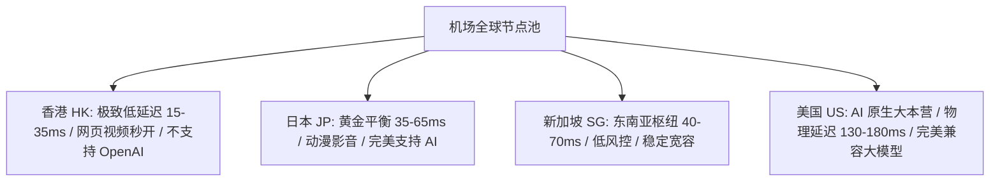

## 引言：打开客户端，几十个国家地区节点该怎么选？

当你成功导入订阅后，展开节点列表，通常会看到琳琅满目的国家国旗与城市名称：香港 (HK)、日本 (JP)、新加坡 (SG)、台湾 (TW)、美国 (US)、英国 (UK)、德国 (DE)……

很多新手会感到困惑：“为什么都是代理，有的节点看视频飞快但打不开 ChatGPT？为什么美国节点延迟高达 150ms 却依然是很多人做开发的首选？”

本指南将系统拆解各个核心地区节点的**物理特性、网络延迟底线、版权生态与最佳适用场景**。

---

## 一、全球四大主流节点地区全景对比矩阵

| 地区代码 | 代表城市 | 物理直达延迟 | AI 支持 (ChatGPT) | 流媒体版权 (Netflix) | 核心适用场景 |
| :--- | :--- | :--- | :--- | :--- | :--- |
| **香港 (HK)** | 香港 | ⚡ **15–35 ms** (极限低) | ❌ 官方地区限制 | ⭐⭐⭐ 繁体中文字幕丰富 | 日常高速网页浏览、YouTube 4K、外服低延迟手游 |
| **日本 (JP)** | 东京 / 大阪 | ⚡⚡ **35–65 ms** (极优) | ✅ 原生完全支持 | ⭐⭐⭐⭐⭐ 独播动漫/影视最全 | **日常首选主力**、Netflix 追剧、ChatGPT、Pixiv |
| **新加坡 (SG)** | 新加坡 | ⚡⚡ **40–70 ms** (极优) | ✅ 原生完全支持 | ⭐⭐⭐⭐ 东南亚华语资源 | 东南亚服游戏、AI 辅助编程、全能备用主力 |
| **美国 (US)** | 洛杉矶 / 圣何塞 | ⚡⚡⚡ **130–180 ms** | ✅ **顶级原生兼容** | ⭐⭐⭐⭐⭐ 美区全量影视库 | Claude / OpenAI 深度生产力、跨境电商 (Amazon/Shopify) |

---

## 二、为什么香港节点无法访问 ChatGPT？

这是新手最常遇到的困惑之一。
- **OpenAI 地区政策**：OpenAI 官方服务严格禁止中国大陆及中国香港（HK）IP 访问。
- **行为表现**：使用香港节点访问 `chatgpt.com` 会立即触发 `Not Available in Your Region` 或 `Access Denied 1020` 拦截。
- **正确应对**：使用规则分流模式（Rule），分流规则会自动将 `openai.com` 路由至美国或日本节点，其余流量继续走香港低延迟通道。

---

## 三、为什么美国节点延迟 150ms 却依然流畅？

物理定律决定了光在跨越太平洋海底光缆时，往返耗时至少需要 120ms–140ms。
- **网页与下载看重的是带宽吞吐**：只要节点下行带宽充足（如 500Mbps 专线），即使延迟为 150ms，加载网页与缓冲 4K 视频依然是瞬间完成。
- **延迟主要影响实时交互**：只有玩 FPS 电竞网游或高频敲击远程终端时，150ms 才会产生可感知的微小拖手感。

---

## 四、节点命名规则黑话破解

优质机场通常在节点名称中包含丰富的参数信息，例如：
`🇭🇰 香港 01 | IEPL专线 | [1.0x] | 原生解锁`
- **🇭🇰 香港 01**：节点所在地区与服务器编号。
- **IEPL 专线**：代表走运营商内网二层光缆传输，晚高峰无丢包。
- **[1.0x]**：扣费倍率（正常按 1:1 扣除流量）。
- **原生解锁**：代表该节点出口 IP 具有当地家庭住宅宽带属性，能够解锁全部流媒体与 AI。

---

## 五、总结与建议

- **日常主力**：默认选择 **日本 (JP)** 或 **新加坡 (SG)** 专线；
- **刷视频与极速浏览**：选择 **香港 (HK)** 专线；
- **AI 生产力与跨境商务**：锁定 **美国 (US)** 纯净节点。

继续探索更多新手教程：[新手指南与进阶手册专区](/guides/)
