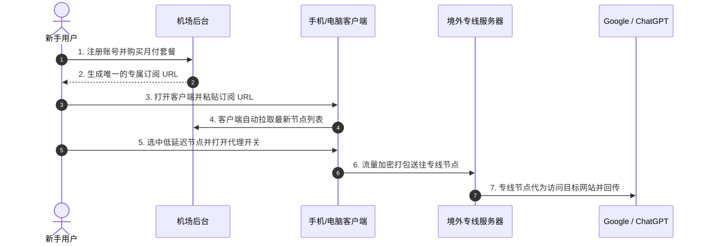

## 引言：为什么大家都在说“买个机场”？

如果你是第一次听说“机场”，可能会误以为它是民航购票软件或者实体设施。在跨境网络访问和技术极客圈子里，**“机场”是指通过分布式服务器节点，帮助用户加速出海访问全球互联网的技术服务商**。

对于刚接触外网的新手而言，面对“订阅”、“节点”、“BGP 中继”、“TUN 模式”、“倍率”等海量专有名词，常常感到无所适从。

本篇文章将用最通俗易懂的语言，彻底拆解机场的底层逻辑，帮助你建立清晰的认知框架。

```mermaid
graph LR
    User[用户设备 (手机/电脑)] -->|1. 打开| Client[代理客户端 (Clash / 小火箭)]
    Client -->|2. 载入| Sub[机场订阅链接]
    Sub -->|3. 解析出| Nodes[全球服务器节点池 (港/日/新/美)]
    Nodes -->|4. 专线加密出海| Internet[全球互联网 (Google / OpenAI)]
```

---

## 一、必须搞懂的 5 大核心概念与名词速查

为了避免在使用过程中遇到障碍，新手必须先厘清以下 5 个核心角色之间的协同关系：

| 核心名词 | 通俗比喻 | 实际技术作用 |
| :--- | :--- | :--- |
| **机场 (Provider)** | 航空公司 / 供货商 | 负责租用国际专线光纤、采购海外机房服务器并进行日常维护的商业运营平台。 |
| **节点 (Node / Server)** | 停机坪 / 境外中转站 | 部署在香港、日本、美国等地的真实服务器，负责帮你转发并接收目标网站的数据。 |
| **订阅链接 (Subscription URL)** | 提货密码 / 动态菜单 | 一串专属于你账户的加密网址。客户端通过它能自动拉取并实时更新服务商的所有节点。 |
| **客户端 (Client / App)** | 飞机舱门 / 驾驶控制台 | 运行在你的手机或电脑上的开源软件（如 Clash Verge、Shadowrocket、v2rayN）。 |
| **分流规则 (Routing Rules)** | 交通分流交警 | 自动识别你的访问意图：国内网站走本地直连（不耗流量），海外受限网站自动走代理。 |

---

## 二、机场的真实工作流程是怎样的？

很多新手常问：“我付完款了，为什么网页还是打不开？” 这是因为机场与常规 App 的使用逻辑截然不同：



1. **购买服务**：你在机场平台购买了某个月度套餐（如 20 元/月 150GB 流量）。
2. **提取凭证**：平台生成一条仅属于你个人的**订阅链接**。
3. **导入工具**：你将订阅链接复制并粘贴到手机或电脑的**客户端软件**中。
4. **选择与连接**：客户端拉取出一份节点列表（如香港 01、日本 02）。你选择一个延迟最低的节点并开启连接。
5. **智能分流**：当你访问百度时，客户端直接走本地网络；当你访问 ChatGPT 时，客户端自动将请求通过节点加密送出。

---

## 三、新手最容易踩的四大认知误区

### 1. 误区一：以为买了机场就不需要装客户端
机场只负责出售后端的网络通道，不提供也不直接内置浏览功能。你必须下载第三方开源客户端（Windows 用 Clash Verge Rev，iPhone 用 Shadowrocket，安卓用 Clash Meta for Android）。

### 2. 误区二：以为免费节点也能凑合用
网络上公开传播的免费节点大多由黑产蜜罐或失效爬虫搭建，不仅晚高峰卡顿严重，还会记录你的访问域名，甚至导致 Google/OpenAI 账号被风控连带封禁。

### 3. 误区三：以为节点越多就越快
低质机场喜欢堆砌数百个虚假节点，实际上可能共用同一台卡顿的公网服务器；高质量机场通常精简至 30–50 个高质量专线节点，保障每个节点带宽充沛。

### 4. 误区四：直接购买大额“三年付”或“永久套餐”
网络服务受政策与上游机房波动影响大，坚决恪守**按月付费**原则，把主动权牢牢握在自己手中。

---

## 四、新手下一步行动建议

现在你已经对机场的基本运行机理有了全面认知。接下来，你可以按照标准的实操步骤开启第一次配置：

- 第一步：参考 [2026 机场选择终极指南](/guides/how-to-choose-airport/) 选择一家支持月付的靠谱专线；
- 第二步：查阅 [第一次使用机场完整流程指南](/guides/first-time-setup-flow/) 按照步骤导入节点；
- 第三步：为你的设备选择专属教程：[Windows 教程](/tutorials/clash/clash-verge-starter-guide/) 或 [iPhone 小火箭教程](/tutorials/shadowrocket/import-subscription/)。
