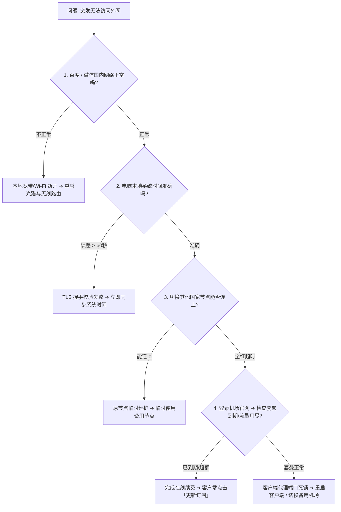

## 引言：网络突然中断时，不要慌乱盲目重装

当你正准备查阅重要资料、开跨国会议或与 ChatGPT 深度对话时，网络突然断开，很多人第一反应是四处乱点、卸载客户端甚至重装系统，往往浪费了大量时间却没找到真正病根。

代理网络的通信链路包含 **本地物理网络、操作系统代理设置、客户端加密核心、境外专线光缆及目标服务可用性** 多个环节。

按照以下标准的 **5 步漏斗式排查法**，你可以在 60 秒内迅速定位症结所在。

---

## 一、标准 5 步漏斗排查实操流程

### 第 1 步：核验本地物理网络
- **动作**：打开浏览器访问 `baidu.com`。
- **判断**：如果百度也打不开，说明是你家里的宽带欠费、Wi-Fi 断连或光猫故障，先解决本地网络问题。

### 第 2 步：核验本地系统时钟（最隐蔽的杀手）
- **动作**：Windows 按 `Win + I` 进入「时间和语言」➔「日期和时间」➔ 点击 **「立即同步」**。
- **原理**：VLESS、Shadowsocks 等协议在握手时严格校验时间戳，时钟误差超过 60 秒将被服务端直接拒绝。

### 第 3 步：在客户端中切换备用节点并重新测速
- **动作**：不要只试一个香港 01 节点，尝试切换至 **日本、新加坡或美国** 的专线节点。
- **判断**：如果其他节点能正常上网，说明仅是原节点处于临时网络维护，无需紧张。

### 第 4 步：登录机场后台核查套餐与流量
- **动作**：打开浏览器直接访问机场官网后台。
- **判断**：
  - 检查账户剩余流量是否已达 100%；
  - 检查月付套餐是否已到达截止日期。
  - 若已到期，完成续费后在客户端点击 **「更新订阅」**。

### 第 5 步：重置客户端系统代理与重启
- **动作**：在 Clash Verge Rev 中关闭「系统代理」，退出软件并重新以管理员身份运行。

---

## 二、总结与应急容灾

按照这 5 步闭环排查，绝大部分突发断网与连接异常问题均能在 1–2 分钟内迅速诊断并排除。

为了彻底杜绝关键时刻的网络中断风险，建议常备一个 [按量不限时备用包](/brands/)，构建双轨高可用网络保障！
