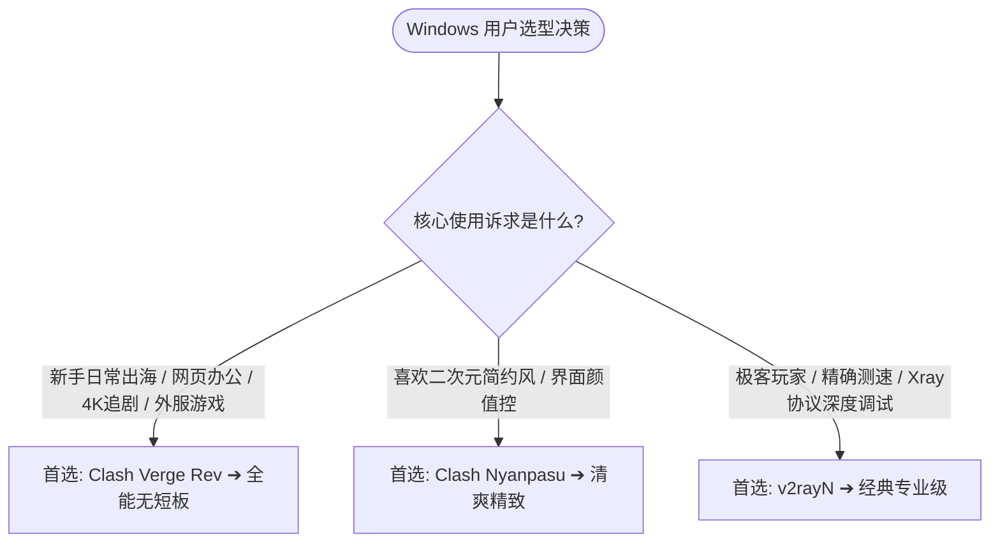

## 引言：Windows 平台百花齐放，哪款才是你的菜？

Windows 是网络代理生态中软件选择最丰富、自定义玩法最深度的操作系统。

从老牌经典的 v2rayN，到新一代基于 Rust+Tauri 的 Clash Verge Rev 和 Clash Nyanpasu，每款工具都有其独特的适用场景。

本指南帮助你在 3 分钟内选出最契合自己使用习惯的 Windows 客户端。

---

## 一、Windows 四大主流客户端横向评测矩阵

| 评测维度 | Clash Verge Rev | Clash Nyanpasu | v2rayN 7.x | Sing-box GUI |
| :--- | :--- | :--- | :--- | :--- |
| **开发架构** | Rust + Tauri | Rust + Tauri | C# + .NET 8 | Go + 官方轻量 GUI |
| **内存空载占用** | ⚡ **40MB – 70MB** | ⚡ **45MB – 75MB** | 50MB – 90MB | ⚡ **20MB – 35MB (极致低)** |
| **内置核心** | Mihomo (Meta) | Mihomo (Meta) | Xray / Sing-box | Sing-box Core |
| **TUN 网卡易用性**| ⭐⭐⭐⭐⭐ 一键安装驱动 | ⭐⭐⭐⭐ 支持 TUN 开关 | ⭐⭐⭐ 需安装虚拟驱动 | ⭐⭐⭐⭐ 脚本/网卡集成 |
| **更新维护活跃度**| ⭐⭐⭐⭐⭐ 极高 (多核心团队) | ⭐⭐⭐⭐ 良好 | ⭐⭐⭐⭐⭐ 高频更新 | ⭐⭐⭐⭐⭐ 官方维护 |
| **上手友好度** | 🟢 **极佳 (新手首选)** | 🟢 极佳 | 🟡 中等 (菜单较多) | 🟡 中等至偏难 |

---

## 二、选型终极建议

1. **日常办公与流媒体主流用户**：
   优先选择安装 **[Clash Verge Rev](/tutorials/clash/clash-verge-starter-guide/)**。全网生态与教程最完备，遇到任何网络报错都能快速找到解决方案。
2. **极客与多协议深度玩家**：
   选择 **[v2rayN 7.x](/tutorials/v2rayn/starter-guide/)**，享受直接测速与原汁原味的 Xray 配置体验。
