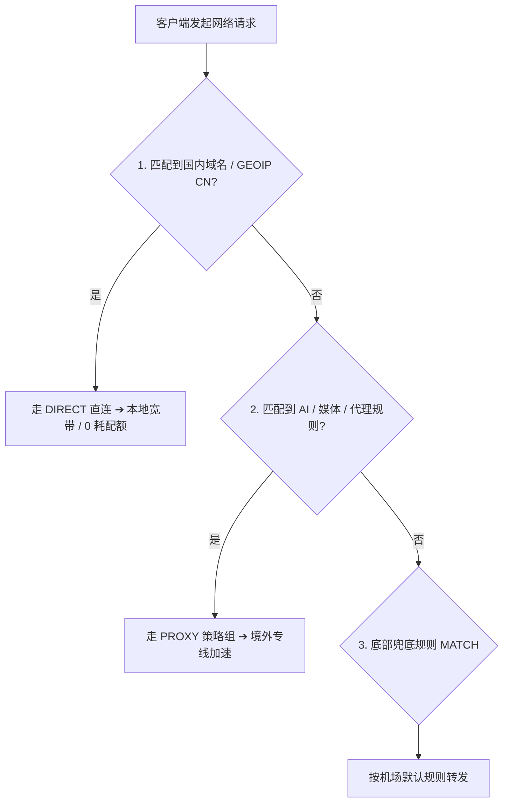

## 引言：为什么“规则分流”是 Clash 的灵魂？

在日常上网时，我们经常需要同时进行多项网络活动：
- 一边在钉钉/企业微信接收国内办公文件；
- 一边在 Chrome 里查阅 Google 文档与 GitHub 仓库；
- 另一边在播放网易云音乐或观看 YouTube 视频。

如果使用全流量走代理的旧式 VPN，国内应用会因为 IP 漂移被频繁要求验证码，且国内视频下载会疯狂消耗宝贵的机场套餐配额。

**Clash 的规则引擎通过精准的域名与 IP 匹配，完美实现了“国内直连、海外加速”的无感分流**。

---

## 一、三大路由模式全方位深度对比

| 模式名称 | 流量转发机制 | 优点 | 缺点 | 推荐场景 |
| :--- | :--- | :--- | :--- | :--- |
| **规则模式 (Rule)** | **按预设规则智能分流** | 国内网络 100% 满速，不扣除国内流量 | 冷门网站若规则遗漏可能无法出海 | **全天候日常使用默认首选** |
| **全局模式 (Global)**| **所有流量无条件走代理** | 彻底规避规则遗漏问题，单点测试方便 | 国内软件变慢、可能触发国内 App 异地风控 | 排查特定境外网站无法加载故障时 |
| **直连模式 (Direct)**| **彻底绕过代理内核** | 本地宽带裸连，零系统开销 | 无法访问任何海外受限网站 | 进行国内几十 GB 大文件下载时 |

---

## 二、Clash 核心规则类型解析

在配置文件的 `rules` 段中，常见的规则语法包括：

- `DOMAIN-SUFFIX,google.com,PROXY`：只要访问以 `google.com` 结尾的域名，全部走代理。
- `DOMAIN-KEYWORD,github,PROXY`：域名只要包含 `github` 关键字，全部走代理。
- `GEOIP,CN,DIRECT`：只要解析出的目标 IP 归属于中国大陆，一律走本地直连。
- `MATCH,PROXY`：以上所有规则均未命中时的最终兜底动作。

---

## 三、总结

坚持在日常保持 **「规则模式 (Rule)」**，即可享受最极致且无感的出海体验！

继续学习进阶 TUN 配置：[Clash TUN 模式与本地 DNS 防污染设置](/tutorials/clash/clash-tun-mode-and-dns-guide/)
