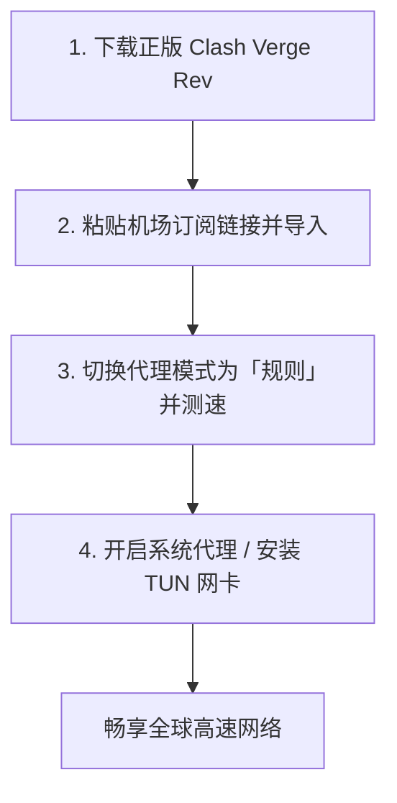
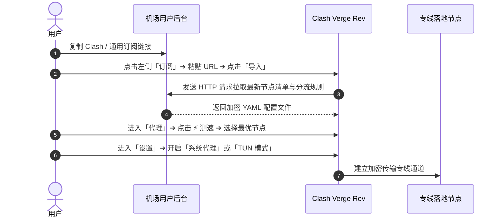

## 快速答案：Clash Verge Rev 极速上手速览

对于零基础用户，掌握以下 4 步即可在 3 分钟内完成配置并正常出海：

1. **下载安装**：前往官方 GitHub 仓库下载对应架构的安装包（Windows 下载 `x64-setup.exe`，Mac 下载 `aarch64.dmg`）。
2. **导入订阅**：打开客户端，点击左侧「订阅 (Profiles)」，粘贴机场后台复制的 Clash 订阅链接并点击「导入」。
3. **切换节点**：进入「代理 (Proxies)」页面，保持顶部为「规则 (Rule)」模式，选择延迟最低的绿色香港或日本专线节点。
4. **启动代理**：进入「设置 (Settings)」开启「系统代理」或「TUN 模式」，即可正常访问 Google、YouTube 与 ChatGPT。

---

## 一、核心使用场景与目标人群

Clash Verge Rev 适合以下四类核心用户群体：

1. **科研人员与程序员**：需要流畅访问 GitHub、Docker Hub、HuggingFace、StackOverflow，并在终端（Terminal / CMD）中免配置直接拉取代码仓库。
2. **AI 大模型高频使用者**：需要同时与 ChatGPT、Claude、Midjourney、Cursor 等多款工具稳定通信，杜绝网络频繁中断。
3. **海外流媒体影音追剧党**：需要观看 YouTube 4K HDR、Netflix、Disney+、Spotify 等高清流媒体，要求线路支持原生跨区解锁。
4. **外服游戏与电竞玩家**：需要连接 Steam、Epic、战网国际服、Apex 或外服手游，对网络延迟抖动与丢包率有严苛要求。

---

## 二、前置条件与下载准备

在开始配置前，请确保满足以下软硬件运行环境：

| 操作系统 | 推荐运行版本 | 必备依赖组件 |
| :--- | :--- | :--- |
| **Windows** | Windows 10 / 11 (64位) | Microsoft WebView2 Runtime (系统通常自带) |
| **macOS** | macOS 12 Monterey 及以上 | Apple Silicon M系列芯片选 ARM64，Intel 芯片选 x64 |
| **Linux** | Ubuntu 20.04+ / Debian 11+ | 提供 AppImage 或 .deb 安装包 |

### 官方正版下载路径指引
务必认准官方开源仓库，切勿在来历不明的第三方导航站或广告弹窗中下载被篡改的安装包：
- **官方 GitHub Releases**：搜索 `clash-verge-rev/clash-verge-rev`
- **Windows 用户**：推荐下载 `Clash.Verge_1.7.x_x64-setup.exe`。
- **macOS 用户**：
  - M1 / M2 / M3 / M4 芯片：下载 `Clash.Verge_1.7.x_aarch64.dmg`。
  - Intel 处理器机型：下载 `Clash.Verge_1.7.x_x64.dmg`。

---

## 三、图文完整 5 步配置流程

### 第一步：获取机场订阅链接
1. 登录你的服务商后台（如 [光速云](/brands/guangsuyun/)、[U1S1](/brands/u1s1/) 或 [一翻云](/brands/yifanyun/)）。
2. 找到「便捷导入」或「一键订阅」区域。
3. 点击 **「复制 Clash 订阅链接」**（如果提供聚合订阅，也可复制通用订阅）。

### 第二步：在客户端导入配置文件
1. 打开 Clash Verge Rev 软件主界面。
2. 点击左侧导航栏的 **「订阅 (Profiles)」**。
3. 在顶部的 URL 输入框中，按 `Ctrl + V`（Mac 按 `Cmd + V`）粘贴刚才复制的链接。
4. 点击右侧的 **「导入 (Import)」** 按钮，等待 2–3 秒直到卡片下载完毕。
5. 鼠标左键单击该订阅卡片，卡片左侧将显示绿色高亮竖条，代表当前配置已成功激活。

### 第三步：测速并选择最佳落地节点
1. 点击左侧导航栏的 **「代理 (Proxies)」**。
2. 确认顶部模式选择为 **「规则 (Rule)」**。
3. 在 `PROXY`（或 `节点选择`）策略组中，点击右上角的 **⚡ 闪电测速图标**。
4. 客户端将对所有节点发起批量延迟探测。选择数值在 30ms–60ms 之间的绿色节点（如深港专线、沪日专线）。

### 第四步：开启系统代理
1. 点击左侧导航栏的 **「设置 (Settings)」**。
2. 将 **「系统代理 (System Proxy)」** 的开关切换为 **开启**。
3. 此时打开 Chrome 或 Edge 浏览器访问 `google.com`，页面即可秒开。

### 第五步：进阶开启 TUN 虚拟网卡模式（强烈推荐）
1. 在「设置」页面中找到 **「服务模式 (Service Mode)」**，点击右侧的 **「安装 (Install)」**。
2. 弹出系统 UAC 管理员权限提示时，点击“是”。安装完成后状态将显示为绿色的 `Active / 已激活`。
3. 在设置中找到 **「TUN 模式 (Tun Mode)」**，开启右侧开关。
4. 此时电脑已自动创建专用虚拟网卡，无论命令行、Git 还是外服游戏，全部流量均已进入透明代理加速！

---

## 四、核心配置与三大路由模式参数解释

很多新手分不清规则、全局和直连模式的区别，以下为详细对照表：

| 路由模式 | 工作机制 | 适用场景 | 流量消耗 |
| :--- | :--- | :--- | :--- |
| **规则模式 (Rule)** | 根据域名和 IP 智能分流。国内走直连，国外走代理 | **日常全天候使用默认推荐** | 仅国外流量扣除机场配额 |
| **全局模式 (Global)** | 电脑所有网络请求全部无条件走所选代理节点 | 排查分流故障、特定境外单点测试 | 国内外全部流量均扣除配额 |
| **直连模式 (Direct)** | 彻底跳过代理核心，所有流量直连公网 | 暂时无需出海、进行国内大文件下载 | 0 流量消耗 |

---

## 五、常见报错与故障深度排查

| 报错现象 | 根本诱因 | 30 秒解决步骤 |
| :--- | :--- | :--- |
| **打不开网页 / 提示代理服务器拒绝连接** | 系统代理端口残留或非正常关机死锁 | 进入设置，关闭并重新开启「系统代理」；重启 Clash Verge。 |
| **所有节点测试全部显示 Timeout** | 电脑本地系统时间与北京时间误差超过 60 秒 | 打开 Windows 设置 ➔ 时间和语言 ➔ 点击「立即同步」。 |
| **开启 TUN 模式后电脑无法解析国内网页** | 本地 DNS 污染或 DNS 递归泄漏 | 在设置中开启 Built-in DNS，将 Nameserver 设为 `223.5.5.5`。 |
| **订阅导入失败 (Network Error)** | 订阅 URL 含有多余空格或被本地宽带拦截 | 在 Safari/Chrome 中直接打开链接测试能否下载文本；临时用手机热点重试。 |

---

## 六、进阶性能调优：打造极致流畅的网络栈

1. **启用 Fake-IP 模式减少 DNS 延迟**：
   在设置中的 DNS 模块开启 `enhanced-mode: fake-ip`。客户端在收到域名查询时瞬间返回保留 IP，省去跨国 DNS 查询往返的 100ms–200ms 耗时。
2. **设置订阅每天定时自动更新**：
   右键点击「订阅」卡片 ➔ 选择「编辑」➔ 设置自动更新间隔为 `1440` 分钟（24 小时），确保节点列表永远保持最新。
3. **开启开机静默启动**：
   在「设置」中同时勾选「开机自启」与「静默启动」，开机时自动隐藏至右下角系统托盘，无需手动点击。

---

## 七、总结与相关阅读

掌握了 Clash Verge Rev 的全套配置体系后，你已经拥有了目前 PC 平台上最先进、最稳定的出海工具链。

### 延伸阅读与相关指引：
- 想要了解如何挑选晚高峰不卡顿的专线？阅读 [2026 机场选择终极指南](/guides/how-to-choose-airport/)
- 遇到节点有延迟却无法上网？查阅 [Clash 有节点无法上网排查手册](/answers/clash-connected-no-internet/)
- 需要挑选经过客观测速核验的服务商？访问 [机场手册品牌资料库](/brands/)
