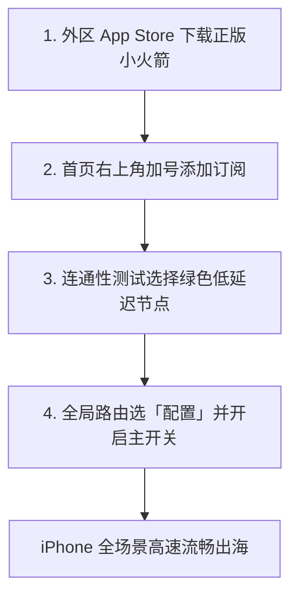
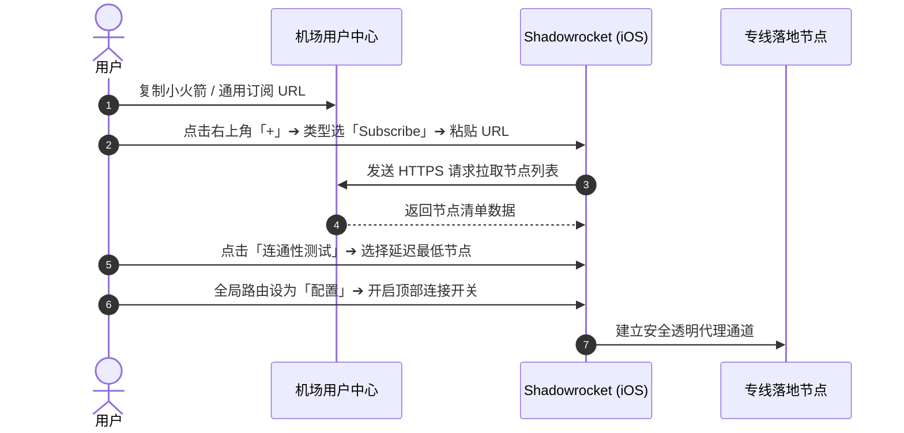

## 快速答案：Shadowrocket (小火箭) 极速上手速览

对于初次在 iPhone 或 iPad 上配置代理的用户，掌握以下 4 步即可在 2 分钟内完成出海连接：

1. **获取应用**：登录外区 Apple ID 从 App Store 下载正版 Shadowrocket（开发者为 *Shadow Launch Technology Group*）。
2. **添加订阅**：打开软件，点击右上角「+」，类型选「Subscribe」，粘贴机场订阅链接并点击右上角「保存」。
3. **连通性测速**：在首页展开节点列表，点击「连通性测试」，选中一个绿色的低延迟专线节点（如香港或日本）。
4. **启动连接**：确认中间全局路由为「配置」，打开最顶部开关并允许 iOS 安装 VPN 描述文件。

---

## 一、核心使用场景与目标人群

iOS 平台的 Shadowrocket 具备极佳的后台驻留性能与节能优化，特别适合以下场景：

1. **移动办公与学术查阅**：在手机端随时流畅查阅 Gmail、Google Scholar、Notion、Slack 与 Telegram。
2. **AI 工具手机端直接对话**：原生支持 ChatGPT iOS App、Claude 及 Perplexity，配合原生住宅节点彻底摆脱报错。
3. **海外短视频与社交达人**：流畅刷 TikTok、Instagram、Twitter (X)、YouTube 4K 及 Twitch 直播。
4. **跨境外贸与跨境电商卖家**：管理海外店铺（Amazon、Shopee、Shopify），需要稳定的独立 IP 环境防关联。

---

## 二、前置条件与正版获取指南

### 1. 为什么中国大陆 App Store 搜索不到小火箭？
由于政策合规原因，网络代理类应用仅在海外 App Store 上架。用户只需拥有一个美区、港区或日区的 Apple ID 即可合法购买下载。

### 2. 正版辨别防骗指南
- **正版开发者**：`Pan` 或 `Shadow Launch Technology Group`。
- **软件图标**：蓝色渐变背景，中间有一枚斜向右上飞行的白色小火箭。
- **价格说明**：通常为一次性买断制（美区售价约为 $2.99 美元），无任何应用内强制按月续费订阅。

---

## 三、图文完整 4 步操作流程

### 第一步：获取机场订阅链接
1. 登录服务商后台（如 [光速云](/brands/guangsuyun/)、[二猫云](/brands/ermaoyun/) 或 [极连云](/brands/jilian/)）。
2. 点击「一键导入 Shadowrocket」或直接点击 **「复制订阅链接」**。

### 第二步：在 App 中添加订阅
1. 打开 Shadowrocket，点击右上角的 **「+」** 加号按钮。
2. 第一行 **类型 (Type)** 点击切换为 **`Subscribe`**。
3. 在 **URL** 输入框中，长按并选择 **粘贴**。
4. 备注 (Remarks) 建议输入机场名字（如 `光速云专线`）。
5. 点击右上角的 **「保存 (Save)」**，软件将自动联网下载全部节点。

### 第三步：批量测速并选定活动节点
1. 返回首页，点击刚添加的订阅卡片展开所有节点列表。
2. 点击 **「连通性测试 (Ping Test)」**，右侧将显示毫秒级延迟（绿色代表低延迟可用，黄色代表中等，红色/Timeout 代表超时）。
3. 选中一个延迟在 30ms–60ms 之间的香港或日本专线节点（选中的节点左侧会出现黄色圆点）。

### 第四步：开启智能分流与授权 VPN
1. 确认首页中间的 **全局路由** 设置为 **「配置 (Config)」**。
2. 点击开启最顶部的 **连接开关**。
3. 首次开启时，iOS 系统会弹出授权提示：“Shadowrocket 想要添加 VPN 配置”，点击 **「允许」** 并验证 Face ID 或指纹锁。
4. 顶部状态栏出现 `VPN` 图标，代表网络加速已成功启动！

---

## 四、核心配置与全局路由三大模式解析

| 路由模式 | 工作原理 | 适用场景 | 流量损耗 |
| :--- | :--- | :--- | :--- |
| **配置 (Config)** | 根据规则文件自动分流：国内流量走直连，国外走代理 | **日常 100% 推荐默认选择** | 仅国外流量扣除机场配额 |
| **代理 (Proxy)** | 手机所有应用（无论国内国外）强制全部走代理 | 临时单点测速、强制跨区测试 | 国内外流量均扣除配额且国内变慢 |
| **直连 (Direct)** | 彻底跳过代理核心，所有网络直通公网 | 暂时无需出海使用 | 0 流量消耗 |

---

## 五、常见报错与故障深度排查

| 报错现象 | 根本诱因 | 30 秒解决步骤 |
| :--- | :--- | :--- |
| **开启后所有国内 App 无法加载** | 全局路由误选为了「代理 (Proxy)」模式 | 将全局路由改回 **「配置 (Config)」** 模式。 |
| **订阅更新失败提示 404 或格式错误** | 订阅 URL 复制不全或本地 Wi-Fi DNS 污染 | 切换为手机 5G 移动网络重试；在 Safari 打开检查是否有效。 |
| **所有节点测试全部显示红色 Timeout** | iPhone 本地系统时钟与标准时间不同步 | 进入系统设置 ➔ 通用 ➔ 日期与时间，开启「自动设置」。 |
| **小火箭在后台经常自动断开** | 开启了 iOS 低电量模式或后台刷新被关 | 在设置中开启 Shadowrocket 的「后台 App 刷新」权限。 |

---

## 六、进阶技巧：规则集防劫持与每日自动更新

### 1. 开启每日自动静默更新
- 进入 App 底部 **「设置 (Settings)」** ➔ **「订阅 (Subscribe)」**。
- 勾选 **「打开应用时更新」** 与 **「自动后台更新」**。
- 这样每次打开小火箭，软件都会自动拉取最新节点，防止旧节点下线断连。

### 2. 导入第三方开源分流规则集（如 ACL4SSR）
- 进入底部 **「配置 (Config)」** 页面。
- 点击右上角 **「+」**，粘贴规则链接：
  `https://raw.githubusercontent.com/ACL4SSR/ACL4SSR/master/Clash/config/ACL4SSR_Online.ini`
- 下载完成后，点击该规则卡片并选择 **「使用配置」**，即可获得强大的广告屏蔽与精准分流能力。

---

## 七、总结与相关阅读

按照本教程配置完成后，你的 iPhone 已拥有最强大、最节能且全自动分流的代理环境。

### 延伸阅读与相关指引：
- 想要了解如何挑选晚高峰不卡顿的专线？阅读 [2026 机场选择终极指南](/guides/how-to-choose-airport/)
- 遇到订阅更新失败报错？查阅 [小火箭订阅更新失败排障指南](/answers/shadowrocket-subscription-error/)
- 需要挑选经过小火箭实机核验的服务商？访问 [机场手册品牌资料库](/brands/)
