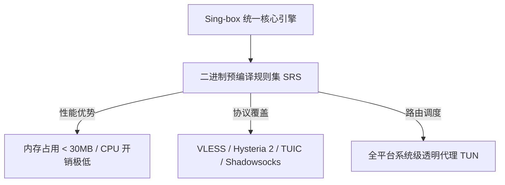
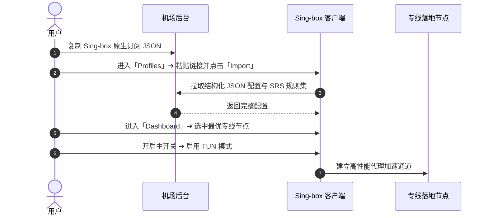

## 快速答案：什么是 Sing-box？为什么它被称为代理客户端的未来？

作为继 Shadowsocks、V2Ray、Clash 之后的第四代通用代理引擎，**Sing-box** 凭借其极致的资源利用率和前瞻性的协议支持，正在迅速成为高端网络用户的新标杆。

---

## 一、核心使用场景与目标人群

Sing-box 适合以下四类高阶出海用户：

1. **追求极致轻量与长续航的移动端用户**：在手机或轻薄笔记本上，Sing-box 的空载 CPU 占用几乎为 0，内存常年保持在 20MB–30MB，彻底告别后台耗电发热。
2. **需要最新实验性协议的极客玩家**：全面原生支持 TUIC v5、Hysteria 2、VLESS+Reality、WireGuard 等前沿协议，无需任何繁琐插件。
3. **软路由与嵌入式 Linux 设备管理员**：在 OpenWrt、树莓派等小内存嵌入式设备上，Sing-box 是替代臃肿老旧核心的理想基础设施。
4. **跨平台统一配置爱好者**：一套标准 JSON 配置与二进制规则集，即可无缝运行在 Windows、macOS、iOS、Android 和 Linux。

---

## 二、前置条件与全平台客户端官方获取指引

在开始配置前，请通过官方开源途径获取对应平台的客户端：

| 运行平台 | 客户端官方名称 | 下载获取渠道 | 核心特性 |
| :--- | :--- | :--- | :--- |
| **iOS / iPadOS** | Sing-box VT / SFI | 外区 App Store 免费下载 | 原生 Swift 开发，支持 Widget 与独立分流 |
| **Android** | SFA (Sing-box for Android) | GitHub Releases / Google Play | 原生 Material You 动效，一键 TUN 网卡接管 |
| **Windows** | Sing-box GUI / Core | 官方 GitHub `SagerNet/sing-box` | 超轻量无依赖，支持 Service 模式透明代理 |
| **macOS** | Sing-box for Apple | Mac App Store / Homebrew | 原生 Apple Silicon 适配，极低系统资源占用 |

---

## 三、图文完整 4 步操作流程

### 第一步：获取 Sing-box 专属订阅链接
登录机场后台（如 [速界](/brands/sujie/)、[光速云](/brands/guangsuyun/) 或 [快狸](/brands/kuaili/)），在便捷导入区域选择复制带有 `Sing-box` 标识的专属 JSON 订阅链接。

### 第二步：在客户端中导入配置文件
1. 打开 Sing-box 客户端，进入底部的 **Profiles (配置)** 页面。
2. 点击右上角 **「+」** 加号。
3. 类型选择 **Remote (远程订阅)**，在 URL 中粘贴复制的订阅链接。
4. 点击 **Import (导入)**，客户端将自动下载 JSON 核心配置并编译二进制 SRS 规则集。

### 第三步：选择落地专线节点与连通性测试
1. 进入 **Dashboard (仪表盘)** 页面。
2. 展开 `Outbounds (出站策略组)`，点击右上角闪电图标进行批量 Ping 测速。
3. 选中延迟在 30ms–60ms 之间的香港或日本专线节点。

### 第四步：启动系统级透明代理 (TUN 模式)
开启客户端顶部的 **Enable (启用)** 开关。系统将自动创建专用虚拟网卡，接管系统全局流量。

---

## 四、核心配置与 SRS 二进制规则集机制解析

### 1. 为什么 Sing-box 采用 JSON 与 SRS 规则集？
传统 Clash 客户端采用文本 YAML 格式，当规则条目多达数万条时，每次网络请求都需要进行复杂的文本正则遍历，造成 CPU 峰值波动与内存浪费。

Sing-box 引入了 **SRS (Sing-box Rule Set)** 二进制规则格式：
- **云端预编译**：规则源在服务器端直接被编译为紧凑的二进制哈希树。
- **微秒级匹配**：客户端匹配域名时直接在内存中执行二分查找，大幅降低 CPU 开销与匹配延迟。

---

## 五、常见报错与故障深度排查

| 报错现象 | 根本诱因 | 30 秒解决步骤 |
| :--- | :--- | :--- |
| **导入配置提示 "unknown field" 报错** | 客户端版本过旧，不支持新增的协议字段 | 升级 Sing-box 客户端至最新稳定版。 |
| **开启后所有网络无法访问 (ERR_NETWORK_CHANGED)** | TUN 虚拟网卡驱动未获系统管理员授权 | 以管理员身份重新运行软件并安装 TUN 驱动。 |
| **节点显示红字超时无法完成 TLS 握手** | 系统时钟不同步导致时间戳校验失败 | 校准本地系统时间至北京标准时间。 |
| **Clash 订阅直接导入解析为空** | 格式不兼容（YAML 与 JSON 差异） | 使用 Sub-Store 工具或联系机场获取原生 Sing-box 链接。 |

---

## 六、进阶技巧：打造低功耗透明出海环境

1. **配置独立 DoH/DoQ 防污染**：在 DNS 字段中指定 `https://223.5.5.5/dns-query` 与 `quic://dns.adguard-dns.com`，兼顾国内秒开与国外防劫持。
2. **启用自动故障转移 (Failover)**：在 Groups 中配置 `urltest` 策略，客户端会在当前节点故障时自动无感切换至备用专线。

---

## 七、总结与相关阅读

Sing-box 代表了下一代代理技术的演进方向。配合经过客观核验的优质服务商，能够为你带来前所未有的轻盈流畅出海体验。

### 延伸阅读与相关指引：
- 了解如何挑选专线机场：[2026 机场选择终极指南](/guides/how-to-choose-airport/)
- 查阅 16 家服务商实机测速报告：[机场手册品牌资料库](/brands/)
- 遇到网络无法连接问题？查阅 [全网故障排查解答中心](/answers/)
