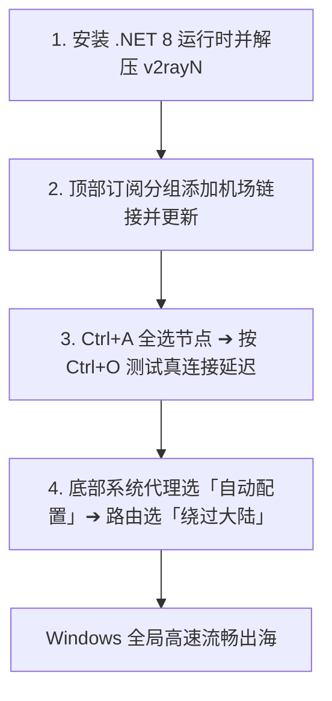
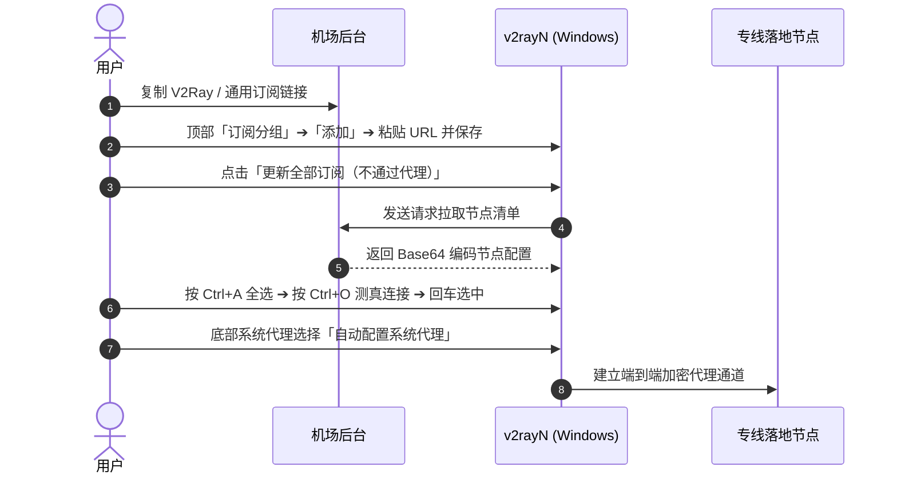

## 快速答案：v2rayN 7.x 极速上手速览

对于 Windows 用户，掌握以下 4 步即可在 3 分钟内完成 v2rayN 配置并正常出海：

1. **环境准备**：下载解压 `v2rayN-with-Core.zip`，并确保安装了 Microsoft .NET Desktop Runtime 8.0。
2. **添加订阅**：打开软件，点击顶部「订阅分组」➔「订阅分组设置」➔ 点击「添加」，粘贴机场订阅 URL 并点击确定。
3. **更新与测速**：点击「订阅分组」➔「更新全部订阅」，按 `Ctrl + A` 全选节点后按 `Ctrl + O` 测速，按回车键选中最优专线节点。
4. **启动代理**：软件底部「系统代理」选择 **「自动配置系统代理」**，路由选择 **「绕过大陆」**。

---

## 一、核心使用场景与目标人群

v2rayN 是 Windows 平台上最成熟且自定义度最高的专业代理客户端，适合以下场景：

1. **追求原生协议多样性的极客**：需要同时支持 VLESS+Reality、Hysteria 2、TUIC 与 Trojan 多协议混跑。
2. **需要精确测定真实下载吞吐的工程师**：内置直接下载测速（Ctrl+T）功能，能够直观测试节点真实 MB/s 速率。
3. **多机场聚合管理用户**：支持为不同机场建立独立的「订阅分组」，便于分类管理不同服务商的节点。
4. **Windows 老旧系统兼容需求**：相比依赖 WebView2 框架的现代软件，v2rayN 在各类 Windows 10/11 系统上均具备极致的兼容性。

---

## 二、前置环境与下载准备

### 1. 安装 Microsoft .NET 8 桌面运行时
v2rayN 7.x 必须依赖 .NET 8 运行环境。如打开软件弹出报错提示，请前往微软官方网站下载安装：
- **组件名称**：`Microsoft .NET Desktop Runtime 8.0.x (x64)`。

### 2. 官方安装包获取
从官方 GitHub Releases 仓库下载：
- **推荐下载文件**：`v2rayN-With-Core.zip`（内部已预装 Xray-Core 与 Sing-box 核心）。
- **解压指引**：解压至 `D:\Tools\v2rayN\` 等英文非系统盘路径，避免权限拦截。

---

## 三、图文完整 4 步操作流程

### 第一步：添加订阅分组
1. 双击运行 `v2rayN.exe`。
2. 点击顶部菜单栏的 **「订阅分组」** ➔ **「订阅分组设置」**。
3. 在弹出窗口左下角点击 **「添加」**。
4. **别名 (Remarks)**：填写机场名称（如 `宇宙云专线`）。
5. **可选地址 (Url)**：粘贴从机场后台复制的 V2Ray/通用订阅链接。
6. 点击右下角 **「确定」** 保存。

### 第二步：更新节点列表
1. 点击顶部菜单栏的 **「订阅分组」** ➔ **「更新全部订阅（不通过代理）」**。
2. 稍等 2–3 秒，主界面将展示全部导入的节点列表。

### 第三步：批量测试真实连接延迟
1. 按键盘快捷键 `Ctrl + A` 全选所有节点。
2. 按快捷键 `Ctrl + O`（测试真实连接延迟），节点列表右侧将显示真实的 HTTP 响应时间。
3. 鼠标单击选中延迟在 30ms–60ms 之间的最优专线节点，按下键盘 **`Enter`** 回车键（选中的活动节点将变为加粗高亮显示）。

### 第四步：开启系统代理与智能分流
在软件最底部状态栏进行如下设置：
- **系统代理**：切换为 **「自动配置系统代理」**（右下角托盘图标将由暗色变为红色/蓝色 V 字）。
- **路由 (Routing)**：切换为 **「绕过大陆 (Whitelist)」**。

此时打开浏览器访问 Google 或 YouTube，已可秒速加载！

---

## 四、核心配置与三大路由模式参数解析

| 路由模式 | 核心工作原理 | 适用场景 | 流量损耗 |
| :--- | :--- | :--- | :--- |
| **绕过大陆 (Whitelist)** | 国内域名和 IP 走直连，国外请求走代理 | **日常 100% 推荐默认选择** | 仅国外流量扣除配额 |
| **全局 (Global)** | 电脑所有应用程序流量全部无条件走代理节点 | 临时排查分流规则、测试外网单点连通性 | 所有流量均走代理且国内变慢 |
| **直连 (Direct)** | 彻底跳过代理核心，所有网络直连公网 | 暂时无需出海使用 | 0 流量消耗 |

---

## 五、常见报错与故障深度排查

| 报错现象 | 根本诱因 | 30 秒解决步骤 |
| :--- | :--- | :--- |
| **所有节点测试全部显示 -1 或 Timeout** | 电脑本地系统时间与北京时间误差超过 60 秒 | 打开 Windows 设置 ➔ 时间和语言 ➔ 点击「立即同步」。 |
| **浏览器提示“代理服务器无响应”** | 本地 Socks 端口 (10808) 冲突或软件意外退出 | 重启 v2rayN；检查端口 10808 是否被占用。 |
| **更新订阅提示“基础连接已经关闭”** | 本地网络 DNS 污染或订阅链接被阻断 | 开启手机热点重试；在浏览器打开订阅链接检查有效性。 |
| **无法打开国内网银或企业内网** | 误开了“全局 (Global)”路由模式 | 底部路由切换回「绕过大陆 (Whitelist)」。 |

---

## 六、进阶性能调优与开机自启

1. **设置开机自启并隐藏至托盘**：
   点击顶部菜单「设置」➔「选项设置」➔ 在「基本设置」中勾选「开机自动启动」与「启动后最小化到托盘」。
2. **开启多路复用 (Mux)**：
   对于高延迟节点，可在选项设置中开启 Mux 多路复用，减少 TCP 握手开销。
3. **Core 内核一键更新**：
   定期点击顶部菜单「检查更新」➔「Xray-Core」，保持协议兼容性始终最新。

---

## 七、总结与相关阅读

按照本指南操作，你的 Windows 电脑已经配置好了功能最完备的代理工作站。

### 延伸阅读与相关指引：
- 想要了解如何挑选晚高峰不卡顿的专线？阅读 [2026 机场选择终极指南](/guides/how-to-choose-airport/)
- 遇到节点全部超时 -1 报错？查阅 [v2rayN 节点超时排错手册](/answers/v2rayn-connection-timeout/)
- 需要挑选支持 VLESS 专线的服务商？访问 [机场手册品牌资料库](/brands/)
